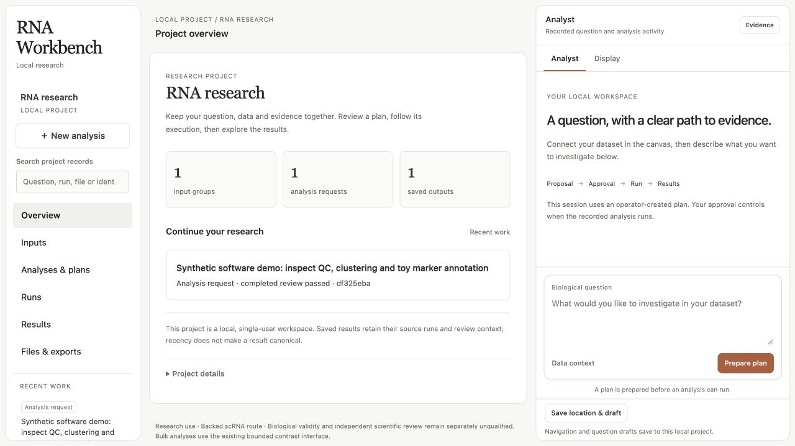
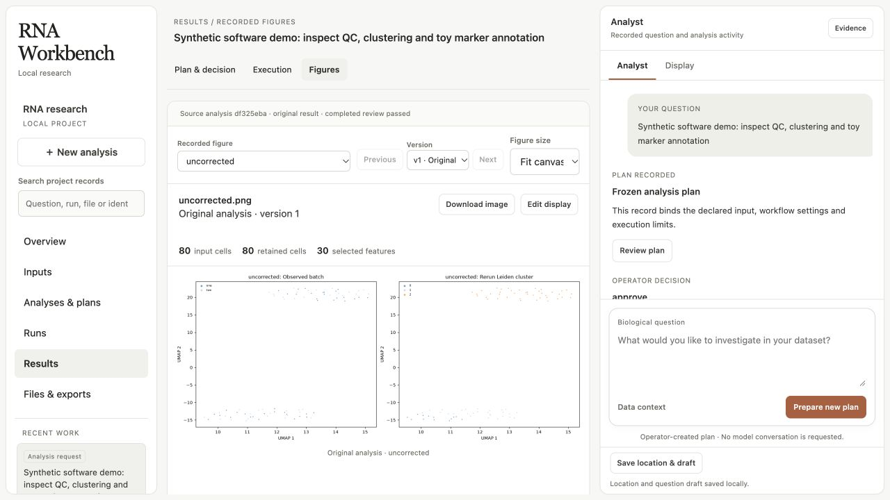
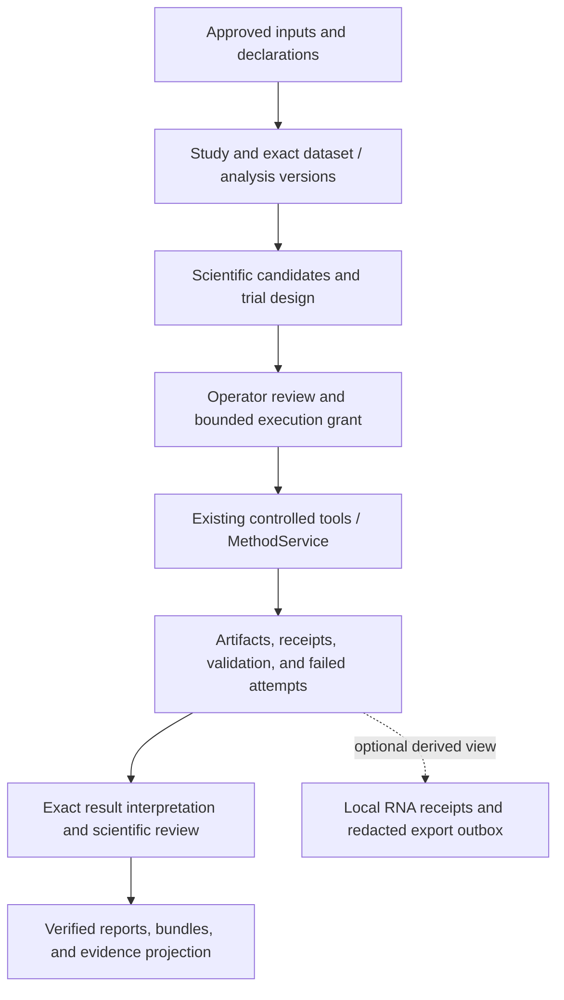
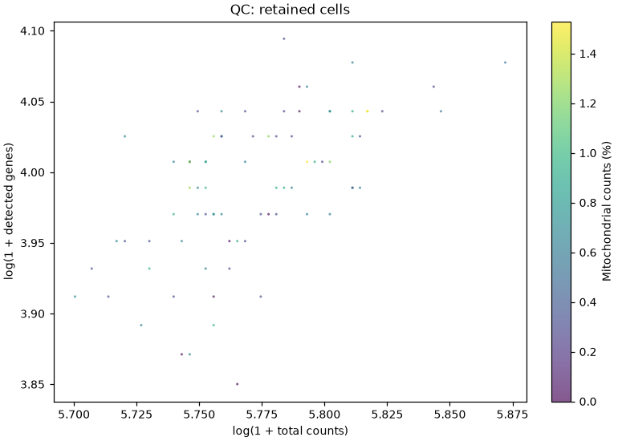
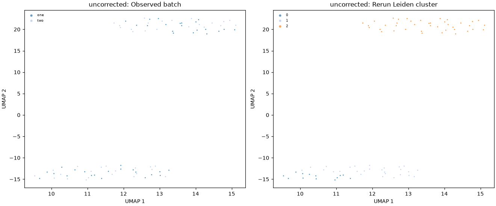
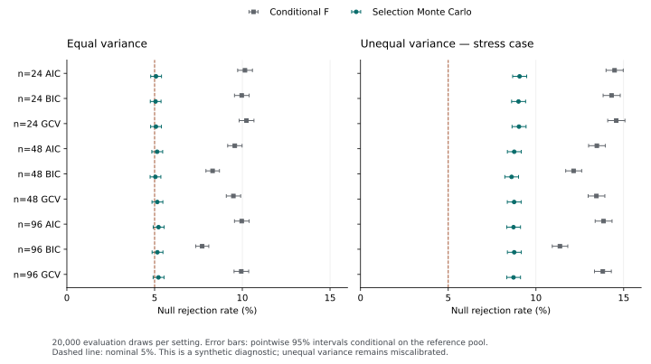

# DevHarness / DevBench

A local research workspace for transcriptomics: inspect data, compare scientific approaches, run bounded analyses, review results, and retain the evidence behind each decision. DevHarness supplies scientific tools and controlled execution; DevBench supplies workflow coordination and executable agent evaluations.

**Main-branch application source: `0.5.0.dev0`, published October 7, 2026. Research software; clinical release remains held.** This development snapshot includes the scientific workspace, method contracts/planner, independent RNA investigation interfaces, discovery evaluation support, and local RNA tracing/export tooling. Publication does not establish scientific method superiority, hosted-service qualification, or clinical readiness. See [release readiness](RELEASE_READINESS.md) and the [requirements and evidence map](docs/requirements-verification.md).

[Workbench](#the-research-workbench) · [Scientific workflow](#the-five-step-scientific-workflow) · [Capabilities](#data-and-analysis-support) · [Architecture](#how-the-components-fit-together) · [Quick start](#run-locally) · [Agent evaluation](#agent-evaluation) · [Verification](#verification-and-known-limits) · [Documentation](#documentation-map)

## The research workbench

### Latest development preview · 300,000 generated points

The October 29 [workbench update in PR #2](https://github.com/Vajraaaang/bio-agent-harness/pull/2) adds a **Synthetic atlas** with 300,000 generated cell-like records across three batches. Both scatter panels render every selected point on Canvas without downsampling. Batch filtering, module signatures, library complexity, batch distributions, and composition share the same generated population.


The preview is available in the [development branch](https://github.com/Vajraaaang/bio-agent-harness/tree/vajraang/workbench-update-20261029); it has not been merged into the main-branch application. Its [atlas guide](https://github.com/Vajraaaang/bio-agent-harness/blob/vajraang/workbench-update-20261029/docs/synthetic-atlas.md) explains the controls and export. The records, group labels, and latent coordinates are generated from a fixed seed; they are not biological observations or a fitted UMAP. No live trial was run.

The development snapshot passed 105 focused local checks and controlled synthetic continuous/count verification. Browser checks counted 600,000 actual point draws across the two scatter panels. These are software/presentation checks, not scientific or clinical validation. Hosted CI currently fails during test collection on local-only paths and a missing test dependency; [verification evidence and limits](https://github.com/Vajraaaang/bio-agent-harness/blob/vajraang/workbench-update-20261029/reports/github-update-20261029/README.md) remain available with the draft update.

### Main-branch interface and historical evidence

The browser interface brings inputs, analyses, runs, figures, scientific review, and exports into one local project. It uses the existing controllers and evidence stores rather than introducing a separate analysis engine.





These are captures of the actual local application from the [October 7 demonstration](reports/github-homepage-20261007/README.md), using assistant-generated synthetic counts and an operator-recorded plan. They show the existing UI; no live model session or independent biological review was performed.

- **Overview and navigation:** Inputs, Analyses & plans, Runs, Results, and Files & exports, with search and recorded activity.
- **Scientific objects:** a Study groups exact DatasetVersion, AnalysisVersion, Run, and ResultVersion references. Changed data, scientific metadata, code, or parameters creates a new relevant version; an unchanged rerun retains the analysis version and creates a new Run.
- **Planning:** formulate a question, retain declarations and unknowns, propose scientific candidates, resolve available implementations, and design comparable trials.
- **Execution and review:** inspect the plan, grant a bounded run, inspect outputs and validation observations, then accept or reject an exact interpretation with a rationale. Successful execution does not automatically accept a result.
- **Figures:** verified QC-scatter and UMAP artifacts expose their plotting data, population, parameters, source identities, and receipts. Presentation revisions change permitted display settings while preserving scientific data and meaning.
- **Recovery:** exact references, revision checks, retained backups, idempotent requests, and explicit reconciliation preserve failed and interrupted attempts. Reloading the view restores navigation and drafts; it does not restore execution grants.

The Analyst panel shows recorded operator/workflow events. Recorded fixture decisions remain visibly labeled; they are not presented as live model messages. Current scope is **one local project**. Remote/HPC execution, broader large/chunked method-artifact support, multi-project administration, durable conversations, and broader governance remain later work for the shared scientific layer; the separate native route supports bounded backed H5AD execution.

Read the [UI operating guide](docs/workbench-ui.md), [shared scientific workspace](docs/shared-scientific-workspace.md), and [research organization contract](docs/research-workspace-organization.md).

## The five-step scientific workflow

Scientific work follows this order in the interface, task instructions, and review records:

| Step | What is recorded | What it protects against |
| --- | --- | --- |
| **1. What data do I have?** | Samples and biological units, groups, measurement type, input identities, quality concerns, declarations, inferences, and unknowns | Treating intact files or unique sample names as proof of valid independent biology |
| **2. What question am I investigating?** | The actual objective, estimand, and source of requirements | Relabeling assistant suggestions, fixture values, or defaults as user requirements |
| **3. Which methods are appropriate, and why?** | Alternatives, assumptions, tradeoffs, missing information, feasibility, and comparison criteria declared before results | Choosing a method simply because it is implemented or performed well on an undeclared criterion |
| **4. What happened?** | Actual attempts, outputs, verified plots when present, warnings, failures, and interventions | Substituting a method's self-report for independent checks or inventing a missing plot |
| **5. What can I conclude, and what remains uncertain?** | Evidence-supported interpretation, recommendation or abstention, and remaining uncertainty | Conflating a successful run with scientific superiority, independent validation, or clinical approval |

Method selection and execution verification are different purposes. Use `method_selection` when alternatives should be assessed; use `execution_verification` to check an already chosen procedure and identify who selected it. Confirmed parameter requirements need explicit matching requirement records. A fixed-procedure smoke test cannot establish the best method.

Repeated donors/specimens/subjects are not independent biological replicates. Completely confounded age and batch cannot yield an identifiable causal batch-adjusted effect by dropping a covariate. Collection age is a reference for inferred pseudotime, not universal ground truth. Network association, curated target membership, and motif-hit enrichment have different evidence scopes.

## Data and analysis support

Support is bounded by the selected adapter, declared measurement type, design, resource limits, and evidence contracts. RNA-seq is the product direction; the current routes do not constitute a universal analysis pipeline.

| Input or question | Current route | Important limits |
| --- | --- | --- |
| Bulk raw-count contrasts / temporal expression | Bounded condition-contrast episodes; separate temporal scientific tools; count models with RLE library-size offsets and empirical-Bayes negative-binomial dispersions | Audit units, design rank, contrasts, and confounding before fitting; RLE is not TMM and the bounded implementation is not claimed identical to full R DESeq2 |
| Continuous or normalized expression | Bounded Gaussian contrasts; separate Gaussian-spline tools, without conversion to counts | Model assumptions remain explicit; selection-conditional inference and calibration limits are disclosed |
| Donor-aware cellular count contrasts | Restricted pseudobulk/episode contracts | Cells cannot substitute for donor replication; task-specific unit/result checks remain required, including the retained T14 finding |
| Backed scRNA exploration | Separate native workbench route for supported H5AD / 10x inputs, reviewed proposals, bounded execution, reports, and bundles | Optional analysis dependencies and frozen admission settings apply; organism/library-specific scientific performance is not established |
| Figure-only revisions | Verified QC-scatter and UMAP presentation children | Preserves data and scientific meaning; broader linked plots, scientific edits, and automatic label adjustment are not implied |
| Raw reads, general single-nucleus/spatial/isoform analysis, full e11 study, remote HPC | Broader scope / integration work | No verified end-to-end product claim in this snapshot; no BAM/FASTQ download is needed for the supplied small demonstrations |

The [episode support matrix](docs/analysis-episodes.md), [analysis workbench](docs/analysis-workbench.md), and [RNA requirements](docs/rna-workbench-requirements.md) document exact contracts. Data inspection should be bounded: do not load an expression matrix larger than 100 MB into pandas. The SDK supports bounded Zarr/HDF5/CSV access; backed cellular execution has its separate admission and resource policies.

Scientific tools include expression-quality audits, design validation, batch diagnostics, temporal fitting and monotonicity, lineage inference, regulatory associations, regulon enrichment, and motif enrichment. Registered tools or the trusted ToolDispatcher retain actual execution evidence; unsupported or failed estimates stay absent rather than being replaced with successful-looking zeros.

## How the components fit together



| Component | Responsibility | Entry point / guide |
| --- | --- | --- |
| `devharness` / `devharness_server` | Scientific SDK and registered MCP tools | [SDK example](#use-the-sdk), registered `devharness` server |
| `devharness_controlled` | Controlled plans, bounded numerical workers, input/source/environment identities, output checks | [Controlled execution](docs/controlled-execution.md) |
| `devbench.analysis` | Analysis episodes, browser service, scientific metadata, method services, planner, workflow records | `devbench-analyze`, [workspace guide](docs/shared-scientific-workspace.md) |
| `devbench.study` | Study preparation, execution coordination, permission controls, trace/export preparation | `devbench-study`, [three-condition guide](docs/three-condition-study.md) |
| `devbench_engine` / experiments | Staged agent tasks, actual execution capture, auditing, grading, and historical protocol compatibility | [Code-as-Action audit](reports/code-action-audit/README.md) |
| Reports and notebooks | Retained, revision-specific measurements and reproducible examples | [Measured results](#retained-measured-results), [notebooks](#notebooks) |

The existing local ledger/capture/artifact stores remain authoritative. Read-only evidence projection does not execute science; separately authorized numerical replay reruns computation under its replay contract. Checkpoint cursors coordinate continuation and do not independently establish scientific validity. Hashes are tamper-evident relative to an independently retained root; they are not authenticated clinical signatures or compliance certificates. The numerical multiprocessing supervisor is a resource boundary, not a security VM.

## Method contracts, planning, and review

The [extensible-methods service](docs/extensible-methods.md) provides immutable contracts for registered tools and custom OCI steps, branch runs, scientific previews, revision-checked acceptance, and replay. Custom code remains exploratory until the applicable review; implementation trust is separate from scientific acceptance.

The [scientific-method planner](docs/scientific-method-planner.md) first generates scientifically appropriate candidates **before revealing the implementation registry**. It preserves unavailable alternatives, checks observed preconditions, freezes trial diagnostics, and separates recommendation, scoped approval, and experimental recipes.

A typical sequence is: inspect exact inputs → create a question-bound plan → generate alternatives → resolve implementations → declare a trial and criteria → authorize execution → inspect coordinator validation → recommend or abstain → record review. Runtime, retained-row counts, structural checks, and a candidate's self-report alone cannot support a method recommendation. Passing the current comparison-evidence floor also does not prove scientific optimality.

```sh
/absolute/repository/.venv/bin/devbench-analyze methods --help
/absolute/repository/.venv/bin/devbench-analyze methods planner --help
```

Use the detailed guide for phase schemas and request records. Listing existing methods or planner state is read-only; initialization, recovery, execution, and acceptance are explicit operations. New code or changed scientific parameters requires a new execution-definition version.

## RNA orchestration and local tracing

The default workflow remains serial. The opt-in [independent RNA mode](docs/rna-independent-investigations.md) admits a lead plus an observed decision to use **zero, one, or two** bounded investigators. A ceiling of two does not require two calls. It uses pinned optional LangGraph packages and versioned evidence/result packets; construction does not dispatch a model or numerical tool.

The native Codex backend's preventive aggregate token ceiling, complete attributable request coverage, and parallel isolation boundary remain unqualified. **Native independent admission is blocked.** Offline captured fixtures establish software behavior, not live investigator benefit or superior biological decisions.

[Optional local tracing](docs/rna-independent-investigations.md#optional-local-tracing-and-separate-export) correlates existing invocation/ledger transitions through a closed local receipt contract. Read-only projection verifies retained stores without continuing science. Redacted export preparation and its durable journal are separate from scientific execution; uncertain delivery needs reviewed reconciliation.

| Evidence layer | Current meaning |
| --- | --- |
| Local receipts, ledger, captures, and checkpoints | Authoritative local execution records with explicit unknowns/gaps |
| RNA projection and fake-transport fixtures | Software checks of topology, status, privacy allowlists, invariance, and export behavior |
| LangSmith hosted delivery/dashboard | Separate qualification; local transport checks do not establish hosted visibility or deduplication |
| Scientific or clinical review | Independent assessment; tracing success grants neither scientific validity nor clinical approval |

Remote payloads exclude matrices, gene statistics, free text, prompts/responses, host paths, and direct identifying metadata; opaque correlation identities are retained. Clinical/unclassified scope is unsupported. Hosted upload and live-session authorization remain separate concrete scopes. Read the [hosted qualification handoff](docs/langsmith-hosted-qualification-handoff.md) and [post-run study export guide](docs/langsmith.md). Planning a deployment or preparing an export does not authorize a scientific campaign or external upload.

## Run locally

Python **3.11+** is required; `make install` defaults to Python 3.12. On Apple Silicon, use a native arm64 interpreter. `uv` applies the committed lockfile; the documented pip fallback is unlocked.

```sh
git clone https://github.com/Vajraaaang/bio-agent-harness.git /absolute/repository
make -C /absolute/repository install
make -C /absolute/repository test
make -C /absolute/repository controlled-demo
```

`make test` runs software tests without live model calls. The controlled demo runs real small synthetic analyses, signed-plan checks, repeats, and configured R references, retaining a fresh output directory. Install R separately for complete reference checks; missing references are reported rather than turned into a pass. The R negative-binomial comparison shares fitted dispersions/offsets and does not independently validate empirical-Bayes estimation.

Install optional functionality explicitly with the locked project environment:

```sh
uv sync --project /absolute/repository --locked --extra dev --extra reporting --extra analysis --extra workflow --python 3.12
```

`analysis` supplies the backed scRNA/notebook stack; `reporting` supplies plots; `workflow` supplies pinned optional graph dependencies. Adding packages does not qualify a workflow or grant model/data execution. Numerical workers need OS permission for local process inspection; notebook tests need local kernel sockets. Failures of those facilities remain actual failures or setup errors.

### Open the scientific browser workspace

Use a fresh protected local workspace and an existing disjoint input root. Paths must be canonical absolute paths; retain the same roots/settings when reopening a service workspace.

```sh
/absolute/repository/.venv/bin/python -m devbench.analysis.workbench_ui \
  --workspace /absolute/browser-workspace \
  --input-root /absolute/approved-inputs \
  --enable-scientific --port 8765
```

The service prints a loopback URL with a random session token. Open that printed URL; the page consumes the fragment and keeps authentication in memory. Do not publish the token. Select **Initialize scientific records** to explicitly create/upgrade the scientific store. Default method storage is `/absolute/browser-workspace/methods`; adoption of an existing store is explicit and project-bound.

This command grants neither model nor numerical execution. Data trials need the service's `--allow-data-execution` flag **and** a fresh one-run browser grant. Protected live planning separately needs a configured model, disjoint agent workspaces, eligible data scope, explicit model permission, and fresh action authorization. Recorded fixture decisions are available for offline demonstrations and remain labeled as fixtures.

The [operating guide](docs/workbench-ui.md) explains workspace locking, input registration, execution admission, cancellation, bundles, and recovery. The [scientific workspace guide](docs/shared-scientific-workspace.md) explains exact-version planning and review.

## Use the SDK

```python
import os
from pathlib import Path

for name in ("OMP_NUM_THREADS", "OPENBLAS_NUM_THREADS", "MKL_NUM_THREADS",
             "VECLIB_MAXIMUM_THREADS", "NUMEXPR_NUM_THREADS"):
    os.environ[name] = "1"

import devharness as dh

if __name__ == "__main__":
    workspace = Path("/absolute/approved-analysis-workspace")
    result = dh.fit_trajectory(
        workspace / "expression.zarr",
        workspace / "metadata.csv",
        "1 + C(batch) + numeric_time",
        genes=["gene_a", "gene_b"],
        time_col="time",
        data_type="continuous",
        selection_criterion="fixed",
        spline_dfs=[3],
    )
    print(result["genes"])
```

The example's genes, design, and `df=3` illustrate a chosen procedure; they are not a recommended method or a user-prespecified scientific requirement. Substitute experiment-appropriate declarations and explicitly set `DEVHARNESS_WORKSPACE_ROOT` to the permitted absolute workspace. Raw counts require their count model. Report fitted p-values and BH q-values with q at least p; failed estimates must stay failed/absent. Standalone supervised-worker scripts need the module-level main guard; do not start an MCP event loop inside a notebook.

## Agent evaluation

DevBench distinguishes software/numerical controls from actual model participation and biological validation.

| Condition / activity | Meaning |
| --- | --- |
| Baseline | Ordinary Python analysis libraries without supplied DevHarness assistance |
| Optional DevHarness | Participants may use, combine, or ignore the supplied tools |
| Enforced DevHarness | Applicable coordinator-recorded checks and numerical claims agreeing with cited trusted tool results |
| Historical `assisted` | Original guided-assistance protocol; not retroactively renamed optional/enforced |
| Offline oracle controls | Privileged software checks; not live agent performance |

The historical benchmark contains 66 task definitions and a curated twelve-task track. Added observed-temporal questions reuse two seeded fixture variants; they are not five independent biological cohorts. Synthetic hidden-reference results, processed public observations, and clinical validation have separate scopes. Coordinator/private grading material must never enter participant workspaces or external model inputs.

The development study path has measured small synthetic controls, permission probes, and an unsuccessful scored-slot pilot. The revised six-slot pilot recorded six analysis sessions and six preflights with **zero accepted answers**; this did not establish biological accuracy or harness benefit. Historical live attempts and subsequent corrections remain distinct. Broader comparative method/agent calibration is unfinished.

Prepare configuration and an empty report without launching participants:

```sh
/absolute/repository/.venv/bin/python -m devbench.study.cli plan \
  --stage smoke --output /absolute/project/results/proposed-study
```

Use a fresh output directory outside system scratch. Preparation creates no authorization to acquire data, run models, or analyze nonempty records. The [three-condition guide](docs/three-condition-study.md), [evaluation preparation](docs/workbench-evaluation.md), and [study evidence scope](docs/study-evidence-scope.md) describe admission, measurement, and integrity limits. Some historical documents refer to local-only campaign artifacts excluded from this public snapshot.

`make pilot` and `make sweep` invoke live Codex participants and consume account quota; they require a separately bounded live execution scope. `make demo` runs privileged offline oracle controls. The legacy `devbench --backend codex-cli` route remains for historical compatibility. Neither a supported backend nor a built notebook proves that a live evaluation completed successfully.

## Verification and known limits

| Evidence | Observed scope | Limit |
| --- | --- | --- |
| October 7 publication checks | Controlled synthetic continuous/count verification passed, repeats matched, audit checks passed, configured R references agreed; all three notebook-bundle tests passed after local kernel/process permission | A focused local check, not complete software/scientific/hosted qualification |
| Broad local development suite | Stopped near 30% with observed failures/setup errors | Incomplete; no full-suite pass is claimed |
| Retained RNA tracing verification | Earlier documentation records focused checks plus broad passes with the retained T14 failure and Harmony errors | Prior revision-specific records; not a fresh all-green run or hosted dashboard measurement |
| Historical `0.4.17` release | 2,014 local software passes/two skips; 126 installed-wheel passes; 1,542 Colab passes/one skip; retained numerical/export/control evidence | Applies to the older source snapshot, not automatically to `0.5.0.dev0` |
| GitHub Actions, initial publication | Ubuntu/Python 3.11 recorded 6,070 passes, 43 failures, 560 skips and 58 errors; other matrix jobs were still running when documented | Hosted suite is not green; failures include optional runtime, installed-resource identity and preflight path-bound issues |

[Initial failing Ubuntu job](https://github.com/Vajraaaang/bio-agent-harness/actions/runs/37585999768/job/112676140042), [GitHub workflow runs](https://github.com/Vajraaaang/bio-agent-harness/actions), and [release readiness](RELEASE_READINESS.md) expose current publication checks and caveats. Failures, sandbox interventions, optional dependency errors, cancellation, and uncertain liveness remain part of the evidence.

Unresolved scientific findings include native count-interval undercoverage and unequal-variance Gaussian miscalibration. The retained T14 cellular effect-definition failure and optional Harmony errors remain labeled. Independent method comparison, case-specific detection floors, live biological-agent benefit, native investigator token/isolation guarantees, hosted tracing behavior, qualified operational recovery, and clinical validation are separate open gates.

No clinical assay validity, GxP/21 CFR Part 11 compliance, authenticated operator approval, or patient-use readiness is claimed. Clinical release requires qualified independent validation, authenticated approval/signature, and operational controls. No private clinical inputs are authorized for external model services.

### Fresh homepage demonstration — October 7, 2026

The [demonstration report](reports/github-homepage-20261007/README.md) describes the generated fixture and exact assistant-selected settings, and retains compact execution evidence, failure/correction history, browser captures, and diagnostic results. Ephemeral input matrices, service state, and tokens are excluded from publication.

| Question | Observed demonstration result |
| --- | --- |
| What data? | An artificial 80-cell × 60-gene integer-count fixture, seed 128, with two planted marker blocks. Generated cells do not establish independent donor/animal replication. |
| What objective? | Exercise the existing reviewed local UI, expose QC/embedding/report evidence, and verify a separate diagnostic control. This is execution verification, not method selection. |
| Which procedure? | Fixed existing backed scRNA route; counts in `X`, no batch correction, 30 selected features, 8 PCs, 1,024 MiB worker cap, 90-second stage limit, 180-second overall budget. These settings were chosen by the assistant for a smoke demonstration. |
| What happened? | Corrected run reached `completed_review_passed` in **107.966 seconds**; 80 cells retained, original input unchanged, bundle integrity checked, zero model sessions. The report preserves the earlier missing-counts-layer setup failure and sandbox process-permission failure. |
| What conclusion? | The measured local UI/execution path worked for this tiny fixture. The service performed no independent scientific review; computational concordance does not establish annotation accuracy, method superiority, or biological validity. |





The QC and embedding images are actual generated outputs, not proposed charts. Planted marker blocks and an idealized embedding cannot validate experimental cell identities. The separate diagnostic experiment checks declared units and a deliberately confounded design **before fitting**; its actual outputs and limits are linked in the report. No new comparative scientific claim follows from these demonstrations.

### Retained measured results

The [portable Gaussian selection study](reports/selection-calibration/README.md) retains 36 summary rows, 186 saved numerical arrays, a frozen prototype, protocol, figure, and standalone consistency verifier.



Corrected null rejection in that prototype ranged from 5.045% to 5.225% under equal variance; unequal variance remained 8.610%–9.065% at nominal 5%. Criteria share simulated vectors, and intervals are pointwise/conditional on the reference pool. These measurements belong to the preserved prototype rather than later packaged API revisions.

```sh
/absolute/repository/.venv/bin/python /absolute/repository/reports/selection-calibration/verify.py
```

Add `--expected-manifest-sha256` with an independently retained manifest hash to anchor integrity. Internal consistency and integrity checks are not independent scientific validation. Other retained evidence includes [temporal task checks](reports/temporal-verification/README.md), [audit verification](reports/audit-verification/README.md), [runtime identity](reports/runtime-identity/README.md), [Code-as-Action capture](reports/code-action-audit/README.md), and [historical Colab evidence](reports/colab-verification/README.md).

## Notebooks

- [Controlled verification](notebooks/controlled_verification.ipynb): self-contained synthetic numerical/control checks without a model login; R availability is reported.
- [Agent benchmark runner](notebooks/colab_runner.ipynb): staged tasks and actual Code-as-Action execution; Colab requires its own authorized model login.
- [Three-condition preparation](notebooks/three_condition_study.ipynb): plan-only configuration/report preparation from a checkout.

Build locally with `make -C /absolute/repository notebook` or the documented scripts. Embedded source snapshots and previous cloud runs are revision-specific. Generating a notebook is not executing it in Colab, and historical cloud results do not validate later code. Watchdogs, setup, and infrastructure delays prevent a guaranteed sub-90-second completion.

## Documentation map

| Start here | Purpose |
| --- | --- |
| [Workbench UI](docs/workbench-ui.md) | Browser operation, figure evidence, cancellation, state, exports, and recovery |
| [Shared scientific workspace](docs/shared-scientific-workspace.md) | Exact scientific objects, five-step journey, planning, results, and review |
| [Analysis episodes](docs/analysis-episodes.md) | Supported bulk/cellular contracts and evidence boundaries |
| [Extensible methods](docs/extensible-methods.md) | Method contracts, custom execution, trust, branch acceptance, and replay |
| [Scientific-method planner](docs/scientific-method-planner.md) | Candidate generation, availability resolution, trial criteria, and recommendation |
| [Scientific review](docs/scientific-review.md) | Review packets and separation from execution success |
| [Independent RNA investigations](docs/rna-independent-investigations.md) | Bounded optional investigators, current native gate, local tracing, and read-only projection |
| [LangSmith export](docs/langsmith.md) | Sanitized preview and separately authorized post-run delivery |
| [Hosted tracing handoff](docs/langsmith-hosted-qualification-handoff.md) | Remaining hosted/native qualification boundaries |
| [Controlled execution](docs/controlled-execution.md) | Numerical/resource controls, plans, and integrity records |
| [Three-condition study](docs/three-condition-study.md) | Baseline/optional/enforced evaluation and launch controls |
| [Requirements and evidence](docs/requirements-verification.md) | Implemented controls, measured evidence, and missing qualification |
| [Release readiness](RELEASE_READINESS.md) | Current publication verification and historical known issues |

Documentation and preserved reports include historical snapshots and local-only artifact references. Dates, source identities, test denominators, and result scopes matter; a prior green check does not qualify a changed implementation. The public [publication manifest](PUBLICATION_MANIFEST.json) retains original copied-source hashes and separately identifies publication-only documentation/metadata edits. Local environments, downloaded expression data, caches, run outputs, and captured source trees are excluded.

Original code is [MIT licensed](LICENSE). Dataset/reference terms are described in [NOTICE.md](NOTICE.md). No clinical or regulatory certification is claimed.
