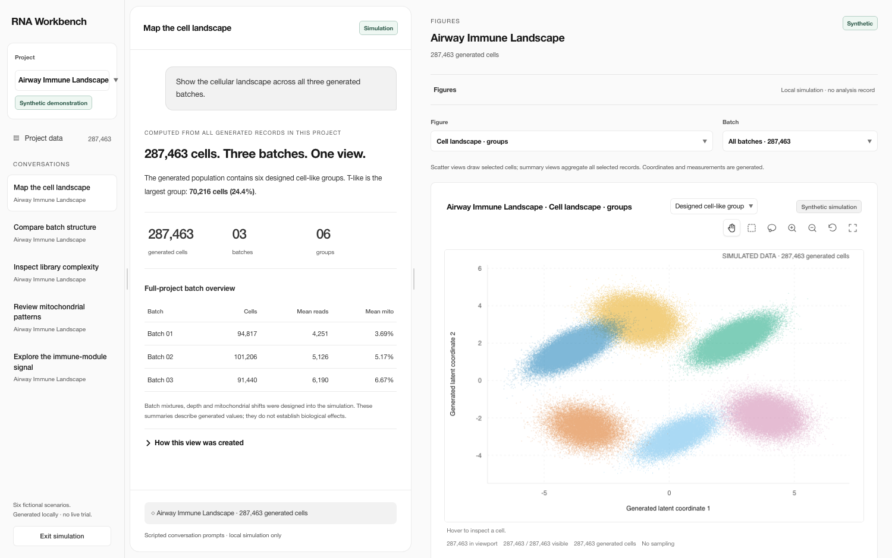
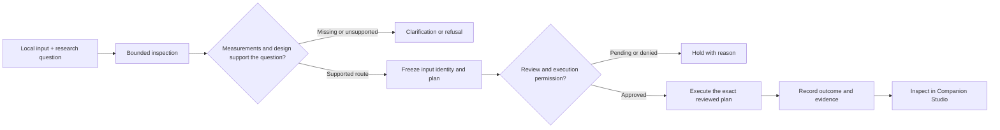

# DevHarness · RNA Workbench

**A local RNA-seq workbench for agents that propose workflows and researchers who review the evidence.** DevHarness checks whether the inputs support the question, freezes a plan for review, and binds completed outputs to an execution receipt. Companion Studio opens the same research session to inspect plans, figures, code and evidence. DevBench provides a separate harness for evaluating agent behavior.

[Run the synthetic demo](#run-the-synthetic-demo) · [Inspect the architecture](#architecture) · [Configure the Codex plugin](integrations/codex/devharness/README.md) · [Read the evidence](#verification-and-limits)



*The offline simulation shows 287,463 generated observations. It exercises the Workbench interface and figures without running an analysis.*

## Run the synthetic demo

Use a local macOS or Linux checkout with `uv`, Python 3.13 and a modern browser. From the repository root:

```sh
make install
repo="$(pwd -P)"
mkdir -p "$repo/results"
demo_dir="$(mktemp -d "$repo/results/studio-demo.XXXXXX")"
mkdir -p "$demo_dir/inputs" "$demo_dir/workspace"
"$repo/.venv/bin/devbench" workbench \
  --input-root "$demo_dir/inputs" \
  --workspace "$demo_dir/workspace" \
  --offline-only --port 8765
```

Open the printed loopback URL with `?simulation=1` appended to its path, for example `http://127.0.0.1:8765/?simulation=1`. Choose **Open simulated project**. Switch projects or batches and inspect, filter or export the generated figures. The browser generates the data locally. The simulation requires no model account, expression data or container.

For a real local research session, start with the [Workbench operating guide](docs/workbench-ui.md) or the [Codex plugin setup](integrations/codex/devharness/README.md). Accounts, inputs, data execution and scientific review each have their own requirements.

## Architecture



The typed MCP interface exposes seven tools over local STDIO. Inspection and planning can run before execution is permitted. Starting a run requires the exact session, plan ID and plan digest. The local service owns review state, bounded execution and receipt verification. The browser renders the resulting session, including holds and failures.

| Layer | Code and contracts |
| --- | --- |
| Agent interface | [MCP server and tool schemas](src/devbench/platform/plugin_mcp.py) · [Codex plugin](integrations/codex/devharness) |
| Scientific admission | [Answerability rules](src/devbench/core/rna_answerability.py) · [Contrast design](src/devbench/core/contrast_design.py) |
| Durable workflow | [Investigation service](src/devbench/platform/workbench_investigations.py) · [LangGraph stage and review contracts](docs/langgraph-workflow.md#enforced-route-and-node-contracts) |
| Local application | [Workbench service](src/devbench/platform/workbench_ui.py) · [Companion Studio assets](src/devbench/analysis/assets) |
| Source custody | [Colab source bundle builder](scripts/build_colab_notebook.py) · [Source include/exclude and tamper checks](tests/test_source_bundle_verification.py) |

## Verification and limits

| Published checkpoint | Observed result |
| --- | --- |
| [Companion Studio source update](RELEASE_READINESS.md) | 93 portable tests and eight local MCP tests passed. The offline browser simulation initialized successfully, and batch filtering changed the displayed count from 287,463 to 94,817 and back. |
| [Synthetic Workbench simulation](reports/workbench-integrated-simulation-20261029/README.md) | The historical publication snapshot passed 144 focused tests. Browser checks covered six generated projects, point counts, batch filtering and SVG/PNG downloads. |
| [Plot family gallery](reports/workbench-plot-families-20261029/README.md) | Browser checks exported 48 PNGs across eight descriptive plot families using the Workbench controls. |
| [Gaussian calibration prototype](reports/selection-calibration/README.md) | Corrected null rejection was 5.045%–5.225% under equal variance. It remained 8.610%–9.065% under unequal variance at a nominal 5% threshold. |

These checkpoints describe the source and conditions in their reports. Synthetic software verification and recorded artifact integrity establish separate properties. Comparative scientific effectiveness, independently qualified deployment and clinical release remain open. See [release readiness](RELEASE_READINESS.md) and the [evaluation design](docs/public-three-condition-study.md).

## Related projects

[OpenAI Agents SDK](https://github.com/openai/openai-agents-python) is a reference for typed tools and tracing. [LatchBio scBench](https://github.com/latchbio/scbench) evaluates agents on single-cell analysis tasks, while [CellAtria](https://github.com/AstraZeneca/cellatria) orchestrates single-cell ingestion and analysis. [nf-core/rnaseq](https://nf-co.re/rnaseq) documents a versioned RNA-seq pipeline with explicit inputs and outputs. DevHarness focuses on the local boundary between an agent request, a scientifically admissible plan, and independently inspectable execution evidence.

Code is [MIT licensed](LICENSE). Dataset and reference terms are in [NOTICE.md](NOTICE.md).
