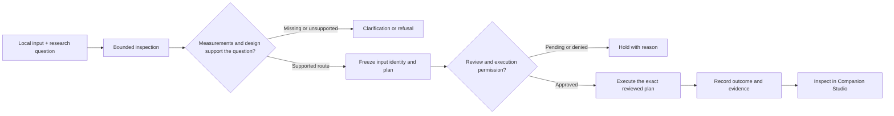

# DevHarness · Companion Research Studio

[](https://github.com/Vajraaaang/bio-agent-harness/actions/workflows/ci.yml)
[](pyproject.toml)
[](LICENSE)
[](#run-companion-research-studio)

DevHarness is a local RNA-seq workbench with a Codex copilot and a browser-based research studio. It checks whether the inputs support the question, freezes a plan for review, and binds completed outputs to execution receipts. DevBench evaluates agent behavior separately.

**[Launch Interactive Studio Demo](https://vajraaaang.github.io/bio-agent-harness/)** · [Architecture](#architecture) · [Evidence](#verification-and-limits)

Work through ten checkpoints in a synthetic single-cell treatment study. Reconcile donor IDs, apply frozen QC, repair a batch-confounded design, and review separate composition and pseudobulk branches. The demo computes cohort and sensitivity summaries from embedded donor records, shows staged model diagnostics, and exports the decision trail. Real fitting runs in the local Workbench.

## Operate DevHarness two ways

### Autonomous Copilot in Codex

Configure and install the [DevHarness Codex MCP plugin](integrations/codex/devharness/README.md). In Codex, select the `@devharness` plugin or invoke `$rna-workbench`. Ask it to inspect a staged dataset, formulate an aim, and propose QC and donor-aware models. Execution requires an approved plan tied to an exact session and plan digest, a supported design, and an available runtime. The plugin and Studio can open the same research session.

### Run Companion Research Studio

Use `uv` and Python 3.13 on macOS or Linux. Keep the input directory and mutable workspace separate. From the repository root, with an existing `inputs/` directory:

```sh
make install
repo="$(pwd -P)"
mkdir -p "$repo/workspace"
"$repo/.venv/bin/python" -m devbench.platform.cli workbench \
  --input-root "$repo/inputs" \
  --workspace "$repo/workspace" \
  --enable-scientific --offline-only --port 8765
```

Open the printed loopback URL. The scientific route checks for SQLite 3.51.3 or newer, or a documented backport. On macOS, a patched Homebrew installation can supply the library with `DYLD_LIBRARY_PATH="$(brew --prefix sqlite)/lib"`. Follow the [Workbench operating guide](docs/workbench-ui.md) for runtime setup and execution permissions.

## Scientific scope and safeguards

- **20-family answerability.** The [registry](src/devbench/core/rna_answerability.py) evaluates whether the measurements and design support a question across 20 research families. The [measurement probes](tests/test_thesis_answerability_matrix.py) cover supported, underspecified, and unsupported cases. Numerical execution depends on the method, input and runtime.
- **Biological replication.** [Design checks](src/devbench/core/contrast_design.py) validate contrasts and estimability. Donor-aware routes use the donor as the biological unit where the declared design calls for it. Multiple cells from a donor do not create independent donor replicates.
- **Selection and inference.** [Negative-binomial count splitting](rna_kernels/scrna_nb_countsplit.py) supports selected marker workflows that separate discovery from inference. [Bayesian scCODA](src/devbench/core/scrna_composition_solver.py) estimates donor-level composition relative to a declared reference and reports posterior inclusion probabilities.
- **Verifiable packages.** [Thesis replay](src/devbench/analysis/thesis_replay.py) checks SHA-256-bound research packages against their retained evidence. Statistical qualification and independent scientific review remain separate.

## Architecture



The typed MCP interface exposes seven tools over local STDIO. Inspection and planning can run before execution is permitted. Starting a run requires the exact session, plan ID and plan digest. The local service owns review state, bounded execution and receipt verification. The browser renders the resulting session, including holds and failures.

| Layer | Code and contracts |
| --- | --- |
| Agent interface | [MCP server and tool schemas](src/devbench/platform/plugin_mcp.py) · [Codex plugin](integrations/codex/devharness) |
| Scientific admission | [Answerability rules](src/devbench/core/rna_answerability.py) · [Contrast design](src/devbench/core/contrast_design.py) |
| Durable workflow | [Investigation service](src/devbench/platform/workbench_investigations.py) · [LangGraph stage and review contracts](docs/langgraph-workflow.md#enforced-route-and-node-contracts) |
| Local application | [Workbench service](src/devbench/platform/workbench_ui.py) · [Companion Studio assets](src/devbench/analysis/assets) |
| Source custody | [Portable source bundles](scripts/source_bundle.py) · [Source include/exclude and tamper checks](tests/test_source_bundle_verification.py) |

## Verification and limits

- [Public CI](https://github.com/Vajraaaang/bio-agent-harness/actions/workflows/ci.yml) checks Workbench and source custody contracts and plugin packaging on macOS and Linux. Run `make test` for the local suite and `make test-wheel-custody` for installed-wheel checks with a patched SQLite runtime.
- The [20-family capability assessment](docs/thesis-goal-and-capability-assessment.md) distinguishes implemented methods, partial support, and missing execution routes. The [method playbooks](docs/references/rna-workbench-method-playbooks-and-literature.md) explain evidence requirements.
- The [verification archive](https://github.com/Vajraaaang/bio-agent-harness/tree/86df6dd5591f11d4fda5b410dcdaa80b33a439b0/reports) retains earlier software checks and calibration findings. See the [evaluation design](docs/public-three-condition-study.md) for the study boundaries.

Software checks and evidence integrity have separate scopes from comparative scientific effectiveness. Clinical release remains held.

## Related projects

[OpenAI Agents SDK](https://github.com/openai/openai-agents-python) is a reference for typed tools and tracing. [LatchBio scBench](https://github.com/latchbio/scbench) evaluates agents on single-cell analysis tasks, while [CellAtria](https://github.com/AstraZeneca/cellatria) orchestrates single-cell ingestion and analysis. [nf-core/rnaseq](https://nf-co.re/rnaseq) documents a versioned RNA-seq pipeline with explicit inputs and outputs. DevHarness focuses on the local boundary between an agent request, a scientifically admissible plan, and independently inspectable execution evidence.

Code is [MIT licensed](LICENSE). Dataset and reference terms are in [NOTICE.md](NOTICE.md).
