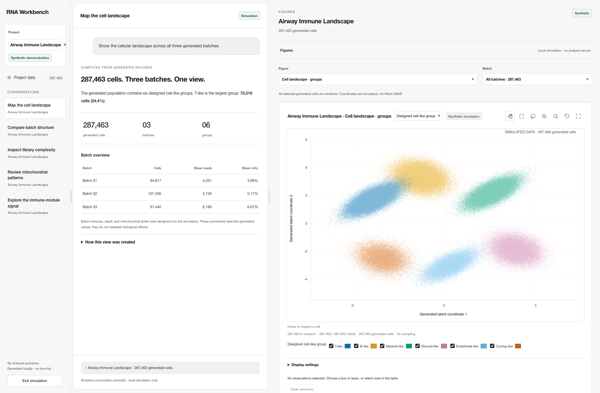

# RNA Workbench

A local workspace for transcriptomics research. Organize datasets by project, investigate them through chats, and inspect figures, code and evidence in one interface.

The application is built around **Project → Data + Chats**. Project navigation, conversation and scientific results occupy independently resizable panes. Each chat keeps its attached datasets, question, workflow state and unsent draft together.



The screenshot uses the current workbench’s project navigation, conversation pane and interactive figure renderer. **Airway Immune Landscape** is a clearly labeled synthetic demonstration with 287,463 generated cell-like records across three unequal batches. The conversation summaries are calculated from those records. Six fictional projects offer different generated populations, and the [plot gallery](reports/workbench-integrated-simulation-20261029/gallery/README.md) shows 18 views exported by the workbench. No live trial, model response or biological discovery is claimed.

## Work in the interface

- **Projects and datasets:** create local projects, add files from an authorized input library, and switch projects without mixing drafts or attachments.
- **Conversations:** attach an ordered set of up to eight datasets to a chat. The analysis overview groups Data, Question, Methods, Results and Conclusion into expandable sections.
- **Scientific results:** inspect figures, notebook code, evidence and display settings beside the conversation. Interactive figures support point inspection, selection and source-bound follow-up questions.
- **Recorded work:** retain plans, runs, results, failed attempts and review decisions with their input and source identities. Execution and scientific acceptance remain separate actions.

Multiple attachments are passed to the planning workflow as an exact input set. Their presence does not establish that the files can be combined or that a joint numerical analysis has run; the selected method must support the complete set.

## Code organization

The browser uses HTML, CSS and JavaScript modules served by a local Python service. The service owns input admission, project routing and workflow records. Numerical execution remains behind the existing controlled-analysis interfaces.

| Area | Source | Responsibility |
| --- | --- | --- |
| Local application | [`workbench_ui.py`](devbench/analysis/workbench_ui.py) | `WorkbenchService`, HTTP request handling, authentication, page composition and workbench operations |
| Projects | [`workbench_projects.py`](devbench/analysis/workbench_projects.py) | `WorkbenchProjectHub`, project workspaces, project-bound service state and data entries |
| Inputs | [`workbench_inputs.py`](devbench/analysis/workbench_inputs.py) | `InputDiscovery`, bounded file inspection and input identity checks |
| Investigations | [`workbench_investigations.py`](devbench/analysis/workbench_investigations.py) | `InvestigationService`, chat attachments, questions and investigation records |
| Interface | [`workbench-ui.html`](devbench/analysis/assets/workbench-ui.html), [`workbench-theme.css`](devbench/analysis/assets/workbench-theme.css) | Three-pane layout, controls, workflow card and responsive presentation |
| Frontend state | [`workbench-projects.js`](devbench/analysis/assets/workbench-projects.js), [`workbench-conversation.js`](devbench/analysis/assets/workbench-conversation.js), [`workbench-investigations.js`](devbench/analysis/assets/workbench-investigations.js) | Project navigation, conversations, drafts and investigation interactions |
| Figures and artifacts | [`scientific-figure.js`](devbench/analysis/assets/scientific-figure.js), [`workbench-artifacts.js`](devbench/analysis/assets/workbench-artifacts.js) | Figure rendering, selections, artifact display and provenance-aware interaction |
| Offline demonstration | [`workbench-demo.js`](devbench/analysis/assets/workbench-demo.js) | Generates a temporary project presentation inside the current workbench, computes summaries and renders through the same figure component without service writes |
| Analysis services | [`devbench.analysis`](devbench/analysis), [`devharness_core`](devharness_core), [`devharness_server`](devharness_server) | Scientific planning, registered tools, bounded data access and numerical methods |

The UI presents the five scientific questions in order: identify the data, define the question, assess methods, inspect outputs, and state supported conclusions. Missing inputs, failed tools and unresolved assumptions remain visible in that process.

## Run locally

Use Python 3.11 or newer. The locked setup defaults to Python 3.12 and uses `uv` when available.

```sh
git clone https://github.com/Vajraaaang/bio-agent-harness.git /absolute/repository
make -C /absolute/repository install
```

The module CLI starts a single-workspace browser service. Use a fresh workspace and a separate approved input directory that already exists:

```sh
/absolute/repository/.venv/bin/python -m devbench.analysis.workbench_ui \
  --workspace /absolute/workbench-workspace \
  --input-root /absolute/approved-inputs \
  --enable-scientific --port 8765
```

Open the loopback URL printed by the service. Its session token is private. Starting the interface does not authorize model calls or numerical execution; those actions have separate admission and permission checks.

The multi-project catalog is composed through `WorkbenchProjectHub` and `make_server(..., project_hub=hub)` with a trusted service factory. That factory supplies each project’s service and the shared execution queue. The module CLI above does not configure that catalog; the [project hub](devbench/analysis/workbench_projects.py) and [HTTP routing tests](tests/test_workbench_project_http.py) document the integration boundary.

Install the optional scRNA and notebook dependencies when needed:

```sh
uv sync --project /absolute/repository --locked \
  --extra dev --extra reporting --extra analysis --python 3.12
```

On a fresh, disconnected workbench page, choose **Open simulated project** to explore six generated projects with distinct seeds and unequal batch populations. Switch conversations, figures and batches; inspect or export plotted values using the workbench controls. The simulation keeps its provenance visible, creates no analysis or approval records, and restores the disconnected page when closed.

See the [operating guide](docs/workbench-ui.md) for initialization, input registration, execution permissions and recovery.

## Verification

The [current verification record](reports/workbench-integrated-simulation-20261029/README.md) records contract tests, workbench and packaging checks, actual browser rendering, interaction isolation and controlled synthetic numerical checks. Rendering tests preserve the retained-figure contract while admitting generated data through a separate simulation contract.

These are bounded software checks. Full-suite hosted CI is not confirmed green, and these checks do not establish comparative biological validity or clinical readiness. [Release readiness](RELEASE_READINESS.md) records limitations.

To run the software tests or the controlled synthetic check locally:

```sh
make -C /absolute/repository test
make -C /absolute/repository controlled-demo
```

The controlled check needs R for its configured references. A missing reference is reported. The count reference shares fitted dispersions and offsets, so it does not independently validate their estimation.

## Documentation

- [Projects, datasets and chats](docs/workbench-redesign/projects-and-source-sets.md)
- [Scientific workspace](docs/shared-scientific-workspace.md)
- [Local RNA analyst](docs/local-rna-analyst.md)
- [Analysis episode support](docs/analysis-episodes.md)
- [Method planning](docs/scientific-method-planner.md)
- [Controlled execution](docs/controlled-execution.md)

Research software. Clinical release remains held pending qualified independent validation and the required operational controls.
