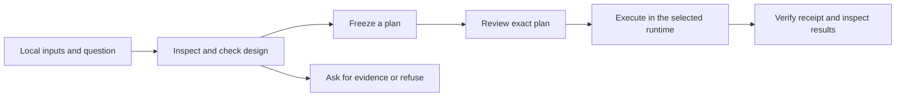

# DevHarness

**A review-gated MCP server for AI-assisted RNA-seq.** Give Codex, Claude Code, Cursor, or a custom agent tools to inspect local data, check experimental design, and carry out reviewed workflows with verifiable receipts.

[](https://github.com/Vajraaaang/bio-agent-harness/actions/workflows/ci.yml)
[](pyproject.toml)
[](LICENSE)

[Quickstart](#quickstart) · [Workflows](docs/capabilities.md) · [MCP reference](docs/mcp-tools.md) · [Evaluation](docs/evaluation.md) · [Interactive Studio demo](https://vajraaaang.github.io/bio-agent-harness/)

## A batch-confounded contrast, caught before fitting

The synthetic bulk example has six libraries from six donors. Every control
was processed in one batch and every treated sample in the other.

> Can these counts estimate a treated-versus-control effect after adjusting for batch? Audit the matrix if the contrast is blocked.

The local STDIO server returns the following results in the runnable walkthrough.

```text
inspect_rna_inputs       counts.csv and design.csv
check_answerability     refused · rank_deficient_or_confounded_design
plan_rna_workflow       matrix_audit · plan digest returned
execute_reviewed_plan   queued · run ID returned
get_run_status          completed
get_execution_receipt   6 features · 6 libraries · replay bundle SHA-256
```

The receipt covers the descriptive audit. The condition effect remains
unresolved. [Run the bulk RNA-seq example](examples/bulk-rnaseq/README.md)

## What the server does

- **Checks the study design.** Inspect counts and metadata, confirm the biological unit, and check model rank and contrast estimability before model fitting.
- **Binds review to the plan.** Freeze input identities, parameters, and the route. Numerical runs follow the approval rules for that exact plan.
- **Retains execution evidence.** Read back bounded results, artifact identities, and the execution receipt. Keep the receipt digest to verify the retained evidence later.

## Quickstart

**1. Install.** Clone the repository, open its root in a terminal, and sync the locked environment.

```sh
uv sync --locked --python 3.13
```

Use a native macOS or Linux runtime. See the runtime and SQLite checks if startup fails. [Installation](docs/installation.md)

**2. Connect an MCP client.** The [Codex plugin](docs/quickstart.md#install-the-codex-plugin)
includes the RNA workflow skill. For direct STDIO registration in Codex,
run the following from the repository root.

```sh
repo="$(pwd -P)"
input_root="$repo/examples/bulk-rnaseq/data"
workspace="$repo/results/mcp-quickstart"
mkdir -p "$workspace"
codex mcp add devharness -- "$repo/.venv/bin/devbench" plugin-mcp \
  --input-root "$input_root" --workspace "$workspace"
```

Claude Code, Cursor, and generic STDIO clients can use the same server command.
[Client setup](docs/quickstart.md)

**3. Ask a question.** In your client, give it the absolute paths to
`counts.csv` and `design.csv` in the example input directory.

> Use DevHarness to inspect these files. The synthetic study has distinct donors identified by `donor_id`. Check whether treated versus control is estimable with `~ condition + batch`. If the contrast is blocked, explain why and run a descriptive audit of the original counts.

The [single-cell example](examples/single-cell-rnaseq/README.md) shows how accepted
QC and donor identity govern pseudobulk and relative composition workflows.

## Workflows

| Workflow | Typical starting point |
| --- | --- |
| Bulk differential expression and Salmon quantification | Replicated gene counts and study design, or staged reads with pinned references |
| Single-cell QC, doublets, preparation, and integration | Original counts with capture and batch annotations |
| Donor-level pseudobulk and scCODA composition | Accepted QC selection, donor identities, and cell-type labels |
| Neighborhood abundance and bulk deconvolution | A declared embedding or a matched cell-type reference |
| Pathway testing and spatial patterns | A verified fit and mapped gene sets, or expression with physical coordinates |
| Cell–cell coexpression and perturbation response | Replicated observations and a declared reference or control group |
| Phenotype prediction | Donor-linked outcomes with a locked independent evaluation partition |

The exact methods, required inputs, and review points are in the [workflow guide](docs/capabilities.md).

## MCP tools

| Tool | Role |
| --- | --- |
| `inspect_rna_inputs` | Identify input types, axes, and bounded metadata |
| `check_answerability` | Check measurements, design, and route prerequisites |
| `plan_rna_workflow` | Freeze the workflow, its sources, and the plan digest |
| `manage_research_aim` | Create, revise, and inspect versioned aims and packages |
| `execute_reviewed_plan` | Request execution with the exact session, plan ID, and digest |
| `get_run_status` | Read progress, holds, and failures |
| `get_execution_receipt` | Read results and verify retained evidence |

[Request examples and field definitions](docs/mcp-tools.md)

## Architecture



The MCP server and local Workbench share investigation state. [Architecture and trust boundaries](docs/architecture.md)

## Evaluation

DevBench defines matched baseline, optional-tool, and enforced-tool conditions.
The public software checks exercise statistical safeguards and the execution
contracts against synthetic inputs. [Evaluation design and runnable checks](docs/evaluation.md)

DevHarness is for computational research. Code is [MIT licensed](LICENSE).
See the [data and reference terms](NOTICE.md) for third-party material.
