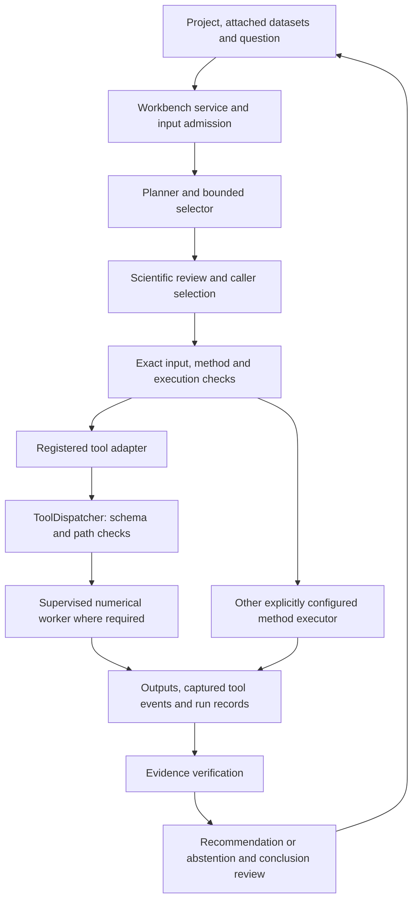

# Agentic workflow, harness and scientific tools

RNA Workbench combines a project/chat interface, bounded planning workflows and executable scientific tools. The agent can propose an action or interpretation; the harness checks the request, owns execution, and retains what actually happened. A fluent conversation is not itself execution evidence.

This guide describes the current code. The disconnected simulated projects and their plots are a separate presentation path: their summaries are computed from generated records, and they do not run the scientific workflow, call a model, create a real analysis result or supply review approval.

## 1. Design and boundaries



These boxes are distinct responsibilities, not interchangeable approvals:

| Layer | Current implementation | Owns |
| --- | --- | --- |
| Project and conversation | [`WorkbenchProjectHub`](../devbench/analysis/workbench_projects.py), [`InvestigationService`](../devbench/analysis/workbench_investigations.py) | Project isolation, attached input sets, questions, drafts and investigation records |
| Browser boundary | [`WorkbenchService`](../devbench/analysis/workbench_ui.py) | Local authentication, request validation, UI state, service policy and calls into application services |
| Planning | [`ScientificMethodPlanner`](../devbench/analysis/method_planner.py), [`SerialRNAWorkflow`](../devbench/analysis/langgraph_workflow.py) | Candidate generation, capability resolution, trial design and the ordered workflow cursor |
| Scientific review | [`ScientificWorkflowRuntime`](../devbench/analysis/workflow_science.py), [`workflow_scientific_reviews.py`](../devbench/analysis/workflow_scientific_reviews.py) | Configured discovery/review operations, review policy and verifiable evidence packets |
| Tool dispatch | [`ToolDispatcher`](../devharness_server/dispatcher.py), [`method_adapter.py`](../devharness_server/method_adapter.py) | Registered tool identity, parameter validation, bound inputs and actual call capture |
| Numerical work | [`watchdog.py`](../devharness_core/watchdog.py) and individual tool workers | Spawned computation, memory/deadline monitoring and cancellation cleanup |
| Retention and recovery | [`WorkflowOperationLedger`](../devbench/analysis/workflow_operations.py), [`CheckpointStore`](../devbench/analysis/checkpoints.py), [`provenance.py`](../devharness_core/provenance.py) | Operation identity, retained effects, artifact hashes, verification and explicit reconciliation |

A declared execution policy is not a universal security boundary. The trusted dispatcher path does not provide container or network isolation for arbitrary Python. Custom method execution has a separate executor and policy; accepting a tool schema does not authorize custom code.

## 2. The five questions and the executable route

The conversation presents five scientific questions. The serial graph implements them with more granular nodes:

| Workbench section | Graph nodes, in order | Intended outcome |
| --- | --- | --- |
| Data | `audit` | Check input identity, measurement declarations, units, quality and design concerns |
| Question | `question` | Bind an explicit scientific objective and distinguish supplied requirements from suggestions |
| Methods | `discovery → generate → candidate_review → resolve → implementation → design → design_review → review → declare → execution_review` | Consider appropriate methods, assess them, resolve implementations, review a frozen design and select exact trials |
| Results | `run → verify` | Execute authorized declared work, retain failures and verify resulting evidence |
| Conclusion | `recommend → conclusion_review` | Produce an evidence-bound recommendation or abstention and review its claims |

The exact route is defined by [`SERIAL_ROUTE`](../devbench/analysis/workflow_state.py). Scientific candidates are generated before capability resolution, so an installed method is not automatically treated as the scientifically preferred method. The graph preserves the possibility that no eligible implementation is available.

`review` pauses the graph for caller action. `execution_review` also pauses when declared trial IDs are present; with no declared trials, it can proceed toward evidence verification. Resuming a pause does not by itself grant scientific approval or runtime execution authority. The `run` node checks data-execution permission and exact trial identity separately. Scientific discovery and review nodes stop with `review_required` if their required runtime is absent.

Every next edge depends on the returned status. A failure, cancellation, unresolved review or reconciliation requirement stops normal progress. The graph does not turn a missing result into a successful conclusion. A successful numerical run is also insufficient by itself to establish that a method is best for the question.

## 3. What makes the workflow agentic

The model-facing selector receives a bounded public observation and permitted actions, rather than the service object or unrestricted access to its storage. In the separate bounded episode driver, actions are `tool`, `finish`, `refuse`, `revise` and `request_information`. The harness applies the selected action and returns the next observation.

[`drive_episode`](../devbench/analysis/episode_agent.py) records each selection context, reservation, response and available execution evidence. Its default `AgentLimits` allow eight selections, a 600-second overall deadline, 90 seconds per selection, 2,048 MiB for selection execution and 128,000 bytes of context. These are defaults for that driver, not promises that every workflow or model uses the same budget. Resuming a retained episode preserves its frozen configuration and budget; it does not reset the allowance.

A request for missing information returns control to the operator and creates a handoff. It is not silently retried as if the missing information had arrived. Invalid actions, exhausted limits and changed inputs produce explicit failure or refusal paths.

The serial scientific graph and bounded episode driver are related orchestration components, not one undifferentiated autonomous loop. A configured route determines which component is used. Recorded selector responses can exercise software behavior offline; they are not evidence that a live agent made the decisions.

## 4. Permissions before effects

The workbench separates several kinds of authority:

- **Input access:** the service uses explicit existing input roots. The project catalog imports from a configured local library, with bounded copies and identity checks. Attaching several files binds their ordered set; it does not establish compatible measurements or independent biological replication.
- **Model calls:** configuring a selector does not enable calls. The episode path persists a reservation and derives model authority before dispatch. The workbench also requires its explicit model-execution policy and eligible data scope.
- **Discovery and review:** `ScientificWorkflowRuntime` separately tracks permission for discovery network access, review-model execution and implementation-model execution. A missing reviewer or review packet cannot be replaced with an invented approval.
- **Data execution:** the service/driver and exact declared trial must admit numerical execution. In the browser route, the service permission and a fresh action grant are separate checks.
- **Custom implementations:** a generated implementation request is not equivalent to a registered, reviewed method. Its implementation and execution policy must be admitted through the corresponding method path.

The workflow cursor contains references and hashes, not matrices or execution grants. [`validate_workflow_state`](../devbench/analysis/workflow_state.py) requires an exact finite schema, a 64,000-byte state ceiling, bounded reference lists and valid workflow/planner bindings. This keeps the graph checkpoint from becoming an alternate source of authority.

## 5. Tool dispatch and resource control

The MCP server and trusted Python integrations use the same registered functions. [`create_server`](../devharness_server/server.py) constructs the MCP server with a dispatcher rooted at the current working directory. The module's `main()` opens the stdio transport and runs the server; importing the module does not start an event loop.

`ToolDispatcher.execute` performs the following work:

1. Reject an unknown tool name and validate arguments against the function-derived JSON Schema, including rejection of additional fields.
2. If `allowed_root` is configured, require each supplied `*_path` argument to be absolute and resolve inside it. A dispatcher constructed without `allowed_root` does not enforce this containment check.
3. Call the registered function and encode a finite JSON result. Nonfinite diagnostics are represented as `null`; a consumer must interpret the tool's status and diagnostics rather than assume all returned values are valid estimates.
4. When `capture_tool_events()` is active, capture the actual arguments, start/end time, elapsed time, result or error, and success flag. This context capture is not automatically a persistent audit store; its caller retains the records.

The [registered-method adapter](../devharness_server/method_adapter.py) additionally binds an immutable method contract to the live registered source and runtime identity. It rejects changed/forged contract identities and parameter overrides of bound artifact inputs. It uses a fresh output directory and checks the JSON output quota.

The adapter's current policy declares 4,096 MiB, a 300-second deadline and a 16,000,000-byte result limit. Memory/deadline limits propagate to supervised workers, and individual tools can impose tighter limits; expression-quality auditing uses 2,000 MiB and 120 seconds. Not every inexpensive tool starts a worker. These values are not a claim that the trusted parent has container, PID or network isolation.

[`run_sandboxed`](../devharness_core/watchdog.py) runs importable numerical functions in spawned child processes and monitors their process trees. It retains resource failures and cancellation outcomes instead of inventing results. Despite its name, it is resource isolation, not a security VM for untrusted Python. Scripts that launch these workers need a module-level `if __name__ == "__main__":` guard; notebook integrations should call the dispatcher instead of starting an MCP event loop.

## 6. Registered tools

The dispatcher currently registers these eleven functions. Input declarations and scientific assumptions must be established before selecting or fitting a method.

| Tool | Inputs | Returned evidence and limit |
| --- | --- | --- |
| `audit_expression_quality` | Expression and metadata paths; optional reference matrix, candidate embedding and contrast | Observed QC, replication/contrast diagnostics and representation-loss checks. Geometry is capped at 500 cells and 200 genes; broader matrix checks stream chunks. It does not fit the contrast. |
| `validate_design_matrix` | Metadata path, safe formula and time column | `is_full_rank`, `rank`, `num_parameters`, `condition_number` and `aliased_columns`. A full-rank design alone does not prove the scientific assumptions. |
| `analyze_batch_effects` | Expression/metadata paths, time column and optional list of up to 100 genes | Descriptive full/partial R², rank diagnostics and explicit non-identifiability. Completely confounded batch/time effects are not causally separated. |
| `compact_temporal_state` | Chunked expression, metadata and time column | A bounded temporal summary/manifold. Compression is not proof that all relevant biological variation was retained. |
| `fit_temporal_trajectory` | Expression/metadata, formula, time column, explicit genes and fitting policy | Per-gene fits, p-values, BH q-values, diagnostics and inference scope. Raw counts use the RLE/empirical-Bayes negative-binomial path; continuous expression stays Gaussian. Selection and replication limits remain explicit. |
| `bulk_condition_contrast` | Canonical CSV inputs, public task declarations and frozen options | A bounded two-condition biological-unit contrast using the existing count or continuous core. It does not accept arbitrary source or formulas. |
| `calculate_temporal_monotonicity` | At least two finite stage estimates with distinct numeric times | Direction, signed step-agreement score and a monotonicity flag. This summarizes the supplied estimates, not causal dynamics. |
| `infer_lineage` | Expression/metadata, an explicit root ID and bounded geometry settings | Per-observation pseudotime, branch assignments, a cluster tree and provenance. Pseudotime is inferred ordering; it is not automatically collection age. |
| `infer_regulatory_network` | Expression/metadata and explicit TF/target lists | Regularized lagged association scores and ranked edges. Association does not establish direct regulation or causality. |
| `regulon_enrichment` | Selected genes, background genes and a TF-target TSV | BH-corrected overlap with the supplied curated membership. It does not test sequence binding. |
| `motif_enrichment` | Foreground/background genes and complete motif hit/no-hit calls | Enrichment of supplied sequence-hit evidence. Missing measurements cannot be recoded as negatives. |

Sources: [statistical tools](../devharness_server/tools_stat.py), [QC](../devharness_server/tools_qc.py), [bulk contrast](../devharness_server/tools_bulk.py), [trajectory summary](../devharness_server/tools_trajectory.py), [lineage](../devharness_server/tools_lineage.py), [network/enrichment](../devharness_server/tools_network.py) and [registration](../devharness_server/dispatcher.py).

## 7. Concrete requests and outputs

The following two request examples are schema-validated templates, not executed analyses. Paths and design columns must be replaced with admitted inputs. The formula is illustrative and is not a user-prespecified or recommended study design.

```json
{
  "name": "audit_expression_quality",
  "arguments": {
    "counts_path": "/absolute/project/data/expression.zarr",
    "metadata_path": "/absolute/project/data/metadata.csv",
    "time_col": "collection_day"
  }
}
```

Use the returned diagnostics to identify invalid values, questionable unit declarations or a lossy representation. A file hash establishes identity; it does not make the data scientifically valid.

```json
{
  "name": "validate_design_matrix",
  "arguments": {
    "metadata_csv_path": "/absolute/project/data/metadata.csv",
    "formula_str": "1 + C(condition) + C(batch)",
    "time_col": "collection_day"
  }
}
```

This returns the rank/alias fields listed above. If condition and batch are completely confounded, dropping a covariate does not recover an identifiable causal effect. Resolve the design question or retain a refusal instead of interpreting a convenient fit as an answer.

For a small arithmetic example, the following call was actually evaluated through the dispatcher using only the three supplied scalar values:

```json
{
  "name": "calculate_temporal_monotonicity",
  "arguments": {"stage_values": {"0": 1.0, "1": 3.0, "2": 2.0}}
}
```

Its result is:

```json
{"is_monotonic": false, "direction": "non_monotonic", "score": 0.0}
```

The increase and decrease cancel in the signed step score. This is a deterministic scalar example, not a biological run, live model trial or validation study. One actual successful tool event was captured for it.

## 8. Evidence, recovery and conclusions

A graph checkpoint answers where control stopped. It does not independently prove that an external effect completed. The operation ledger binds attempts to exact workflow, node, planner and input identities; uncertain effects require reconciliation against retained evidence before continuation. [`ScientificWorkflowRuntime.reconcile`](../devbench/analysis/workflow_science.py) explicitly avoids performing a new search, review or implementation request while recovering a prior operation.

The [stage checkpoint store](../devbench/analysis/checkpoints.py) verifies input/code/config identity, dependency receipts and output hashes before reusing completed stages. Changed input, configuration, source or output bytes invalidate reuse. Failed, interrupted and cancelled attempts remain part of the record.

The [execution DAG](../devharness_core/provenance.py) uses canonical records and SHA-256 identities. Its integrity is meaningful relative to an independently retained expected root. It is not an authenticated electronic signature, a compliance certificate, proof that the inputs are biologically valid, or evidence of clinical readiness.

Conclusions therefore use separate evidence scopes:

- A rendered plot verifies what the interface drew.
- A passing software check verifies the tested behavior and source scope.
- A completed numerical run verifies execution under its stated contract.
- Comparative scientific evidence is needed to recommend a method over alternatives.
- Independent biological and clinical validation remain separate requirements.

The workbench is designed to retain these distinctions while making data, plans, outputs and their supporting code inspectable in one place.
