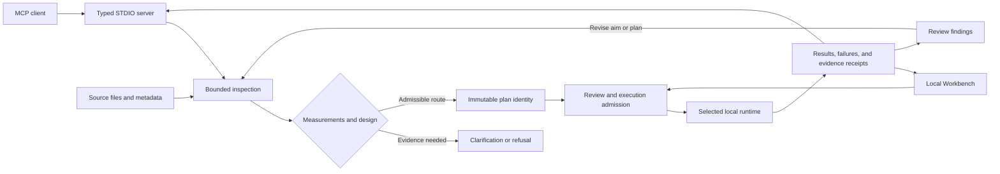

# Architecture and trust boundaries

DevHarness connects a client’s RNA-seq request to a local, reviewable
execution. The agent and Workbench share the same investigation session.

1. **Inspect.** Resolve inputs under the declared input root. Record file and axis identities. Project bounded facts such as count storage and metadata column names.
2. **Check answerability.** Evaluate the question against measured data, biological units, and method-specific design requirements. The rank check catches non-estimable contrasts, including complete confounding.
3. **Freeze.** Bind the input identities, objective, parameters, runtime route, and resulting plan digest. A revised plan gets its own identity.
4. **Review and run.** Use the session ID, plan ID, and plan digest to request execution. Routes that require approval check the matching review record. The worker records its terminal state and retained outputs.
5. **Verify.** Read back bounded summaries and check evidence against SHA-256 identities. Retain a trusted receipt digest outside the workspace for independent integrity checking.
6. **Revisit the plan.** Review the findings and diagnostics against the original question. If they change the aim, inputs, or method, revise the aim as needed, check answerability again, and freeze a new plan in the same session. The revised plan follows its own review and retains the earlier run and evidence in the session history.

| Layer | Source |
| --- | --- |
| Typed requests and local STDIO transport | [MCP server](../src/devbench/platform/plugin_mcp.py) |
| Measurement requirements and design | [Answerability registry](../src/devbench/core/rna_answerability.py) · [Contrast design](../src/devbench/core/contrast_design.py) |
| Runs and coordinated review | [Job store](../src/devbench/platform/plugin_jobs.py) · [Investigation service](../src/devbench/platform/workbench_investigations.py) |
| Local application and replay | [Workbench service](../src/devbench/platform/workbench_ui.py) · [Replay verification](../src/devbench/analysis/thesis_replay.py) |

Input classification and workspace custody govern what the MCP server can
disclose. Private data stays on the local Workbench route. A client can send
tool responses to its model service, so use an appropriate client and data
scope. Server-side verification establishes artifact integrity. Scientific
review evaluates the design, estimates, and supported claims. [Evaluation](evaluation.md)
