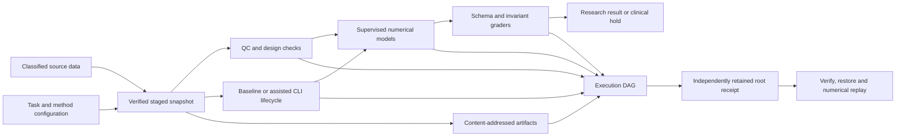

# Architecture and trust boundaries

Version 0.2 is a local research execution platform with audit-oriented technical controls. Qualified clinical release is deliberately unavailable. Software verification, analytical validation, clinical validation and organizational compliance are separate bodies of evidence.

## Boundaries

1. **Data admission.** Source classification is the most restrictive of task declarations, the trusted builder and file overlays. It cannot be downgraded by staging. Unknown overlays block external execution. Classification is not automated PHI detection.
2. **Computation.** Chunked stores avoid full expression loads. Spawned children are monitored recursively and terminated on memory/growth/deadline failures. Production kernel, disk and network limits require an appropriately isolated deployment.
3. **Agent interaction.** CLI authentication belongs to the user or organization. API keys are not required for subscription backends. MCP paths are workspace-bound. Python callbacks are trusted executable code and must be separately validated before regulated use.
4. **Inference.** RLE/empirical-Bayes counts and Gaussian continuous models have explicit assumptions, bounded calibration references, selection criteria and diagnostics. Repeated biological units require a different sampling model. Automated spline selection does not turn conditional Wald tests into prespecified confirmatory inference.
5. **Grading.** Known simulation truth is private to the runner; observational public references are distinguished. Binary vetoes check explicit contradictions such as q<p, invalid contrasts or significance claims inconsistent with recorded q-values. Narrative causal validity is not delegated to an LLM judge.
6. **Evidence.** Content copies, manifests and node hashes are published without overwriting through the API. Local owners retain OS-level modification power. External trusted roots and protected retention are necessary to establish tamper evidence across administrative changes.
7. **Release.** Actor labels are assertions, not authenticated signatures. Control evidence may reach independent-review readiness but never authorizes clinical release. The control map covers the remaining validated access, identity, signature, retention and procedural requirements.

## Reproducibility contract

The deterministic analysis fingerprint binds data hashes, source, installed numerical runtime, declared parameters, method and seeds. The execution root additionally binds actor assertions, sequence and timestamps. Numerical replay demands the original runtime fingerprint and captured workspace-bound inputs, then compares structured results with declared tolerances. It does not claim deterministic re-execution of hosted models, unrecorded external data, or arbitrary hardware.

## Benchmark interpretation

The 55 simulation scenarios are distinct mechanisms and diagnostic questions, not 55 empirical cohorts. Three extra public tasks derive references from measured bulk data. Oracle controls validate engineering behavior; they cannot support a frontier-model performance claim. Baseline comparisons exclude tasks whose success inherently requires assisted-only tool history. Repeated tasks are clustered for bootstrap uncertainty, and missing evidence stays unknown.

The current development session has no approved external CLI model comparison. A destination-specific approval request is pending because automatic approval review rejected the proposed Anthropic source review. This does not affect local numerical validation.
