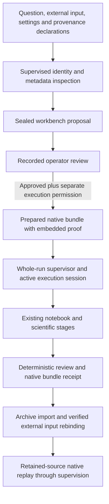

# Reviewed backed-workbench execution

The existing H5AD/10x workbench now has an operator-reviewed dispatch path. It keeps the large input external, records its digest and the registered workflow settings, embeds review evidence in the native bundle, and uses the existing scientific stages and replay mechanism.

This is distinct from bounded mean/state contrast episodes. It does not copy H5AD into the 100 MB table transport or change the workbench's scientific methods. The existing proposal CLI can now ask Codex to select this registered workflow, request information or refuse. The operator supplies scientific settings/declarations and still reviews any suggestion. The connection has offline protocol/software fixtures; live model behavior and semantic plan quality remain unqualified.

## Codex suggestion entry

Use the existing `devbench.analysis.episode_cli --plan-request` interface. A backed request has `dataset.transport: backed_workbench`, an absolute `source`, the existing complete workbench `parameters`, and the `declarations` described below. It can also bind `model_path` and `run_timeout_seconds`. Generate the parameters through the existing `default_parameters` helper and retain the expected input digest. Relative source/model paths in CLI requests resolve against the request file.

```python
from devbench.analysis.workbench import default_parameters

def make_request(source, expected_sha256, declarations, *, counts_layer, batch_key):
    parameters = default_parameters(
        data_sha256=expected_sha256,
        counts_layer=counts_layer,
        batch_key=batch_key,
    )
    return {
        "question": "Inspect QC, clustering and the available cell annotation",
        "dataset": {
            "transport": "backed_workbench",
            "source": str(source),
            "parameters": parameters,
            "declarations": declarations,
            "run_timeout_seconds": 3600,
        },
    }
```

Supply the actual retained digest, layer, capture-column mapping and provenance; the helper does not infer them. Serialize the returned object as the request JSON, after reviewing the scientific/resource profile. Workbench settings remain in that profile; table `limits`/`fixed_options` are rejected for this transport. Do not reuse a contrast specification or a source-bound prepared bundle's generated fields as a fresh request.

```sh
/absolute/repo/.venv-analysis/bin/python -m devbench.analysis.episode_cli \
  --plan-request /absolute/request.json --codex-model EXACT_MODEL_IDENTIFIER \
  --agent-workspaces /absolute/protected/actors --model-data-scope synthetic \
  --allow-model-execution --allow-data-execution \
  --output /absolute/protected/new-planning-run
```

This command requires separately authorized model usage and disclosure. `public` is the other permitted external-model scope; neither declaration is a PHI detector. To exercise the coordinator without a provider, use an explicit `--plan-answer` recorded-decision file instead of Codex/model flags. That mode is a software demonstration, not a live-agent result.

The proposal response is `{"kind":"propose","workflow":"scrna_qc_integration_annotation/1","rationale":"..."}`, or the existing information/refusal form. There are no contrast fields or editable parameters in this schema. The agent sees an allowlisted metadata/settings projection, not input/model bindings, matrices, per-cell labels, retained source or protected evaluation material. Supplied question/provenance text and marker/column labels still require a disclosure decision.

An agent-suggested proposal binds its sealed authoring records. Publication and first approval check that origin; the copied review proof retains the verified authoring root for native replay. Raw provider logs remain separately retained in the planning directory. Replaying the scientific workflow does not reproduce or rerun the model suggestion.

## Flow



Approval is a caller-asserted research record. It does not establish independent scientific validation, authenticated identity, model permission or clinical release.

## API

Use a standalone script with a module-level `if __name__ == "__main__":` guard when invoking supervised workers. The API lives in `devbench.analysis.workbench_proposals`:

- `prepare_workbench_proposal`: requires `allow_data_read=True`; takes the question, source, existing workbench parameters and provenance declarations. An optional model source must match the recorded model digest. The input matrix is not copied into the proposal.
- `record_workbench_review`: requires `allow_review=True`; records `approve`, `reject` or `needs_information` against the retained proposal root.
- `prepare_reviewed_workbench`: requires `allow_data_execution=True`; rechecks original input, model and implementation identities, calls existing `prepare_bundle`, and embeds the verified proposal/review proof.
- `execute_reviewed_workbench(bundle, execution_output, allow_data_execution=True)`: runs the existing notebook under the reviewed total deadline and records supervision in a separate protected directory.

All paths must be canonical absolute paths. Proposal/review/execution evidence needs protected storage outside platform scratch. Outputs must be fresh and disjoint from inputs and existing proof. Compute authorization is separate from review and must be supplied again for a new execution attempt.

The declarations are:

```json
{
  "assay": "scrna",
  "measurement": "umi_counts",
  "count_provenance": "Actual quantification/protocol and preprocessing provenance",
  "capture_unit_key": "batch",
  "capture_units_confirmed": false,
  "annotation_provenance": "Actual model/marker provenance, or its absence and limitations"
}
```

`capture_units_confirmed` must stay false until experimental records establish the mapping. A batch label is not itself evidence of a capture library. The current doublet workflow requires this distinction; unsupported/unconfirmed declarations can be recorded but cannot receive an approving review. Count identity is likewise a declaration, not something proven by integer-looking values or a file hash. Other assays/measurement profiles retain their unsupported status in this variant.

Approving reviews require all five explicit confirmations: `question_and_scope`, `input_provenance`, `capture_units`, `settings_and_limits`, and `interpretation_limits`. These fields record what the reviewer asserted. They are not automatic conclusions or a substitute for qualified review.

The existing `default_parameters` helper still supplies the registered QC/integration/clustering/annotation configuration. Use its actual frozen parameters, including the input digest, selected layer, batch key, marker/model settings and resource bounds. Do not rename a different biological question into this workflow. Annotation can remain unavailable without suitable references; existing computational labels only support reference concordance.

## Supervision and replay

`run_timeout_seconds` is frozen in the proposal, positive and no greater than 3600 seconds. It caps the supervised execution attempt; proposal preparation and review are separate operations. The whole process tree is supervised at the recorded memory ceiling and growth policy, while native stages retain their own limits. The wrapper does not allocate, provision or stop a Colab VM; an authorized Colab run still needs its external shutdown guard.

Reviewed notebook/stage entry requires the active supervisory session. Direct `execute_bundle`, `run_stage` or stage-CLI calls cannot accidentally bypass that wrapper. An active coordinator/source mismatch is rejected; use the retained source for replay. Source identity and session checks are controls for cooperating code, not proof against a host owner rewriting code or process state.

On orderly completion/failure, the temporary session marker is removed. A leftover marker after an abrupt parent/runtime termination is **not evidence that a process remains alive**. A subsequent attempt is refused and recorded without deleting that marker; the operator must inspect the prior attempt before recovery. There is no automatic retry, budget reset or permission expansion.

Native `--replay-bundle` remains the replay entry point. It verifies/imports the native receipt, uses a newly verified external input binding, re-enters retained source, copies the review proof and routes reviewed execution through the total-run supervisor. Replays may declare a new execution tier and parent receipt; scientific settings and resource limits remain the reviewed values. A new tier does not inherit local permission attestation or prior compute authorization.

The reviewed data digest is rechecked before final native sealing. This verifies identity at defined boundaries; it does not turn an externally writable file into an immutable storage system.

## Evidence and outcomes

The proposal/review use existing execution-DAG receipts. The native bundle keeps its own `manifest_sha256` receipt and artifact format. The separate execution record binds both review roots, the native result and observed supervision. Do not treat these receipt formats as interchangeable.

Possible execution statuses are `completed_review_passed`, `completed_review_failed`, `infrastructure_failure` and `execution_failure_unclassified`. Resource/OS/interruption failures can be identified as infrastructure failures. Other native exceptions retain their error type/message and unknown origin; the adapter does not guess that an untyped failure is scientific or infrastructural. Native review is deterministic output checking, not independent biological validation.

No live agent or e11 run is established by the local software fixtures. Live qualification of the model suggestion path, broader assay support, scientific failure typing, independent scientific review and intended-use qualification remain separate work.
