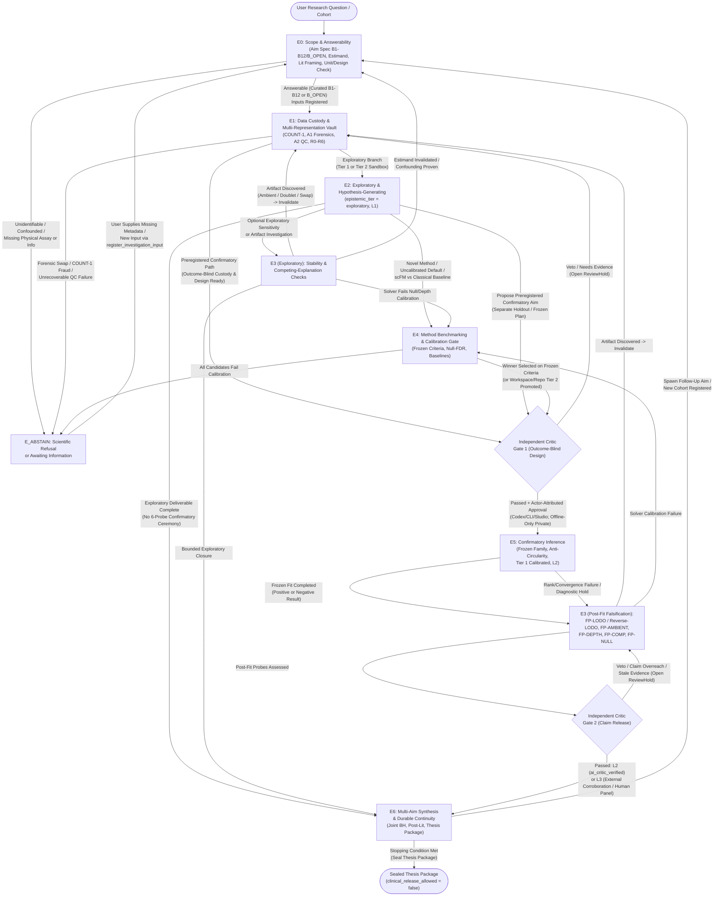

# Adaptive Research Design: Epistemic Investigation Graph, Durable Custody, and Thesis Synthesis

- **Document ID**: `03-adaptive-research-design.md`
- **Status**: Draft Specification (Phase 2A)
- **Audited Baseline**: HEAD `18161fdabd162084732a4dd3c74e1ea42254a81b` (delta from 2026-11-23 audit `ad1d74724e1e4d12a3c0fe6840e6521bd34a445b`)
- **Priority Scope**: Single-Cell / Single-Nucleus RNA-seq (`P1`) -> Bulk RNA-seq Hardening (`P2`) -> General RNA-seq Extensibility (`P3`); `clinical_release_allowed = false` permanently
- **Related Specifications**:
  - [README.md](README.md) (Executive Index & Cross-Document Map)
  - [01-baseline-audit-and-gaps.md](01-baseline-audit-and-gaps.md) (Audited Codebase Baseline, Post-PR-#13 Delta & Gaps)
  - [02-problem-space-and-methods.md](02-problem-space-and-methods.md) (Orthogonal 3-Axis Capability Model `A0`–`A3`, `B1`–`B12` + Open Lane, `C1`–`C2` & Method Matrix)
  - [04-system-architecture-and-governance.md](04-system-architecture-and-governance.md) (Local Research Engine Daemon, Dual-Lane Tier 1/Tier 2 Execution, Storage & Governance)
  - [05-codex-and-mcp-integration.md](05-codex-and-mcp-integration.md) (13-Tool MCP Control Plane, Modular Skills & Codex Client Mechanics)
  - [06-milestones-and-evaluation.md](06-milestones-and-evaluation.md) (Milestones `M0`–`M5` & 6-Scorecard Scientific Evaluation Framework)

---

## Executive Positioning

Real computational transcriptomics research does not proceed down a single waterfall from question to final figure. In sustained, thesis-grade single-cell (`scRNA-seq`), single-nucleus (`snRNA-seq`), spatial, and bulk RNA-seq investigations, artifacts are discovered *during* downstream modeling, different research aims require incompatible numerical representations of the same biological cohort, exploratory discovery must remain mathematically separated from confirmatory testing, and new external datasets or negative findings reshape subsequent aims.

At HEAD `18161fd`, the repository already possesses strong, production-live durability primitives in [`AdaptiveWorkflow`](../../../src/devbench/platform/adaptive_workflow.py), [`ThesisAimLifecycle`](../../../src/devbench/platform/thesis_aims.py), [`ThesisWorkflow`](../../../src/devbench/platform/thesis_workflow.py), [`ScientificAuthority`](../../../src/devbench/engine/scientific_authority.py), [`ReviewHoldLifecycle`](../../../src/devbench/analysis/scientific_review_holds.py), [`ThesisJointBHRegistry`](../../../src/devbench/platform/thesis_joint_bh.py), [`thesis_synthesis.py`](../../../src/devbench/analysis/thesis_synthesis.py), and [`thesis_replay.py`](../../../src/devbench/analysis/thesis_replay.py). However, those capabilities are fragmented across internal Python APIs and disconnected from the 7-tool Codex MCP surface ([`plugin_mcp.py`](../../../src/devbench/platform/plugin_mcp.py)), throttled by rigid caps (`_MAX_REVISIONS = 3`, `_MAX_AIMS = 32`, `session_input_scope_mismatch`, 16 MB partition vaults, single-job locks), and only loosely coupled to [`plugin_graph.py`](../../../src/devbench/platform/plugin_graph.py) dependency checks. Meanwhile, the earlier prototype package under [`src/devbench/adaptive/`](../../../src/devbench/adaptive/) is largely quarantined (`exploration.py:309` raises `ImportError`, `policy.py:97,114-131` raises `RuntimeError`; only `models.py`, `admission.py`, and `GROUPED_EVALUATOR_SOURCE` are live).

This specification defines the **Epistemic Investigation Graph** — a non-linear research lifecycle built directly atop the live SQLite WAL ledger (`ScientificAuthority` + `AdaptiveWorkflow` + `ThesisAimLifecycle`) and wired cleanly to the 13-tool MCP Control Plane ([05-codex-and-mcp-integration.md](05-codex-and-mcp-integration.md)) and Dual-Lane Execution Runtime ([04-system-architecture-and-governance.md](04-system-architecture-and-governance.md)). Its central architectural invariant is the strict separation between:
1. **Immutable Artifact & Provenance Custody** (a content-addressed, append-only execution DAG), and
2. **Non-Linear Epistemic Progression** (a guarded state machine over aims, parallel branches, falsification probes, calibration gates, Independent Critic reviews, and the four-level claim hierarchy `L1`–`L4`).

---

## 1. Critical Reassessment of Provisional Stages A–L & Bidirectional Traceability

### 1.1 Why a Linear `A -> L` Waterfall Fails Real Transcriptomics Research

The provisional v1.0 lifecycle (`A` Question/Aims/Literature -> `B` Inspection -> `C` Design -> `D` Plan -> `E` Upstream Prep -> `F` QC -> `G` Representation -> `H` Question-Specific Analyses -> `I` Competing Explanations -> `J` Validation -> `K` Method Benchmarking -> `L` Multi-Aim Synthesis) correctly enumerates the *obligations* of rigorous RNA-seq research, but fails whenever implemented as a linear progression:

1. **Downstream Discovery of Upstream Artifacts (Backtracking `H -> E/F/G`)**:
   - In frozen-tissue `snRNA-seq`, ambient neuronal RNA spillover frequently manifests only during differential expression (`B1`) or cluster annotation (`B2`), mimicking cell-type activation or phantom states (Caglayan et al., *Neuron* 2022; Muskovic & Powell, *Genome Biol.* 2021).
   - Doublet subclusters, donor swaps, or spatial capture-depth gradients (Bhuva et al., *Genome Biol.* 2024) routinely emerge during Stage `H` and force revision of QC masks, donor/unit mappings, or ambient-RNA dispositions. A linear pipeline either forces manual session restart or silently mixes stale and fresh artifacts.
2. **Question-Specific Multi-Representation Divergence (No Single Global Stage `G`)**:
   - One cohort simultaneously requires immutable `COUNT-1` raw counts for negative-binomial (`NB`) pseudobulk DE (`B1`) and DTU (`B4`), `scran` shifted-log expression for PCA/clustering (`B2`), Harmony/`scVI` latent embeddings for cross-batch integration (`B7`), ambient-corrected counts (`CellBender`/`SoupX`) for sensitivity probes, and depth-conditioned residuals for spatial SVG validation (`B8`). Freezing one global representation at Stage `G` breaks downstream aims.
3. **Exploratory Discovery vs. Confirmatory Inference Entanglement**:
   - In real thesis work, researchers explore clustering, QC thresholds, pathway patterns, and candidate hypotheses *before* formulating a preregistered confirmatory contrast. Running both in one linear pass either induces post-clustering double-dipping (as demonstrated in the 2026-11-23 audit's NB count-splitting dispersion-sensitivity probe) or forces premature formalization of ill-posed aims.
4. **Mid-Investigation Admission of External Evidence**:
   - Sustained investigations routinely introduce external reference atlases (`popV`/`CellTypist`/`scArches`), curated ligand-receptor or gene-set resources, genotype panels for donor forensics (`souporcell`/`Vireo`), or independent replication cohorts *after* initial exploratory results appear. At HEAD `18161fd`, [`plugin_mcp.py:2609-2612`](../../../src/devbench/platform/plugin_mcp.py#L2609-L2612) blocks this with `session_input_scope_mismatch`.
5. **Method Benchmarking as an Interruptible Gate, Not a Terminal Stage**:
   - Stage `K` (method selection/benchmarking) cannot sit after Stage `J`. It must trigger dynamically whenever an existing solver fails null calibration (e.g., `edgeR` QL violating the 7.5% null-FDR ceiling in 3/5 synthetic regimes at `B-I 9.0%`, `S-I 10.5%`, `S-P 8.0%`, or multi-isoform DTU stress regimes), when an unfamiliar platform appears (`scBench` documented >40 percentage-point accuracy drops outside memorized 10x/Scanpy pipelines), or when a foundation model (`scGPT`/`Geneformer`) is proposed against classical linear baselines.
6. **Asynchronous Multi-Aim Progression**:
   - Within one investigation, Aim 1 can complete `L3` confirmatory synthesis (`supported`), Aim 2 can confirm a `negative_finding` (`no_significant_finding`), Aim 3 can hit `E_ABSTAIN` due to complete batch-condition confounding, and Aim 4 can branch exploratorily from Aim 1's residuals. A single investigation-wide stage pointer cannot represent this state cleanly.

### 1.2 The Epistemic Investigation Graph (`E0`–`E6` + `E_ABSTAIN`)

Instead of a single global linear cursor, **each Research Aim** (and its child analysis branches) traverses an explicit **Epistemic Investigation Graph** backed by the immutable workspace DAG:

| State | Name | Scientific Purpose | Permitted Execution Lanes | Max Claim Tier |
|---|---|---|---|---|
| **`E0`** | **Scope & Answerability** | Translate open-ended question (curated `B1`–`B12` or `B_OPEN`) into target estimand, biological unit, falsification plan, confirmatory vs. exploratory role, initial literature framing, and measurement/identifiability check. | Control plane (`inspect_inputs`, `check_answerability`, `manage_research_aim`) + host-side Literature Broker | `none` (planning / scoping) |
| **`E1`** | **Data Custody & Multi-Representation Vault** | Register/hash immutable raw inputs (`COUNT-1`, reads, metadata, spatial/multimodal), run donor/sample forensics (`A1`), modality-aware QC/ambient/doublet/nuclear checks (`A2`), and materialize versioned representations (`R0`–`R6`) with lineage pointers. | Tier 1 curated intake/QC/upstream kernels + Tier 2 read-only exploratory inspection | `L1_execution_verified` (custody & QC verified) |
| **`E2`** | **Exploratory & Hypothesis-Generating** | Conduct open-ended visualization, unsupervised clustering, unsplit marker ranking, QC threshold sensitivity, novel assay exploration, and prototype scripting via governed code execution. | Tier 1 descriptive kernels + Tier 2 Governed Exploratory Code Sandbox | `L1_execution_verified` (`epistemic_tier="exploratory"`; confirmatory p/q blocked) |
| **`E3`** | **Competing Explanations & Falsification** | Execute discriminating sensitivity and falsification probes. Operates in **two distinct roles**: (a) optional exploratory sensitivity (`E2 -> E3`) for stability/artifact checks; and (b) **mandatory post-fit confirmatory falsification (`E5 -> E3 -> Gate 2`)** running `FP-LODO` (including reverse-LODO on negative findings), `FP-AMBIENT`, `FP-DEPTH`, `FP-COMP`, and `FP-NULL` on the frozen `E5` fit *without* leaking target discoveries prior to `E5` preregistration. Emits explicit back-edges to `E0` or `E1` if primary assumptions break. | Tier 1 sensitivity/diagnostic kernels + Tier 2 custom falsification probes | `L1_execution_verified`–`L2_statistically_calibrated` (diagnostic & robustness evidence) |
| **`E4`** | **Method Benchmarking & Calibration Gate** | Compare candidate methods (including mandatory simple/classical baselines) against pre-frozen null-FDR, power, leverage, and transferability criteria on null/training partitions *before* inspecting target test discoveries. Required when challenging defaults, evaluating scFMs, or promoting Tier 2 prototypes (workspace-scoped or repo-wide). | Tier 1 benchmark harness + Tier 2 sandboxed candidates on training/synthetic/null partitions (`PartitionVault`) | `L2_statistically_calibrated` (statistical calibration evidence) |
| **`E5`** | **Confirmatory Inference** | Execute preregistered, design-verified, anti-circular inference on frozen hypothesis families with verified biological units, tested-universe pinning, cross-aim Joint BH when applicable, explicit actor-attributed operator approval, and Independent Critic Gate 1 (outcome-blind design) + post-fit `E3` + Critic Gate 2 (claim release). | Tier 1 Curated/Calibrated Kernels ONLY (or Tier 2 code formally promoted through `E4` + Promotion Gate in [04](04-system-architecture-and-governance.md)) | `L2_statistically_calibrated` (`ai_critic_verified: true` after automated Gate 2; `L3_scientifically_supported` ONLY upon external replication / orthogonal validation or `human_expert_panel` sign-off; `L4` permanently held) |
| **`E6`** | **Multi-Aim Synthesis & Continuity** | Integrate completed, negative, exploratory, failed, and refused aims; compute cross-aim Joint BH releases; run post-evidence literature synthesis; seal the reproducible Thesis Research Package; and spawn follow-up aims back to `E0`. | Control plane synthesis & verification (`manage_research_aim`, `thesis_synthesis.py`, `thesis_replay.py`) | `L2_statistically_calibrated` (`ai_critic_verified: true`) or `L3_scientifically_supported` (when externally corroborated or `human_expert_panel` adjudicated; `clinical_release_allowed=false`) |
| **`E_ABSTAIN`** | **Scientific Refusal / Awaiting Information** | Structured, calibrated hold or refusal distinguishing recoverable `awaiting_information` (missing metadata/mapping/reference) from non-recoverable `scientific_refusal` (rank-deficient confounding, `n=1` unit, missing physical assay). | None for refused inferential aim; optional low-consequence `retain`/`diagnostic_flagging` or `E2` exploratory deliverables when valid | `L1_execution_verified` (receipt-backed refusal / RFI proof) |

### 1.3 Bidirectional 1-to-1 Traceability Matrix (`A`–`L` <-> `E0`–`E6` + `E_ABSTAIN`)

#### Table 1A: Provisional Stages `A`–`L` -> Epistemic Investigation Graph

| Provisional Stage | Provisional Description | Target Epistemic State(s) | Live Codebase Anchors (HEAD `18161fd`) | Key Structural Upgrade in This Spec |
|---|---|---|---|---|
| **Stage A** | Question, aims & literature framing | **`E0`** (+ post-evidence synthesis in **`E6`**) | [`thesis_aims.py`](../../../src/devbench/platform/thesis_aims.py), [`thesis_literature.py`](../../../src/devbench/analysis/thesis_literature.py), [`workbench_investigations.py:107-292`](../../../src/devbench/platform/workbench_investigations.py#L107-L292) | Replace regex `classify_question` with structured Aim + Open-Lane contract; support both pre-study (`E0`) and post-evidence (`E6`) receipt-backed literature custody. |
| **Stage B** | Evidence inspection & answerability | **`E0`** & **`E1`** (or **`E_ABSTAIN`**) | [`rna_answerability.py`](../../../src/devbench/core/rna_answerability.py), [`workbench_inputs.py`](../../../src/devbench/analysis/workbench_inputs.py), [`plugin_mcp.py:619,1563`](../../../src/devbench/platform/plugin_mcp.py#L619) | Out-of-core H5AD/Zarr inspection for *all* privacy tiers (fixing private-only streaming asymmetry); harden `COUNT-1` against integer-`log2(1+k)`. |
| **Stage C** | Study design & unit/identifiability | **`E0`** (design gate) & **`E1`** (donor forensics `A1`) | [`contrast_design.py`](../../../src/devbench/core/contrast_design.py), [`tools_stat.py`](../../../src/devharness_server/tools_stat.py) (`validate_design_matrix`) | Add Axis `A1` donor/sample forensic verification (`souporcell`/`Vireo`/sex-chr/swap checks) before confirmatory admission; expose standalone design audit on MCP. |
| **Stage D** | Adaptive analysis plan | **`E0`** (aim intent), **`E2`** (adaptive branching), **`E5`** (frozen plan) | [`adaptive_workflow.py`](../../../src/devbench/platform/adaptive_workflow.py), [`plugin_graph.py`](../../../src/devbench/platform/plugin_graph.py), [`method_planner.py`](../../../src/devbench/platform/method_planner.py) | Split mutable exploratory plans (`E2`) from immutable preregistered confirmatory plans (`E5`); replace 15-op `Plan` enum with general `freeze_analysis_plan`. |
| **Stage E** | Upstream data prep (FASTQ, quant, droplets) | **`E1`** | [`fastq_cli.py`](../../../src/devbench/analysis/fastq_cli.py), [`community_workflow.py`](../../../src/devbench/analysis/community_workflow.py), [`mounted_scrna.py`](../../../src/rna_kernels/mounted_scrna.py) | Unify upstream pipelines (`nf-core/rnaseq`, `nf-core/scrnaseq`, `Bambu`/`IsoQuant`, raw droplets) into `R0 -> R1` vault provenance with long-running daemon jobs. |
| **Stage F** | QC & artifact investigation | **`E1`** (custody/masks) <-> **`E2`/`E3`** (artifact discovery back-edge) | [`mounted_scrna.py`](../../../src/rna_kernels/mounted_scrna.py), [`singlecell.py`](../../../src/devbench/analysis/singlecell.py) | Add `scDblFinder`, `DropletQC` nuclear/intronic snRNA QC, `CellBender >=0.3.2`/`SoupX`/`DecontX`; emit transitive DAG invalidations when QC masks change. |
| **Stage G** | Representation selection (`COUNT-1` vs derived) | **`E1`** (multi-representation vault) enforced at **`E2`/`E5`** | [`adaptive_workflow.py:1104-1166`](../../../src/devbench/platform/adaptive_workflow.py#L1104-L1166), [`expression_io.py`](../../../src/devbench/core/expression_io.py) | Replace single-representation stage with concurrent `R0`–`R6` Representation Vault + hard Admission Matrix enforced at step dispatch. |
| **Stage H** | Question-specific analyses | **`E2`** (exploratory) vs. **`E5`** (confirmatory) | [`src/devbench/core/*.py`](../../../src/devbench/core/), [`src/rna_kernels/*.py`](../../../src/rna_kernels/), [`plugin_rna_solvers.py`](../../../src/devbench/platform/plugin_rna_solvers.py) | Explicitly partition Stage `H` by epistemic tier (`E2` exploratory sandbox vs. `E5` calibrated Tier 1 kernels); wire unwired solvers and open-lane Tier 2 execution. |
| **Stage I** | Competing explanations | **`E3`** | [`thesis_aims.py:81-85,1070-1114`](../../../src/devbench/platform/thesis_aims.py#L81-L85), [`scientific_review.py`](../../../src/devbench/analysis/scientific_review.py) | Upgrade from manual text logging to executable falsification probes (LODO, ambient/doublet, depth, composition, reference stability, null permutations) with receipt proofs. |
| **Stage J** | Validation & anti-circularity | **`E3`** (sensitivity), **`E5`** (anti-circularity & Critic), **`E6`** (Joint BH) | [`protected_partitions.py`](../../../src/devbench/core/protected_partitions.py), [`scrna_marker_inference.py`](../../../src/devbench/core/scrna_marker_inference.py), [`joint_bh.py`](../../../src/devbench/core/joint_bh.py), [`thesis_blinded_review.py`](../../../src/devbench/core/thesis_blinded_review.py) | Wire `ClusterDE`/NB-split, tested-universe ORA, out-of-core `PartitionVault`, cross-aim Joint BH, and Independent Critic directly into the MCP lifecycle. |
| **Stage K** | Method development & benchmarking | **`E4`** | [`method_planner.py`](../../../src/devbench/platform/method_planner.py), [`exploratory_oci.py`](../../../src/devbench/engine/exploratory_oci.py), [`exploratory_benchmark.py`](../../../src/devbench/engine/exploratory_benchmark.py) | Generalize `exploratory_benchmark.py` beyond 512 MB binary JSON classifiers; expose frozen-criteria multi-method comparison & classical-baseline gates via MCP. |
| **Stage L** | Multi-aim iteration & durable continuity | **`E6`** (looping back to **`E0`**) | [`scientific_authority.py`](../../../src/devbench/engine/scientific_authority.py), [`thesis_synthesis.py`](../../../src/devbench/analysis/thesis_synthesis.py), [`thesis_replay.py`](../../../src/devbench/analysis/thesis_replay.py) | Remove `_MAX_REVISIONS=3`, `_MAX_AIMS=32`, and `session_input_scope_mismatch`; bridge `plugin_graph.py` to `ThesisAimLifecycle` basis invalidation; seal 7-deliverable Thesis Package. |

#### Table 1B: Epistemic States -> Provisional Stages, Claim Tiers & 13-Tool MCP Mapping

| Epistemic State | Maps Back to Stages | Claim Ceiling | Primary MCP Control-Plane Tools ([05](05-codex-and-mcp-integration.md)) |
|---|---|---|---|
| **`E0`** | A, B, C, D (framing) | `none` | `inspect_runtime_capabilities`, `inspect_inputs`, `register_investigation_input`, `check_answerability`, `manage_research_aim` (`propose_aim`, `query_literature(phase="pre_study")`) |
| **`E1`** | B, C (forensics), E, F, G | `L1_execution_verified` | `register_investigation_input`, `list_kernels_and_methods`, `freeze_analysis_plan` (`epistemic_purpose="qc_diagnostic"`), `submit_reviewed_run`, `get_run_status`, `get_run_receipt` |
| **`E2`** | D (adaptive), F (re-QC trigger), H (exploratory) | `L1_execution_verified` (`exploratory`) | `freeze_analysis_plan` (`plan_kind="tier2_exploratory_code"` or `"tier1_kernel"`, `epistemic_purpose="exploratory"`), `submit_reviewed_run`, `query_artifact_table`, `list_investigation_state`, `cancel_run` |
| **`E3`** | I, J (sensitivity) | `L1_execution_verified`–`L2_statistically_calibrated` | `freeze_analysis_plan` (`epistemic_purpose="sensitivity_probe"`, `branch_kind="sensitivity"`), `submit_reviewed_run`, `manage_research_aim` (`assess_explanation`) |
| **`E4`** | K | `L2_statistically_calibrated` | `list_kernels_and_methods`, `freeze_analysis_plan` (`epistemic_purpose="method_benchmark"`, `branch_kind="method_benchmark"`), `submit_reviewed_run`, `get_run_receipt` |
| **`E5`** | D (frozen), H (confirmatory), J (anti-circularity & Critic) | `L2_statistically_calibrated` (`ai_critic_verified: true`) -> `L3_scientifically_supported` (with external corroboration or `human_expert_panel`) | `manage_research_aim` (`approve_aim`, `freeze_joint_bh`, `request_critic_review`), `freeze_analysis_plan` (`plan_kind="tier1_kernel"`, `epistemic_purpose="confirmatory"`), `submit_reviewed_run`, `get_run_receipt` |
| **`E6`** | A (post-evidence lit), J (Joint BH), L | `L2_statistically_calibrated` / `L3_scientifically_supported` (`L4` held) | `manage_research_aim` (`record_outcome`, `release_joint_bh`, `query_literature(phase="post_evidence")`, `build_research_package`), `list_investigation_state` |
| **`E_ABSTAIN`** | B, C, D (refusal / RFI) | `L1_execution_verified` (refusal proof) | `check_answerability`, `manage_research_aim` (`record_outcome` with `refused` / `awaiting_information`) |

---

## 2. End-to-End Adaptive Research Mechanics

### 2.1 Open-Ended Question Translation, Novel Questions & Grounded Literature Custody

#### 2.1.1 Structured Aim Translation (Replacing Regex Classification)
At HEAD `18161fd`, [`workbench_investigations.py:107-292`](../../../src/devbench/platform/workbench_investigations.py#L107-L292) classifies research questions via brittle regular expressions (`classify_question`) and hard-coded string tables (`question_requirements`), while [`rna_answerability.py`](../../../src/devbench/core/rna_answerability.py) gates execution on 39 pre-enumerated question strings. For general automated research, the agent translates any free-form user inquiry into one or more structured `ResearchAimSpec` records persisted via `manage_research_aim`:

- **Curated Capability Routing (`B1`–`B12`)**: Maps to the 12 core biological inference classes in [02-problem-space-and-methods.md](02-problem-space-and-methods.md) with their associated Assay/Custody preconditions (`A0`–`A3`) and mandatory falsification templates.
- **Explicit Open / Unclassified Inference Lane (`B_OPEN`)**: When a user asks a novel or cross-cutting question that does *not* fit `B1`–`B12` (e.g., an unusual non-model organism stress-response metric, custom isoform-to-protein-domain coupling, or bespoke multi-assay signature), the controller MUST NOT reject it simply for lacking a canned label. Instead, it registers the aim under `inference_class: "B_OPEN"` with mandatory structured fields:
  1. `target_estimand`: Plain-language and mathematical statement of the quantity being estimated or tested.
  2. `biological_unit` and `unit_independence_status`: Observed vs. declared vs. unknown independence of donors, animals, litters, tissue sections, or cell lines.
  3. `required_measurements`: Explicit list of measurement primitives (e.g., `gene_counts`, `spatial_coordinates`, `genotypes`) checked against registered vault artifacts.
  4. `epistemic_designation`: `exploratory` (default for `B_OPEN` until a calibrated Tier 1 or workspace-promoted Tier 2 procedure exists) or `confirmatory` (requires frozen hypothesis family, `E4` calibration or verified external proof, and anti-circularity proof).
  5. `falsification_criteria`: At least two concrete competing explanations or null checks whose failure would weaken or refute the proposed conclusion.
  6. `requirement_sources`: Parameter and constraint provenance table (`parameter_origins`).

**Concrete `B_OPEN` End-to-End Execution Call Flow (MCP -> Daemon -> Promotion Path):**
1. `inspect_inputs` (`file_kind="expression"|"metadata"|...`) + `register_investigation_input` (`file_kind`, `investigation_role="primary_cohort"`) register immutable source digests (`session_id`, mapped 1-to-1 to `lineage_id` in `ScientificAuthority`).
2. `check_answerability(session_id, question_text, axis_b_class="B_OPEN", assay="open"|"<assay>", entry_point="open"|"<entry>", artifact_ids=[...], design=...)` verifies measurement presence, biological-unit hierarchy, and design estimability without requiring a canned `B1`–`B12` template, returning `status="tier2_exploratory_only"` (or `"awaiting_information"` / `"refused"` if measurements/design fail).
3. `manage_research_aim(action="propose_aim", session_id, inference_class="B_OPEN", kind="exploratory", ...)` persists the aim with `epistemic_state="E0"`.
4. `freeze_analysis_plan(session_id, branch_id, aim_id, plan_kind="tier2_exploratory_code", epistemic_purpose="exploratory", exploratory_code={base_image_id, language, source_code|script_path, expected_outputs}, input_bindings={...}, parameter_origins={...})` freezes an immutable Tier 2 plan (`claim_tier_ceiling="L1_execution_verified"`).
5. `submit_reviewed_run` executes the script in the `--network none` Tier 2 sandbox (`E2`); `get_run_receipt` + `query_artifact_table` return bounded receipts tagged `L1_execution_verified` (`epistemic_tier="exploratory"`, confirmatory p/q stripped).
6. *Optional confirmatory elevation*: If the researcher wants confirmatory `E5` claims for the novel `B_OPEN` estimator, the agent freezes an `E4` `BenchmarkProtocol` on synthetic null/training partitions (`epistemic_purpose="method_benchmark"`), passes the **workspace-scoped Tier 2 -> Tier 1 Promotion Gate** ([04-system-architecture-and-governance.md](04-system-architecture-and-governance.md) §4.4), passes Outcome-Blind Critic Gate 1 + operator approval, and executes the promoted kernel in `E5` (`plan_kind="tier1_kernel"`, `epistemic_purpose="confirmatory"`).

#### 2.1.2 Strict Attribution Discipline
Extending [`AimRequirement`](../../../src/devbench/platform/thesis_aims.py#L70-L78), [`RequirementSource`](../../../src/devbench/analysis/thesis_synthesis.py#L69-L78), and [`_required_source_records`](../../../src/devbench/analysis/thesis_synthesis.py#L154-L165), every modeling parameter, threshold, covariate list, gene-set choice, and method preference carries a cryptographically verifiable `origin`:

| `origin` Value | Meaning | Ledger Verification Rule |
|---|---|---|
| `user_prespecified` | Explicitly constrained by the user in a recorded input prompt or signed requirement record | **Hard-checked**: `source_sha256` MUST match an immutable `fact` record (`kind="fact"`) recorded from the verbatim user requirement before fitting. An assistant suggestion, prior conversation mention, fixture default, or benchmark template can NEVER carry `user_prespecified`. |
| `operator_approved` | Proposed by the agent or planner and explicitly approved by an attributed human actor | `source_sha256` MUST bind an attributed `approval` record (`actor`, `rationale`, `approved_at`). |
| `assistant_proposed` | Proposed by the Codex/research agent based on domain judgment or exploratory evidence | Retained with `evidence_sha256` or rationale; explicitly disclosed as selection-conditional when derived after inspecting data. |
| `fixture_default` | Kernel, library, or package default (e.g., `fdr=0.05`, `min_cells=20`, `leiden_res=0.8`) | Explicitly tagged so evaluation and Critic review distinguish algorithmic defaults from user requirements. |
| `derived` | Computed from an upstream verified artifact (e.g., adaptive radius `2 * q90(d1)` or tested gene universe) | `source_sha256` MUST point to the accepted upstream artifact digest. |

#### 2.1.3 Grounded Literature Comparison Custody & Host-Side Literature Broker
DevHarness already enforces cryptographic literature custody in [`thesis_literature.py`](../../../src/devbench/analysis/thesis_literature.py) (`LiteratureComparisonPlan`, `LiteratureQueryReceipt`, `_publication_view`, `_retrievals`), but currently only exposes `query_literature_post_evidence` on MCP and lacks a live retrieval adapter. Because Tier 1 and Tier 2 execution containers run strictly with `--network none`, **all literature retrieval runs exclusively inside a host-side, read-only Daemon Literature Broker** invoked via `manage_research_aim(action="query_literature", phase="pre_study" | "post_evidence", ...)`:

- **Broker Security, Allowlist & Offline Mechanics**:
  1. Restricted to an explicit, read-only HTTPS allowlist of public scientific metadata APIs (Europe PMC, Crossref + Retraction Watch notices, PubMed E-utilities, bioRxiv/medRxiv API). Arbitrary URLs, POST bodies, and execution-container network access remain strictly forbidden.
  2. **Pre-Egress Redaction & Privacy Hard-Stop**: Every outbound query string passes through `EvidenceBroker` redaction checks; whenever `privacy_floor in {"private", "clinical"}` or the daemon runs `--offline-only`, live network queries are **hard-disabled** and `query_literature` operates exclusively over pre-staged, caller-supplied local literature snapshot bundles (`offline_snapshot_path`, hashed & timestamp-checked identically).
  3. **Cryptographic Snapshot Receipt**: Every response body is stored read-only in the workspace vault with its SHA-256 (`content_sha256`), response byte count, and timezone-aware UTC `retrieved_at` timestamp (`_retrievals`, [`thesis_literature.py:182-192`](../../../src/devbench/analysis/thesis_literature.py#L182-L192)).
- **Two Distinct Literature Phases**:
  1. **Pre-Study Framing (`E0`, `phase="pre_study"`)**: Informs competing hypotheses, biological plausibility, marker panels, assay-specific artifacts (e.g., snRNA ambient neuronal spillover, cross-species paralogs), and baseline method choices. Recorded under `basis:literature_framing:<id>` (`kind="review_basis"`) and explicitly tagged so post-hoc discovery claims cannot masquerade as pre-study priors.
  2. **Post-Evidence Comparison (`E3`/`E6`, `phase="post_evidence"`)**: Freezes a `LiteratureComparisonPlan` (scope description, selection rule, comparison dimensions, deduplicated corpus receipts) before generating novelty/concordance narratives. Automatically audits retraction and correction notices (`_publication_view`: blocks sealing with `literature_corpus_source_retracted` or `literature_corpus_correction_requires_review` on retracted or unreviewed corrected sources), and stamps `scope: "retrieved_material_at_sealing_revision"` and `semantic_entailment_verified: false` unless independently audited.
  - **Holdout Isolation**: Literature queries MUST NEVER embed private/clinical metadata, raw expression matrices, or embargoed `PartitionVault` holdout feature lists.

---

### 2.2 Data Custody, Donor/Sample Forensics, Answerability & Design Identifiability

1. **Out-of-Core Input Inspection & Additive Custody (`inspect_inputs` + `register_investigation_input`)**:
   - Eliminate the asymmetric `100 MiB` cap (`_H5_FILE_BUDGET` at [`plugin_mcp.py:619,770,784`](../../../src/devbench/platform/plugin_mcp.py#L619)) so *both* public and private `H5AD`, `Zarr`, `SpatialData`, `MuData`, `TileDB-SOMA`, `10x MTX`, and `Parquet` inputs are inspected out-of-core via chunked metadata/header readers without loading matrices into memory.
   - Separate four epistemic fields in every intake receipt: `observed` (file bytes, dimensions, dtypes, sparsity, schema, missingness), `declared` (user/metadata-supplied assay, donor column, condition labels, count provenance), `inferred` (automated distribution forensics, sex-chromosome scores), and `unknowns` (each marked `blocking: true | false` relative to action scope).
2. **Hardened `COUNT-1` Intake Forensics (Closing the Integer-`log2` Blindspot)**:
   - As proven in [`reproduce_probes.py:95-119`](../../../docs/audits/2026-11-23-rna-capabilities/reproduce_probes.py), `log2(1 + [1, 3, 7, 15]) = [1, 2, 3, 4]` currently bypasses integer-only checks when misdeclared as `raw_counts`.
   - Upgraded `COUNT-1` intake combines exact checks with statistical distribution forensics on a deterministic bounded sample of nonzero entries (applied only when sample support meets a minimum floor of `>= 1,000` nonzero entries across `>= 50` profiles, avoiding false alarms on ultra-sparse single-nucleus subsets):
     - Hard fail on negative values, NaNs/Infs, or non-integer floats (unless explicitly declared `tximport_estimated_counts` with paired `effective_lengths` and verified provenance).
     - **Suspicious-Transform Warning / Hold (`count1_transform_suspect`)**: Triggered if (a) `max(X) <= 30` with compressed dynamic range despite high detected-gene counts (`> 2,000` genes/profile, separating normalized bulk/pseudo-counts from genuine low-UMI snRNA nuclei where median detected genes are lower and UMI `1`s dominate `> 50%` of nonzero entries) and low library-size coefficient of variation (`CV < 0.05` across profiles, indicating library-size normalization), OR (b) over-representation of low-integer values inconsistent with negative-binomial UMI/read tails (e.g., median nonzero `>= 3` with near-zero `1`s or uniform integer support `[0..k]`), OR (c) AnnData `uns`/layer provenance metadata (`log1p`, `scaled`, `pearson_residuals`) contradicts a `raw_counts` declaration. Triggering `count1_transform_suspect` places a recoverable `ReviewHold` on NB count models until the raw count layer (`raw/X` or `layers["counts"]`) is verified or an attributed operator audit (`manage_research_aim(action="record_waiver", waiver_kind="count1_override_verified")`) confirms genuine sparse raw UMI provenance.
3. **Donor / Sample Forensic Verification Gate (Axis `A1`)**:
   - Unique sample or cell barcodes NEVER establish independent biological units. Before any aim enters `E5` (Confirmatory Inference), the engine executes the `A1` Forensic Gate scaled to available measurements:
     - *Always executed (expression + metadata)*: Biological-unit hierarchy check (`donor -> specimen -> capture_lane -> library -> cell`, using [`prove_donor_aliases`](../../../src/devbench/core/contrast_design.py)), sex-chromosome marker concordance (`XIST` vs. `UTY`/`DDX3Y`/`RPS4Y1` against declared sex when present), pairwise pseudobulk/sample correlation scan flagging unexpected near-identical profiles (`r > 0.995` across distinct declared donors -> `suspected_duplicate_donor`), and condition-vs-capture-lane cross-tabulation.
     - *Executed when BAM/VCF/SNP data are registered*: Genotype-based genetic demultiplexing and swap/contamination verification via `souporcell` / `Vireo` (pooled scRNA/snRNA) or `VerifyBamID2` / `QTLtools MBV` (bulk/genotyped cohorts).
     - Any detected mismatch (sex discordance, suspected donor swap, cross-donor contamination) emits a `basis:donor_forensics:<id>` hold blocking `E5` promotion until resolved or corrected (which triggers transitive invalidation per Section 4.2).
4. **Measurement Answerability & Study-Design Identifiability (`check_answerability`)**:
   - Evaluates three distinct checks before execution:
     1. *Physical measurement sufficiency*: Required assay primitives exist in registered artifacts (e.g., splice junctions for `B4` PSI splicing, genotypes for `B11` eQTL, spatial coordinates for `B8`). Supports both curated `B1`–`B12` contracts and structured `B_OPEN` (`assay="open"|"<assay>"`, `entry_point="open"|"<entry>"`) specifications.
     2. *Biological-unit replication & nesting*: Counts true independent biological units per condition/stratum; refuses cell-level or technical-replicate pseudoreplication for donor-level population claims.
     3. *Design-matrix rank & confounding*: Compiles full linear/mixed contrast design ([`contrast_design.py`](../../../src/devbench/core/contrast_design.py) + `validate_design_matrix`); proves exact estimability (`rank(X)`, contrast in row space of `X`, collinearity/VIF diagnostics). Completely confounded `condition ~ batch` or `age ~ batch` designs NEVER silently drop covariates to manufacture a "batch-adjusted" effect; they route to `E_ABSTAIN` (`scientific_refusal`) for confounded confirmatory claims while optionally permitting labeled `E2` exploratory description.

---

### 2.3 Method Selection & Fair Benchmarking Policy (`E4`)

At HEAD `18161fd`, [`ScientificMethodPlanner`](../../../src/devbench/platform/method_planner.py) implements open-world candidate eligibility (`_applicability`, lines 82–141) and `ACTION_PREREQUISITE_POLICIES` (`retain`, `diagnostic_flagging`, `exclude`, `infer`, lines 40–54), but is completely unwired from MCP. Under this design, its core policies power the **`E4` Method Benchmarking & Calibration Gate**:

1. **Pre-Result Criteria Freeze (`BenchmarkProtocol`)**:
   - Before executing competing solvers on target or calibration data, the agent commits an immutable `BenchmarkProtocol` record (`basis:benchmark_protocol:<id>`, `kind="review_basis"`) declaring:
     - `aim_id` and `evaluation_purpose` (`method_selection` vs. `sensitivity_check` vs. `tier2_promotion`),
     - `candidates`: Complete roster of methods + exact parameter origins (`user_prespecified` vs. `assistant_proposed` vs. `fixture_default`),
     - `mandatory_baselines`: At least one simple, calibrated classical baseline whenever evaluating complex, deep-learning, or foundation-model methods (e.g., shifted-log PCA / `Harmony` / `scVI` against `scGPT`/`Geneformer`; label-blind regime-routed `B1` primaries and comparators per [README.md](README.md) `ADR-15` — `edgeR v4` [`legacy=FALSE`, `TMM`, `abundance.trend=FALSE` for `<500` eligible genes] / `limma-voom` [`voomWithQualityWeights` + `eBayes(robust=TRUE)`] / `dreamlet` / `DESeq2` for bulk/pseudobulk; linear/ridge baselines for perturbation or phenotype prediction — directly enforcing the lessons of Kedzierska et al. 2025 and Ahlmann-Eltze et al. 2025),
     - `criteria`: Frozen primary and secondary metrics (e.g., empirical null-FDR <= 0.05–0.075 on matched null simulations/permutations, type-I error uniformity, power/recall on planted effects, LODO rank stability, `scib-metrics` bio-conservation vs. batch-correction tradeoff, donor-grouped CV calibration/AUROC, and resource envelope),
     - `selection_rule`: Explicit deterministic rule (or lexicographic threshold + tie-breaker) evaluated *before* inspecting target-cohort discoveries.
2. **Zero Implementation Bias**:
   - The planner MUST assess theoretical and empirical suitability *before* inspecting local runtime availability (`list_kernels_and_methods`).
   - A method MUST NEVER be preferred merely because it is already wrapped as a Tier 1 kernel (e.g., refusing to silently prefer an uncalibrated grouped quasi-binomial DTU or single-chain `scCODA` over `satuRn`/`DRIMSeq`+`stageR` or multi-chain `scCODA`/`propeller`). If the scientifically preferred method is absent from Tier 1, the agent explicitly surfaces the gap and either (a) prototypes and benchmarks it in Tier 2 (`exploratory` until promoted via `E4`), or (b) discloses the methodological tradeoff and records the unmet runtime requirement.
3. **Action-Consequence Prerequisite Separation**:
   - Preserves `ACTION_PREREQUISITE_POLICIES` (`method_planner.py:40-47`): unknowns about donor independence or assay semantics block `infer` and `exclude`, but MUST NOT falsely block `retain` or `diagnostic_flagging` (such as computing library-size histograms, sparsity summaries, or sex-marker checks needed to *resolve* those very unknowns).
4. **Selection-Conditional Inference Disclosure**:
   - Whenever model degrees of freedom, covariate adjustments, integration methods, or solvers are selected using data from the study cohort (AIC/BIC/GCV, `scib-metrics`, or `E4` training-partition comparisons), the ledger records `selection_conditional: true` and binds the exact selection receipt. If selection used target outcomes on the same samples, the resulting run is locked to `E2`/`E3` (`exploratory`) unless validated on a disjoint `PartitionVault` holdout or independent cohort.

---

### 2.4 Multi-Representation Custody & Admission Matrix (`E1`)

Every dataset registered in `E1` can own multiple immutable, lineage-linked representations inside the **Multi-Representation Vault**. Each representation is an `ArtifactVersion` carrying `representation_class`, `parent_version_ids`, `measurement_history`, `biological_unit`, `unit_membership_sha256`, `label_origin`, `selection_status`, `learned_scope`, and `permitted_uses` (extending [`ArtifactVersion`](../../../src/devbench/platform/adaptive_workflow_state.py#L38-L57)).

#### Canonical Representation Classes (Harmonized Wire Enum Across `03`, `04`, `05`)

Every vault artifact and MCP `ArtifactRef` carries the canonical snake_case `representation_class` wire enum below (`R0`–`R6` serve as shorthand doc codes; non-matrix vault artifacts additionally use `derived_summary`, `metadata_only`, and `reference_only`):

| Doc Code | Canonical Wire `representation_class` | Provenance & Custody Contract |
|---|---|---|
| **`R0`** | `raw_reads_or_droplets` | Immutable FASTQ, BAM/CRAM, or unfiltered raw droplet barcode matrices (pre-EmptyDrops / pre-CellBender). Read-only source custody. |
| **`R1`** | `count_1_raw_counts` | Immutable raw integer/UMI counts (`h5ad`, `zarr`, `h5`, `TileDB-SOMA`) OR `tximport_estimated_counts` with paired `effective_lengths`. Passes hardened `COUNT-1` check (Section 2.2). |
| **`R2`** | `ambient_adjusted_counts` | Denoised count matrix (`CellBender >=0.3.2`, `SoupX`, `DecontX`) with explicit `parent_version_ids -> [R1]` and `basis:ambient_disposition`. Must preserve integer/rounded-count metadata and never silently overwrite `R1`. |
| **`R3`** | `size_factor_normalized` | Size-factor normalized / variance-stabilized expression (`scran` shifted-log `log1p(y/s)`, `logCPM`, `TPM`/`FPKM`, analytic Pearson residuals, `vst`). Explicitly marked `count1_admissible = false`. |
| **`R4`** | `integrated_latent_or_graph` | Low-dimensional embeddings, batch-corrected coordinates, and kNN/neighborhood graphs (PCA, Harmony, `scVI`/`scANVI`, `scPoli`, `SysVI`, `SATURN`, `MuData` WNN/MultiVI, UMAP/ForceAtlas2). |
| **`R5`** | `spatial_geometry_and_residuals` | `SpatialData` coordinate transformations, tissue-mask polygons, radius/Delaunay graphs, and capture-depth-conditioned NB/Pearson residuals. |
| **`R6`** | `aggregated_unit_counts` | Donor/specimen pseudobulk count sums (derived strictly from `R1` or audited `R2` + current QC/label mask), cell-type composition count tables, or sample-level count aggregations. *(Continuous/summary outputs use `derived_summary`.)* |

#### Representation-to-Analysis Admission Matrix (Enforced at Dispatch in `AdaptiveWorkflow._input`)

| Biological Analysis Class (Axis B) | `R0` Reads / Droplets | `R1` `COUNT-1` Raw | `R2` Ambient-Corrected | `R3` Size-Factor Norm | `R4` Integrated Latent / Graph | `R5` Spatial Geometry / Resid | `R6` Aggregated Unit / PB |
|---|---|---|---|---|---|---|---|
| **Upstream Quant / EmptyDrops / CellBender (`A0`/`A2`)** | **Primary** | Secondary (`SoupX`/`DecontX` if raw unavailable) | Reject | Reject | Reject | Reject | Reject |
| **NB Pseudobulk / Bulk DE (`B1`: `edgeR v4`, `DESeq2`, `dreamlet`, `NEBULA`)** | Reject | **Primary** (via `R6` PB or bulk `R1`) | **Sensitivity** (or Primary with explicit `E3` raw-vs-ambient parity check) | **HARD REJECT** (`adaptive_COUNT-1_measurement_history`) | **HARD REJECT** | **HARD REJECT** | **Primary** (when lineage-verified from `R1`/`R2`) |
| **Continuous / Gaussian Spline or `limma-trend` (`B1`/`B6`)** | Reject | Via `R3` | Via `R3` | **Primary** (explicit continuous model, no count conversion) | Exploratory only | Sensitivity | Primary (sample-level continuous) |
| **Clustering, UMAP, Rare-Pop Discovery (`B2` exploratory)** | Reject | Via `R3`/`R4` | Sensitivity | **Primary** (PCA/HVG) | **Primary** (graph/Leiden/UMAP) | Spatial domains (`BANKSY`) | Reject |
| **Post-Clustering Markers (`B2` confirmatory: `ClusterDE` / NB Countsplit / `CADET`)** | Reject | **Primary** (required for NB split / `ClusterDE` null) | Sensitivity | Exploratory ranking ONLY (`p=None, q=None`) | **HARD REJECT** for confirmatory DE | Reject | Reject |
| **Composition & Neighborhood DA (`B3`: `scCODA`, `propeller`, `miloR`/`pertpy`)** | Reject | Via `R4` (Milo graph) + `R6` (counts) | Sensitivity | Via `R4` | **Primary** (neighborhood graph ONLY, not counts) | Spatial neighborhood DA | **Primary** (donor × cell-type / nhood integer counts) |
| **DTU, Isoform & Splicing (`B4`: `satuRn`, `DRIMSeq`, `edgeR diffSplice`, `LeafCutter`, `Bambu`)** | **Primary** (junctions / long-read) | **Primary** (transcript/exon/junction counts) | Sensitivity | **HARD REJECT** | **HARD REJECT** | Reject | Donor-level isoform counts |
| **Pathways, ORA, GSEA, Regulons (`B5`: `fgsea`, `CAMERA`, `decoupleR`, `SCENIC+`)** | Reject | Via verified DE receipt (`B1`) | Sensitivity | Exploratory TF activity / `CAMERA` (continuous) | Exploratory module scoring | Reject | **Primary** (verified DE stats + exact `filtered_tested_background`) |
| **Trajectories & Fate (`B6`: `Lamian`, `condiments`, `CellRank 2`, `tradeSeq`)** | Spliced/unspliced for exploratory velocity only | **Primary** (`tradeSeq` NB GAM) | Sensitivity | **Primary** (donor Gaussian spline / `Lamian`) | **Primary** (diffusion/pseudotime/CellRank kernels) | Reject | Donor-level trajectory curves |
| **Integration & Reference Mapping (`B7`: `Harmony`, `scVI`/`scANVI`, `popV`, `scArches`, `SATURN`)** | Reject | **Primary** (`scVI`/`scANVI` NB likelihood) | Sensitivity | **Primary** (`Harmony`, `SingleR`, `CellTypist`) | Output target (`scib-metrics` evaluated) | Reject | Reject |
| **Spatial SVGs, Domains & Deconvolution (`B8`: `SPARK-X`, `BANKSY`, `RCTD`, `Cell2location`)** | Reject | **Primary** (`RCTD`/`Cell2location`/`SPARK-X` counts) + `R5` | Sensitivity | `BANKSY` / exploratory + `R5` | Latent domains | **Primary** (coords, masks, depth-conditioned sensitivity) | Multi-section donor summary |
| **Cell-Cell Communication (`B9`: `LIANA+`, `MultiNicheNet`)** | Reject | **Primary** (donor pseudobulk differential `MultiNicheNet`) | Sensitivity | **Primary** (`LIANA+` scoring + donor aggregation) | Exploratory | Spatial proximity filter | **Primary** (donor-replicated LR contrasts) |
| **Perturbation Screens (`B10`: `SCEPTRE`, `pertpy`, `Mixscape`, `CINEMA-OT`)** | Reject | **Primary** (`SCEPTRE` conditional NB) | Sensitivity | `Mixscape` / `CINEMA-OT` | Latent perturbation space | Reject | Guide/donor pseudobulk |
| **eQTL, ASE & Somatic Abnormalities (`B11`: `tensorQTL`, `WASP`, `Numbat`)** | **Primary** (BAM/allele pileup) | **Primary** (allele counts / donor PB) | Reject (distorts allelic ratios) | Normalized PB for `tensorQTL` (after `R1` aggregation) | Reject | Reject | **Primary** (donor-level eQTL matrix) |
| **Predictive Modeling (`B12`: donor-grouped nested CV)** | Reject | Training fold only -> fit transform inside fold | Sensitivity | **Fit strictly inside training fold** (`learned_scope="partition_only"`) | **HARD REJECT** if `learned_scope="full_cohort"` (`adaptive_held_out_full_cohort_or_unknown_learned_state`) | Fold-local spatial features | Donor-level feature matrix |

---

### 2.5 Connected Multi-Step Analysis Graphs, Branching & Mid-Session Input Admission

#### 2.5.1 Unifying `plugin_graph.py` with `AdaptiveWorkflow`
At HEAD `18161fd`, [`plugin_graph.py:271-299`](../../../src/devbench/platform/plugin_graph.py#L271-L299) sets `branch_id = step_id`, pins `biological_unit = "not_declared"`, binds only two generic basis records (`workbench-intake`, `workbench-exposure`), and its dependency check (`require_plugin_dependencies`, lines 184–219) verifies only that predecessor `plugin_runs` rows completed — bypassing `AdaptiveWorkflow` basis invalidation and `ThesisAimLifecycle` aim-revision cascades unless the operation is specifically `pseudobulk` or `build_research_package`.

Under this specification, **every** Tier 1 kernel run and Tier 2 exploratory code run frozen via `freeze_analysis_plan` registers a full `AdaptiveStep` in the unified ledger with:
- Explicit `aim_id` (and `thesis-aim:<sha>` basis binding when attached to a registered aim),
- Explicit `branch_id` and `branch_kind` (`primary | sensitivity | competing_hypothesis | method_benchmark | exploratory_scratch`),
- Typed `InputLink`s binding exact `ArtifactVersion` IDs (either pinned vault representations or upstream step output ports) with edge use (`compute` vs. `claim`),
- Complete `BasisUse` list binding every governing upstream basis (`qc_mask`, `donor_forensics`, `ambient_disposition`, `reference_annotation`, `label_qualification`, `aim_approval`, `benchmark_protocol`).

#### 2.5.2 Parallel Branching & Sweep Completeness
Investigations routinely fork parallel branches from a shared upstream artifact (e.g., `branch:raw-edger-v4`, `branch:cellbender-edger-v4`, `branch:dreamlet-mixed`, or competing cell-annotation/clustering hypotheses):
- Parallel branches execute concurrently under the Daemon's resource pools (removing `plugin_jobs.py:349`'s single-job mutex; see [05-codex-and-mcp-integration.md](05-codex-and-mcp-integration.md)).
- Comparative sweeps (e.g., parameter grids, multi-solver benchmarks, LODO donor drops) are registered via `AdaptiveWorkflow.declare_sweep(sweep_id, members)` ([`adaptive_workflow.py:991-1015`](../../../src/devbench/platform/adaptive_workflow.py#L991-L1015)), which makes sweep membership **immutable** and requires an explicit omission reason for any unexecuted member — preventing cherry-picking of favorable branches.

#### 2.5.3 Mid-Session Input Admission (`register_investigation_input`)
To support real longitudinal research while preserving custody, `session_input_scope_mismatch` ([`plugin_mcp.py:2609-2612`](../../../src/devbench/platform/plugin_mcp.py#L2609-L2612)) is replaced by an explicit append-only MCP tool `register_investigation_input` taking both coarse `file_kind` (`expression | metadata | reference | manifest | spatial`, matching `inspect_inputs`) and granular `investigation_role`:
- **Admitted `investigation_role` Values**: `primary_cohort`, `reference_atlas`, `gene_set_collection`, `ligand_receptor_resource`, `external_replication_cohort`, `genotype_panel`, `prior_study_table`, `follow_up_experiment`.
- **Custody Invariants**:
  1. Registration is **strictly append-only**: previously registered input hashes are never deleted or mutated; existing steps stay bound to the exact input digests they consumed. Note that MCP `session_id` (32-hex handle) maps **1-to-1** to `lineage_id` in `ScientificAuthority`.
  2. **Monotonic Privacy Escalation**: Each investigation carries an effective `session_privacy_floor` (`synthetic < public < private < clinical`). Registering a `private`, `clinical`, or `unclassified` input mid-session monotonically escalates `session_privacy_floor`, immediately enforces offline-only Studio handoff (`EvidenceBroker` redacts `artifact` metadata/shape/preview on MCP and returns `category: "private_data_local_studio_only"` + `studio_url`), and disables the host-side Literature Broker. Downgrading a session's privacy floor is permanently forbidden.
  3. **Zero Unnecessary Invalidation**: Adding a new reference atlas or external replication cohort does **not** invalidate completed steps that did not depend on it; new branches simply pin the newly registered `ArtifactVersion` alongside prior artifacts.

---

### 2.6 Competing Explanations & Mandatory Falsification Probes (`E3`)

At HEAD `18161fd`, [`ThesisAimLifecycle.assess_explanation`](../../../src/devbench/platform/thesis_aims.py#L1070-L1114) enforces that every declared `CompetingExplanation` be assessed before an aim closes with `supported` or `no_significant_finding`, and requires a current accepted artifact (`artifact_sha256 != None`) for any non-`inconclusive` conclusion. However, no standardized automated probes exist to execute those checks.

**Critical Pre-Registration & Causality Separation (Preventing Pre-`E5` Outcome Leakage):**
Falsification probes that inspect primary contrast discoveries (`FP-LODO`, `FP-AMBIENT`, `FP-DEPTH`, `FP-COMP` expression adjustment, `FP-NULL`) MUST NOT run *before* `E5` preregistration, because inspecting target-contrast discoveries before freezing `E5` would induce p-hacking and circularity. Accordingly, falsification is strictly split into two phases:
1. **Outcome-Blind Pre-`E5` Checks (Gate 1: `E1`/`E2`/`E4` -> `E5`)**: `A1` donor forensics, `A2` QC & differential QC retention (metadata/count-level, contrast-outcome blind), hardened `COUNT-1` audit, design rank/collinearity, `E4` calibration on null/training partitions, optional exploratory `FP-STAB` (clustering/integration stability before locking cell-type labels), and **prospective declaration** of the competing-explanation probe plan on the aim.
2. **Post-Fit `E5` Falsification Probes (`E5` -> `E3` [post-fit] -> Critic Gate 2 -> `E6`)**: Executed *after* the frozen `E5` confirmatory fit completes and *before* Critic Gate 2 releases the claim into `E6`.
3. **Pure `E2` Exploratory Exemption**: Routine exploratory aims closing as `provisional_exploratory` (`L1_execution_verified`, `p_value=None, q_value=None`) do **NOT** require the 6-probe mandatory falsification ceremony — preserving rapid hypothesis-generating iteration without unnecessary bureaucracy.

| Probe ID | Phase & Mandatory Trigger Scope | Concrete Execution Mechanics | Automatic Failure / Hold Condition |
|---|---|---|---|
| **`FP-LODO`** (Donor Influence / Leverage & Reverse-LODO) | **Post-`E5`** for all donor-replicated inference (`B1`, `B3`, `B4`, `B6`, `B9`, `B10`) with `n_units >= 4` | Refit frozen `E5` estimand dropping each biological unit in turn (`declare_sweep("lodo-...")`). For positive discoveries: compute LODO rank stability, sign concordance, and max leverage shift. **For `negative_finding` aims (`0` discoveries): run reverse-LODO** checking whether dropping a single outlier donor unmasks spurious variance inflation or a strong consensus signal. | Emits `single_donor_driven_signal` hold if `> 50%` of primary discoveries lose significance (`q > fdr`) or flip sign upon dropping a single unit, or `single_donor_masking_warning` on reverse-LODO outlier masking. |
| **`FP-AMBIENT`** (Ambient / Doublet / Nuclear Sensitivity) | **Post-`E5`** for all `P1` scRNA-seq / snRNA-seq aims (`B1`, `B2`, `B3`, `B6`, `B9`) | Re-run frozen `E5` contrast or marker set on `ambient_adjusted_counts` (`R2`: `CellBender >=0.3.2` / `SoupX` / `DecontX`) and tightened doublet (`scDblFinder`) / nuclear-fraction (`DropletQC`) masks; quantify effect-size correlation and top-gene retention. | Emits `ambient_or_doublet_confounded` warning/hold if top discoveries are enriched for high-ambient/empty-droplet profile genes or collapse under ambient/doublet removal. |
| **`FP-DEPTH`** (Capture-Depth & Library-Size Confounding) | **Post-`E5`** for all spatial SVG/domain aims (`B8`) and scRNA/bulk contrasts with `> 2x` arm median library-size imbalance | Pair unadjusted test with capture-depth-conditioned model (NB depth offset / `SPARK-X` covariate conditioning per Bhuva et al. 2024; `bulk_dtu` depth-stratified check). | Emits `capture_depth_confounded` hold if significant calls correlate strongly with spot/sample total counts (`abs(rho) > 0.6`) and vanish under depth conditioning. |
| **`FP-COMP`** (Composition vs. Intrinsic Expression & Differential QC Retention) | **Pre-`E5`** (outcome-blind QC retention) + **Post-`E5`** (bulk/PB DE `B1`, perturbation `B10`) | (a) Pre-`E5` audit of differential QC cell-retention rate across conditions/donors; (b) Post-`E5` bulk deconvolution proportion adjustment (`B3`) or scRNA abundance-shift check verifying whether composition shifts explain aggregate DE. | Emits `differential_qc_retention_bias` (Gate 1 warning/hold) or `composition_confounded_expression` (Gate 2 hold) when retention differs systematically (`p < 0.05` across donors) or bulk hits track cell-fraction shifts. |
| **`FP-STAB`** (Reference, Clustering & Hyperparameter Stability) | **Pre-`E5` / Exploratory** (`B2`, `B7`) + **Post-`E5`** (`B3`, `B6`) | Compare alternative integration (`Harmony` vs. `scVI`), resolution sweep (e.g., Leiden `0.4 / 0.8 / 1.2`), consensus annotator agreement (`popV` / `CellTypist` / `SingleR`), or `scCODA` reference-cell-type swap. | Emits `representation_or_reference_unstable` hold if target population identity or compositional inference reverses across plausible parameter/reference choices. |
| **`FP-NULL`** (Negative-Control / Label-Permutation / Null Calibration) | **Post-`E5`** for all confirmatory inference (`E5`) & perturbation screens (`B10`) | Check non-targeting controls (`SCEPTRE` NTCs), negative-control genes (`RUVg`), or donor-label permutations (when `C(n, n_1) >= 20`) for type-I error inflation (`lambda_GC` / null-p uniformity). | Emits `null_inflation_detected` hold blocking Gate 2 claim release if empirical null rejection rate exceeds the frozen calibration ceiling (e.g., `> 0.075` at nominal `0.05`). |

*Exemption Rule*: If a probe is mathematically infeasible on the dataset (e.g., `FP-LODO` when `n_donors = 3` leaves insufficient df, or `FP-AMBIENT` when raw droplets are unavailable), the probe is explicitly recorded in `assessed_explanations` as `conclusion: "inconclusive"` with a structured `infeasibility_reason`, and the residual uncertainty is propagated verbatim into the Thesis Package limitations.

---

### 2.7 Validation, Anti-Circularity & the Independent Critic/Verifier Protocol (`E5`)

#### 2.7.1 Cryptographically Enforced Anti-Circularity Controls
1. **Post-Clustering Selective Inference (Wiring [`scrna_marker_inference.py`](../../../src/devbench/core/scrna_marker_inference.py))**:
   - Any differential test comparing clusters derived from the same expression matrix MUST pass through `project_post_clustering_markers`.
   - Unsplit markers (`method="unsplit"`) and naive Poisson thinning (`method="poisson_thinning"`) are **hard-stripped** to `marker_scope="exploratory_marker_ranking"` (`p_value=None`, `q_value=None`, `selected=False`) and blocked from confirmatory ORA (`require_confirmatory_marker_ora` raises `PermissionError`).
   - Confirmatory marker eligibility requires either (a) mounted **`ClusterDE`** (`ClusterDEProof` with verified unimodal synthetic null + null diagnostic digest), (b) **`CADET`** single-feature selective inference, or (c) **`NegativeBinomialSplitProof`** with Dirichlet-multinomial splitting and independently estimated, prior-free dispersion (`dispersion.origin != "in_sample"`, avoiding the ±0.35 fold-correlation failure proven in the 2026-11-23 audit).
2. **Tested-Universe Pinning for Pathways & Enrichment**:
   - Close the `devharness_server/tools_network.py:319-350` vulnerability permanently: every confirmatory ORA, regulon enrichment, or motif enrichment call MUST pin `filtered_tested_background` directly to the SHA-256 of an accepted upstream DE or verified marker receipt, never trusting caller-supplied gene lists.
3. **Out-of-Core `PartitionVault` & Donor-Grouped Nested CV**:
   - Generalize [`PartitionVault`](../../../src/devbench/core/protected_partitions.py) and [`PartitionAuthority`](../../../src/devbench/engine/partition_authority.py) from the current 16 MB JSON-row limit (`_MAX_PARTITION = 16_000_000`, `cells * genes <= 500_000`) to **donor-disjoint index-sliced H5AD/Zarr vaults**.
   - Every evaluation/holdout split is stratified by biological unit (donor/cohort, never cell-level), sealed in the ledger (`embargoed(db, sha256)`), and strictly unreadable by MCP `query_artifact_table` or Tier 2 exploratory containers. `AdaptiveWorkflow._check_partition_inputs` ([`adaptive_workflow.py:1319-1358`](../../../src/devbench/platform/adaptive_workflow.py#L1319-L1358)) enforces that no artifact with `learned_scope in {"full_cohort", "unknown"}` can enter `protected_evaluation`, preventing feature-selection, normalization, or integration leakage across folds.
4. **Cross-Aim Joint BH & Multiplicity Discipline**:
   - Wire [`JointBHPlan`](../../../src/devbench/core/joint_bh.py), [`ThesisJointBHRegistry`](../../../src/devbench/platform/thesis_joint_bh.py), and atomic [`prepare_joint_bh_release`](../../../src/devbench/platform/thesis_joint_bh_release.py) into `manage_research_aim` and `freeze_analysis_plan`, extending beyond `bulk_condition_contrast` to all confirmatory inference families (`B1`–`B12`).
   - Enforced invariants: (a) prospective family freeze *before* the first member aim is approved or dispatched (`_require_prospective`), (b) member outputs remain sealed as `JOINT_BH_INPUT` with empty `permitted_uses` until all family members complete and atomic pooled BH adjustment runs (`_adjust`), (c) non-estimable hypotheses (`p_value=None`) are padded as `1.0` in the prespecified attempted denominator (`_arithmetic_probabilities`) while retaining `q_value=None` in output rows, and (d) strict probability ordering `0 <= p_value <= q_value <= 1`.

#### 2.7.2 Independent Critic / Verifier Protocol
Inspired by *Virtual Lab*'s Scientific Critic (Swanson et al., *Nature* 2025) and directly operationalizing DevHarness's existing [`thesis_blinded_review.py`](../../../src/devbench/core/thesis_blinded_review.py) and [`ReviewHoldLifecycle`](../../../src/devbench/analysis/scientific_review_holds.py) (both currently unreachable from MCP), an **Independent Critic / Verifier** role executes at two mandatory epistemic gates via `manage_research_aim(action="request_critic_review", ...)`:

1. **Gate 1 — Outcome-Blind Pre-Confirmatory Design & Plan Gate (`E1`/`E2`/`E4` -> `E5`)**:
   - Inspects a **masked review packet** (`BlindedAimSubject` with distinct `masked_packet_sha256` strictly omitting target-contrast p-values/discoveries) covering: biological units (`units`), design rank & covariates (`design`), `COUNT-1`/forensic ancestry & outcome-blind QC retention (`provenance`), target estimand & claim tier (`claim_scope`), prospectively declared competing-explanation plan (`alternatives`), and multiplicity/holdout plan.
2. **Gate 2 — Post-Fit Falsification & Claim Release Gate (`E5 -> E3 [post-fit] -> E6`)**:
   - Audits complete `E5` receipts, arithmetic/BH invariants (`0 <= p <= q <= 1`, tested-universe digest match), post-fit `E3` falsification probe outcomes (`FP-LODO` incl. reverse-LODO, `FP-AMBIENT`, `FP-DEPTH`, `FP-COMP`, `FP-NULL`), figure-to-numeric-sidecar consistency (`read_figure_pair`), literature retraction/entailment bounds, negative-finding verification (`validate_negative_aims`), and follow-up experiment specificity (`follow_up`).

**Structural Independence, Veto Mechanics & `L2`/`L3` Claim Separation**:
- **Author-Exclusion Invariant** (preserving [`_review_contributors`](../../../src/devbench/platform/thesis_aims.py#L532-L545)): The Critic runs as a separate, isolated verifier context (distinct actor identity + fresh context window without the authoring agent's scratchpad/chain-of-thought, OR a human expert panel in Workbench Studio). Any attempt by an actor who proposed, revised, approved, or dispatched any step in the aim to submit a Critic assessment is rejected with `PermissionError("Blinded reviewers must be independent")`.
- **Six-Dimension Rubric & Veto Codes** (extending `BlindedAimAssessment`): Every Critic review rates all 6 dimensions (`units`, `design`, `provenance`, `claim_scope`, `alternatives`, `follow_up`) as `supports | needs_evidence | veto`, emitting structured `veto_codes` (e.g., `VETO_PSEUDOREPLICATION`, `VETO_DOUBLE_DIPPING`, `VETO_UNASSESSED_LODO`, `VETO_COUNT1_VIOLATION`, `VETO_EXPLORATORY_CLAIM_OVERREACH`, `VETO_TESTED_UNIVERSE_MISMATCH`, `VETO_CONFOUNDED_DESIGN`).
- **Deterministic Hold Coupling**: A `veto` or `needs_evidence` disposition automatically opens a [`ReviewHold`](../../../src/devbench/analysis/scientific_review_holds.py) tied to an explicit `ResolutionPredicate` (`mechanical` checks like `ArtifactVerified`/`AliasProved`, or `non-mechanical` scientific checks like `AssumptionAdequate`/`CounterevidenceResolved`/`DiagnosticThreatAdequate`). The aim cannot advance to `E5` or close into `E6` (`outcome="completed"`) while any hold remains open.
- **Canonical `critic_origin` & Strict `L2`/`L3` Boundary**: Every review record binds `critic_origin in {"deterministic_verifier", "ai_critic_review", "human_expert_panel", "hybrid"}`. Passing automated `E5` + post-fit `E3` probes + `deterministic_verifier` / `ai_critic_review` Gate 2 earns **`L2_statistically_calibrated`** (`ai_critic_verified: true`, serving as an `L3` pre-screen) — **never** `L3_scientifically_supported` on its own. Promoting an investigation conclusion to **`L3_scientifically_supported`** requires **either** independent external-cohort replication / orthogonal experimental validation receipts **or** `human_expert_panel` Gate 2 sign-off (and at platform level, passing `M5` Scorecards 2–6 in [06-milestones-and-evaluation.md](06-milestones-and-evaluation.md)). `L4` clinical validation remains permanently held (`clinical_release_allowed = false`).

---

## 3. Formal State Machine & Control Policies

### 3.1 Epistemic Investigation Graph Diagram



### 3.2 Formal State Transition Guard Table

| From | Trigger / Action | Mandatory Guard Preconditions | To | Ledger Mutation | Max Claim Tier |
|---|---|---|---|---|---|
| `START` | `inspect_inputs` + `manage_research_aim(propose_aim)` | Canonical input digests verified; `ResearchAimSpec` valid (`B1`–`B12` or `B_OPEN`); `user_prespecified` items match retained `fact` hashes | `E0` | Append `thesis_aims` (`propose`), `investigation_inputs` | `none` |
| `E0` | `check_answerability` -> `awaiting_information` or `refused` | Verified blocker (`missing_fields` or rank/unit/assay proof); anti-over-refusal check confirms no valid `E2` deliverable can satisfy request without resolution | `E_ABSTAIN` | Append `thesis_answerability` + aim status `awaiting_information` / `refused` | `L1_execution_verified` (refusal proof) |
| `E_ABSTAIN` | `register_investigation_input` or user clarification recorded | New `fact` record or input artifact resolves previously logged blocker | `E0` | Append `investigation_inputs` / `basis(fact)` -> re-evaluate `E0` | `none` |
| `E0` | `freeze_analysis_plan` (`epistemic_purpose="qc_diagnostic"`) | Required raw/count inputs registered; `privacy_floor` set | `E1` | Register `AdaptiveStep`s for `A0`/`A1`/`A2` | `L1_execution_verified` |
| `E1` | `A1` forensic or hardened `COUNT-1` hard failure | Unresolved donor swap, sex mismatch, or falsified count transform (without auditable `count1_override_verified`) | `E_ABSTAIN` (or `ReviewHold`) | Record `basis:donor_forensics` failure + `hold` | `L1_execution_verified` |
| `E1` | `freeze_analysis_plan` (`epistemic_purpose="exploratory"`) | Valid `representation_class` admitted by Section 2.4 Matrix | `E2` | Insert `AdaptiveStep` (`branch_kind="exploratory_scratch"` or `"competing_hypothesis"`) | `L1_execution_verified` (`exploratory`) |
| `E2` | Optional exploratory sensitivity check | At least 1 accepted `E2` artifact; competing hypothesis or stability check defined | `E3` (exploratory) | Insert `AdaptiveStep`s (`epistemic_purpose="sensitivity_probe"`, `branch_kind="sensitivity"`) | `L1_execution_verified` |
| `E2` / `E3` | Launch method comparison / challenge default | `BenchmarkProtocol` frozen (`basis:benchmark_protocol:<id>`) including mandatory classical baseline on null/training partitions before target test inspection | `E4` | Record `basis(review_basis)` + `declare_sweep("benchmark-...")` | `L2_statistically_calibrated` |
| `E1` / `E2` / `E4` | **Gate 1 (Outcome-Blind)** Promote aim & plan to confirmatory (`E5`) | (1) `A1` forensics passed & `COUNT-1` valid; (2) outcome-blind `A2`/differential QC retention passed; (3) `E4` calibration valid (and workspace/repo promotion complete if `B_OPEN` Tier 2); (4) competing-explanation probe plan declared (NOT post-fit outcomes); (5) `JointBHPlan` frozen if multi-aim; (6) Critic Gate 1 `passed` (no open `ReviewHold`); (7) explicit actor-attributed approval (`codex_native` / CLI `devbench approve` / optional Studio on public; mandatory `--offline-only` Studio/CLI on private) | `E5` | Record `approve_aim`, `freeze_joint_bh`, `critic_reviews(gate="design_promotion_E5")`, insert `primary` confirmatory `AdaptiveStep` (`plan_kind="tier1_kernel"`, `epistemic_purpose="confirmatory"`) | `L2_statistically_calibrated` |
| `E5` | Confirmatory fit completes -> launch mandatory post-fit falsification | Valid `E5` `StepReceipt` (`0 <= p <= q <= 1`), tested universe bound, anti-circularity proof valid | `E3` (post-fit) | Execute mandatory post-fit probes (`FP-LODO` incl. reverse-LODO on nulls, `FP-AMBIENT`, `FP-DEPTH`, `FP-COMP`, `FP-NULL`) + `assess_explanation` | `L2_statistically_calibrated` |
| `E3` (any) | Back-edge: QC/ambient/donor artifact found | Receipt-backed diagnostic evidence (`evidence_sha256`) | `E1` | Emit updated `basis` (`qc_mask`, `ambient_disposition`, `donor_forensics`) -> **transitive invalidation** (Section 4.2) | `L1_execution_verified` |
| `E3` (post-fit) | **Gate 2 (Claim Release)** Critic Gate 2 `passed` | All declared post-fit probes assessed (`assess_explanation`), `JointBHRelease` atomic if pooled (`release_joint_bh`), figure-sidecar parity verified, Critic Gate 2 `passed` | `E6` | Record `critic_reviews(gate="claim_release_E6")`, `record_outcome` (`supported` or `no_significant_finding`) | `L2_statistically_calibrated` (`ai_critic_verified: true`) or `L3_scientifically_supported` (only with external replication / orthogonal validation or `human_expert_panel`) |
| `E2` / `E3` (exploratory) | Close aim as bounded exploratory | Pure exploratory aim or confirmatory inference infeasible (`n=2`, unsplit markers); exploratory evidence verified with `p_value=None, q_value=None` *(no 6-probe confirmatory ceremony required)* | `E6` | `record_outcome` (`provisional_exploratory`) with explicit uncertainty statement | `L1_execution_verified` (`exploratory`) |
| `E6` | Spawn follow-up aim (`depends_on=[aim_k]`) | Parent aim closed (`supported`, `no_significant_finding`, or `provisional_exploratory`) | `E0` | `propose_aim` with acyclic `depends_on` edge | `none` |
| `E6` | Seal Thesis Research Package (`build_research_package`) | No active/pending controller decisions; all approved aims closed or explicitly dispositioned (`partial`/`abstained`); Critic checks current; `clinical_release_allowed=false` | `DONE` | Write immutable package + `thesis-package-receipt.json` SHA-256 root | `L2_statistically_calibrated` / `L3_scientifically_supported` (`L4` held) |

### 3.3 Branching & Merging Semantics

1. **Typed Branch Roles**: Every step belongs to one explicit `branch_id` with `branch_kind in {"primary", "sensitivity", "competing_hypothesis", "method_benchmark", "exploratory_scratch"}`.
2. **Preservation Without Silent Overwriting**:
   - Branches are **never deleted**. Retiring an unsuccessful, falsified, or superseded branch calls `retire_branch(branch_id, reason, evidence_sha256)` (`reason in {"falsified", "superseded", "duplicate", "irrelevant", "scope_change"}`), preserving all attempts, receipts, and artifacts for audit and thesis discussion.
   - `reason = "scope_change"` or `"falsified"` with a `data_integrity` tag revokes all outputs from `comparison_versions`; other retirements retain outputs in `comparison_versions` so declared comparison steps can plot before/after sensitivity deltas without re-enabling them for confirmatory claims (extending [`_apply_retirement`](../../../src/devbench/platform/adaptive_workflow_state.py#L456-L474)).
3. **Anti-P-Hacking Primary Promotion (Merging)**:
   - At most one active `primary` branch exists per `(aim_id, aim_version)`.
   - Promoting a `method_benchmark` or `sensitivity` branch to become the aim's `primary` branch is **forbidden** on the basis of target-cohort discovery count or smallest p-value. Promotion requires either:
     - An `E4` `BenchmarkProtocol` receipt demonstrating superior performance on pre-frozen calibration/null/training criteria, OR
     - An attributed aim revision (`revise_aim`) recording the exact upstream artifact/diagnostic (`evidence_sha256`) that invalidated the previous primary specification (e.g., `ambient_or_doublet_confounded` or `rank_sensitivity_hold`).
   - Merging outputs across parallel aims (e.g., Aim 1 DE + Aim 2 DE into a shared confirmatory family, or Aim 1 DE + Aim 3 composition into synthesis) happens strictly through typed combiner nodes (`JointBHRelease`, multi-aim synthesis tables) that verify all parent branches are current, non-retired, and share consistent upstream custody bases (`qc_mask`, `donor_forensics`).

### 3.4 Uncertainty Handling & Calibrated Abstention Taxonomy

Empirical evidence from **BixBench** (Mitchener et al., 2025) demonstrated that giving frontier agents an unconstrained refusal option triggers severe **over-refusal** (depressing accuracy below random guessing), while **BioAgent Bench** (Fa et al., ICML 2026) showed that lacking rigorous intake checks leads to **silent execution on corrupted or decoy inputs**. To prevent *both* failure modes, every aim and tool outcome maps onto a strict **5-way epistemic disposition**:

| Disposition | Epistemic State | When Required | Forbidden Misuse | Required Output Payload |
|---|---|---|---|---|
| **1. `awaiting_information`** | `E_ABSTAIN` (recoverable) | A *resolvable* input or metadata gap blocks the requested action scope (e.g., missing biological-unit column declaration, unspecified target contrast, absent reference atlas). | NEVER emit when a safe `retain`/`diagnostic_flagging` inspection has not yet been run to inspect available headers/columns, or when a `provisional_exploratory` analysis is valid and requested. | Exact `missing_fields[]`, `unblocking_action`, `permissible_interim_actions[]` (e.g., header audit, QC plots). |
| **2. `scientific_refusal`** | `E_ABSTAIN` (non-recoverable on current data) | Proven mathematical or physical impossibility: completely confounded `condition ~ batch` design, `n=1` independent unit per arm for inferential claims, absent physical modality (e.g., asking for eQTL without genotypes or PSI without junction/transcript counts), or unresolvable forensic swap. | NEVER emit merely because a default Tier 1 kernel is missing when Tier 2 governed exploration is appropriate, or because the study has a small-but-identifiable replicate count (`n=3` paired donors). | `refusal_code`, `evidence_sha256` (exact rank/forensic/answerability receipt), `experimental_remediation` (concrete study-design fix). |
| **3. `provisional_exploratory`** | `E2` / `E3` -> `E6` | Confirmatory inference is barred (e.g., `n=2` donors, unsplit post-clustering markers, RNA velocity without metabolic labeling, novel `B_OPEN` prototype prior to `E4` calibration), **yet** bounded descriptive/hypothesis-generating outputs are scientifically informative. | NEVER attach confirmatory `p_value`, `q_value`, `selected=true`, or causal claims; MUST strip inferential statistics (`validate_gene_fields(..., inferential_scope=False)`). | Bounded descriptive tables/figures, `epistemic_tier="exploratory"`, `confirmatory_blockers[]`, concrete next validation step. |
| **4. `negative_finding`** (`no_significant_finding`) | `E5` -> `E3` -> `E6` | Valid, answerable confirmatory model completed cleanly with `tested_hypotheses > 0` and zero discoveries at frozen FDR (`minimum_q > fdr`), verified by `validate_negative_aims` ([`thesis_synthesis_evidence.py:323-361`](../../../src/devbench/analysis/thesis_synthesis_evidence.py#L323-L361)) + reverse-LODO outlier-masking check. | NEVER misclassify as a tool error, `unresolved`, or `scientific_refusal`; NEVER silently re-run alternate models to hunt for a positive hit without attributed revision. | `tested_hypotheses`, `minimum_q`, frozen `fdr`, `power_or_mde_note` (minimum detectable effect / sample size context), post-fit `E3` probe receipts. |
| **5. `supported_confirmatory`** (`supported`) | `E5` -> `E3` -> `E6` | Passes `L1` custody + `L2` calibrated inference (`0 <= p <= q <= 1`) + post-fit `E3` falsification probes + Independent Critic Gates 1 & 2. Earns `L2_statistically_calibrated` (`ai_critic_verified: true`) on automated Gate 2, and `L3_scientifically_supported` upon external replication / orthogonal validation or `human_expert_panel` sign-off. | NEVER claim `L3` solely from automated AI Critic review, NEVER claim `L4` clinical validity or direct causal mechanism from purely observational correlation; `clinical_release_allowed=false`. | Accepted primary artifact digests, effect intervals, LODO/sensitivity receipts, Critic pass receipt, `l3_corroboration_basis`, remaining limitations. |

*(Codebase mapping note: in [`ThesisAimLifecycle`](../../../src/devbench/platform/thesis_aims.py#L60-L66), `OutcomeStatus` maps 1-to-1 to these epistemic dispositions: `supported` <-> `supported_confirmatory`, `no_significant_finding` <-> `negative_finding`, `refused` <-> `scientific_refusal`, `unresolved` <-> `awaiting_information`/incomplete, plus the additive `provisional_exploratory` status for bounded `E2` deliverables.)*

**Calibrated Anti-Over-Refusal Rule (Enforced in `check_answerability` & Controller)**:
Before terminating an aim in `E_ABSTAIN`, the controller runs a deterministic two-step check:
1. Verify every cited blocker is a hard precondition for the *requested* action intent (`_applicability` in `method_planner.py:82-141`) and backed by an observed inspection receipt (not an assumption).
2. If confirmatory inference (`E5`) is blocked by sample size or label origin, check whether `provisional_exploratory` (`E2`) or `diagnostic_flagging` (`E1`) is scientifically valid; if so, report `confirmatory_status: "refused_or_awaiting_info"` *alongside* `exploratory_status: "eligible"` so the agent delivers honest, scoped exploratory value instead of empty abstention.

### 3.5 Bounded Failure Recovery & Pivot Protocol

A tool failure is **scientific or operational evidence to diagnose**, never permission to fabricate a result or silently coerce outputs. Every failure is classified into one of three deterministic categories with separate recovery policies:

| Failure Class | Concrete Examples | Recovery Policy & Budget | Mandatory Custody Rule |
|---|---|---|---|
| **Class 1: Infrastructure / Transient** | Worker `SIGKILL`, Docker daemon hiccup, host sleep/OOM (`worker_oom_killed`), timeout (`deadline_exceeded`), `exploratory_coordinator_interrupted` | Run `reconcile_pending()` first to confirm `cleanup_state="confirmed"` and zero orphan containers (`recover_mounted_container`). Allow up to **2 unchanged retries** (`reason="retry"`) with identical parameters (or 1 resource-profile escalation, e.g., higher RAM/timeout slot via new plan). | Original failed attempt & `StepReceipt` remain immutable in `attempt_history`; idempotency key prevents duplicate side effects (`_check_dispatch_key`). |
| **Class 2: Contract / Schema / Tier 2 Code Defect** | Missing column name, syntax/import error in Tier 2 Python/R script, schema violation, `cell_type` mismatch, file-format mismatch | Allow bounded iterative repair (default **max 5 revisions** per exploratory code step; **max 2** for Tier 1 plan parameter fixes). Each fix inspects the bounded stderr/diagnostic receipt and creates a new immutable step generation (`reason="diagnostic_revisit"` or `"method_change"`). | Every failed script digest and bounded stderr excerpt is retained; never overwrite prior script files in place. |
| **Class 3: Scientific / Statistical Failure or Refutation** | Design matrix rank-deficient, dispersion estimation non-convergence on subset of genes, `RANK_SENSITIVITY_HOLD`, `FP-LODO` collapse, `E4` null-FDR failure, Critic `veto` | **Zero unchanged retries permitted.** Must trigger an attributed scientific pivot (`reason in {"design_change", "method_change", "claim_revision"}`) with `evidence_sha256` citing the failing receipt: (a) revise aim/model (soft Critic/operator checkpoint at 3 revisions, configurable ceiling default **12**), (b) branch to an `E4` benchmark, (c) downgrade claim to `provisional_exploratory`, or (d) transition to `E_ABSTAIN`. | Failed per-gene estimates remain `estimate_status != "estimated"` with `p_value=None, q_value=None` (never replaced with `0.0` or `1.0` in reported rows, while preserved in prespecified BH denominators). |

### 3.6 Formal Stopping Conditions

An investigation (or autonomous controller campaign) terminates or pauses cleanly when **any** of the following 6 conditions holds:

| Stopping Condition | Trigger Predicate | Terminal / Paused Outcome | Resumption Contract |
|---|---|---|---|
| **`S1: Epistemic Sufficiency`** | All approved aims have current, non-stale outcomes in `{supported, no_significant_finding, provisional_exploratory, refused}`, all Critic gates passed, zero open `ReviewHold`s, and Thesis Package sealed. | `completed` | New follow-up investigation or new aim proposed from `E6 -> E0`. |
| **`S2: Negative Result Confirmed`** | Primary confirmatory aim(s) closed as `no_significant_finding` with verified `tested_hypotheses > 0`, `minimum_q > fdr`, power/MDE disclosure, and `E3` probes assessed. | `completed` (negative finding) | Optionally spawn exploratory `E2` follow-up aim under separate `aim_id`; never re-open closed confirmatory family to p-hack. |
| **`S3: Identifiability / Measurement Block`** | All active aims blocked in `E_ABSTAIN` (`scientific_refusal` or `awaiting_information`) and no permissible interim diagnostic remains unrun. | `refused` or `abstained` (`awaiting_information`) | Resumes upon `register_investigation_input` or recorded user clarification resolving the exact blocker ID. |
| **`S4: Diminishing Marginal Information`** | Across two consecutive `E2`/`E3` iterations for an exploratory aim, no new falsification threat is discovered, top-feature overlap (Jaccard) `>= 0.95`, and uncertainty set is unchanged. | `provisional_exploratory` -> transition to `E6` synthesis prompt | Agent summarizes findings and asks researcher whether to promote to `E5` or conclude. |
| **`S5: Budget / Resource Exhaustion`** | Campaign hits configured wall-clock limit, compute-job quota, controller decision budget (configurable, default `64`), or aim revision ceiling (default `12`). | `partial` (if verified completed steps exist) or `unresolved` | Commits exact `resumption_conditions[]`; requires explicit new budget grant (`resume_controller` with `expected_outcome_sha256`). |
| **`S6: Operator Halt / Cancellation`** | User invokes `cancel_run` or cancels campaign (`campaign.status == "cancelled"`). | `partial` or `unresolved` (`reason="cancelled"`, preserving [`_controller_stop_outcome`](../../../src/devbench/platform/adaptive_workflow.py#L674-L691)) | Kills active workers/containers (`cleanup_state="confirmed"`), retains all prior evidence, forbids promoting to `completed`. |

---

## 4. Durable State & Transitive Dependency Invalidation

### 4.1 Unified SQLite WAL State Model & Removal of Artificial Caps

At HEAD `18161fd`, durable state is split across two SQLite databases (`plugin-jobs.sqlite3` in [`plugin_jobs.py`](../../../src/devbench/platform/plugin_jobs.py) and the `ScientificAuthority` ledger in [`scientific_authority.py`](../../../src/devbench/engine/scientific_authority.py)) with arbitrary hard limits that break sustained multi-aim investigations. Under the unified Local Research Engine Daemon ([04-system-architecture-and-governance.md](04-system-architecture-and-governance.md)), **one workspace-scoped SQLite WAL database** (`require_patched_wal()`, SQLite `>= 3.51.3` or documented backport) owns all event streams, indexed projections, and job supervision in single ACID transactions.

#### Artificial Caps Removed / Relaxed (While Preserving Bounded Safety)

| Current Cap (HEAD `18161fd`) | Exact Code Location | Why It Breaks Sustained Research | Replacement Governed Policy |
|---|---|---|---|
| `_MAX_REVISIONS = 3` | [`thesis_aims.py:52,773`](../../../src/devbench/platform/thesis_aims.py#L52) | Hard-blocks a 4th revision when late artifacts or multi-cohort updates refine an aim | Soft Critic/operator audit checkpoint at revision `3`; configurable default budget (`12`) triggering a **recoverable soft budget-extension checkpoint** (attributed extension record) rather than a dead-end refusal. |
| `_MAX_AIMS = 32` | [`thesis_aims.py:51,747`](../../../src/devbench/platform/thesis_aims.py#L51) | Too small for multi-tissue / multi-cell-type / multi-contrast thesis investigations | Configurable default budget (`256` active aims per investigation, recoverable soft extension checkpoint) with paginated `list_investigation_state`. |
| `session_input_scope_mismatch` | [`plugin_mcp.py:2609-2612`](../../../src/devbench/platform/plugin_mcp.py#L2609-L2612) | Blocks adding reference atlases, gene sets, or replication cohorts mid-session | Replaced by append-only `investigation_inputs` + `register_investigation_input` MCP tool with monotonic privacy escalation. |
| `max_decisions <= 24` & `4096` record replay cap | [`adaptive_workflow.py:326,535-537`](../../../src/devbench/platform/adaptive_workflow.py#L535-L537) | Truncates multi-aim adaptive campaigns and long replay exports | Configurable campaign decision grant (default `64`, extendable via new linked grant); streaming chunked replay export backed by projection checkpoints (`_CHECKPOINT_INTERVAL`). |
| `_MAX_STEPS = 512` | [`adaptive_workflow.py:78`](../../../src/devbench/platform/adaptive_workflow.py#L78) | Exhausted by LODO sweeps + multi-cell-type DE + sensitivity branches | Configurable default DAG budget (`4096` steps, recoverable soft extension checkpoint) backed by indexed SQLite `dependency_edges` rather than full-log scans. |
| `_MAX_PARTITION = 16 MB` & `500,000` cell×gene cap | [`protected_partitions.py:16`](../../../src/devbench/core/protected_partitions.py#L16), [`partition_authority.py:57`](../../../src/devbench/engine/partition_authority.py#L57) | Excludes any realistic scRNA/snRNA cohort from `PartitionVault` embargo custody | Index-sliced out-of-core H5AD/Zarr `PartitionVault` sealing donor-disjoint subsets by chunked SHA-256 manifest. |
| `branch_id = step_id` & loose `depends_on` | [`plugin_graph.py:184-219,273`](../../../src/devbench/platform/plugin_graph.py#L273) | `plugin_graph.py` ignores `ThesisAimLifecycle` basis invalidations and QC mask changes | Every MCP plan binds explicit `branch_id`, `aim_id`, `representation_id`, and `BasisUse` edges directly in `AdaptiveWorkflow`. |

#### Concrete SQLite WAL Extension DDL (Extending `scientific_authority.py` `SCHEMA`)

Existing authoritative tables (`scientific_records`, `scientific_outbox`, `scientific_projection_checkpoints`, `scientific_execution`, `scientific_attempts`, `scientific_access_*`) remain the immutable append-only source of truth (`version = 2` additive migration). Throughout all tables, MCP `session_id` (32-hex handle) maps **1-to-1** to `lineage_id`. Soft budget columns (`max_aims`, `max_aim_revisions`, `max_steps`) trigger recoverable operator/Critic budget-extension checkpoints rather than permanent dead-end refusals. The following indexed projection tables are updated **atomically inside the same SQLite transaction (`_execution_tx`)** as every event append:

```sql
-- 1. Append-only investigation input custody (replaces fixed session_inputs lock)
CREATE TABLE investigation_inputs (
    lineage_id TEXT NOT NULL,
    input_id TEXT NOT NULL,
    artifact_version_id TEXT NOT NULL,
    sha256 TEXT NOT NULL,
    file_kind TEXT NOT NULL CHECK(file_kind IN (
        'expression','metadata','reference','manifest','spatial'
    )),
    investigation_role TEXT NOT NULL CHECK(investigation_role IN (
        'primary_cohort','reference_atlas','gene_set_collection',
        'ligand_receptor_resource','external_replication_cohort',
        'genotype_panel','prior_study_table','follow_up_experiment'
    )),
    data_classification TEXT NOT NULL CHECK(data_classification IN (
        'synthetic','public','private','clinical','unclassified'
    )),
    count1_status TEXT NOT NULL CHECK(count1_status IN (
        'verified','suspect_transform','override_verified','not_counts','not_applicable'
    )),
    registered_revision INTEGER NOT NULL,
    registered_at_ns INTEGER NOT NULL,
    metadata_json TEXT NOT NULL,
    PRIMARY KEY (lineage_id, input_id),
    FOREIGN KEY (lineage_id, registered_revision)
        REFERENCES scientific_records(lineage_id, revision)
);

-- 2. Investigation privacy floor & soft budget checkpoints
CREATE TABLE investigation_metadata (
    lineage_id TEXT PRIMARY KEY,
    privacy_floor TEXT NOT NULL CHECK(privacy_floor IN (
        'synthetic','public','private','clinical'
    )),
    clinical_release_allowed INTEGER NOT NULL DEFAULT 0 CHECK(clinical_release_allowed = 0),
    max_aims INTEGER NOT NULL DEFAULT 256 CHECK(max_aims >= 1),
    max_aim_revisions INTEGER NOT NULL DEFAULT 12 CHECK(max_aim_revisions >= 3),
    max_steps INTEGER NOT NULL DEFAULT 4096 CHECK(max_steps >= 64),
    updated_revision INTEGER NOT NULL
);

-- 3. Multi-representation vault catalog (Canonical harmonized wire enum R0-R6 + auxiliary)
CREATE TABLE representation_vault (
    lineage_id TEXT NOT NULL,
    version_id TEXT NOT NULL,
    sha256 TEXT NOT NULL,
    representation_class TEXT NOT NULL CHECK(representation_class IN (
        'raw_reads_or_droplets',
        'count_1_raw_counts',
        'ambient_adjusted_counts',
        'size_factor_normalized',
        'integrated_latent_or_graph',
        'spatial_geometry_and_residuals',
        'aggregated_unit_counts',
        'derived_summary',
        'metadata_only',
        'reference_only'
    )),
    biological_unit TEXT NOT NULL,
    unit_membership_sha256 TEXT NOT NULL,
    learned_scope TEXT NOT NULL CHECK(learned_scope IN (
        'none','partition_only','full_cohort','unknown'
    )),
    epistemic_tier TEXT NOT NULL CHECK(epistemic_tier IN (
        'custody','exploratory','diagnostic','calibrated','confirmatory'
    )),
    claim_tier TEXT NOT NULL CHECK(claim_tier IN (
        'none','L1_execution_verified','L2_statistically_calibrated','L3_scientifically_supported'
    )),
    storage_uri TEXT NOT NULL,
    stale INTEGER NOT NULL DEFAULT 0 CHECK(stale IN (0, 1)),
    comparison_retained INTEGER NOT NULL DEFAULT 0 CHECK(comparison_retained IN (0, 1)),
    producer_step_id TEXT,
    producer_generation INTEGER,
    created_revision INTEGER NOT NULL,
    PRIMARY KEY (lineage_id, version_id)
);

-- 4. Per-aim epistemic state machine projection (extends ThesisAimLifecycle)
CREATE TABLE aim_epistemic_state (
    lineage_id TEXT NOT NULL,
    aim_id TEXT NOT NULL,
    aim_version INTEGER NOT NULL CHECK(aim_version >= 1),
    inference_class TEXT NOT NULL, -- 'B1'..'B12' or 'B_OPEN'
    epistemic_state TEXT NOT NULL CHECK(epistemic_state IN (
        'E0','E1','E2','E3','E4','E5','E6','E_ABSTAIN'
    )),
    claim_tier TEXT NOT NULL CHECK(claim_tier IN (
        'none','L1_execution_verified','L2_statistically_calibrated','L3_scientifically_supported'
    )),
    ai_critic_verified INTEGER NOT NULL DEFAULT 0 CHECK(ai_critic_verified IN (0, 1)),
    l3_corroboration_basis TEXT NOT NULL DEFAULT 'none' CHECK(l3_corroboration_basis IN (
        'none','external_replication','orthogonal_validation','human_expert_panel'
    )),
    disposition TEXT CHECK(disposition IN (
        'awaiting_information','scientific_refusal','provisional_exploratory',
        'negative_finding','supported_confirmatory'
    )),
    primary_branch_id TEXT,
    invalidated_by_basis TEXT,
    updated_revision INTEGER NOT NULL,
    PRIMARY KEY (lineage_id, aim_id)
);

-- 5. Typed branch registry (parallel hypotheses, sensitivity, benchmarks)
CREATE TABLE branch_registry (
    lineage_id TEXT NOT NULL,
    branch_id TEXT NOT NULL,
    aim_id TEXT,
    branch_kind TEXT NOT NULL CHECK(branch_kind IN (
        'primary','sensitivity','competing_hypothesis',
        'method_benchmark','exploratory_scratch'
    )),
    parent_branch_id TEXT,
    status TEXT NOT NULL CHECK(status IN ('active','retired','promoted')),
    retirement_reason TEXT CHECK(retirement_reason IS NULL OR retirement_reason IN (
        'falsified','superseded','duplicate','irrelevant','scope_change'
    )),
    evidence_sha256 TEXT,
    updated_revision INTEGER NOT NULL,
    PRIMARY KEY (lineage_id, branch_id)
);

-- 6. Materialized transitive dependency graph (unifies plugin_graph + AdaptiveWorkflow + ThesisAimLifecycle)
CREATE TABLE dependency_edges (
    lineage_id TEXT NOT NULL,
    source_kind TEXT NOT NULL CHECK(source_kind IN (
        'basis','artifact','step','aim','joint_bh_family'
    )),
    source_id TEXT NOT NULL,
    target_kind TEXT NOT NULL CHECK(target_kind IN (
        'artifact','step','aim','joint_bh_family','critic_review'
    )),
    target_id TEXT NOT NULL,
    edge_use TEXT NOT NULL CHECK(edge_use IN ('compute','claim','multiplicity')),
    PRIMARY KEY (lineage_id, source_kind, source_id, target_kind, target_id, edge_use)
);
CREATE INDEX idx_dep_source ON dependency_edges(lineage_id, source_kind, source_id);
CREATE INDEX idx_dep_target ON dependency_edges(lineage_id, target_kind, target_id);

-- 7. Independent Critic / Verifier reviews & holds (extends BlindedAimPanel + ReviewHoldLifecycle)
CREATE TABLE critic_reviews (
    lineage_id TEXT NOT NULL,
    review_id TEXT NOT NULL,
    aim_id TEXT NOT NULL,
    aim_version INTEGER NOT NULL,
    gate TEXT NOT NULL CHECK(gate IN ('design_promotion_E5','claim_release_E6')),
    critic_origin TEXT NOT NULL CHECK(critic_origin IN (
        'deterministic_verifier','ai_critic_review','human_expert_panel','hybrid'
    )),
    subject_sha256 TEXT NOT NULL,
    masked_packet_sha256 TEXT NOT NULL,
    status TEXT NOT NULL CHECK(status IN (
        'awaiting_reviews','passed','needs_evidence',
        'unresolved_disagreement','vetoed','stale_evidence'
    )),
    veto_codes_json TEXT NOT NULL,
    updated_revision INTEGER NOT NULL,
    PRIMARY KEY (lineage_id, review_id)
);
```

#### Canonical JSON Record Schema for Per-Aim Epistemic Snapshot (Exposed via `list_investigation_state`)

```json
{
  "format": "devbench.epistemic-aim-state/1",
  "session_id": "a1b2c3d4e5f60718293a4b5c6d7e8f90",
  "lineage_id": "a1b2c3d4e5f60718293a4b5c6d7e8f90",
  "revision": 42,
  "privacy_floor": "public",
  "clinical_release_allowed": false,
  "aim": {
    "aim_id": "aim-microglia-de",
    "version": 2,
    "kind": "confirmatory",
    "inference_class": "B1",
    "epistemic_state": "E3",
    "claim_tier": "L2_statistically_calibrated",
    "ai_critic_verified": false,
    "l3_corroboration_basis": "none",
    "disposition": null,
    "question": "Which genes show donor-replicated differential expression in snRNA microglia between AD and control?",
    "estimand": "Donor-level log2 fold change (AD vs Control) adjusted for sex and sequencing batch",
    "biological_unit": "donor_id",
    "primary_branch_id": "branch-pb-edger-v4",
    "sensitivity_branches": ["branch-pb-cellbender-edger-v4", "branch-lodo-sweep", "branch-dreamlet"],
    "depends_on": ["aim-cell-annotation"],
    "multiplicity_family_id": "fam-cortical-celltypes-fdr05",
    "post_fit_probes": {
      "FP-LODO": {"status": "assessed", "conclusion": "weakened", "receipt_sha256": "..."},
      "FP-AMBIENT": {"status": "assessed", "conclusion": "weakened", "receipt_sha256": "..."},
      "FP-COMP": {"status": "assessed", "conclusion": "weakened", "receipt_sha256": "..."},
      "FP-NULL": {"status": "assessed", "conclusion": "weakened", "receipt_sha256": "..."}
    },
    "critic_gates": {
      "design_promotion_E5": {"status": "passed", "critic_origin": "ai_critic_review", "subject_sha256": "..."},
      "claim_release_E6": {"status": "awaiting_reviews", "critic_origin": "ai_critic_review", "subject_sha256": null}
    },
    "active_holds": [],
    "stale_dependencies": []
  }
}
```

---

### 4.2 Exact Transitive Dependency Invalidation Rules & Propagation Algorithm

To close the disconnect between [`plugin_graph.py`](../../../src/devbench/platform/plugin_graph.py) and [`AdaptiveWorkflow`](../../../src/devbench/platform/adaptive_workflow_state.py#L348-L474) / `ThesisAimLifecycle` ([`_invalidated`](../../../src/devbench/platform/thesis_aims.py#L352-L371) and [`_sync_basis`](../../../src/devbench/platform/thesis_aims.py#L687-L718)), **every** mutable scientific basis carries a canonical `basis_id` prefix and a deterministic invalidation rule.

#### Table 4.1: Exact Invalidation Propagation Matrix

| Change Event | Basis Prefix & `BasisKind` | Compute-Stale (`tombstone` + `generation++` + `stale_versions`) | Claim-Stale (`claim_stale` only; outputs preserved for diagnostic/comparison) | Aim, Joint BH & Critic Cascade | Preserved Without Re-run |
|---|---|---|---|---|---|
| **1. QC Cell / Sample Mask Change** | `qc-mask:<cohort>` (`membership`) | All downstream derived representations (`R2`–`R6`), clustering, pseudobulk, DE, DA, pathway, and trajectory steps consuming the mask via `compute` edge. | Declared `comparison=True` steps retain prior outputs in `comparison_versions` when `reason="diagnostic_revisit"`. | Bound aims revert to `E1`/`E2` (`invalidated_by_basis`); any `JointBHRelease` including an invalidated member becomes stale (`thesis_joint_bh_member_invalidated`); open/passed Critic panels mark `stale_evidence`. | `R0`/`R1` raw custody, unrelated cohorts, pre-study literature framing. |
| **2. Donor / Biological-Unit Forensic Mapping Correction** | `donor-forensics:<cohort>` (`fact` / `membership`) | **ALL** downstream unit-level aggregations (`R6`), pseudobulk DE, DTU, composition, LODO sweeps, grouped-CV partitions (`PartitionVault`), and `E5` models. | **None preserved for claims**; historical outputs retained in audit log ONLY (`comparison_versions` revoked if swap corrected). | All dependent aims revert to `E0`/`E1`; `JointBHPlan` / `JointBHRelease` invalidated; Critic panels marked `stale_evidence`; `PartitionVault` holdouts invalidated and must be re-partitioned. | `R0`/`R1` raw files, cell-only technical metrics (gene/UMI counts per barcode). |
| **3. Ambient RNA Disposition Change** (raw <-> `CellBender`/`SoupX` or params) | `ambient:<cohort>` (`learned_state`) | Steps pinned specifically to `ambient_adjusted_counts` (`R2`) and their downstream derivatives. | Steps pinned to `count_1_raw_counts` (`R1`) are **NOT** compute-invalidated; their `FP-AMBIENT` explanation assessment becomes `stale_explanation_evidence`, placing `claim_stale` on dependent `E5` claims until `FP-AMBIENT` re-runs. | Aims with `FP-AMBIENT` dependency cannot close `E6` until probe re-runs; `R1` primary fits remain intact. | All `R1` raw computations, donor forensics, bulk cohorts. |
| **4. Reference Genome / GTF / Gene-Set / LR Database Update** | `reference:<id>` (`source`) | Steps consuming the updated reference (`compute` edge: quantification, annotation, ORA/GSEA, CCC, ortholog map). | Downstream narrative claims referencing old gene symbols/pathways marked `claim_stale`. | Dependent aims revert to `E2`/`E3` (or `E1` if quantification changed); Joint BH invalidated if feature universe (`family_sha256`) changed. | Independent assays/aims not binding `reference:<id>`. |
| **5. Cell-Type Annotation / Label Qualification Update** | `labels:<cohort>` (`learned_state`) | Pseudobulk `R6`, cell-type DE (`B1`), composition (`B3`), cell-type CCC (`B9`), and downstream pathways (`B5`). | Unsupervised embeddings (`R4`) and `R1`/`R2` counts remain current. | Aims depending on changed labels revert to `E2`/`E3`; `P-P` label-qualification proofs (`label_qualification_sha256`) re-checked; Critic panels mark `stale_evidence`. | `R0`–`R4` upstream matrices/embeddings, donor forensics. |
| **6. Aim Contrast, Estimand, or Multiplicity Family Revision** | `thesis-aim:<sha>` (`fact`) | All steps directly binding the revised aim's `basis_id` (`_sync_basis` in `thesis_aims.py:699-718`) and all steps of downstream aims in `_invalidated(aim_id)`. | Prior exploratory `E2` visualizations not bound to the revised confirmatory contrast remain intact as historical exploration. | Revised aim increments `version`, resets `approval`/`outcome`/`critic_reviews`, reverts to `E0`; all downstream `depends_on` aims and shared `AimMultiplicity` family members mark `invalidated`; frozen `JointBHPlan` becomes unusable (`thesis_joint_bh_aim_versions_changed`). | Upstream `E1` vault (`R0`–`R6`), independent unrelated aims. |
| **7. Upstream Step Parameter Revision (`diagnostic_revisit` vs. `method_change` vs. `design_change`)** | Step generation `(step_id, gen)` | Revised step + all transitive `compute` children (`AdaptiveState.invalidate`); `generation[step_id] += 1`. | `claim`-only consumers mark `claim_stale`; if `reason == "diagnostic_revisit"`, previous outputs move to `comparison_versions` for side-by-side comparison. | Any aim citing the tombstoned `(step_id, old_gen)` receipt in `outcome.evidence` or `assessed_explanations` marks outcome/explanation stale (`_outcome_current -> False`). | Sibling branches, unrelated aims, upstream ancestors. |
| **8. Literature Retraction or Correction Notice** | `literature:<corpus>` (`review_basis`) | **Zero compute invalidation** (numerical fits do not re-run). | Literature comparison & synthesis claim nodes (`claim` edges) mark `claim_stale` (`literature_corpus_source_retracted` / `literature_corpus_correction_requires_review`). | `E6` synthesis package sealing blocked until literature comparison is re-assessed; `E5` numerical receipts stay valid. | All `E1`–`E5` numerical artifacts and receipts. |
| **9. Mid-Session New Input Registration (`register_investigation_input`)** | `input:<id>` (append-only) | **Zero compute invalidation** of existing steps. | **Zero claim invalidation** unless `data_classification` escalates `privacy_floor` to `private`/`clinical`, in which case external MCP row-level disclosure handles are immediately revoked (`EvidenceBroker`). | Existing aims remain in their current states; new aims/branches may pin the new input immediately. | All existing steps, receipts, aims, and Critic reviews. |
| **10. Branch Retirement (`falsified`/`superseded` vs. `scope_change`)** | `branch:<id>` | All steps in retired branch + any downstream step consuming a retired branch output via `compute` edge. | For `superseded`/`duplicate`/`irrelevant`/`falsified` (non-fraud), outputs stay in `comparison_versions` for diagnostic plotting; for `scope_change`, all outputs are hard-tainted (`stale_versions`). | Any aim citing retired branch artifacts in `outcome.evidence` or `assessed_explanations` fails `_verify_artifact` (`thesis_aim_evidence_not_current`). | Active sibling branches and upstream shared inputs. |

#### Deterministic Transitive Invalidation Algorithm (Executed Atomically in `_execution_tx`)

```python
def propagate_invalidation(
    db: Connection,
    lineage_id: str,
    seed_events: Sequence[tuple[str, str, str]],  # (source_kind, source_id, initial_use: 'compute'|'claim')
    reason: str,
    *,
    retain_comparisons: bool = False,
    revoke_comparisons: bool = False,
) -> InvalidationReport:
    """
    Atomic SQLite SAVEPOINT transitive closure bridging:
      basis -> representation_vault -> AdaptiveWorkflow steps ->
      ThesisAimLifecycle aims -> JointBH releases -> Critic panels.
    """
    # 1. Seed queue with (node_kind, node_id, impact_use) where 'compute' > 'claim'.
    impact: dict[tuple[str, str], str] = {}
    queue = deque(seed_events)

    while queue:
        kind, node_id, use = queue.popleft()
        # A step whose own role is 'claim' upgrades claim-impact to compute-tombstone
        if kind == "step" and use == "claim" and step_role(db, lineage_id, node_id) == "claim":
            use = "compute"
        prev = impact.get((kind, node_id))
        if prev == "compute" or prev == use:
            continue
        impact[(kind, node_id)] = use

        # 2. Traverse materialized dependency_edges (covering BasisUse, InputLink,
        #    derived_parents, plugin_graph dependencies, aim.depends_on, and JointBH membership).
        for target_kind, target_id, edge_use in query_outgoing_edges(db, lineage_id, kind, node_id):
            # Skip declared comparison consumers when diagnostic_revisit preserves comparison_versions
            if (
                retain_comparisons
                and not revoke_comparisons
                and target_kind == "step"
                and is_comparison_step(db, lineage_id, target_id)
                and edge_use == "compute"
                and kind == "artifact"
            ):
                continue
            next_use = "compute" if (use == "compute" and edge_use in {"compute", "multiplicity"}) else "claim"
            queue.append((target_kind, target_id, next_use))

        # 3. When a step is compute-invalidated, taint its produced ArtifactVersions
        #    so pinned-version consumers (including plugin_graph steps) are also reached.
        if kind == "step" and use == "compute":
            for ver_id in step_output_versions(db, lineage_id, node_id):
                if retain_comparisons and not revoke_comparisons:
                    mark_comparison_retained(db, lineage_id, ver_id)
                else:
                    mark_artifact_stale(db, lineage_id, ver_id)
                queue.append(("artifact", ver_id, "compute"))

    # 4. Materialize effects atomically:
    #    - steps (compute): record tombstone(step_id, gen, reason), increment generation[step_id] += 1
    #    - steps (claim):   record claim_stale(step_id, gen, reason)
    #    - aims:            set invalidated_by_basis = reason; revert E5/E6 aims to E2/E3 (or E0/E1 on forensic/aim edit)
    #    - joint_bh_family: mark active JointBHRelease stale (blocks current_use / synthesis)
    #    - critic_review:   transition status -> 'stale_evidence' (requires fresh Critic review on new receipts)
    return commit_invalidation_effects(db, lineage_id, impact, reason)
```

---

## 5. Reproducible Thesis Research Package Contract

Extending [`thesis_synthesis.py`](../../../src/devbench/analysis/thesis_synthesis.py) (`FORMAT = "devbench.adaptive-thesis/1"` -> upgraded to `"devbench.adaptive-thesis/2"`, retaining v1 verifier compatibility) and [`thesis_replay.py`](../../../src/devbench/analysis/thesis_replay.py), a sealed Thesis Research Package delivers **all 7 required thesis deliverables** from one exact, tamper-evident SQLite ledger revision while lifting the brittle `128 MB` all-in-one bundle limit (`_MAX_PACKAGE_BYTES = 128_000_000`) via content-addressed local vault references for large raw/derived expression matrices.

### 5.1 Mapping to the 7 Required Thesis Deliverables

| # | Thesis Deliverable | Exact Package Files | Verification Invariant |
|---|---|---|---|
| **1** | **Questions, Literature & Multi-Aim Plan** | `summary.md`, `aims/aim_lifecycle.json`, `aims/revision_history.json`, `literature/literature_comparison.json` | Every aim carries estimand, `inference_class`, `epistemic_state`, `requirement_sources` (with verified `user_prespecified` fact digests), and timestamped retraction-checked literature receipts. |
| **2** | **Data Custody, Metadata & Pinned References** | `custody/data_inventory.json`, `custody/forensics_report.json`, `custody/pinned_references.json` | Separates `observed`, `declared`, `inferred`, and `unknowns`; pins exact SHA-256 of every registered input, genome/GTF/gene-set/atlas reference, and `A1` donor-forensics receipt. |
| **3** | **Executable Code, Containers, Seeds & SHA-256 DAG** | `custody/execution_dag.json`, `custody/container_digests.json`, `replay_bundle/replay.py`, `replay_bundle/index.json`, `replay_bundle/parameters.json`, `replay_bundle/requests/*.json`, `replay_bundle/plans/*.json`, `replay_bundle/tier2_scripts/*` | Complete SHA-256 execution DAG + digest-pinned OCI image IDs + lockfile versions + RNG seeds + frozen Tier 2 source scripts. `replay_bundle/replay.py --expected-root <sha>` verifies package integrity; passing `--input-root --output --allow-data-execution` replays Tier 1 & Tier 2 steps. |
| **4** | **COUNT-1 Raw vs. Derived Artifact Separation** | `custody/representation_lineage.json` | Explicit DAG separating `R0`/`R1` (`COUNT-1` raw counts) from `R2`–`R6` (ambient-corrected, normalized, latent, spatial, pseudobulk). Large matrices (`> 16 MB`) are referenced by SHA-256 + `local_directory_keyed_by_sha256` protocol rather than copied inline. |
| **5** | **Numeric Result Tables & Plot-Data Sidecars** | `results/tables/*.parquet`, `results/cross_aim_bh/*.parquet`, `figures/figure-NN.{png,pdf}`, `figures/figure-NN.{csv,json}` | Every table carries complete attempted families (`0 <= p <= q <= 1`, NA for failed estimates). Every figure is cryptographically paired with its numeric sidecar and `plot_state` (`render_verified=true`, `scientific_assessment` recorded) via [`read_figure_pair`](../../../src/devbench/analysis/thesis_synthesis_evidence.py#L375-L420). |
| **6** | **Versioned Methods, Diagnostics, Sensitivity & Calibration** | `methods.md`, `diagnostics/falsification_probes.json`, `diagnostics/benchmark_comparisons.json`, `diagnostics/critic_reviews.json` | Records every Tier 1 & Tier 2 procedure version, `E4` frozen benchmark outcomes (including classical baselines), all `E3` falsification probes (`FP-LODO`..`FP-NULL`), and Independent Critic Gate 1 & Gate 2 assessments + veto/hold resolutions. |
| **7** | **Results, Discussion, Negative Findings, Failed Runs, Limitations & Follow-Up** | `summary.md`, `results/research_findings.json` (plus `results/final_discovery.json` when benchmark `answer_schema.json` is bound), `provenance_manifest.json` | `summary.md` strictly follows the 5-question scientific order (`What data?` -> `What question?` -> `Which methods & why?` -> `What happened?` -> `What can I conclude & what remains uncertain?`). Preserves verified `negative_aim_families`, complete `attempt_history` of failed/abstained steps, `L1`–`L4` claim badges, concrete falsifiable `follow_up` experiments (`experiment`, `uncertainty`, `observable`), and `clinical_release_allowed: false`. |

### 5.2 Concrete Package Directory Layout

```text
<thesis-package-root>/
├── thesis-package-receipt.json          # Canonical SHA-256 inventory of every file below; its SHA-256 is root_sha256
├── provenance_manifest.json             # Master machine-readable manifest (format: devbench.adaptive-thesis/2)
├── summary.md                           # Deterministic 5-question narrative rendered strictly from verified receipts
├── methods.md                           # Versioned methods, container digests, calibration notes & replay commands
├── aims/
│   ├── aim_lifecycle.json               # Current per-aim epistemic state, outcomes, explanations, multiplicity families
│   └── revision_history.json            # Append-only aim revisions, invalidations & operator rationales
├── custody/
│   ├── data_inventory.json              # Observed / declared / inferred / unknowns + biological-unit declarations
│   ├── forensics_report.json            # A1 donor/sample swap, sex-concordance, duplicate & COUNT-1 audit receipts
│   ├── representation_lineage.json      # R0-R6 vault lineage graph & external SHA-256 matrix pointers
│   ├── pinned_references.json           # Genome, GTF, gene-set, LR DB, reference-atlas versions & SHA-256s
│   ├── execution_dag.json               # Full projection snapshot: steps, branches, sweeps, tombstones, attempt_history
│   └── container_digests.json           # Digest-pinned OCI images, R/Bioc/Python lockfiles, host architecture
├── diagnostics/
│   ├── falsification_probes.json        # FP-LODO, FP-AMBIENT, FP-DEPTH, FP-COMP, FP-STAB, FP-NULL receipts
│   ├── benchmark_comparisons.json       # E4 frozen BenchmarkProtocols, classical baseline comparisons & decisions
│   └── critic_reviews.json              # Gate 1 & Gate 2 Critic assessments, veto codes, holds & resolutions
├── literature/
│   └── literature_comparison.json       # Pre-study & post-evidence query receipts, UTC timestamps, retraction audits
├── results/
│   ├── research_findings.json           # Structured cross-aim findings (general research mode; claim-tier tagged)
│   ├── final_discovery.json             # Optional: emitted ONLY when benchmark answer_schema.json is bound & validated
│   ├── answer_schema.json               # Optional: bound schema digest when operating in Benchmark Mode
│   ├── tables/                          # Complete tested numeric tables (Parquet, bounded or external SHA-256 ref)
│   └── cross_aim_bh/                    # Atomic pooled Joint BH adjusted tables + family plans
├── figures/
│   ├── figure-01.png                    # Verified rendered figure (PNG/PDF)
│   ├── figure-01.csv                    # Exact paired numeric sidecar (CSV/JSON)
│   └── ...
└── replay_bundle/
    ├── replay.py                        # Standalone verification & numerical replay entrypoint
    ├── index.json                       # Format devbench.thesis-mounted-replay/2 (Tier 1 + Tier 2 + Joint BH + QC)
    ├── parameters.json                  # Canonical synthesis & replay parameters
    ├── requests/                        # Exact canonical worker request JSONs (fit-001.json, ...)
    ├── plans/                           # Exact compiled PipelineSpec / kernel plan JSONs
    └── tier2_scripts/                   # Content-addressed Tier 2 exploratory Python/R scripts & lock specs
```

### 5.3 Canonical `provenance_manifest.json` Schema (`devbench.adaptive-thesis/2`)

```json
{
  "$schema": "https://json-schema.org/draft/2020-12/schema",
  "title": "DevHarness Adaptive Thesis Provenance Manifest v2",
  "type": "object",
  "additionalProperties": false,
  "required": [
    "format",
    "package_mode",
    "lineage_id",
    "ledger_revision",
    "adaptive_root_sha256",
    "question",
    "outcome",
    "privacy_floor",
    "clinical_release_allowed",
    "claim_summary",
    "data_inventory_path",
    "forensics_report_path",
    "representation_lineage_path",
    "aim_lifecycle_path",
    "execution_dag_path",
    "falsification_probes_path",
    "critic_reviews_path",
    "requirement_sources",
    "negative_aim_families",
    "failed_attempts_preserved",
    "figures",
    "unavailable_figures",
    "external_large_artifacts",
    "runtime",
    "follow_up"
  ],
  "properties": {
    "format": { "const": "devbench.adaptive-thesis/2" },
    "package_mode": { "enum": ["general_research", "benchmark_schema_bound"] },
    "lineage_id": { "type": "string", "pattern": "^[A-Za-z0-9_.:-]{1,128}$" },
    "ledger_revision": { "type": "integer", "minimum": 1 },
    "adaptive_root_sha256": { "type": "string", "pattern": "^[a-f0-9]{64}$" },
    "question": { "type": "string", "minLength": 1, "maxLength": 4000 },
    "outcome": { "enum": ["completed", "partial", "refused", "abstained"] },
    "privacy_floor": { "enum": ["synthetic", "public", "private", "clinical"] },
    "clinical_release_allowed": { "const": false },
    "claim_summary": {
      "type": "object",
      "required": [
        "highest_claim_tier",
        "execution_verified_L1",
        "statistically_calibrated_L2",
        "ai_critic_verified",
        "scientifically_supported_L3",
        "l3_corroboration_basis",
        "clinically_validated_L4"
      ],
      "properties": {
        "highest_claim_tier": {
          "enum": ["none", "L1_execution_verified", "L2_statistically_calibrated", "L3_scientifically_supported"]
        },
        "execution_verified_L1": { "type": "boolean" },
        "statistically_calibrated_L2": { "type": "boolean" },
        "ai_critic_verified": { "type": "boolean" },
        "scientifically_supported_L3": { "type": "boolean" },
        "l3_corroboration_basis": {
          "enum": ["none", "external_replication", "orthogonal_validation", "human_expert_panel"]
        },
        "clinically_validated_L4": { "const": false }
      }
    },
    "data_inventory_path": { "type": "string" },
    "forensics_report_path": { "type": "string" },
    "representation_lineage_path": { "type": "string" },
    "aim_lifecycle_path": { "type": "string" },
    "execution_dag_path": { "type": "string" },
    "falsification_probes_path": { "type": "string" },
    "benchmark_comparisons_path": { "type": ["string", "null"] },
    "critic_reviews_path": { "type": "string" },
    "literature_comparison_path": { "type": ["string", "null"] },
    "requirement_sources": { "type": "object" },
    "cross_aim_bh": { "type": "object" },
    "negative_aim_families": { "type": "object" },
    "failed_attempts_preserved": { "type": "integer", "minimum": 0 },
    "figures": { "type": "array" },
    "unavailable_figures": { "type": "array" },
    "external_large_artifacts": {
      "type": "array",
      "items": {
        "type": "object",
        "required": ["version_id", "representation_class", "sha256", "byte_size", "hydration_protocol"],
        "properties": {
          "version_id": { "type": "string" },
          "representation_class": {
            "enum": [
              "raw_reads_or_droplets",
              "count_1_raw_counts",
              "ambient_adjusted_counts",
              "size_factor_normalized",
              "integrated_latent_or_graph",
              "spatial_geometry_and_residuals",
              "aggregated_unit_counts",
              "derived_summary",
              "metadata_only",
              "reference_only"
            ]
          },
          "sha256": { "type": "string", "pattern": "^[a-f0-9]{64}$" },
          "byte_size": { "type": "integer", "minimum": 1 },
          "hydration_protocol": { "const": "local_directory_keyed_by_sha256" }
        }
      }
    },
    "runtime": {
      "type": "object",
      "required": ["coordinator_python", "coordinator_platform", "container_image_digests", "numerical_replay_available", "cross_architecture_policy"],
      "properties": {
        "coordinator_python": { "type": "string" },
        "coordinator_platform": { "type": "string" },
        "container_image_digests": { "type": "array", "items": { "type": "string" } },
        "numerical_replay_available": { "type": "boolean" },
        "cross_architecture_policy": {
          "type": "object",
          "required": ["same_arch_exact_bytes", "cross_arch_max_abs_tol_p", "cross_arch_max_abs_tol_q"],
          "properties": {
            "same_arch_exact_bytes": { "type": "boolean" },
            "cross_arch_max_abs_tol_p": { "type": ["number", "null"] },
            "cross_arch_max_abs_tol_q": { "type": ["number", "null"] }
          }
        }
      }
    },
    "answer_binding": {
      "type": ["object", "null"],
      "description": "Populated only in benchmark_schema_bound mode; holds answer_schema_sha256, status, and final_discovery_sha256."
    },
    "follow_up": {
      "type": "array",
      "items": {
        "type": "object",
        "required": ["experiment", "uncertainty", "observable"],
        "properties": {
          "experiment": { "type": "string", "minLength": 1 },
          "uncertainty": { "type": "string", "minLength": 1 },
          "observable": { "type": "string", "minLength": 1 }
        }
      }
    }
  }
}
```

### 5.4 Package Sealing & Replay Verification Rules
1. **Atomic Revision Fence**: Sealing reads the entire ledger snapshot inside one SQLite read transaction at `expected_revision` and re-verifies `workflow.status()["revision"] == expected_revision` before writing `thesis-package-receipt.json` (preserving [`thesis_synthesis.py:898-899`](../../../src/devbench/analysis/thesis_synthesis.py#L898-L899)).
2. **No Unclosed Approved Aims on `completed`**: `outcome == "completed"` is rejected (`thesis_approved_aim_not_closed` / `thesis_required_review_aim_not_closed`) if any approved aim lacks a current outcome or has an open/stale Critic review or `ReviewHold`.
3. **Deterministic Narrative Re-Verification**: `verify_thesis_package(root, expected_root)` checks every file SHA-256 against `thesis-package-receipt.json`, re-renders `summary.md` and `methods.md` from `provenance_manifest.json` + linked JSON receipts and asserts byte equality, validates `validate_negative_aims`, validates `0 <= p <= q <= 1` on all confirmatory tables, and asserts `clinical_release_allowed is False` and `clinically_validated_L4 is False`.
4. **Same-Arch vs. Cross-Arch Replay Honesty (`ADR-16` / `UD-02`)**: Because the 2026-11-23 audit measured `3.06e-6` (`p`) and `4.40e-6` (`q`) cross-architecture drift between `arm64` and `amd64` `edgeR` runs ([`execution-release-gate.md:66-68`](../../../docs/audits/2026-11-23-rna-capabilities/execution-release-gate.md)), `replay_thesis_package` enforces the ratified two-tier equivalence contract ([README.md](README.md) `ADR-16`):
   - **Same architecture (`exact_match_same_arch`, pinned digest, single-threaded BLAS):** Exact bitwise identity (`sha256` byte match, `0` tolerance).
   - **Cross-architecture (`cross_arch_calibrated_match`, `arm64` vs. `amd64`, identical pinned package versions):** Quantity-specific hybrid tolerance schedule — (a) **structural/discrete fields** (`gene_id` order, `estimate_status`, `missing_reason`, filtered/failed sets, `NaN`/`Inf` masks, design rank): exact match (`0` tolerance); (b) **continuous model quantities** (`lib.size`, offsets, normalization factors, `log2FC`, QL `F`, `df.prior`, `df.residual.adj`, `df.total`, `s2.post`): `rtol = 1e-5`, `atol = 1e-7` (near-zero rule for `|x| < 1e-4`); (c) **probabilities (`p_value`, `q_value`)**: dual check — linear `atol = 1e-5` AND log-tail check `|log10(p_1) - log10(p_2)| <= 5e-4` for `p >= 1e-300` (floor-clamped below `1e-300`), plus exact `0 <= p <= q <= 1` and exact within-architecture BH recomputation (`atol = 1e-14`); and (d) **discovery-set agreement at threshold `alpha`**: 100% exact set agreement outside the boundary band `[alpha - 2*tol, alpha + 2*tol]` (`0.05 +/- 2e-5`), zero direction/sign flips among all discovered genes, and every gene inside the boundary band logged and verified within `q_value` tolerance. Single-threaded Netlib/FlexiBLAS is retained strictly as an optional debugging oracle, not the production default.

---

## 6. Acceptance Criteria & Unresolved Questions

### 6.1 Concrete Acceptance Criteria (Adaptive Research Design)

| ID | Milestone | Pass / Fail Verification Criterion |
|---|---|---|
| **AC-3.1** | `M1` / `M3` | **No Artificial Continuity Caps**: A multi-aim investigation can register `> 32` aims (tested at 40 aims), revise a single aim `> 3` times (tested through revision 5 with soft audit checkpoint at revision 3), and register a new reference atlas / external replication cohort mid-session via `register_investigation_input` without triggering `session_input_scope_mismatch` or invalidating unrelated steps. |
| **AC-3.2** | `M1` | **Monotonic Privacy Escalation**: Registering a `private` or `clinical` input mid-session on an initially `public` investigation monotonically elevates `privacy_floor`, revokes row-level/identifier MCP disclosures via `EvidenceBroker`, and rejects any attempt to downgrade `privacy_floor` back to `public`. |
| **AC-3.3** | `M2` / `M3` | **Hardened `COUNT-1` & `A1` Forensics Gate**: (a) Supplying `log2(1 + [1, 3, 7, 15])` declared as `raw_counts` triggers `count1_transform_suspect` and blocks NB inference until audited; (b) injecting a synthetic sex-chromosome swap or duplicate donor (`r > 0.995`) fails the `A1` Forensic Gate and blocks `E5` promotion. |
| **AC-3.4** | `M2` / `M3` | **Representation Admission Matrix Enforcement**: Attempting to pass `size_factor_normalized` (`R3`) or `integrated_latent_or_graph` (`R4`) into NB pseudobulk DE or DTU fails deterministically with `adaptive_COUNT-1_measurement_history`; attempting to pass an `integrated_latent_or_graph` (`R4`) embedding with `learned_scope="full_cohort"` into `PartitionVault` evaluation fails with `adaptive_held_out_full_cohort_or_unknown_learned_state`. |
| **AC-3.5** | `M3` | **Transitive Invalidation Across Unified DAG**: Updating `qc-mask:<cohort>`, `donor-forensics:<cohort>`, or revising an upstream aim atomically (1) tombstones all downstream `AdaptiveStep`s (including MCP-dispatched steps previously isolated in `plugin_graph.py`), (2) marks downstream aims `invalidated`, (3) invalidates active `JointBHRelease` outputs, and (4) transitions affected Critic panels to `stale_evidence`, while preserving `comparison_versions` on `diagnostic_revisit` and leaving unrelated branches untouched. |
| **AC-3.6** | `M3` | **Pre-Registration Causality, Anti-Circularity & Independent Critic Enforcement**: (a) Unsplit post-clustering markers are stripped to `exploratory_marker_ranking` (`p=None, q=None`) and rejected by ORA; (b) Gate 1 (`E1`/`E2`/`E4` -> `E5`) runs strictly outcome-blind (verifying `A1` forensics, `COUNT-1`, design rank, outcome-blind QC retention, declared probe plan, and explicit actor-attributed approval without inspecting target-contrast discoveries); (c) post-fit `E5` aims cannot clear Gate 2 into `E6` with unassessed mandatory post-fit falsification probes (`FP-LODO` incl. reverse-LODO on negative findings, `FP-AMBIENT`, `FP-DEPTH`, `FP-COMP`, `FP-NULL` where applicable), while pure `E2` exploratory aims close without the 6-probe ceremony; (d) Critic self-review by any contributing actor fails with `PermissionError`; (e) automated `ai_critic_review` Gate 2 caps `claim_tier` at `L2_statistically_calibrated` (`ai_critic_verified: true`), reserving `L3_scientifically_supported` for external corroboration or `human_expert_panel`; (f) any Critic `veto` opens a `ReviewHold` blocking `E6` `completed` sealing. |
| **AC-3.7** | `M3` / `M5` | **Calibrated Abstention (Anti-Over-Refusal + True Refusal)**: Across paired answerable vs. unidentifiable test cases (see Scorecard 3 in [06-milestones-and-evaluation.md](06-milestones-and-evaluation.md)), the agent (a) refuses 100% of rank-deficient confounded and missing-modality confirmatory prompts (`scientific_refusal`), (b) delivers `provisional_exploratory` (with `p=None, q=None`) instead of falsely refusing exploratory-valid `n=2` or unsplit-marker questions, and (c) cleanly closes verified null cohorts as `negative_finding` (`minimum_q > fdr`). |
| **AC-3.8** | `M3` | **Fair `E4` Benchmarking & Anti-P-Hacking**: A candidate comparison in `E4` cannot execute without a pre-frozen `BenchmarkProtocol` containing at least one classical baseline; promoting a branch to `primary` solely on target-cohort discovery count without an `E4` receipt or attributed revision is blocked; `user_prespecified` attribution without a matching `fact` digest raises `ValueError`. |
| **AC-3.9** | `M3` | **Bounded Recovery & Zero Fabrication**: Simulating worker `SIGKILL`, Tier 2 code syntax error, and solver non-convergence verifies: orphan container cleanup (`cleanup_state="confirmed"`), bounded retry exhaustion, permanent retention of failed receipts in `attempt_history`, and zero fabricated numeric p/q/effect values. |
| **AC-3.10** | `M3` / `M5` | **7-Deliverable Thesis Package Seal & Replay**: `build_research_package` produces a `devbench.adaptive-thesis/2` directory containing all 7 deliverables (`aims/`, `custody/`, `diagnostics/`, `literature/`, `results/`, `figures/`, `replay_bundle/`, `summary.md`, `methods.md`, `provenance_manifest.json`, `thesis-package-receipt.json`); `verify_thesis_package` passes with `clinical_release_allowed=false`; and `replay_thesis_package` enforces `exact_match_same_arch` (bitwise `sha256` match) on the same architecture and the `ADR-16` quantity-specific `cross_arch_calibrated_match` schedule across `arm64`/`amd64`. |

### 6.2 Unresolved Questions / Open Decisions

| ID | Blocking Milestone | Open Decision | Options & Tradeoffs | Recommended Default |
|---|---|---|---|---|
| **OQ-3.1** | `M3` | **Automated Critic Model / Runtime Independence**: How should the automated Independent Critic run in local single-user Codex setups without requiring a second paid API provider? | (A) Fresh isolated Codex/LLM subprocess turn (`ai_critic_review`) with masked packet + zero author scratchpad; (B) `deterministic_verifier` only (arithmetic/custody/BH/LODO thresholds) + optional `human_expert_panel` Studio review; (C) `hybrid`: mandatory `deterministic_verifier` (runs locally offline) + optional isolated `ai_critic_review` on `public`/`synthetic` data + `human_expert_panel` on `private`/`clinical`. | **Option (C)** — guarantees deterministic, zero-cost, offline-safe verification for `L1`/`L2` custody while capping automated Critic output at `L2_statistically_calibrated` (`ai_critic_verified: true`). |
| **OQ-3.2** | `M1` / `M3` | **Default Confirmatory Gate Ergonomics on Public/Synthetic Data**: How should `E1`/`E2`/`E4` -> `E5` promotion on `public`/`synthetic` cohorts balance rigor against Studio-click friction? | (A) Keep mandatory Studio click for all `E5` fits (high friction, blocks CLI-first workflows); (B) Explicit actor-attributed approval (`codex_native` tool approval, CLI `devbench approve`, OR optional Studio — Studio never mandatory on public/synthetic) + outcome-blind Critic Gate 1, while keeping autonomous public `E1`/`E2` Tier 1 diagnostics and mandatory `--offline-only` local human approval on all `private`/`clinical` runs & waivers; (C) Zero operator approval on public `E5`. | **Option (B)** — matches [04-system-architecture-and-governance.md](04-system-architecture-and-governance.md) §6.2 and [README.md](README.md) `UD-04`: removes the Studio click bottleneck without dropping attributed confirmatory sign-off. |
| **OQ-3.3** | `M2` / `M3` | **Live Literature Retrieval Providers & Offline Fallback**: Which primary literature APIs should back `E0`/`E6` `thesis_literature.py` snapshots (PubMed E-utilities, Europe PMC, OpenAlex, Crossref/Retraction Watch, bioRxiv/medRxiv)? | (A) Caller-supplied offline snapshots only (current HEAD — friction-heavy); (B) Built-in read-only local daemon literature broker hitting Europe PMC + Crossref/Retraction-Watch + bioRxiv with UTC timestamps, response hashing, and strict `EvidenceBroker` redaction (disabled in `--offline-only` / `private` mode unless manually scrubbed queries are approved). | **Option (B)** with strict `--offline-only` enforcement on `private`/`clinical` sessions. |
| **OQ-3.4** | `M3` *(Ratified at `M0`)* | **RATIFIED (`ADR-16` / `UD-02`) — Cross-Architecture Numerical Replay Tolerances**: Given the measured `3.06e-6` (`p`) and `4.40e-6` (`q`) `arm64` vs. `amd64` `edgeR` drift, what formal cross-arch verification tier should `replay_thesis_package` support? | (A) Require exact bytes always (fails cross-arch replay between Apple Silicon laptops and Linux x86_64 CI); (B) Ratified `ADR-16` two-tier policy: `exact_match_same_arch` (`sha256` byte identity, `0` tol, single-threaded BLAS) + `cross_arch_calibrated_match` (discrete `0`; continuous `rtol=1e-5`/`atol=1e-7` near-zero `abs(x)<1e-4`; dual `p`/`q` linear `atol=1e-5` + `abs(log10(p_1)-log10(p_2))<=5e-4` for `p>=1e-300`, `0<=p<=q<=1`, within-arch BH `atol=1e-14`; 100% set match outside `0.05 +/- 2e-5`, 0 sign flips, boundary band logged), keeping Netlib/FlexiBLAS as optional debug oracle only. | **RATIFIED: Option (B) (`ADR-16`)** — preserves cryptographic same-arch identity while enabling calibrated collaborative replay between macOS ARM64 and Linux AMD64 researchers. |
| **OQ-3.5** | `M3` / `M4` | **Cross-Aim Joint BH Dependence & Hierarchical Multiplicity**: Current [`JointBHPlan`](../../../src/devbench/core/joint_bh.py#L55) restricts dependence to `independence` or `positive_regression_dependence` (BH only). Should `M3`/`M4` add Benjamini-Yekutieli (`BY`), hierarchical `stageR` OFDR (critical for DTU gene-vs-transcript screening in `B4`), or weighted BH across heterogeneous aims? | (A) BH only (risks anticonservative adjustment under negative correlation or 2-stage DTU); (B) Extend `AimMultiplicity.adjustment` to `BH`, `BY`, `stageR_OFDR`, or `holm` with method-matched proof rules. | **Option (B)** starting with `BH` + `stageR_OFDR` in `M3`/`M4` to properly support `B4` DTU and negatively correlated contrasts. |
| **OQ-3.6** | `M2` / `M3` | **Default Thresholds for `FP-LODO` and `S4` Diminishing Marginal Information**: What exact default sensitivity thresholds (`max_lodo_flip_fraction`, `jaccard_convergence_threshold`) avoid false alarms on small `n=4` donor cohorts while catching true single-donor outliers? | Needs empirical calibration across synthetic + real public cohorts (Kang 2018 PBMC, Airway 2015, multi-donor brain snRNA) during `M2`/`M3` before locking defaults. | Start as advisory warnings with configurable thresholds in `M3`, promote to calibrated hold gates in `M5` once benchmarked. |
