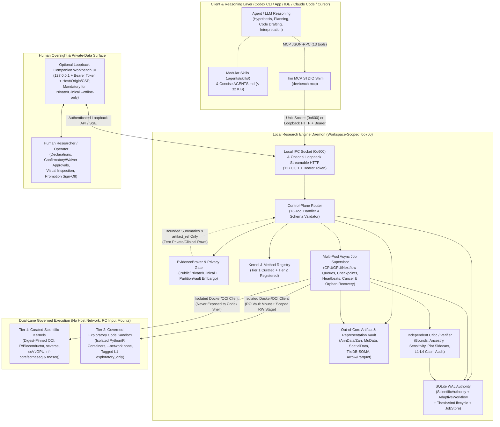

# 04 — System Architecture and Governance Specification

- **Status:** Target Architecture Specification (Phase 2)
- **Audited Baseline:** `HEAD` `18161fdabd162084732a4dd3c74e1ea42254a81b` (delta from `2026-11-23` audit `ad1d74724e1e4d12a3c0fe6840e6521bd34a445b`; see [01-baseline-audit-and-gaps.md](01-baseline-audit-and-gaps.md))
- **Scope:** Local system architecture, module consolidation, dual-lane governed execution, out-of-core data custody, governance/automation policy, privacy boundaries, and security threat model for a general automated RNA-seq research agent (**Priority 1:** single-cell / single-nucleus RNA-seq; **Priority 2:** bulk RNA-seq hardening; **Priority 3:** extensible general RNA-seq breadth; **`clinical_release_allowed = false` permanently**).
- **Companion Specifications:** [README.md](README.md) · [01-baseline-audit-and-gaps.md](01-baseline-audit-and-gaps.md) · [02-problem-space-and-methods.md](02-problem-space-and-methods.md) · [03-adaptive-research-design.md](03-adaptive-research-design.md) · [05-codex-and-mcp-integration.md](05-codex-and-mcp-integration.md) · [06-milestones-and-evaluation.md](06-milestones-and-evaluation.md)

---

## 1. Architectural Assessment & Tradeoff Analysis

A thesis-grade RNA-seq research agent must simultaneously satisfy two tensions that current bioinformatics agents usually fail to reconcile:

1. **Open-ended scientific generality:** Real investigations span the Orthogonal 3-Axis Capability Model (`A0`–`A3`, `B1`–`B12` + `B_OPEN`, `C1`–`C2` in [02-problem-space-and-methods.md](02-problem-space-and-methods.md)) and non-linear epistemic trajectories (`E0`–`E6` + `E_ABSTAIN` in [03-adaptive-research-design.md](03-adaptive-research-design.md)). No fixed catalog of 15 canned tools can anticipate custom QC diagnostics, new R/Bioconductor or Python/scverse packages, multi-aim sensitivity sweeps, or unfamiliar assays.
2. **Enforceable scientific custody, reproducibility, and privacy:** Prompt instructions alone cannot prevent silent `COUNT-1` raw-count corruption, pseudoreplication, circular marker reuse, holdout leakage, private/clinical data exfiltration over LLM APIs, or orphaned multi-hour containers.

We evaluated four concrete architectural options against the repository baseline at `18161fd`.

### 1.1 Comparative Assessment of Options A, B, C, and D

| Dimension | Option A: Extend Fixed-Tool Plugin (`plugin_mcp.py` + 25+ hard-coded ops) | Option B: Thin MCP Control Plane + Modular Skills + Governed Execution Sandbox | Option C: Pure Skills + CLI / Code-as-Action (No MCP) | Option D: Local Research Engine Daemon (MCP STDIO/HTTP + Workbench + SQLite WAL + Multi-Job Supervisor) |
|---|---|---|---|---|
| **Generality across 3-Axis Capability Model & novel methods** | **Poor.** Every new assay, diagnostic, or solver forces new Pydantic union branches into `Plan` ([`plugin_mcp.py`](../../../src/devbench/platform/plugin_mcp.py#L443-L452), already 5,805 LOC) and bloats tool schemas. | **High.** Fixed governance/custody tools + registry-driven Tier 1 kernels + Tier 2 sandboxed Python/R execution lane cover novel analyses without MCP schema churn. | **High.** Agent authors and runs arbitrary Python/R directly in the shell. | **Highest.** Retains Option B's generality while supporting concurrent multi-hour CPU/GPU/container/Nextflow workloads and shared multi-client state. |
| **Scientific custody (`COUNT-1`, donor units, embargoes, SHA-256 DAG)** | **Strong inside canned ops; collapses outside.** Users/agents bypass the plugin with raw shell scripts whenever an operation is missing (already observed in [`examples/single-cell-rnaseq/README.md`](../../../examples/single-cell-rnaseq/README.md#L33)). | **Strong.** Even custom exploratory scripts mount read-only attested inputs, inherit `COUNT-1` / `PartitionVault` guards, and receive tamper-evident `L1` receipts. | **Weak.** Custody depends on prompt compliance; raw shell commands can leak private rows to stdout, mutate source files, or test on holdouts. | **Strongest.** Single local authority (`ScientificAuthority` + `EvidenceBroker` + `PartitionVault`) enforces invariants identically across MCP, CLI, and Workbench UI. |
| **Long-running multi-hour jobs (alignment, scVI, multi-seed sweeps)** | **Broken.** `JobStore.launch()` enforces a 1-job workspace mutex (`local_job_already_active`, [`plugin_jobs.py`](../../../src/devbench/platform/plugin_jobs.py#L348-L351)), hard 3,600 s `SIGALRM` cap (`L31,L554`), and no cancellation tool. | **Fragile if job supervision lives in STDIO.** Restarting Codex CLI or compacting a session risks orphaning workers or losing live status. | **Fragile.** Codex shell timeouts and restarts orphan background processes; no transactional attempt reconciliation. | **Best.** Workspace daemon outlives client restarts, manages CPU/GPU concurrency pools, tracks heartbeats/checkpoints, and performs daemon-ID verified orphan cleanup. |
| **Codex sandbox & approval compatibility** | Works (STDIO MCP runs outside Codex's Seatbelt/Bubblewrap sandbox), but misuses `readOnlyHint=True` on mutating `plan_rna_workflow` ([`plugin_mcp.py`](../../../src/devbench/platform/plugin_mcp.py#L5564)). | **Strong.** Codex shell stays in `read-only` or `workspace-write` (no Docker socket or private-data access); privileged execution passes strictly through audited MCP tools. | **High security friction.** Running Docker/Bioconductor or loopback Studio from shell requires granting `network.unix_sockets` (`/var/run/docker.sock` = host root equivalence) or `danger-full-access`. | **Best.** Daemon holds Docker/vault custody; Codex connects via thin STDIO shim (zero sandbox weakening) or authenticated loopback Streamable HTTP. |
| **Cross-client portability & privacy boundary** | Portable over STDIO; strong privacy gate for canned ops, but brittle auto-browser Studio spawning. | **Very good.** Portable `plugin.json` + `.agents/skills/` + STDIO MCP works across Codex CLI/App, Claude Code, and Cursor. | **Moderate.** Skills are portable, but approval gating and private-data egress blocking are unenforced across clients. | **Best** when accessed through a zero-setup **STDIO shim** that auto-attaches to or launches the workspace daemon, with optional Streamable HTTP for multi-client sharing. |
| **Maintenance & migration risk from `18161fd`** | Low short-term, **unmaintainable long-term** (already fragmented across 2 MCP servers and 5.8k LOC in `plugin_mcp.py`). | Moderate — directly generalizes `plugin_mcp.py`, `ExploratoryOCI`, and `MountedKernelOCI`. | Low engineering cost, unacceptable scientific/privacy regression. | Moderate upfront, **lowest operational friction** because the repo *already* runs two local processes (`plugin_mcp` + auto-spawned `workbench_ui`) over shared SQLite WAL! |

### 1.2 Chosen Architecture: Unified Option (B) + (D)

The target architecture combines **Option B's separation of concerns** with **Option D's durable local daemon**:

1. **Local Research Engine Daemon (`devbench daemon`)**: One owner-private, workspace-scoped local process per investigation workspace that unifies the SQLite WAL authority (`ScientificAuthority` + `WorkflowOperationLedger` + `JobStore`), the out-of-core **Artifact & Multi-Representation Vault**, the **Multi-Pool Async Job Supervisor**, the **`EvidenceBroker` Privacy Gate**, and an optional **Loopback Companion Workbench HTTP Server** (`127.0.0.1`).
2. **Thin 13-Tool MCP Control Plane (`devbench mcp`)**: A lightweight STDIO shim (plus optional authenticated loopback Streamable HTTP endpoint on the daemon) exposing **13 crisp, strictly typed tools** with accurate `ToolAnnotations` and `outputSchema` (full tool contracts in [05-codex-and-mcp-integration.md](05-codex-and-mcp-integration.md)). Every tool call returns in `< 5 s` using non-blocking job handles and bounded `artifact_ref` pointers.
3. **Modular Domain Skills (`.agents/skills/`)**: Progressive-disclosure methodology guides covering scRNA/snRNA QC, pseudobulk DE, composition/DA, trajectory/programs, spatial/CCC, benchmarking/critique, and private-data Studio routing — keeping `AGENTS.md` well under Codex's 32 KiB `project_doc_max_bytes` limit.
4. **Dual-Lane Governed Execution Engine**:
   - **Tier 1 (Curated Scientific Kernels & Reference Pipelines):** Registry-driven, digest-pinned OCI/R/Python/Nextflow kernels capable of producing `L2_statistically_calibrated` evidence (and contributing to `L3_scientifically_supported` conclusions when corroborated by external replication/orthogonal validation or `human_expert_panel` sign-off).
   - **Tier 2 (Governed Exploratory Code Sandbox):** Generalized isolated container/sandbox execution for agent-authored Python/R scripts and parameterized notebooks, tagged `L1_execution_verified` (`exploratory_only`) by default and eligible for Tier 1 elevation only through an explicit **Promotion Gate**.
5. **Independent Critic / Verifier Role**: A separate, non-author verification worker/controller checking mathematical bounds (`0 <= p <= q <= 1`), tested-universe pinning, `COUNT-1` ancestry, sensitivity/LODO stability, plot-data sidecar consistency, and `L1`–`L4` epistemic-tier discipline (detailed in [03-adaptive-research-design.md](03-adaptive-research-design.md) and [06-milestones-and-evaluation.md](06-milestones-and-evaluation.md)).
6. **Optional Loopback Companion Workbench UI**: Used for rich interactive QC/figure inspection, private/clinical offline-only workflows, and confirmatory/waiver operator reviews — never an unnecessary click barrier for routine public/synthetic exploratory work.

---

## 2. Target System Architecture

### 2.1 Core Architectural Invariants
- **Single local writer / authority:** All plan freezing, aim revisions, run state transitions, artifact registrations, and disclosure reservations commit transactionally through the daemon's SQLite WAL authority (`ScientificAuthority`), eliminating multi-process SQLite lock races between MCP and Workbench. Every 32-hex MCP `session_id` maps **1-to-1** to `lineage_id` in `ScientificAuthority`.
- **Process-lifespan decoupling:** Because `devbench mcp` is a thin STDIO shim connecting over a `0o600` local Unix domain socket (spawning the daemon on demand under `flock` if absent), killing or restarting Codex CLI/App never interrupts in-flight jobs or leaks containers.
- **Strict execution isolation:** Neither Codex's shell nor any Tier 1/Tier 2 worker receives `/var/run/docker.sock`, host credentials, or ambient write permissions outside its scoped run staging directory. Only the daemon invokes the isolated container client (`LocalDocker.isolate_client`).
- **Four-level claim provenance on every artifact:** Every persisted output in `Vault` carries an immutable metadata header binding `claim_tier` (`none` | `L1_execution_verified` | `L2_statistically_calibrated` | `L3_scientifically_supported`; `L4_clinically_validated` permanently excluded and `clinical_release_allowed = false`), `execution_lane` (`tier1_curated` | `tier2_exploratory`), canonical `representation_class`, and parent input SHA-256 digests.

### 2.2 Clean-Machine CLI, Daemon Bootstrap & macOS `AF_UNIX` Mitigation
- **Unified CLI Entrypoints (`pyproject.toml` `devbench`):**
  - `devbench mcp --input-root <dir> --workspace <dir> [--no-auto-browser]` — thin STDIO MCP shim; auto-attaches to or boots the workspace daemon.
  - `devbench daemon start|status|stop --workspace <dir> [--input-root <dir>] [--http-port <port>] [--offline-only]` — explicit daemon lifecycle management.
  - `devbench approve --workspace <dir> --session-id <id> --plan-id <id> --plan-sha256 <sha> [--rationale <text>]` — local actor-attributed CLI approval surface (usable in headless/SSH terminals without opening Companion Studio).
  - `devbench workbench --workspace <dir> --input-root <dir> [--offline-only] [--port <port>]` — attaches to or launches the daemon's loopback Companion Studio UI (`127.0.0.1`).
- **Atomic Bootstrap & Stale Recovery:** Daemon state lives inside `<workspace>/.devbench-daemon/` (`0o700`, owner-only, `require_protected_storage` outside `/tmp` scratch): `daemon.lock` (`flock` exclusive startup guard), `daemon.json` (`{pid, process_created_at, socket_path, http_origin, offline_only, workspace, started_at}`), and `daemon.token` (`0o600`, 256-bit random bearer secret). On startup or shim connect, the caller acquires `daemon.lock`, verifies whether any recorded `(pid, process_created_at)` is live via `psutil`, cleans up stale sockets/files if dead, reconciles uncertain worker/OCI attempts via `ScientificAuthority.reconcile_attempt` + `recover_mounted_container()`, and spawns a detached daemon (`start_new_session=True`) if absent.
- **macOS `AF_UNIX` 104-Byte `sun_path` Limit Mitigation:** Deep workspace paths routinely exceed macOS's 104-byte `sockaddr_un.sun_path` limit (`108` bytes on Linux). The daemon MUST NOT bind sockets directly at `<workspace>/.devbench-daemon/daemon.sock` when the canonical path exceeds `96` bytes; instead it binds a short hashed path under `$XDG_RUNTIME_DIR/devbench-ipc-<uid>/s-<sha256(workspace)[:16]>.sock` (or `$TMPDIR/devbench-ipc-<uid>/s-<sha256(workspace)[:16]>.sock` on macOS, verifying `0o700` owner-only parent directory without symlinks and `0o600` socket mode; alternative relative-path bind from a `dir_fd`), and records the exact canonical `socket_path` in `<workspace>/.devbench-daemon/daemon.json` (which itself remains in protected storage).

---

## 3. Module-by-Module Refactor, Consolidation & Deprecation Map (`src/`)

This map reconciles the actual `HEAD` (`18161fd`) module layout audited in [01-baseline-audit-and-gaps.md](01-baseline-audit-and-gaps.md) into the target architecture while preserving tested benchmark infrastructure.

| Current Module(s) at `18161fd` | Disposition | Target Role & Concrete Changes | Blocking Milestone |
|---|---|---|---|
| [`src/devbench/platform/plugin_mcp.py`](../../../src/devbench/platform/plugin_mcp.py) (5,805 LOC) | **Decompose & Refactor** | Split into: (a) thin MCP protocol adapter (`src/devbench/mcp/server.py`, `schemas.py`) implementing the 13 control-plane tools with strict `outputSchema` and honest `ToolAnnotations`; (b) daemon RPC client (`src/devbench/mcp/shim.py`); (c) control-plane service modules (`intake.py`, `answerability.py`, `planning.py`, `query.py`). Retire the monolithic 15-op `Plan` discriminated union; remove `session_input_scope_mismatch` mid-session lock in favor of `register_investigation_input`; fix `6b446dc` private-only H5AD streaming asymmetry (`L619`). | `M1` |
| [`src/devbench/platform/plugin_jobs.py`](../../../src/devbench/platform/plugin_jobs.py) | **Replace / Evolve** | Evolve `JobStore` into `src/devbench/daemon/supervisor.py` (workspace daemon + SQLite job queue unified with `ScientificAuthority`). Remove global 1-job mutex (`local_job_already_active`, `L349`), replace hard `MAX_SECONDS = 3600` `SIGALRM` with per-profile deadlines (up to 72 h) + heartbeat/checkpoint supervision, add `cancel_run`, and disable default surprise browser auto-open in `ensure_offline_studio()`. | `M1` |
| [`src/devbench/platform/plugin_mcp_ui.py`](../../../src/devbench/platform/plugin_mcp_ui.py) | **Keep & Scope** | Retain `ui://devharness/{plan,run,receipt}-card` (`text/html;profile=mcp-app`, `protocolVersion: "2026-01-26"`) strictly as optional progressive enhancement when `clientCapabilities.extensions["io.modelcontextprotocol/ui"]` is advertised. Never place execution approval actions inside iframes. | `M1` |
| [`src/devbench/platform/plugin_rna_solvers.py`](../../../src/devbench/platform/plugin_rna_solvers.py) | **Fix (`M0`), Then Absorb into Registry (`M1`/`M2`)** | **M0 immediate bugfix:** fix `cell_type` preflight crash at `L408` so optional-`cell_type` spatial SVG runs match `spatial_analysis.py:331-334`. **M1/M2:** migrate the 7 `LOCAL_OPERATIONS` into declarative Tier 1 Kernel Registry entries reading out-of-core H5AD/Zarr/Parquet (removing CSV-only 100 MB / 12.5M-entry caps in `_rna_solver_inputs.py:22-23`). | `M0`, `M1`, `M2` |
| [`src/devbench/platform/plugin_motor_umap.py`](../../../src/devbench/platform/plugin_motor_umap.py), [`plugin_motor_programs.py`](../../../src/devbench/platform/plugin_motor_programs.py), [`plugin_motor_code.py`](../../../src/devbench/platform/plugin_motor_code.py) | **Extract from Core** | Remove dataset-specific `shared_motor_umap` ("e09, e10, e11") and `motor_program_comparison` from the general control-plane schema (`plugin_mcp.py:219-240`). Re-package them as example registered plugins/recipes under `examples/` or optional registry bundles. | `M1` |
| [`src/devbench/platform/plugin_graph.py`](../../../src/devbench/platform/plugin_graph.py) & [`plugin_registered_method.py`](../../../src/devbench/platform/plugin_registered_method.py) | **Unify & Generalize** | Merge native plugin graph custody and registered exploratory dispatch into one unified **Graph Execution & Method Registry** layer bound directly to `AdaptiveWorkflow` + `ThesisAimLifecycle` invalidation (closing the `depends_on` vs aim-basis disconnect noted in [01-baseline-audit-and-gaps.md](01-baseline-audit-and-gaps.md)). Enable MCP-driven registration/versioning of Tier 2 scripts and private-data offline execution. | `M1`, `M3` |
| [`src/devbench/platform/adaptive_workflow.py`](../../../src/devbench/platform/adaptive_workflow.py) & [`thesis_aims.py`](../../../src/devbench/platform/thesis_aims.py) | **Retain Core & Lift Caps** | Keep the live SQLite-backed DAG, generation tracking, artifact staleness, and cross-aim basis invalidation (`_invalidated`, `_sync_basis`). Lift hard caps (`_MAX_AIMS = 32`, `_MAX_REVISIONS = 3` in `thesis_aims.py:51-52`), bind all execution nodes to aim/representation basis IDs, and expose blinded/critic review hooks through `manage_research_aim` and the Critic role. | `M3` |
| [`src/devbench/platform/method_planner.py`](../../../src/devbench/platform/method_planner.py) & [`langgraph_workflow.py`](../../../src/devbench/platform/langgraph_workflow.py) | **Wire & Scope** | Expose `ScientificMethodPlanner`'s candidate-applicability & frozen-criteria comparison logic through `list_kernels_and_methods` / `check_answerability` and `E4` benchmarking. Keep `AdaptiveRNAWorkflow` / `SerialRNAWorkflow` (`langgraph_workflow.py`) as optional internal headless orchestrators rather than a parallel state store. | `M3` |
| [`src/devbench/platform/workbench_ui.py`](../../../src/devbench/platform/workbench_ui.py), [`workbench_http.py`](../../../src/devbench/platform/workbench_http.py), [`workbench_investigations.py`](../../../src/devbench/platform/workbench_investigations.py) | **Host Under Daemon & Harden** | Serve Workbench HTTP routes from the unified daemon (eliminating duplicate lock/state ownership and `studio-server.json` polling fragility). Add per-launch cryptographic bearer token on mutating/API routes alongside existing `Host`/`Origin`/`Sec-Fetch-Site` + nonce CSP checks (`workbench_http.py:427-436`). Replace regex `classify_question` (`workbench_investigations.py:107-156`) with structured investigation framing; lift `MAX_INVESTIGATIONS=100` / `MAX_TURNS=256` / `MAX_RECORD_BYTES=2 MiB` caps. | `M1`, `M3` |
| [`src/devharness_server/server.py`](../../../src/devharness_server/server.py), [`dispatcher.py`](../../../src/devharness_server/dispatcher.py), `tools_*.py`, `r/*.R` | **Freeze to Benchmark Mode & Invert Kernel Dependency (`ADR-18`)** | **Keep `devharness` STDIO MCP frozen strictly as the historical `DevBench` Benchmark-Mode harness** (zero new tools, zero references from general-research `AGENTS.md` or `.agents/skills/`, enforced via CI skill lint). **Invert the shared-kernel dependency:** move/wrap reusable statistical engines (`r/*.R`, `bulk_dream.R`, `rna_pathway_camera`, `tools_scrna_composition.py`, `tools_network.py` with mandatory verified-universe background custody) into [`src/rna_kernels/`](../../../src/rna_kernels/) + the Tier 1 Kernel Registry, leaving thin backward-compatible re-export shims in `devharness_server` so existing `DevBench` tests remain bit-compatible. | `M1`, `M2`, `M4` |
| [`src/devbench/engine/scientific_authority.py`](../../../src/devbench/engine/scientific_authority.py) & [`workflow_operations.py`](../../../src/devbench/engine/workflow_operations.py) | **Preserve & Extend** | Keep as the canonical transactional authority (WAL outbox, epoch/revision fencing, `reserve_attempt` / `dispatch_attempt` / `reconcile_attempt` / `stage_output` / `accept_output`, `EvidenceBroker` disclosure clock). Add actor-attributed approval records (`anyone for now`), checkpoint/resume metadata columns, and pool-aware concurrency accounting. | `M1`, `M3` |
| [`src/devbench/engine/mounted_kernel_oci.py`](../../../src/devbench/engine/mounted_kernel_oci.py) | **Generalize via `ContainerBackend` (`ADR-20`)** | Preserve `--pull=never --network none --read-only --cap-drop ALL --security-opt no-new-privileges=true`, exact bind verification (`_verify_mounts`), and daemon-ID verified orphan cleanup (`recover_mounted_container`). Replace hard-coded 4-module `worker_module` whitelist (`L349-355`), fixed `--cpus 2`, `--pids-limit 64`, and 64 MB `/tmp` with registry-declared resource profiles (CPU/RAM/GPU/scratch/timeout ceilings) and a uniform **`ContainerBackend` protocol** (`probe()`, `verify_image()`, `run_isolated()`, `cleanup()`) shipping `DockerBackend` + rootless `PodmanBackend` in `M1-3` and HPC `ApptainerBackend` in `M2`. | `M1`, `M2` |
| [`src/devbench/engine/exploratory_oci.py`](../../../src/devbench/engine/exploratory_oci.py) & [`method_executor.py`](../../../src/devbench/engine/method_executor.py) | **Generalize (Tier 2 Runner)** | Preserve isolated container flags and `PartitionVault` training/evaluation embargo isolation. Replace single hard-coded `EXPLORATORY_IMAGE_ID` (`method_executor.py:43-48`) with a curated set of versioned scientific base images (Python scverse, R/Bioconductor, optional GPU); replace RAM-only `tmpfs` output staging with quota-bounded, run-scoped non-exec host staging dir hashed & sealed on completion; remove arbitrary parameter name bans (`batch_size`/`chunk_size`/`batch`/`chunks`/`shard`, `exploratory_oci.py:121-122`), 16 MB cap, and binary-classifier-only `exploratory_benchmark.py` lock. | `M1`, `M2` |
| [`src/devbench/engine/mounted_matrix_vault.py`](../../../src/devbench/engine/mounted_matrix_vault.py) & [`src/devbench/core/expression_io.py`](../../../src/devbench/core/expression_io.py) | **Upgrade to Out-of-Core Vault** | Replace `MAX_MOUNTED_MATRIX_BYTES = 512 MiB` full-directory copying (`mounted_matrix_vault.py:13`) with zero-copy read-only storage mounts + chunk/manifest attestation across `AnnData`/Zarr, `MuData`, `SpatialData`, `TileDB-SOMA`, and Arrow/Parquet. Extend `BackedExpression` (`expression_io.py`) to support Zarr and CSC/CSR streaming uniformly. | `M1`, `M2` |
| [`src/devbench/engine/permissions.py`](../../../src/devbench/engine/permissions.py), [`runtime_lease.py`](../../../src/devbench/engine/runtime_lease.py), [`episode_codex.py`](../../../src/devbench/engine/episode_codex.py) | **Preserve for Benchmark / Critic Harness** | Keep Codex Named Permission Profiles (`PermissionBoundary`, `probe_boundary`), `RuntimeLease`, and `EpisodeCodexAdapter` for isolated benchmark evaluation (`DevBench`) and optional isolated Critic/Verifier invocation. Update any deprecated Codex flags to match current `approval_policy` semantics (Section 1 of [05-codex-and-mcp-integration.md](05-codex-and-mcp-integration.md)). | `M1`, `M5` |
| [`src/devbench/adaptive/`](../../../src/devbench/adaptive/) (6 files) | **Deprecate & Archive Quarantined Stubs** | Move the 3 live exports (`models.py`, `admission.py`, `GROUPED_EVALUATOR_SOURCE`) into `src/devbench/core/` or `src/devbench/engine/` and retire quarantined prototype stubs (`exploration.py:309`, `policy.py:97`, in-memory `ledger.py`) that raise `ImportError`/`RuntimeError`. | `M0` |
| [`src/rna_kernels/`](../../../src/rna_kernels/) & [`containers/`](../../../containers/) | **Expand & Calibrate** | Fix `edgeR` QL calibration failures (`B-I`/`S-I`/`S-P`, `M0`), wire unwired kernels (`scrna_nb_countsplit`, `scrna_marker`, `scrna_integrate_qualified`, `fit_donor_trajectory`, `rna_pathway_camera`) into the Tier 1 Registry, and add Priority 1 scRNA/snRNA kernels (`scDblFinder`, `CellBender 0.4.0`/`SoupX`/`DecontX` per `ADR-27`, `dreamlet`, embedding-only `miloR` `mounted_milo.py` + `scrna_milo.R` per `ADR-26`, `scib-metrics`, `Ensembl+in-paralogs`/`SAMap`/`SATURN` per `ADR-28`, `ClusterDE`, `souporcell`/`Vireo`, multi-chain `scCODA`/`pertpy`) per [02-problem-space-and-methods.md](02-problem-space-and-methods.md). | `M0`, `M2`, `M4` |

---

## 4. Dual-Lane Governed Execution & Tier 2 → Tier 1 Promotion Gate

To achieve both arbitrary scientific breadth and statistical rigor, every computational step executes inside one of two explicit lanes enforced by the daemon's Job Supervisor.

### 4.1 Tier 1 — Curated Scientific Kernels & Reference Pipelines

- **Definition:** Versioned, pre-audited analytical kernels and upstream pipelines registered in the daemon's **Kernel Registry** (`registry/*.json` / SQLite table), backed by digest-pinned OCI images. Per **`ADR-20` (`UD-05`)**, an explicit opt-in non-OCI OS fallback (`allow_non_oci_public_fallback = true`, using `bwrap` / macOS `sandbox-exec` / isolated locked `uv`/R subprocess) is **strictly restricted to `public`/`synthetic` data**, hard-capped at `claim_tier = "L1_execution_verified"` (never `E5`/`L2` or `private`/`clinical`), and MUST stamp `oci_isolated: false` + `isolation_backend` on every receipt and in `inspect_runtime_capabilities`.
- **Contract:** Each kernel declares:
  - `kernel_id`, `semver`, `capability_axes` (mapping to `A0`–`A3`, `B1`–`B12` | `B_OPEN`, `C1`–`C2`),
  - typed `input_ports` requiring canonical `representation_class` values (`raw_reads_or_droplets` [`R0`], `count_1_raw_counts` [`R1`], `ambient_adjusted_counts` [`R2`], `size_factor_normalized` [`R3`], `integrated_latent_or_graph` [`R4`], `spatial_geometry_and_residuals` [`R5`], `aggregated_unit_counts` [`R6`], `derived_summary`, `metadata_only`, `reference_only`),
  - typed `parameter_schema` (JSON Schema, `additionalProperties: false`),
  - `runtime_pin` (`oci_image_digest`, `lockfile_sha256`, `supported_architectures`, `gpu_required`/`gpu_optional`, `oci_isolated`, `isolation_backend`),
  - `resource_profile` (`default_cpus`, `max_cpus`, `default_memory_mb`, `max_memory_mb`, `default_timeout_sec`, `max_timeout_sec`, `scratch_mb`),
  - `calibration_status` (`uncalibrated_L1` | `calibrated_L2` with link to calibration suite receipt SHA-256 and tested regime scope), and
  - `output_ports` (Arrow/Parquet tables, AnnData/Zarr layers, structured plot-data JSON sidecars, PNG/SVG/Plotly figures).
- **Runtime Isolation (`ContainerBackend`, `ADR-20`):** Replace direct `LocalDocker` calls with the uniform `ContainerBackend` protocol (`probe()`, `verify_image()`, `run_isolated()`, `cleanup()`), supporting configurable multi-core CPU, optional GPU passthrough (`--gpus` on Linux / MPS on verified native local workers), larger scratch staging, and three OCI drivers:
  - **`DockerBackend` (`M1-3`):** Preserves `mounted_kernel_oci.py` (`--pull=never`, `--network none`, `--read-only`, `--cap-drop ALL`, `--security-opt no-new-privileges=true`, `--ipc private`, `--user uid:gid`, exact 2-mount bind verification `_verify_mounts`, daemon-ID verified `recover_mounted_container`).
  - **Rootless `PodmanBackend` (`M1-3`):** Enforces daemonless label/storage-ID cleanup verification, `--userns=keep-id` for host-UID `/outputs` ownership, and an explicit Linux cgroups v2 delegation probe in `probe()` before trusting `--pids-limit`/`--memory` (failing closed or marking `oci_isolated: false` if undelegated).
  - **HPC `ApptainerBackend` (`M2`):** Requires local SHA-256-verified `.sif` images and enforces `--containall --no-home --cleanenv --no-eval --net --network=none --ro-bind <in>:/inputs --bind <out>:/outputs`; probes that unprivileged user/net namespaces (or setuid `--net`) actually isolate networking — if the host kernel blocks `--net --network=none`, refuses `private`/`clinical` runs and marks `oci_isolated: false` rather than silently sharing host networking.
- **Upstream Pipeline Lane (`A0`):** Local pre-staged FASTQ/BAM workflows (`nf-core/scrnaseq`, `nf-core/rnaseq`, `STARsolo`, `alevin-fry`, `Salmon`, `Bambu`/`IsoQuant`) run as Tier 1 pipelines with pinned pipeline release commit + container image digests and Nextflow trace ingestion into the daemon's progress ledger. Explicit user-authorized public-data retrieval (e.g., GEO/SRA/CELLxGENE download) runs in a **separate network-admitted staging step** before offline compute — never inside an analysis container.

### 4.2 Tier 2: Governed Exploratory Code Sandbox

Tier 2 eliminates the "escape to raw bash" failure mode by letting the research agent write and execute arbitrary Python or R scripts (or parameterized `.ipynb` / `.qmd` notebooks) **without leaving the custody, hashing, and privacy perimeter**.

- **Curated Scientific Base Images:** Replace the single bare `EXPLORATORY_IMAGE` (`method_executor.py:43-48`) with a small family of digest-pinned, offline base images:
  1. `devharness-explore-py`: Python 3.13 + `numpy`, `scipy`, `pandas`, `pyarrow`, `polars`, `anndata`, `scanpy`, `mudata`, `spatialdata`, `tiledbsoma`, `statsmodels`, `scikit-learn`, `matplotlib`, `seaborn`, `plotly`, `umap-learn`, `igraph`, `leidenalg`, `harmonypy`.
  2. `devharness-explore-r`: R 4.5+/Bioconductor + `SingleCellExperiment`, `Seurat`, `edgeR`, `limma`, `DESeq2`, `scran`, `scuttle`, `miloR`, `satuRn`, `stageR`, `variancePartition`, `dreamlet`, `ggplot2`, `arrow`, `zellkonverter`.
  3. `devharness-explore-gpu` *(optional)*: CUDA-enabled Python image with `torch`, `scvi-tools`, `cellbender`, `rapids-singlecell`.
- **Execution Mechanics & Security Controls:**
  - **Code submission:** Agent submits either inline `source_code` (bounded `<= 512 KiB`) OR a workspace-relative `script_path` (`O_NOFOLLOW`-verified, hashed, and immutably snapshotted at freeze time) + `base_image_id` + explicit `input_bindings` (`artifact_id` -> `/inputs/<port>`) + `expected_outputs` manifest + `resource_profile` via `freeze_analysis_plan(plan_kind="tier2_exploratory_code", ...)`.
  - **Static preflight linter:** Before execution, checks syntax (`ast.parse` / `Rscript --vanilla -e 'parse(...)'`), rejects forbidden host-escape patterns (attempting to read `/proc/1`, `/var/run/docker.sock`, etc., as defense-in-depth alongside container isolation), and warns if a script appears to fit count models on a non-`COUNT-1` input or mix training/holdout IDs.
  - **Container isolation:** `--pull=never`, `--network none`, `--read-only`, `--cap-drop ALL`, `--security-opt no-new-privileges=true`, `--ipc private`, `--user uid:gid`, `--pids-limit` per profile (e.g., 256 for multi-threaded BLAS/PyTorch), `--memory`/`--cpus` per profile.
  - **Data mounts:** Only explicitly declared input artifacts are mounted **read-only** (`bind-recursive=disabled`) at `/inputs/<port>`. Embargoed `PartitionVault` holdouts (`evaluation/`) are **unconditionally rejected** for Tier 2 mounts (`exploratory_oci.py:471-472` invariant preserved).
  - **Writable output staging (fixing the `tmpfs` bottleneck):** Instead of forcing multi-GB derived matrices into RAM-backed `tmpfs` (`method_executor.py:66-70`), each run gets a dedicated, owner-only (`0o700`), quota-monitored host staging directory mounted at `/outputs` (`rw,nosuid,nodev,noexec`), plus a bounded `/tmp` scratch mount. Upon container exit (or forced cleanup), the daemon validates declared outputs against size/schema budgets, computes SHA-256 digests, moves accepted files into the immutable Vault (`0o400`), and deletes unreferenced scratch.
  - **Private-data Tier 2 workflow (`--offline-only`):** Unlike `plugin_registered_method.py:25` (which bans `private` data), Tier 2 supports `private`/`clinical` datasets via **two zero-egress local paths**:
    1. *Offline Local Authoring:* The human researcher authors or edits the script directly inside `--offline-only` Companion Studio (or local editor bound to the workspace), reviews exact input bindings and resource caps, approves execution locally, and inspects results strictly in Studio.
    2. *Schema-Blind Synthetic-Tested Template Handoff:* An MCP agent develops and tests a parameterized Tier 2 script against public/synthetic fixtures over MCP, freezes the template via `freeze_analysis_plan(plan_kind="tier2_exploratory_code")` without seeing private headers or rows, and hands off `{plan_id, plan_sha256, studio_url}` so the local operator binds private inputs, audits the script, approves execution, and views outputs strictly inside `--offline-only` Studio. All outputs inherit sticky `private` tainting in `EvidenceBroker` so **zero** stdout/stderr rows, tables, or figures can cross MCP.
- **Strict Epistemic Tagging:**
  - Every Tier 2 output is permanently stamped `execution_lane: "tier2_exploratory"`, `claim_tier: "L1_execution_verified"`, and `figure_verification: "produced_unverified"`.
  - Tier 2 outputs **can** drive exploratory discovery (`E2`), diagnostic/falsification probes (`E3`), custom publication-quality plots (with mandatory plot-data sidecar), and method prototyping (`E4`).
  - Tier 2 outputs **cannot** directly enter `E5` Confirmatory Inference or `L2`/`L3` claims without passing the **Promotion Gate** (or serving strictly as an explicitly labeled exploratory sensitivity check).

### 4.3 Independent Critic / Verifier Role

Drawing on `Virtual Lab`'s non-author critic pattern and DevHarness's blinded review design (`src/devbench/analysis/scientific_review.py`, `src/devbench/core/thesis_blinded_review.py`), the daemon supports an **Independent Critic / Verifier** with canonical `critic_origin` values (`deterministic_verifier` | `ai_critic_review` | `human_expert_panel` | `hybrid`) executed outside the authoring agent's conversation context:

1. **Deterministic Structural & Mathematical Verifier (`deterministic_verifier`, always-on, zero LLM cost):** Runs automatically on every completed run receipt before `accept_output`: verifies finite values, `0 <= p <= q <= 1`, BH monotonicity against exact tested-universe size, `COUNT-1` ancestry for count-based methods, donor-unit cardinality vs declared design rank, no holdout hash overlap, and plot-data sidecar hash match against plotted summary tables.
2. **Adversarial Scientific Critic (`ai_critic_review` at Gate 1 pre-`E5` & Gate 2 post-`E5`/pre-`E6`; `human_expert_panel` / `hybrid` for `L3` elevation):** Receives *only* the sealed evidence bundle (inputs metadata, frozen plan, diagnostics, sensitivity results, negative findings, and draft claims — **never** the authoring agent's private chain-of-thought) and produces a signed critique record checking for circularity, p-hacking, batch/donor confounding, unsupported causal language, and `L1`–`L4` claim inflation. Automated `E5` + post-fit `E3` probes + `ai_critic_review` Gate 2 earns **`L2_statistically_calibrated`** (`ai_critic_verified: true`, `L3` pre-screen); **`ai_critic_review` never counts as qualified human scientific review**, and **`L3_scientifically_supported`** requires independent external replication/orthogonal validation or `human_expert_panel` sign-off (and at platform level, passing `M5` Scorecards 2–6).

### 4.4 Tier 2 → Tier 1 Promotion Gate (Workspace-Scoped vs Repository-Wide)

A custom method or analysis script developed in Tier 2 can be promoted into Tier 1 **only** when all six gate conditions are satisfied and sealed in `ScientificAuthority`. The specification explicitly distinguishes two promotion scopes so novel `B_OPEN` thesis methods can earn `E5` confirmatory admission without waiting for an upstream repository release:
- **Workspace-Scoped Tier 1 Promotion (`scope: "workspace"`):** Promotes a validated `B_OPEN` or custom thesis method into the active workspace's local Tier 1 Registry (`registry/local/`) after passing Gates 1–6 against workspace-relevant null and planted-signal calibration suites, authorizing `E5` confirmatory execution (`L2_statistically_calibrated`) within that investigation and bundling full source + calibration evidence inside the Thesis Research Package.
- **Repository-Wide Tier 1 Promotion (`scope: "repository"`):** Promotes a generally reusable method into `bio-agent-harness`'s core curated kernel catalog (`containers/`, `src/rna_kernels/`) after additionally passing cross-architecture (`arm64`/`amd64`) CI calibration, external benchmark comparison (`M5`), and maintainer review.

| Gate Check | Mandatory Artifact / Verification |
|---|---|
| 1. **Pinned Reproducible Environment** | Exact OCI image digest + dependency lockfile SHA-256 (`uv.lock` / `renv.lock`) + deterministic seed control (`seed` required in schema). |
| 2. **Typed I/O & Representation Contract** | Strict `inputSchema`, `outputSchema`, declared `representation_class` requirements, and explicit refusal behavior on invalid inputs / confounded designs. |
| 3. **Null Calibration & Planted-Signal Suite (`L2`)** | Passes complete-null Type-I / empirical-FDR calibration and planted-effect power checks across declared regimes (stored as content-addressed calibration receipt). |
| 4. **Adversarial & Boundary Tests** | Passes unit tests for missing/empty groups, extreme depth imbalance, missing gene annotations (e.g., absent mito symbols), and non-finite edge cases. |
| 5. **Independent Critic Audit** | Non-author Critic pass (`deterministic_verifier` + `ai_critic_review` or `human_expert_panel`) confirms no leakage, no silent fallbacks, and honest failure modes. |
| 6. **Explicit Operator Sign-Off** | Actor-attributed approval record in `ScientificAuthority` promoting `(method_version_id, calibration_receipt_sha256, scope)` to `tier1_curated` with explicit `calibrated_regimes` scope. |

---

## 5. Out-of-Core Data Custody & Scalable Storage Architecture

The repository's current data-size ceilings — `_H5_FILE_BUDGET = 100 MiB` (`plugin_mcp.py:638`), `MAX_INPUT_BYTES = 100 MB` & `MAX_MATRIX_ENTRIES = 12.5M` (`_rna_solver_inputs.py:22-23`), `MAX_MOUNTED_MATRIX_BYTES = 512 MiB` (`mounted_matrix_vault.py:13`), `MAX_SAMPLES = 1,000 / 4,096`, `20,000` genes (`scrna_donor_trajectory.py:34-36`), and `_PARQUET_LIMIT = 16 MB` (`tier_a_executor.py:76`) — are incompatible with real human scRNA/snRNA datasets (which routinely have 36,000+ GRCh38 genes and 100k–2M+ cells spanning 1–50+ GB).

### 5.1 Supported Out-of-Core Storage Formats

| Format | Primary Biological Use Case | Custody & Streaming Access Strategy |
|---|---|---|
| **AnnData HDF5 (`.h5ad`)** | Single-cell / single-nucleus matrices, multi-layer representations (`layers/counts`, `X`, `obsm`) | Extend [`BackedExpression`](../../../src/devbench/core/expression_io.py#L28-L151) to handle both CSR and CSC streaming in fixed RAM blocks (default 64 MiB chunk budget); inspect headers, `obs`/`var` schemas, and storage layouts in `O(1)` metadata reads regardless of file size (**for both public and private inputs**, fixing the `6b446dc` asymmetry). |
| **AnnData Zarr (`.zarr`)** | Multi-GB / multi-chunk scRNA/snRNA atlases, parallel chunk reads | Native `zarr` v2/v3 metadata + chunked array streaming; attested by deterministic Merkle tree over `.zmetadata`/`zarr.json` + chunk digests (without copying full directories into a 512 MiB vault). |
| **MuData (`.h5mu` / Zarr)** | Multimodal CITE-seq, Multiome (RNA+ATAC), V(D)J (`A3` multimodal; `B2`, `B3`, `B5`, `B6`) | Per-modality slot inventory (`mod/rna`, `mod/prot`, `mod/atac`) with aligned `obs` index verification and independent `COUNT-1` tracking per modality. |
| **SpatialData (OME-NGFF Zarr + GeoParquet)** | Visium, Visium HD, Xenium, MERFISH, Slide-seq (`A0`/`A3`, `B8`) | Backed coordinate tables (GeoParquet), multi-scale images (OME-Zarr — never loaded into LLM context), and expression tables with explicit physical coordinate frame & units metadata. |
| **TileDB-SOMA (`.soma`)** | Atlas-scale (1M–50M+ cells) & CZ CELLxGENE Census slices (`A0`, `B7`) | Query-pushdown slicing (`value_filter` on `obs`/`var`) exporting bounded Arrow/AnnData working slices into the workspace Vault with exact query-predicate provenance. |
| **Apache Arrow / Parquet (`.parquet`)** | Result tables (DE, DTU, pathways, CCC, DA), sample metadata, plot-data sidecars | Streaming predicate pushdown and pagination via `pyarrow.dataset` for `query_artifact_table` (eliminating the 16 MB `_PARQUET_LIMIT` while keeping every MCP response <= 64 KiB). |
| **Delimited Text (`.csv` / `.tsv` / `.gz`) & 10x MTX** | Bulk count tables, sample sheets, Cell Ranger outputs | Retain bounded streaming readers; automatically ingest large bulk/10x MTX matrices into indexed Parquet/AnnData-Zarr derivatives inside the Vault rather than reparsing CSVs per solver. |

### 5.2 Zero-Copy Vault Custody & Upgraded `COUNT-1` Forensics
- **Zero-copy attested mounting:** For large read-only inputs (> 256 MiB), the daemon records `(canonical_path, device, inode, size_bytes, mtime_ns, full_or_merkle_sha256)` in `ScientificAuthority`, mounts the source read-only into containers, and re-verifies `stat` + fast Merkle/digest consistency pre- and post-execution (falling back to immutable content-addressed copy only when requested or when storage is mutable/network-backed).
- **Multi-Representation Lineage Table:** Each registered dataset/derivative records an explicit canonical `representation_class`:
  - `raw_reads_or_droplets` (`R0`): pre-staged FASTQ/BAM reads or unfiltered raw droplet matrices before cell calling,
  - `count_1_raw_counts` (`R1`): unmodified integer UMI or non-UMI counts, or Salmon/tximport fractional counts + effective lengths,
  - `ambient_adjusted_counts` (`R2`): CellBender `0.4.0`/SoupX/DecontX-adjusted counts (`ADR-27`: `r0_cellbender`, `r0_cpu_soupx_decontx`, or `E3`-only `r1_filtered_only_decontx_heuristic`, with mandatory `ambient_method`, `decontamination_regime`, `input_matrix_tier`, `hardware_backend`, `cellbender_version`, `cellbender_deferred_reason`) — explicitly tagged as `E3` sensitivity/corrected, preserving raw `R1` sibling for primary DE,
  - `size_factor_normalized` (`R3`): `scran`/log1p/CPM/Pearson-residual normalized expression,
  - `integrated_latent_or_graph` (`R4`): Harmony/scVI/Scanorama embeddings, kNN graphs, or cross-species alignments (`Ensembl+in-paralogs` / `SAMap` / `SATURN` with mandatory `CrossSpeciesHomologyManifest` per `ADR-28`) — **blocked** from feeding count-based DE,
  - `spatial_geometry_and_residuals` (`R5`): physical spatial coordinates, tissue graphs, and depth-conditioned spatial residuals,
  - `aggregated_unit_counts` (`R6`): donor/unit × population pseudobulk count aggregates of `R1` with cell-count and zero-fraction metadata,
  - plus non-expression custody classes `derived_summary`, `metadata_only`, and `reference_only`.
- **Closing the `COUNT-1` Integer-Log2 Blindspot ([01-baseline-audit-and-gaps.md](01-baseline-audit-and-gaps.md)):** Intake validation upgrades `_verify_h5_counts` (`plugin_mcp.py:753-800`) beyond "nonnegative integers" to inspect empirical value distributions (max value, unique-integer cardinality, library-size variance, presence of small-integer plateau signatures like `log2(1 + {1,3,7,15})`, and slot history metadata) — emitting a mandatory `suspected_transformed_integer_counts` warning / clarification gate when a matrix looks transformed despite integer dtype (with minimum nonzero-count threshold and auditable override so genuine low-UMI snRNA matrices are not falsely blocked).

---

## 6. Governance, Automation Policy & Mode Separation

### 6.1 Benchmark Mode (`DevBench`) vs General Research Mode (`DevHarness`)

A major architectural flaw in the current repo is that benchmark-specific constraints leak from [`AGENTS.md`](../../../AGENTS.md) into general research skills ([`SKILL.md`](../../../integrations/codex/devharness/skills/rna-workbench/SKILL.md#L39)). These two modes MUST be cleanly separated:

| Property | Benchmark Mode (`DevBench` Evaluation Harness) | General Research Mode (`DevHarness` Research Agent) |
|---|---|---|
| **Purpose** | Controlled, reproducible agent evaluation on fixed synthetic/public tasks (`baseline` / `optional` / `enforced` arms). | Sustained, open-ended, thesis-grade RNA-seq scientific investigations. |
| **Instruction source** | Task-scoped prompt + `src/devbench_engine/AGENTS.md` (packaged per-task). | Concise general research `AGENTS.md` + modular `.agents/skills/` (progressive disclosure). |
| **Output schema** | Task-specific `answer_schema.json` + `final_discovery.json` (`stage_kinetics`, `four distinct master_regulators`, etc.). | Open-ended **Thesis Research Package** ([03-adaptive-research-design.md](03-adaptive-research-design.md)) + optional user-supplied schema. |
| **MCP server** | `devharness` (`src/devharness_server/server.py`) or isolated harness fixture. | Unified `devbench mcp` (13-tool control plane) + Local Research Engine Daemon. |
| **Network & public data** | Strictly disabled (`web_search="disabled"`, `network.enabled=false`). | Compute containers strictly `--network none`; explicit operator-approved staging tool/step allowed for public references, GEO/CELLxGENE datasets, and literature queries. |
| **Dataset scale caps** | Small task fixtures; strict wall/token budgets per benchmark run. | Out-of-core streaming (`AnnData`/Zarr, `SpatialData`, `TileDB-SOMA`, Parquet); no arbitrary 100 MB / 4,096-sample / 20k-gene caps. |
| **Sandbox profile** | `PermissionBoundary` (`src/devbench/engine/permissions.py`) with `--ignore-user-config`, `project_doc_max_bytes=0`, `approval_policy="never"`. | Standard user Codex CLI/App (`sandbox_mode="workspace-write"`, `approval_policy="on-request"` or granular) + daemon-enforced container isolation. |

### 6.2 Autonomy vs Clarification vs Operator Approval Matrix

The current `plugin_mcp.py` forces manual Companion Studio clicks even for routine public/synthetic `bulk_de` and `pseudobulk` fits (`plugin_mcp.py:3408,4845`), creating severe automation friction without improving scientific rigor. Simultaneously, governance must remain auditable under an **`anyone for now` actor-attributed approval model**: any local operator interacting via Codex native approval, CLI `devbench approve`, or Companion Studio can grant approvals, and every grant records `{actor_id, surface, auth_method, granted_at_utc, plan_id, plan_sha256, rationale}` in `ScientificAuthority` (preserving a clean drop-in upgrade path to Ed25519 / macOS Keychain signing in `src/devharness_controlled/`).

| Action Category | Public / Synthetic Data Policy | Private / Unclassified / Clinical Data Policy | Audit / Ledger Requirement |
|---|---|---|---|
| **Read-only inspection & capability checks** (`inspect_runtime_capabilities`, `inspect_inputs`, `check_answerability`, `list_kernels_and_methods`, `list_investigation_state`, `get_run_status`, `get_run_receipt`, `query_artifact_table`) | **Autonomous** (no approval prompt; `readOnlyHint=True`). | Metadata/header inspection **blocked from MCP** (`private_data_local_studio_only`); allowed locally in `--offline-only` Studio. | Read events logged in disclosure ledger (`EvidenceBroker`). |
| **Exploratory Tier 1 QC / Diagnostics / Sensitivity** (`E1`, `E2`, `E3`: QC, doublets, ambient diagnostics, integration benchmarks, LODO sensitivity) | **Autonomous** after plan freeze (no Studio click or per-step approval required). | **Mandatory `--offline-only` Studio / local CLI human approval**; results stay strictly local (never returned on MCP). | Immutable `plan_sha256` + `L1`/`L2` receipt committed to WAL. |
| **Exploratory Tier 2 Custom Python/R Scripts** (`E2`, `E3`, `E4` prototyping) | **Default (`ADR-19`):** Explicit per-plan approval (`codex_native` / CLI `devbench approve` / optional Studio), recorded in `scientific_plan_approvals` with `script_sha256`. **Optional out-of-band opt-in (`auto_approve_tier2_public = true`):** allowed ONLY via `devbench daemon --auto-approve-tier2-public` or an owner-only `0o600` policy file inside `.devbench-daemon/` (never mutable via MCP or agent-writable files), failing closed unless ALL hold: (a) `data_classification in {"public", "synthetic"}` and `has_private_input == False`; (b) `oci_isolated == True` (`--network none --read-only --cap-drop ALL --security-opt no-new-privileges:true`, verified 2-mount inventory, zero `PartitionVault` holdouts); (c) `epistemic_purpose in {"qc_diagnostic", "exploratory", "sensitivity_probe", "method_benchmark"}` (never `confirmatory`/`E5`); (d) outputs hard-tagged `claim_tier = "L1_execution_verified"`, `exploratory_only = true`; and (e) ledger records `auth_method = "workspace_policy_auto_tier2_public"` + policy digest + `script_sha256`. | **Mandatory `--offline-only` Studio / local CLI human code review & approval** (via offline local authoring or schema-blind synthetic-tested template handoff, §4.2); zero MCP output egress. | Script SHA-256 + base image digest + policy digest (if auto) + output hashes committed; `claim_tier = L1_execution_verified`. |
| **Missing provenance, ambiguous contrast, suspected transformed counts, or donor/forensic conflict** | **Clarification gate (`E_ABSTAIN` / `awaiting_information`)** — agent must ask user; never silently guess or relabel biological units. | Same, handled strictly inside local Studio/CLI. | User declaration stored with exact `declaration_origin` (`user_declaration` vs `metadata_declaration`). |
| **Confirmatory Inference (`E5`)** (preregistered primary DE, pseudobulk, composition, DTU, spatial, perturbation, prediction fits entering `L2_statistically_calibrated` & joint multiplicity budget) | **Explicit actor-attributed operator approval** (`codex_native` / CLI `devbench approve` / optional Studio) + **Critic Gate 1** (outcome-blind design/custody check) — **Studio UI optional, not mandatory** for public/synthetic data. | **Mandatory `--offline-only` Studio / local CLI human approval** + Critic Gate 1; zero data egress. | Binds `aim_id` + `aim_version` + `plan_sha256` + `actor_id` + Critic Gate 1 & Gate 2 records. |
| **Scientific Waivers** (e.g., proceeding with unverified donor forensics, relaxing QC retention warning, deviating from preregistered contrast) | **Mandatory explicit operator approval** with written rationale; automatically downgrades claim ceiling to `L1_execution_verified` unless scientifically justified. | Mandatory `--offline-only` local human approval. | Immutable `waiver` record linked to all downstream receipts. |
| **Tier 2 → Tier 1 Kernel Promotion** | **Mandatory operator sign-off** after Gate Checks 1–5 (Section 4.4; workspace-scoped or repository-wide). | N/A (kernels must be qualified on synthetic/public calibration suites). | Promotion record + calibration suite SHA-256 in Registry & WAL. |
| **Network Staging & Literature Broker** (downloading public GEO/CELLxGENE datasets, reference genomes, or querying allowlisted literature APIs) | **Explicit operator approval** per host/target manifest; executes via host-side read-only Daemon Literature Broker / staging worker outside `--network none` containers (with offline snapshot fallback). | **Forbidden** when workspace contains active `private`/`clinical` taint unless isolated to a clean public staging project. | Network/literature manifest + snapshot SHA-256 recorded. |
| **Clinical Diagnosis / Clinical Release (`L4`)** | **Permanently forbidden (`clinical_release_allowed = false`).** | **Permanently forbidden (`clinical_release_allowed = false`).** | Hard-coded invariant in `ScientificAuthority` and all package manifests. |

---

## 7. Data Privacy, Controlled-Access Boundaries & Security Threat Model

### 7.1 Three-Tier Data Classification & Sticky Tainting

1. **`synthetic` / `public`**: Eligible for MCP inspection, bounded summary readback, and model-assisted Codex sessions (with explicit notice that MCP clients forward tool outputs to their configured LLM provider).
2. **`private` / `unclassified`** *(default for any undeclared input)*: Enforced server-side via `EvidenceBroker`, sticky hash tainting (`has_private_input` across all derived artifacts in a session), and `_clinical_name()` column/path scanning (`plugin_mcp.py:99-114`). **Zero** row-level values, sample/donor strings, error fragments, stdout/stderr, or plots cross MCP; MCP returns only opaque `{session_id, plan_id, plan_sha256, studio_url, launch_hint}` directing the user to `--offline-only` loopback Studio.
3. **`clinical` / `controlled_access`** (e.g., dbGaP/EGA/PHI): Treated as `private` with additional hard blocks on external model execution, literature egress, and any export outside encrypted/owner-only local audit bundles; `clinical_release_allowed = false` is non-overridable.

### 7.2 Security & Sandbox Escape Threat Model

| Threat Vector | Concrete Attack / Failure Scenario | Mandatory Defense-in-Depth Mitigation |
|---|---|---|
| **1. MCP-Outside-Sandbox Privilege Boundary** | Local STDIO MCP servers run *outside* Codex's Seatbelt/Bubblewrap sandbox ([05-codex-and-mcp-integration.md](05-codex-and-mcp-integration.md)); a compromised prompt tricks an overly broad MCP tool into running host shell commands or reading `~/.ssh`. | Thin 13-tool surface with **zero** arbitrary host shell or arbitrary host file-read tools; canonical `O_NOFOLLOW` path validation strictly within declared `input_root` / `workspace`; all compute runs inside isolated OCI containers. |
| **2. Docker Socket Privilege Escalation** | Granting Codex shell `network.unix_sockets = {"/var/run/docker.sock" = "allow"}` or mounting `docker.sock` inside a worker equals host root access. | **Never** expose `docker.sock` to Codex shell or any Tier 1/Tier 2 container. Only the daemon communicates with Docker via an isolated client config (`LocalDocker.isolate_client`), enforcing `--pull=never --network none --read-only --cap-drop ALL --security-opt no-new-privileges:true --user uid:gid` and verifying exact bind mounts (`_verify_mounts`) before container start. |
| **3. Loopback HTTP / Streamable-HTTP CSRF & Local-Process Hijack** | Malicious browser tab (DNS rebinding / cross-site fetch) or untrusted local user/process sends POST mutations to `127.0.0.1:<port>` Workbench or Streamable HTTP MCP. | Bind strictly to `127.0.0.1`; enforce existing `Host`, `Origin`, `Sec-Fetch-Site` validation and nonce CSP (`workbench_http.py:427-436`); **add a mandatory 256-bit per-launch cryptographic bearer token** stored in a `0o600` workspace file (exchanged into `HttpOnly; SameSite=Strict` cookie for Studio UI, and required via `Authorization: Bearer` on all API and Streamable HTTP MCP endpoints). Prefer `0o600` Unix domain socket for local STDIO-shim <-> daemon IPC. |
| **4. Symlink, Hardlink & TOCTOU Input Swapping** | Attacker or script swaps a symlinked input file between `freeze_analysis_plan` and worker execution, or swaps a receipt file before readback. | Canonical path resolution (`path.resolve(strict=True) == path`), `O_NOFOLLOW` opens, owner-only `0o700`/`0o600` workspace/SQLite checks (`require_protected_storage`), pre- and post-execution SHA-256 verification of inputs and outputs, and immutable `0o400` content-addressed vault storage. |
| **5. Prompt Injection via Biological Metadata & Literature** | Crafted sample IDs, column names, gene symbols, or bioRxiv/PubMed abstracts inject instructions into Codex to bypass approvals or misclassify private data as public. | Delimit untrusted external text (`BEGIN_UNTRUSTED_*`, preserving `episode_codex.py:542`); strict Pydantic `extra="forbid"` + bounded string lengths; never interpolate metadata into shell commands (argv-only everywhere); security/privacy checks enforced server-side in Python/SQLite (never delegated to LLM obedience). |
| **6. Holdout & Anti-Circularity Leakage** | Agent writes a Tier 2 exploratory script to read evaluation holdout labels or inspect post-selection test statistics inside `E2`. | `PartitionVault` keeps evaluation holdouts physically separate (`evaluation/`) and tagged in `partition_authority.embargoed`; daemon refuses to mount embargoed hashes into Tier 2 containers or serve them over `query_artifact_table`. |
| **7. Resource Exhaustion / Orphaned Compute** | Buggy Tier 2 script forks exponentially, fills `/tmp` or disk, or crashes after spawning a Docker container. | Enforced `--pids-limit`, `--memory`/`--memory-swap`, `--cpus`, staging disk quotas, `MemoryWatchdog` RSS monitors, per-profile deadlines, and daemon-ID verified `recover_mounted_container()` reconciliation on startup and `cancel_run`. |

---

## 8. Acceptance Criteria (Architecture & Governance)

1. **Single Authority & Process Decoupling (`M1`):** Killing the MCP STDIO client mid-run leaves an in-flight daemon worker alive; reconnecting a fresh MCP session observes live status and retrieves the verified receipt on completion with zero SQLite corruption.
2. **Dual-Lane Isolation (`M1`):** A Tier 2 exploratory script attempting outbound TCP/DNS, writing to `/inputs`, reading `/etc/passwd` or `~/.codex`, or mounting an embargoed `PartitionVault` artifact is blocked with deterministic error receipts and zero leaked bytes; a legitimate custom Python/R script runs end-to-end and outputs `claim_tier = "L1_execution_verified"`.
3. **Out-of-Core Scale (`M1`/`M2`):** A synthetic `>= 500 MB` (`>= 36k` genes) public H5AD and Zarr dataset passes `inspect_inputs`, `check_answerability`, QC, and pseudobulk execution within `<= 2 GiB` control-plane RSS and `<= 4 GiB` worker RSS (removing the 100 MB / 12.5M / 20k-gene / private-only-streaming bottlenecks).
4. **Loopback & Privacy Hardening (`M1`):** Unauthenticated HTTP requests or wrong-`Origin`/wrong-`Host` requests to Workbench or Streamable HTTP MCP return `401`/`403`; sentinel strings embedded in `private`, `clinical`, or embargoed inputs never appear in any MCP tool response, `validation_errors`, stderr, or `ui://` card.
5. **Mode Separation & Approval Ergonomics (`M1`/`M3`):** Public/synthetic Tier 1 QC and exploratory runs execute without requiring manual Workbench UI clicks, while confirmatory `E5` fits, scientific waivers, Tier 2 → Tier 1 promotions, and `private` executions enforce explicit actor-attributed approvals recorded in `ScientificAuthority`.
6. **Zero Legacy Escape Hatches (`M0`/`M1`):** Dataset-specific motor-neuron ops are removed from the core control-plane schema, `src/devbench/adaptive/` quarantined stubs are retired, and `spatial_analysis` optional `cell_type` preflight (`plugin_rna_solvers.py:408`) passes end-to-end.

---

## 9. Unresolved Questions & Open Decisions

| # | Open Decision | Options & Tradeoff | Blocking Milestone |
|---|---|---|---|
| **Q4.1** | **RATIFIED (`ADR-19` / `UD-04`) — Tier 2 Exploratory Code Approval Default on Public/Synthetic Data** | **Settled (`ADR-19`):** Default public/synthetic Tier 2 scripts to explicit per-plan approval (`codex_native` / `devbench approve` / optional Studio, recording `script_sha256` in `scientific_plan_approvals`); allow optional `auto_approve_tier2_public = true` ONLY out-of-band (`devbench daemon --auto-approve-tier2-public` or `0o600` `.devbench-daemon/` policy file, never MCP/agent-mutable), failing closed unless public/synthetic, `oci_isolated == True`, non-confirmatory, `L1` `exploratory_only`, and ledger-recorded (`auth_method = "workspace_policy_auto_tier2_public"`). | `M1` *(Ratified)* |
| **Q4.2** | **RATIFIED (`ADR-20` / `UD-05`) — Non-Docker Academic HPC / Local Fallback Runtime** | **Settled (`ADR-20`):** Replace `LocalDocker` calls with uniform `ContainerBackend` (`DockerBackend` + rootless `PodmanBackend` with `--userns=keep-id`, daemonless cleanup, cgroups v2 delegation probe in `M1-3`; `ApptainerBackend` with SHA-256 `.sif`, `--containall --no-home --cleanenv --no-eval --net --network=none`, net-ns probe in `M2`); opt-in OS fallback (`allow_non_oci_public_fallback = true`) restricted to `public`/`synthetic` `L1_execution_verified`, stamped `oci_isolated: false` + `isolation_backend`. | `M1` / `M2` *(Ratified)* |
| **Q4.3** | **RATIFIED (`ADR-21` / `UD-06`) — SQLite WAL Version Dependency Packaging (`>= 3.51.3`)** | **Settled (`ADR-21`):** Do NOT bundle `pysqlite3`/`pysqlite3-binary` (no macOS `arm64` wheels; WAL corruption risk alongside stdlib `sqlite3` in `langgraph-checkpoint-sqlite`). Standardize dev/users/CI on `uv`-managed `python-build-standalone` (`.python-version`, `uv.toml` `python-preference = "only-managed"`, `uv sync --locked --python-preference only-managed`) bundling stdlib `sqlite3 >= 3.51.3`; keep Homebrew (`/opt/homebrew/opt/sqlite/lib`, `/usr/local/opt/sqlite/lib`) + Linux `DEVBENCH_SQLITE_LIB` secondary fallback with `uv python install` SIP remediation. | `M1` *(Ratified)* |
| **Q4.4** | **RATIFIED & IMPLEMENTED (`ADR-22` / `UD-07`, `M1-1` `4b90e76` / `292d16f`) — Daemon Idle Lifetime & Multi-Workspace Routing** | **Settled & Implemented (`ADR-22`):** One daemon per workspace (`0o700` `.devbench-daemon/`, macOS `<104`-byte hashed `0o600` `AF_UNIX` socket, configurable idle auto-shutdown defaulting to 30 min after last active job and client disconnect, `0` disables). | `M1` *(Implemented)* |
| **Q4.5** | **Independent Critic Execution Backend** | Run the adversarial scientific Critic (`E3`/`E5`/`E6`) via a separate local Codex CLI invocation (`EpisodeCodexAdapter`), a user-configured model endpoint, or strictly deterministic rule-based verification when `--offline-only` is active. | `M3` |
