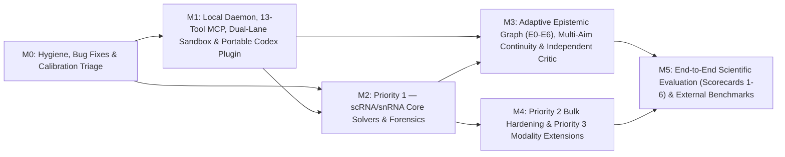

# 06 — Prioritized Implementation Roadmap & Scientific Evaluation Framework

**Specification Suite:** Automated General RNA-seq Research Agent (`devharness` / `DevBench`)  
**Audited Repository Baseline:** `18161fdabd162084732a4dd3c74e1ea42254a81b` (delta from 2026-11-23 audit `ad1d74724e1e4d12a3c0fe6840e6521bd34a445b`)  
**Governing Epistemic Rule:** Software execution verification (`L1`) does NOT establish statistical calibration (`L2`), scientific validity (`L3`), or clinical safety (`L4`). Clinical diagnosis/release remains permanently out of scope (`clinical_release_allowed = false`).  
**Cross-References:** [README.md](README.md) · [01-baseline-audit-and-gaps.md](01-baseline-audit-and-gaps.md) · [02-problem-space-and-methods.md](02-problem-space-and-methods.md) · [03-adaptive-research-design.md](03-adaptive-research-design.md) · [04-system-architecture-and-governance.md](04-system-architecture-and-governance.md) · [05-codex-and-mcp-integration.md](05-codex-and-mcp-integration.md)

---

## 1. Four-Level Claim Separation Hierarchy (`L1`–`L4`)

Every receipt, thesis package, release gate, and benchmark scorecard MUST tag claims using the canonical `claim_tier` wire enum (`none` | `L1_execution_verified` | `L2_statistically_calibrated` | `L3_scientifically_supported`; `L4` is permanently excluded via `clinical_release_allowed = false`) and `critic_origin` enum (`deterministic_verifier` | `ai_critic_review` | `human_expert_panel` | `hybrid`). Higher levels strictly require passing all lower-level prerequisites; a pass at `L1` MUST NEVER be reported as `L2` or `L3`.

| Claim Level (Wire Enum) | Name | What It Establishes | Required Evidence to Earn Level | Explicitly Forbidden Inferences | HEAD `18161fd` Status |
|---|---|---|---|---|---|
| **`L1`** (`L1_execution_verified`) | **Execution Verified** | Code, container, schema, custody, and replay mechanics ran deterministically on bound inputs without silent truncation, privacy leakage, or orphan processes. | Digest-pinned runtime, exact plan SHA-256, `outputSchema` conformance, `COUNT-1` / tested-universe / partition integrity checks, crash/cancel cleanup receipts, independent Studio/receipt parity. | Does NOT establish calibrated false-discovery control, biological accuracy, method optimality, or autonomous agent judgment. | **Partial:** `make test-rna-release` passes **9/39** question contracts (30/39 blocked); CI runs 14/594 test files + 6 plugin tests. |
| **`L2`** (`L2_statistically_calibrated`) | **Statistically Calibrated** | **Solver level:** procedure controls error rates within a formally bounded design/assay envelope. **Investigation level:** a frozen `E5` fit passes post-fit `E3` falsification probes and `ai_critic_review` Gate 2 (`ai_critic_verified: true`, serving as an `L3` pre-screen). | **Solver level:** held-out complete-null & planted-effect simulations (Scorecard 1) reporting study-level FDP with endpoint-matched bounds (`ADR-17`: exact one-sided Clopper–Pearson binomial UCB on global-null strata; Waudby-Smith & Ramdas 2024 hedged-betting CI / predictable plug-in empirical Bernstein on planted-signal strata), small/moderate-effect power, CI coverage, LODO stability, and depth/dispersion/confounding stress tests. **Investigation level:** `L2`-qualified solver + passing post-fit `E3` probes + `deterministic_verifier`/`ai_critic_review` Gate 2. | Does NOT establish independent biological ground truth, causal mechanism, external-cohort generalization, or qualified human scientific validation (`ai_critic_review` never auto-stamps `L3`). Under `ADR-17`, solo-developer self-audits remain capped at `L1`/`L2`. | **Failing / Incomplete:** `edgeR 4.10.7` fails 3/5 frozen null regimes (B-I 9.0%, S-I 10.5%, S-P 8.0% vs 7.5%); DTU fixed seed-337 (13/250) only; scCODA, spatial, Milo, markers uncalibrated. |
| **`L3`** (`L3_scientifically_supported`) | **Scientifically Supported** | **Investigation level:** a conclusion is corroborated beyond single-dataset statistical fit. **Platform/agent level:** the integrated autonomous agent + Critic produces valid, reproducible, well-calibrated biological conclusions (and appropriate refusals/negative findings) on blinded real and perturbed studies. | **Investigation level:** `L2_statistically_calibrated` PLUS independent external replication / orthogonal experimental validation OR qualified `human_expert_panel` sign-off. **Platform level (`M5`):** passing Scorecards 2–6 under `ADR-17` functional governance separation (adversarial/forensic perturbations, paired false-refusal/false-acceptance balance, competing-method discipline, non-10x transfer, multi-aim backtracking replays, published-study reproduction, and external blinded `human_expert_panel` adjudication with Krippendorff's `alpha >= 0.70` or quadratic-weighted `kappa >= 0.70`). | Does NOT authorize clinical diagnosis, patient treatment decisions, or regulatory compliance. | **Not Run (`0` campaigns):** `agentic-rna-v24-evaluation-protocol.md` blocked; `discovery-evaluation-protocol.md` `NOT_RUN`; zero live-Codex or external benchmark scores. |
| **`L4`** *(excluded)* | **Clinically Validated `[Held / Out of Scope]`** | Regulatory-grade clinical safety, analytical/clinical validity, authenticated electronic signatures, and operational clinical controls. | Independent prospective clinical validation, accredited clinical QA/QC, authenticated human clinical sign-off, and regulated deployment controls. | **Permanently forbidden in this system (`clinical_release_allowed = false`).** Local SHA-256 DAGs are tamper-evident logs, never compliance certificates or e-signatures. | **Held (`clinical_release_allowed = false`).** |

---

## 2. Prioritized Implementation Roadmap (`M0`–`M5`)

### 2.1 Milestone Dependency Graph

### 2.2 Detailed Milestone Specifications

#### `M0` — Hygiene, Bug Fixes & Calibration Triage
- **Objective:** Eliminate known HEAD `18161fd` defects, contract drift, stale v0.1.0 Codex packaging, and diagnose the blocking `edgeR` null-calibration & cross-architecture drift before building new layers.
- **Dependencies:** None (starts immediately on HEAD `18161fd`).
- **Target Modules:**
  - [`src/devbench/platform/plugin_rna_solvers.py`](../../../src/devbench/platform/plugin_rna_solvers.py) (line 408: align `spatial_pattern` preflight with optional `cell_type` in `spatial_analysis.py:331-334`).
  - [`src/devbench/platform/plugin_mcp.py`](../../../src/devbench/platform/plugin_mcp.py) (declare `outputSchema` in `list_tools()`; fix `readOnlyHint=False` on state-mutating `plan_rna_workflow`; remove private-only streaming asymmetry at line 619 so public/synthetic H5ADs also stream; diagnose Kang 38 MB `local_workflow_unavailable` bypass).
  - [`src/devharness_server/r/bulk_edger.R`](../../../src/devharness_server/r/bulk_edger.R), [`src/devharness_server/r/mounted_edger.R`](../../../src/devharness_server/r/mounted_edger.R), [`src/devharness_server/r/mounted_general.R`](../../../src/devharness_server/r/mounted_general.R), [`src/rna_kernels/mounted_bulk.py`](../../../src/rna_kernels/mounted_bulk.py), [`tests/test_thesis_calibration.py`](../../../tests/test_thesis_calibration.py) (HEAD **already** calls `glmQLFit(..., legacy = FALSE, robust = TRUE, abundance.trend = TRUE, dispersion = NULL)` in `bulk_edger.R:108-109` and `mounted_edger.R:55-56`, and `evidence.json` shows independent pooled `39/400 = 9.75%, p = 7.95e-5` vs paired `38/600 = 6.33%, p = 0.134`. Execute the ratified `ADR-15` fixed 2×2 diagnostic ablation separating **DGP** [`pure NB` vs `LogNormal-compounded NB`] × **panel scale** [`N = 192` vs `N = 10,000`] across `edgeR v4` [`legacy = FALSE`, `robust = TRUE/FALSE`, `abundance.trend = TRUE/FALSE`, `TMM` vs `RLE`, `filterByExpr`], `limma-voom` [`voom` / `voomWithQualityWeights` + `eBayes(robust = TRUE)`], `DESeq2`, and `dreamlet`; implement the pre-specified, label-blind regime-routed solver policy; and deploy the `ADR-16` same-arch SHA-256 + cross-arch hybrid equivalence verifier, keeping Netlib/FlexiBLAS as optional debug oracle only).
  - [`integrations/codex/`](../../../integrations/codex/) (retire stale `devharness-0.1.0.zip`, `README.md`, `validation/`, `package-evidence.json`, and broken `tests/verify_rna_runtime.py`; fix `mcp-payload-contracts.md:301` stale `effect` ranking and `L519` `cell_type` drift).
  - [`AGENTS.md`](../../../AGENTS.md) & [`src/devbench/adaptive/`](../../../src/devbench/adaptive/) (separate benchmark-only `final_discovery.json` / 100 MB rules from general research agent guidance; explicitly deprecate/remove quarantined `exploration.py`/`policy.py`/`ledger.py` dead stubs while keeping live `models.py`/`admission.py`).
- **Concrete Pass/Fail Acceptance Criteria (`L1`/`L2`):**
  1. Cell-type-free `spatial_pattern` executes cleanly through MCP STDIO with matching receipt and verified test.
  2. Public Kang 2018 PBMC 38 MB H5AD inspects and stages cleanly through MCP without bypassing `inspect_inputs`.
  3. Zero stale v0.1.0 Codex artifacts remain advertised as active; `mcp-payload-contracts.md` matches runtime behavior 100% under an automated contract-drift test.
  4. `ADR-15` 2×2 DGP×scale root-cause memo + label-blind regime-routed solver policy verified across the preserved 2,200-cohort regression panel (`tests/test_thesis_calibration.py`) AND a new independently seeded validation panel (`n = 1,200–1,350` global-null cohorts/stratum with exact one-sided Clopper–Pearson UCB `U <= 0.075` per `ADR-17`): `<500` eligible genes uses `edgeR v4` (`legacy = FALSE, robust = TRUE, abundance.trend = FALSE, TMM, filterByExpr`); balanced/paired `n < 15`/arm uses `edgeR v4 QL` (`TMM`) + `limma-voom` sensitivity; unbalanced/repeated/longitudinal uses `dreamlet`; heterogeneous independent-donor / `n >= 15–20`/arm (or confirmed LogNormal-NB failure) uses `limma-voom` (`voomWithQualityWeights` + `eBayes(robust = TRUE)`) primary + `edgeR v4` sensitivity (+ rank/permutation sensitivity at `n >= 20`/arm). Any regime still failing its frozen gate remains marked uncalibrated.
  5. `ADR-16` numerical equivalence verifier passes both `exact_match_same_arch` (`sha256` byte identity, `0` tol, single-threaded BLAS) and `cross_arch_calibrated_match` across `arm64` vs `amd64` (`0` discrete tol; continuous `rtol = 1e-5, atol = 1e-7` near-zero `|x| < 1e-4`; dual `p`/`q` linear `atol = 1e-5` AND `|log10(p_1) - log10(p_2)| <= 5e-4` for `p >= 1e-300`, `0 <= p <= q <= 1`, within-arch BH `atol = 1e-14`; 100% discovery agreement outside `0.05 +/- 2e-5`, 0 sign flips, boundary-band genes logged).
  6. `AGENTS.md` meets the `< 8 KiB` target (`< 16 KiB` CI warning, strictly below Codex's `32 KiB` `project_doc_max_bytes` hard cap).
- **Anti-Gaming Rules:** Do NOT alter the historical 2,200-cohort seed/generator to hide the `ad1d7472` failure (preserve it as a permanent regression case); do NOT relax the null-FDR ceiling post-hoc.

#### `M1` — Unified Control Plane, Local Research Engine Daemon, Dual-Lane Sandbox & Portable Codex Plugin
- **Objective:** Replace the split dual-MCP (`plugin_mcp.py` + `devharness_server`) and monolithic 15-op `Plan` union with the target architecture specified in [04-system-architecture-and-governance.md](04-system-architecture-and-governance.md) and [05-codex-and-mcp-integration.md](05-codex-and-mcp-integration.md).
- **Dependencies:** `M0`.
- **Target Modules:**
  - Unified Local Research Engine Daemon (`M1-1` landed `4b90e76`/`292d16f` per `ADR-22`: workspace `.devbench-daemon/`, 30-min idle shutdown, `devbench mcp` STDIO default + opt-in `--enable-streamable-http`) & 13-tool MCP Control Plane refactoring [`src/devbench/platform/plugin_mcp.py`](../../../src/devbench/platform/plugin_mcp.py) (retiring the 15-op `Plan` union, extracting hardcoded `shared_motor_umap` / `motor_program_comparison`, enforcing `ADR-19` public Tier 2 per-plan default + fail-closed out-of-band `auto_approve_tier2_public`), [`src/devbench/platform/plugin_jobs.py`](../../../src/devbench/platform/plugin_jobs.py), [`src/devbench/platform/workbench_ui.py`](../../../src/devbench/platform/workbench_ui.py), and [`src/devbench/platform/workbench_http.py`](../../../src/devbench/platform/workbench_http.py), while freezing [`src/devharness_server/`](../../../src/devharness_server/) strictly to Benchmark Mode (`DevBench`) and inverting reusable statistical engines into `src/rna_kernels/` + Tier 1 Registry with thin re-export shims (`ADR-18`).
  - Dual-lane execution: replace direct `LocalDocker` calls in [`src/devbench/engine/mounted_kernel_oci.py`](../../../src/devbench/engine/mounted_kernel_oci.py) with `ContainerBackend` (`DockerBackend` + rootless `PodmanBackend` in `M1-3`, `ApptainerBackend` in `M2`, capped `public`/`synthetic` `L1` OS fallback per `ADR-20`; remove 4-module whitelist & rigid `--cpus 2` cap) and evolve [`src/devbench/engine/exploratory_oci.py`](../../../src/devbench/engine/exploratory_oci.py) + [`src/devbench/platform/plugin_registered_method.py`](../../../src/devbench/platform/plugin_registered_method.py) into the **Tier 2 Governed Exploratory Code Sandbox** (supporting H5AD/Zarr/Parquet, Python/R, bounded artifact extraction, `epistemic_tier="exploratory"` cryptographic tagging, and offline private execution).
  - Out-of-core storage & cap removal: [`src/devbench/core/_rna_solver_inputs.py`](../../../src/devbench/core/_rna_solver_inputs.py), [`src/devbench/core/expression_io.py`](../../../src/devbench/core/expression_io.py), [`src/devbench/engine/mounted_matrix_vault.py`](../../../src/devbench/engine/mounted_matrix_vault.py), [`src/devbench/core/rna_answerability.py`](../../../src/devbench/core/rna_answerability.py) (implement Orthogonal 3-Axis `A0–A3 × B1–B12/B_OPEN × C1–C2`, lift 100 MB / 12.5M-entry / 4,096-sample / 20k-gene / 1-job-lock / 3600s-timeout / `session_input_scope_mismatch` caps).
  - Packaging, SQLite & CI (`ADR-21`, `ADR-23`–`ADR-25`): `uv`-managed `python-build-standalone` (`sqlite3 >= 3.51.3`, zero `pysqlite3`), single-source root `plugin.json` + generated `.codex-plugin/plugin.json` mirror, 8 `.agents/skills/` + symlink-free `configure.py --mirror-clients` + `--check-mirrors`, CI legacy-tool skill lint, `inspect_runtime_capabilities`, loopback bearer token, opt-in Studio browser launch, and Tier 1/2/3 CI workflow.
- **Concrete Pass/Fail Acceptance Criteria (`L1`):**
  1. All 13 MCP control-plane tools pass strict JSON schema validation (`additionalProperties: false`), `outputSchema` validation, and honest `ToolAnnotations` across `2025-11-25` MCP clients with graceful degradation when `ui://`, Elicitation, and Tasks are absent; CI skill lint passes with zero legacy `devharness_server` tool references (`ADR-18`).
  2. Multi-job concurrency pool runs ≥2 concurrent jobs simultaneously, survives MCP STDIO client restart without killing workers, supports `cancel_run` with verified zero-orphan container cleanup (`DockerBackend` + rootless `PodmanBackend` cgroups/cleanup checks per `ADR-20`), and enforces configurable multi-hour deadlines (tested with checkpoint resume on simulated `SIGKILL`).
  3. Out-of-core inspection and Tier 1/Tier 2 execution succeed on a `>= 500 MB` sparse H5AD/Zarr matrix (`>= 36,000` GRCh38 genes) within `<= 2 GiB` control-plane RSS and `<= 4 GiB` worker RSS, and `register_investigation_input` cleanly admits a new reference atlas mid-investigation.
  4. Tier 2 custom Python/R script runs inside `--network none --read-only --cap-drop ALL`, produces a hashed `exploratory` artifact, obeys `ADR-19` explicit per-plan default + fail-closed out-of-band `auto_approve_tier2_public`, and is mechanically blocked from emitting `E5` confirmatory claims or reading `PartitionVault` holdouts.
  5. `uv`-managed patched SQLite CI Tier 1 runs full STDIO/`test_plugin.py`/Layer 1/3/4 checks on `ubuntu-latest` + `macos-latest` (`ADR-21`, `ADR-25`), manifest-parity & `--check-mirrors` tests pass (`ADR-23`, `ADR-24`), live isolated `CODEX_HOME` smoke test passes (`codex plugin marketplace add` / `codex mcp list` / `codex exec` + `probe_boundary()`), AND privacy sentinel leakage suite reports **0 leaks** across MCP responses, stderr, error messages, and `ui://` payloads.
- **Anti-Gaming Rules:** No granting `/var/run/docker.sock` to Codex shell; no marking `L1` protocol conformance as scientific validity; no bypassing `EvidenceBroker` for `private`/`clinical` files.

#### `M2` — Single-Cell & Single-Nucleus Core (Priority 1)
- **Objective:** Deliver calibrated, SOTA Priority 1 scRNA/snRNA capabilities across `A1`, `A2`, `B1`–`B3`, `B5`–`B7`, `B9`, `B10`, wiring every currently stranded solver and replacing weak approximations identified in [02-problem-space-and-methods.md](02-problem-space-and-methods.md).
- **Dependencies:** `M0`, `M1`.
- **Target Modules:**
  - Digest-pinned scRNA/snRNA OCI images (`containers/rna-kernel-2.0/` successor) + [`src/rna_kernels/mounted_scrna.py`](../../../src/rna_kernels/mounted_scrna.py), [`src/rna_kernels/scrna_upstream_contract.py`](../../../src/rna_kernels/scrna_upstream_contract.py).
  - Forensics & QC (`A1`/`A2`): new donor-forensics module (`souporcell`/`Vireo`/sex-chr/count-distribution check), `scDblFinder`, `DropletQC`, `CellBender >=0.3.2` / `SoupX` / `DecontX`, differential retention audit.
  - Core solvers: `scib-metrics`, `popV`/`scArches`, `ClusterDE` + `CADET` + dispersion-gated `scrna_nb_countsplit.py`, `dreamlet` + `edgeR v4` + `NEBULA` + `lemur` (with CIs + LODO), `miloR`/`pertpy.tools.Milo` + `miloDE` (replacing custom Normal-Wald in `scrna_neighborhood_da.py`), multi-chain covariate-aware `scCODA` + `tascCODA` + `propeller`, `CellRank 2` + `Lamian` + `condiments` + wired `scrna_donor_trajectory.py`, `decoupler` v2 consensus + wired `CAMERA` + tested-universe enforcement across all ORA/regulon/motif tools + `scverse/liana` + `MultiNicheNet` + `SCENIC+`, `SCEPTRE` + `pertpy` + `CINEMA-OT`.
- **Concrete Pass/Fail Acceptance Criteria (`L1` + `L2`):**
  1. Every Priority 1 replacement/addition executes end-to-end through the 13-tool MCP control plane with verified receipts and plot-data sidecars (zero stranded solvers in `src/rna_kernels/` or `src/devbench/core/`).
  2. Donor-forensics gate catches 100% of synthetic sex-swap, duplicate-donor, and integer-`log2(1+x)` false-raw-count probes (`A1`), and snRNA-seq frozen-brain test cohort executes end-to-end with `DropletQC` nuclear fraction + ambient-vs-raw DE sensitivity.
  3. Multi-chain `scCODA` emits ≥4 chains with $\hat{R} \le 1.01$, ESS, covariates, and credible intervals; `miloR`/`pertpy.tools.Milo` passes donor-level null-DA calibration; `ClusterDE` / `CADET` pass post-clustering complete-null FDR checks under NB overdispersion where misspecified count-splitting fails.
  4. `edgeR v4` and `dreamlet` pseudobulk DE receipts include CIs and LODO influence refits and pass Scorecard 1 null-FDR + power criteria across `S-I`, `S-P`, `P-P`, and unbalanced repeated-donor regimes.
  5. `SCEPTRE` passes negative-control (NTC gRNA) calibration check on synthetic/public low-MOI CRISPR screen; RNA velocity outputs are mechanically constrained to `E2` exploratory tier.
- **Anti-Gaming Rules:** Do NOT reuse `scrna_neighborhood_da.py`'s Normal Wald approximation under a `Milo` label; do NOT promote `scCODA` single-chain runs; do NOT pass unverified caller backgrounds into `regulon_enrichment`/`motif_enrichment`.

#### `M3` — Adaptive Investigation Graph (`E0`–`E6`), Multi-Aim Continuity & Independent Critic
- **Objective:** Implement the full non-linear Epistemic Investigation Graph, transitive DAG invalidation, open-world method benchmarking, non-author Independent Critic/Verifier, and Reproducible Thesis Research Package specified in [03-adaptive-research-design.md](03-adaptive-research-design.md).
- **Dependencies:** `M1`, `M2`.
- **Target Modules:**
  - [`src/devbench/platform/adaptive_workflow.py`](../../../src/devbench/platform/adaptive_workflow.py), [`src/devbench/platform/thesis_aims.py`](../../../src/devbench/platform/thesis_aims.py), [`src/devbench/platform/plugin_graph.py`](../../../src/devbench/platform/plugin_graph.py), [`src/devbench/engine/scientific_authority.py`](../../../src/devbench/engine/scientific_authority.py) (unify graph dependencies with aim basis invalidation; remove `_MAX_REVISIONS=3`, `_MAX_AIMS=32`, `MAX_TURNS=256`; encode `E0`–`E6` + `E_ABSTAIN` state transitions and multi-branch preservation).
  - [`src/devbench/platform/method_planner.py`](../../../src/devbench/platform/method_planner.py), [`src/devbench/engine/exploratory_benchmark.py`](../../../src/devbench/engine/exploratory_benchmark.py) (expose `ScientificMethodPlanner` via MCP; generalize `exploratory_benchmark` beyond 64 KB binary JSON classifiers to arbitrary `B1`–`B12`/`B_OPEN` method comparisons with frozen pre-result criteria and linear-baseline gates).
  - [`src/devbench/core/thesis_blinded_review.py`](../../../src/devbench/core/thesis_blinded_review.py), [`src/devbench/analysis/scientific_review.py`](../../../src/devbench/analysis/scientific_review.py), [`src/devbench/analysis/thesis_literature.py`](../../../src/devbench/analysis/thesis_literature.py), [`src/devbench/analysis/thesis_replay.py`](../../../src/devbench/analysis/thesis_replay.py), [`src/devbench/analysis/thesis_synthesis.py`](../../../src/devbench/analysis/thesis_synthesis.py) (implement non-author Independent Critic/Verifier role, expose blinded review actions in MCP, add citation/retraction-timestamped literature custody, emit full 7-part Thesis Research Package).
- **Concrete Pass/Fail Acceptance Criteria (`L1` + `L2`):**
  1. Multi-aim backtracking integration test: revising a QC mask, ambient disposition, or donor mapping in `E1` automatically invalidates all transitively dependent `E2`/`E3`/`E5` graph nodes and `ThesisAimLifecycle` outcomes across ≥3 aims and ≥5 revisions, preserving superseded history without silent overwrite.
  2. Independent Critic/Verifier automatically blocks Gate 1 (pre-`E5`) when seeded with an unsplit clustering marker test claiming confirmatory p-values, and blocks Gate 2 (post-`E5` / pre-`E6`) when seeded with (a) missing post-fit LODO sensitivity on a single-donor-driven DE result, (b) a plot sidecar whose plotted numbers contradict the receipt table, or (c) causal language on an associative network/CCC output; passing `ai_critic_review` Gate 2 stamps `L2_statistically_calibrated` (`ai_critic_verified: true`), never `L3_scientifically_supported`.
  3. Method-benchmarking engine (`E4`) rejects post-result criterion changes and blocks an scFM/deep model that fails to beat a frozen linear/PCA baseline on a donor-disjoint split.
  4. End-to-end export of a Reproducible Thesis Research Package passes independent hash-verified replay (`thesis_replay.py`) with zero missing provenance links.
- **Anti-Gaming Rules:** Independent Critic MUST run in a distinct non-author context receiving evidence-first packets (never merely echoing the author's narrative summary); `critic_origin` MUST accurately tag `deterministic_verifier` / `ai_critic_review` / `human_expert_panel` / `hybrid`, and `ai_critic_review` MUST NEVER be aliased as `human_expert_panel`.

#### `M4` — Bulk Hardening (Priority 2) & General RNA-seq Modality Extensions (Priority 3)
- **Objective:** Close Priority 2 bulk calibration gaps (DTU/splicing, deconvolution, survival/transportable prediction, `nf-core/rnaseq`) and deliver extensible Priority 3 modality coverage (Spatial `B8`, Long-Read `B4`×`A3`, Multimodal/Repertoire `A3`, eQTL/ASE `B11`, `TileDB-SOMA`, cross-cohort meta-analysis `C1`).
- **Dependencies:** `M2` (can run in parallel with late `M3`).
- **Target Modules:**
  - Bulk hardening: [`src/devbench/core/bulk_dtu.py`](../../../src/devbench/core/bulk_dtu.py) (head-to-head qualification vs `satuRn` / `DRIMSeq` / `edgeR v4 diffSplice` + `stageR`, plus `LeafCutter`/`MAJIQ v2`), [`src/devbench/core/bulk_deconvolution.py`](../../../src/devbench/core/bulk_deconvolution.py), [`src/devbench/core/phenotype_prediction.py`](../../../src/devbench/core/phenotype_prediction.py), [`src/devbench/analysis/community_workflow.py`](../../../src/devbench/analysis/community_workflow.py) (`nf-core/rnaseq` v3.28 & `nf-core/scrnaseq` v2.2 wrappers).
  - Spatial (`B8`): [`src/devbench/core/spatial_analysis.py`](../../../src/devbench/core/spatial_analysis.py) upgraded with `SpatialData` v0.8, `Squidpy` tissue-mask/Delaunay graphs, NB-aware depth-conditioned SVG sensitivity (`SPARK-X`), `BANKSY`, `RCTD`/`Cell2location`, and multi-donor/multi-section replication.
  - Long-read (`B4`×`A3`), Multimodal/Repertoire (`A3`), eQTL/ASE (`B11`), Atlas I/O (`A0`), Meta-analysis (`C1`): OCI kernel adapters for `Bambu`/`IsoQuant`/`SQANTI3 v6`, `MuData`+`totalVI`+`Scirpy`, `tensorQTL`+`WASP`, `TileDB-SOMA` reader, and random-effects cross-study meta-analysis.
- **Concrete Pass/Fail Acceptance Criteria (`L1` + `L2`):**
  1. Qualified DTU solver controls nominal 5% type-I error and 5% stage-wise OFDR across equal-depth, 100× donor-depth imbalance (preserving seed-337 regression), 2-to-20 isoform genes, and high-leverage donor regimes.
  2. Spatial workflow eliminates cross-gap graph bridging on discontinuous tissue masks, passes the 100× capture-depth-gradient null probe (remediating the 14/32 false-SVG failure under NB overdispersion via depth-conditioned `SPARK-X`/residual comparison), and executes a multi-donor spatial study with domain + deconvolution outputs.
  3. Long-read (`Bambu`/`IsoQuant` + `SQANTI3`), multimodal (`MuData`/`totalVI`/`Scirpy`), and eQTL/ASE (`tensorQTL`+`WASP`) adapters execute cleanly through the unified control plane with `A0`–`A3` custody gates and `make test-rna-release` advances from 9/39 to verified coverage across all committed P1/P2/P3 bindings.
- **Anti-Gaming Rules:** Missing/unverified modality endpoints (e.g., Ribo-seq, m6A, circRNA without curated Tier 1 kernels) MUST route honestly to Tier 2 `B_OPEN` exploratory execution or `E_ABSTAIN`—never fake Tier 1 coverage via stub fixtures.

#### `M5` — End-to-End Scientific Evaluation, External Benchmarks & Controlled Release Gate
- **Objective:** Assign independent evaluation owners, un-block [`docs/agentic-rna-v24-evaluation-protocol.md`](../../../docs/agentic-rna-v24-evaluation-protocol.md) and [`docs/discovery-evaluation-protocol.md`](../../../docs/discovery-evaluation-protocol.md), execute all **6 Scorecards** (Section 3) on locked disjoint cohorts and pinned external benchmarks, and publish a transparent capability/failure dossier.
- **Dependencies:** `M3`, `M4`.
- **Target Modules:** [`src/devbench/study/`](../../../src/devbench/study/), [`src/devbench_engine/`](../../../src/devbench_engine/), [`src/devbench/analysis/rna_investigation_evaluation.py`](../../../src/devbench/analysis/rna_investigation_evaluation.py), [`scripts/verify_rna_execution_release.py`](../../../scripts/verify_rna_execution_release.py), plus new frozen evaluation harnesses for Scorecards 1–6.
- **Concrete Pass/Fail Acceptance Criteria (`L3`):**
  1. Functional governance separation ratified per `ADR-17` (NIST AI RMF GOVERN 2.1 / FDA GMLP): Standard (`>=5` distinct named owners) OR Small-team minimum (`2–4` people across 3 non-overlapping functional roles: Runtime/Builder Owner with zero truth access, Independent Scientific & Statistical Sign-Off, and Automated Policy-as-Code Custodian + fail-closed CI release gate), while Solo (`1` person) stays capped at `L1`/`L2` until an external blinded panel adjudicates Scorecard 6 for `L3`; plus study-level disjoint partitions (dev / pilot / locked qualification) and pinned external benchmark commits (`Q6.3`) formally sealed prior to running locked campaigns.
  2. Matched-arm live-agent evaluation (Baseline vs Optional vs Enforced, and `A0`/`B`/`C`/`D` controller+critic under matched total budgets) completes on locked cohorts (`n = 30–60` independent studies per track) with full denominator accounting (zero dropped failures/timeouts) and study-clustered uncertainty intervals.
  3. All 6 Scorecards report observed metrics under the `ADR-17` hierarchical `delta` allocation (`delta_global = 0.05`: `delta_S1 = 0.025` + `delta_S2_S6 = 0.025`, secondary diagnostics labeled nominal), failure catalog, cost/latency burden, and external blinded expert panel scores (`>= 2` independent domain reviewers + tie-breaker; Krippendorff's `alpha >= 0.70` or quadratic-weighted Cohen's `kappa >= 0.70`), cleanly separating `L1`, `L2`, and `L3` outcomes.
- **Anti-Gaming Rules:** Zero participant/developer access to locked qualification truth; zero post-result threshold/stratum/tolerance edits; any failing stratum stays unavailable rather than hidden.

### 2.3 Explicit Non-Goals
1. **No clinical diagnosis, treatment recommendation, or regulated clinical release (`L4`)** (`clinical_release_allowed = false` permanently).
2. **No autonomous wet-lab actuation or unapproved external network exfiltration of private/clinical datasets** (no Codex Cloud execution on private data).
3. **No reimplementation of mature Bioconductor/scverse statistical engines in custom Python** where digest-pinned OSS (`edgeR v4`, `dreamlet`, `scDblFinder`, `miloR`, `satuRn`, `SCEPTRE`, `SpatialData`) already has peer-reviewed calibration.
4. **No single composite "benchmark score" that collapses software execution (`L1`), null calibration (`L2`), and biological judgment (`L3`) into one number.**

---

## 3. The 6-Scorecard Scientific Evaluation Framework

This framework extends and operationalizes [`docs/evaluation.md`](../../../docs/evaluation.md), [`docs/agentic-rna-v24-evaluation-protocol.md`](../../../docs/agentic-rna-v24-evaluation-protocol.md) (study-level disjoint partitioning, matched arms `A0`/`Direct-R`/`B`/`C`/`D`/`D-late`, fail-closed admission), and [`docs/discovery-evaluation-protocol.md`](../../../docs/discovery-evaluation-protocol.md) (presentations A–F, M1–M6 discovery/restraint metrics), incorporating the ratified `ADR-17` endpoint-matched concentration bounds, stratum sample sizes, and hierarchical `delta` allocation. Every campaign freezes source digests, models, prompts, datasets, denominators, and thresholds **before** execution, labels secondary diagnostics (per-platform breakdowns, latency, token burden) as nominal/descriptive so they do not dilute confirmatory `delta`, and reports exact uncertainty intervals across independent underlying studies (clustering repeated runs/variants by study).

### Scorecard 1 — Statistical Calibration & Negative-Finding ("No Effect") Control Panel (`L2` Gate)
- **What it tests:** Whether core solvers and the integrated agent control false discoveries when the true biological effect is zero ("negative finding" datasets) while preserving power on realistic small/moderate planted signals.
- **Mandatory Strata:**
  - Bulk & pseudobulk DE across all 5 v2.4 regimes (`B-I`, `B-P`, `S-I`, `S-P`, `P-P`) plus unbalanced repeated-donor mixed designs, small-effect (`log2FC = 0.5–1.0`) and moderate-effect panels, and complete-null cohorts (preserving the 2,200-cohort `ad1d7472` panel as a regression case).
  - Multi-isoform DTU (2–20 transcripts/gene) under equal depth, 100× unequal donor depth (preserving seed-337), and single-donor leverage.
  - Spatial SVGs under 100× spatial capture-depth gradients with NB overdispersion (generalizing the 14/32 probe) and tissue-gap geometry.
  - Post-clustering marker nulls under overdispersed NB data (including misspecified dispersion) and compositional DA nulls (`scCODA`/`Milo`/`propeller`) under uneven capture rates.
  - Negative-finding ("no effect") full-agent studies (extending presentation `E` of `discovery-evaluation-protocol.md`) testing whether the agent truthfully reports a well-powered null result rather than p-hacking or inventing post-hoc subgroups.
- **Metrics & Ratified Gates (`ADR-15`–`ADR-17`):**
  - **Global-null synthetic strata ($\text{FDP}_i \in \{0, 1\}$):** Exact one-sided Clopper–Pearson binomial UCB at $n = 1,200\text{–}1,350$ cohorts/stratum with ceiling $U \le 0.075$ ($\ge 80\%$ power at true $\text{FDR} = 0.05$ across up to $10\text{–}12$ strata; resolving the Maurer–Pontil binary global-null sample-size trap). A tighter $U \le 0.060$ ceiling is required ONLY when explicitly budgeting $n \ge 6,500$ cohorts/stratum on fast pure-R/Python synthetic kernels (never on LLM-in-the-loop strata).
  - **Planted-signal synthetic strata (continuous $\text{FDP}_i \in [0, 1]$):** Waudby-Smith & Ramdas (2024, *JRSS-B* 86(1):1–27, `doi:10.1093/jrsssb/qkad009`) hedged-betting CI / predictable plug-in empirical Bernstein at $n = 600\text{–}1,000$ cohorts/stratum with ceiling $U \le 0.065\text{–}0.070$.
  - **Live-agent negative-finding & evaluation strata (Scorecards 2–6):** $n = 30\text{–}60$ independent underlying studies per track using study-clustered exact binomial / paired McNemar / Wilcoxon signed-rank (WSR) intervals with transparent uncertainty reporting.
  - **Simultaneous $\delta$ allocation (Global FWER $\delta_{\text{global}} = 0.05$, hierarchical weighted Bonferroni/Holm):** Allocate $\delta_{S1} = 0.025$ across Scorecard 1 primary strata ($\delta_k = 0.025 / K$, e.g., $0.0025$ for $K = 10$; or $0.05 / K = 0.005$ when $L2$ solver calibration is gated separately from $L3$ live-agent release) and $\delta_{S2\text{–}S6} = 0.025$ across primary live-agent release claims.
  - **Additional Calibration & Equivalence Checks:** 95% CI empirical coverage (`[92%, 98%]`), power floor on small/moderate effects, and `ADR-16` same-arch SHA-256 identity + `cross_arch_calibrated_match` across `arm64` vs `amd64`.

### Scorecard 2 — Adversarial, Misleading & Forensic Perturbation Suite (`L3` Robustness Gate; informed by `BioAgent Bench`)
- **What it tests:** Resilience to real-world messy, corrupted, mislabeled, or adversarial inputs that cause unguarded coding agents to exit `0` with scientifically invalid outputs (`BioAgent Bench`, arXiv:2601.21800).
- **Mandatory Perturbations:**
  - **Forensic traps (`A1`):** Swapped donor IDs with conflicting sex-chromosome expression or genotype mismatches; duplicate/technical-replicate samples labeled as independent animals (`F-unknown` / `F-known` from `discovery-evaluation-protocol.md`).
  - **Representation traps (`COUNT-1`):** Integer-valued `log2(1+x)` matrix falsely labeled `raw_counts` (`reproduce_probes.py` probe); batch-corrected or imputed matrix passed as raw counts.
  - **Design & enrichment traps:** Completely confounded batch/condition splits (presentation `D`), misleading irrelevant covariates, and standalone ORA gene-list queries with inflated genome-wide backgrounds (`0.01786 -> 6.02e-9` trap).
  - **Data-hygiene & context perturbations:** Decoy files in workspace, truncated/corrupted H5AD/CSV headers, omitted cell types in deconvolution references, and prompt bloat (measuring completion drop vs `BioAgent Bench`'s ~28% degradation baseline).
- **Metrics & Prospective Gates:** Zero accepted critical integrity violations (`0 / N` across frozen suite); consequential-error detection rate by Controller+Critic (`>=95%` prospective); step-level reasoning & artifact validity score (not just final output); prompt-bloat degradation `<= 5 percentage points`.

### Scorecard 3 — Paired Abstention Calibration: False Refusal vs False Acceptance (`L3` Judgment Gate; informed by `BixBench`)
- **What it tests:** Calibrated scientific restraint—directly preventing the `BixBench` (arXiv:2503.00096) failure mode where frontier models over-refuse complex valid tasks whenever an abstention option is exposed.
- **Design (Matched Twin Pairs):** Every unanswerable/confounded/missing-assay study (`E_ABSTAIN` expected) is paired with a minimally modified **answerable twin** (e.g., completely confounded batch/condition vs partially overlapping batch/condition; unverified duplicate IDs `F-unknown` vs verified same-library resequencing `F-known`; missing-assay RNA-modification claim vs valid bulk DE on the same file; snRNA-seq missing mito symbols that IS valid for nuclear QC & pseudobulk DE; redundant-alias donor column that IS repairable).
- **Metrics & Prospective Gates:** Report BOTH **False Acceptance Rate** (confirmatory claim emitted on unanswerable twin; target `0%` critical violations) AND **Terminal False Blocking Rate** (answerable twin falsely refused; prospective target `<= 5%`), plus Initial Erroneous Critic Hold Rate (`<= 10%` prospective) and Useful Completion lower 95% confidence bound (`>= 0.85` on answerable strata per v2.4).

### Scorecard 4 — Competing-Method Discipline & Anti-Hype Evaluation (`L3` Methodological Gate)
- **What it tests:** Whether the agent actually executes and compares competing explanations and simple baselines instead of favoring flashy, newly hype-driven, or already-wired methods.
- **Mandatory Scenarios:**
  - Single-cell foundation model / deep perturbation predictor vs simple linear / PCA / `scVI` baseline on donor-disjoint splits (Ahlmann-Eltze et al., 2025; Kedzierska et al., 2025).
  - Unadjusted spatial Moran's I vs capture-depth-conditioned `SPARK-X` when library size tracks tissue structure (Bhuva et al., 2024).
  - Single-cell cell-level Wilcoxon DE (pseudoreplicated) vs donor pseudobulk `edgeR v4` / `dreamlet`, and unsplit Leiden markers vs `ClusterDE` / `CADET`.
  - Splicing-kinetics RNA velocity vs real-time/CellRank 2 multi-view fate mapping on discordant lineages.
  - Subgroup heterogeneity / sex-by-condition crossover (presentations `A` & `B` of `discovery-evaluation-protocol.md`) where marginal DE misses the true biological structure.
- **Metrics & Prospective Gates:** Executed-alternative receipt rate (`M5` from `discovery-evaluation-protocol.md`: merely naming an alternative earns **0 credit**); pre-result frozen comparison-criteria compliance (`100%`); parameter-attribution accuracy (`100%` separation of user-prespecified vs assistant/default parameters); accurate disagreement disclosure when comparators diverge.

### Scorecard 5 — Unfamiliar Questions, Non-10x Technology Transfer & External Benchmarks (`L3` Generalization Gate; informed by `scBench`, `BixBench`, `BioAgent Bench`)
- **What it tests:** Real-world generalization outside memorized 10x Chromium + Scanpy tutorials and outside the 12 named `Axis B` families.
- **Mandatory Components:**
  - **Unclassified `B_OPEN` Thesis Tasks:** Held-out composite questions (e.g., cross-modal isoform-expression coupling, non-standard longitudinal interaction + composition mediation) requiring Tier 2 Governed Exploratory Sandbox prototyping + `E3`/`E4` verification.
  - **Non-10x Technology Transfer:** Held-out real cohorts spanning Parse Biosciences combinatorial barcoding, Smart-seq3, frozen postmortem brain snRNA-seq, Visium HD / Xenium imaging spatial, and ONT/PacBio long-read RNA-seq—measuring cross-platform accuracy gap (targeting `< 10 pp` drop vs `scBench`'s `40+ pp` frontier-model collapse).
  - **Pinned External Benchmark Suites (Matched Total Budgets):**
    - `scBench` (`github.com/latchbio/scbench`, exact pinned commit/tag): report overall and per-platform accuracy across Baseline vs DevHarness-assisted arms.
    - `BixBench` (`github.com/Future-House/BixBench`, pinned release): report open-answer accuracy AND MCQ with/without refusal ablation (explicitly logging false-refusal rates).
    - `BioAgent Bench` (`arXiv:2601.21800`, pinned RNA-seq + perturbation tracks): report step-level progress and perturbation retention.
- **Metrics:** Paired arm lift (DevHarness Controller+Critic vs unassisted Codex baseline at matched total token/wall/compute budget), cross-platform transfer drop, and `B_OPEN` valid-completion rate.

### Scorecard 6 — Multi-Aim Longitudinal Backtracking, Published-Study Reproduction & Blinded Expert Rubric (`L3` Thesis Gate; informed by `CORE-Bench` & `DiscoveryBench`)
- **What it tests:** Sustained, multi-session thesis investigation fidelity—where early assumptions break mid-study—plus external biological reproduction and qualified human scientific review.
- **Mandatory Components:**
  1. **Multi-Aim Longitudinal Backtracking Replays:** Multi-aim studies seeded with a late-discovered artifact (e.g., ambient spillover or single outlier donor discovered in Aim 2 that invalidates Aim 1 DE and Aim 3 pathways), scoring transitive DAG invalidation, honest revision history, cross-aim multiplicity accounting, and process/methodology adherence (extending `CORE-Bench`'s shift from binary pass rates to process scores).
  2. **Published-Study Reproduction Panel (4 Reference Cohorts):**
     - *Bulk paired*: Airway 2015 (`methods/airway-2015/`, paired donor design + `tximport`/`svaseq`).
     - *scRNA paired stimulation*: Kang 2018 PBMC (`examples/single-cell-rnaseq/`, executed **fully through MCP without bypass**).
     - *snRNA-seq frozen tissue*: BICCN motor cortex nuclei (testing nuclear/intronic QC, ambient spillover, and annotation uncertainty).
     - *Multi-donor spatial*: Public multi-donor spatial cohort with independently assessed histology (testing `SpatialData`, depth sensitivity, domains, and donor-level replication).
  3. **Blinded Domain-Expert Evaluation Rubric (`ADR-17` / `Q6.6` — `>= 2` Independent Domain Reviewers + Tie-Breaker; Inter-Rater Reliability Floor: Krippendorff's $\alpha \ge 0.70$ or Quadratic-Weighted Cohen's $\kappa \ge 0.70$; Scored 1–5 Blinded to Arm Identity):**

| Rubric Dimension | Score 1 (Fail / Unsafe) | Score 3 (Supervised Thesis Acceptable) | Score 5 (Publication-Grade Rigor) |
|---|---|---|---|
| **1. Question, Estimand & Design Validity** | Wrong unit/pseudoreplication; ignores confounding. | Valid estimand & unit; minor covariate omissions disclosed. | Exact estimand, rank/unit verified, clear pre-specified contrasts & design limits. |
| **2. Data, Forensic & QC Hygiene** | Misses swaps/doublets/ambient/format traps. | Standard QC & basic diagnostics; retention logged. | Modality-specific QC (e.g., snRNA nuclear/ambient), forensic checks, differential retention audited. |
| **3. Statistical Rigor & Anti-Circularity** | Double-dipping, bad ORA background, uncalibrated test. | Valid primary test & multiplicity; limited sensitivity. | Calibrated `L2` solver, anti-circular labels/splits, CIs, LODO influence, exact tested-universe receipts. |
| **4. Competing Explanations & Restraint** | Over-claims causality; ignores null/contradictions. | Notes key caveats; runs ≥1 sensitivity check. | Executes genuine competing hypotheses/baselines, reports negative findings & honest abstention. |
| **5. Reproducibility & Plot-Data Fidelity** | Broken replay; plot contradicts table or missing provenance. | Reproducible script & matching primary figures. | Full SHA-256 DAG replayable Thesis Package; every figure verified against bound numeric sidecars. |
| **6. Thesis Utility & Follow-Up Actionability** | Unusable or misleading narrative. | Sound chapter draft needing moderate human rework. | Coherent multi-aim synthesis, clear limitations, and experimentally grounded follow-up aims. |

---

## 4. Anti-Gaming & Evaluation Integrity Rules

1. **Study-Level Disjoint Partitioning:** Development, pilot, and locked qualification partitions are split at the **underlying biological study / generator cluster** level. All derived views, perturbations, and seeds of one study stay in one partition; any exposed qualification study is permanently burned from future locked claims.
2. **Complete Denominator Honesty:** Operational crashes, timeouts, refused runs, partial runs with already-exposed discoveries, and unknown-usage episodes remain in the assigned-study denominator—never dropped as "infrastructure exclusions."
3. **Matched Total Budgets Across Arms:** Comparative arms (Baseline vs Optional vs Enforced; Controller vs Controller+Critic) MUST match total tokens, wall time, compute, tool calls, retries, and human clarification rules, logging actual usage alongside ceilings.
4. **Independent Functional Ownership Separation (`ADR-17`, per NIST AI RMF GOVERN 2.1 / FDA GMLP):** Runtime and developer teams CANNOT self-certify `L2` calibration or `L3` blinded expert adjudication. Standard (`>= 5` people) uses 5 distinct named owners; small teams (`2–4` people) enforce 3 non-overlapping functional roles (Runtime/Builder with zero qualification-truth access, non-author Independent Scientific/Statistical Sign-Off, and Automated Policy-as-Code Custodian + Release Gate); solo developers (`1` person) cap self-audited claims at `L1`/`L2` until an external blinded review panel adjudicates Scorecard 6 for `L3`. `critic_origin` (`deterministic_verifier` | `ai_critic_review` | `human_expert_panel` | `hybrid`) MUST distinguish automated checks (`ai_critic_review` earns at most `L2_statistically_calibrated` with `ai_critic_verified: true`) from qualified `human_expert_panel` review.
5. **No Post-Result Moving of Goalposts:** Thresholds, tolerances, strata, family weights, and stopping rules are frozen and hashed prior to locked evaluation. Failures are preserved as permanent regression records; changing criteria requires a new prospective protocol version and fresh disjoint cohorts.
6. **Strict `L1`–`L4` Disclosure:** Every report, UI card, and thesis package explicitly prints the highest achieved claim level (`L1`/`L2`/`L3`), unmet gates, and `clinical_release_allowed: false`.

---

## 5. Concrete Acceptance Criteria (Roadmap & Evaluation Framework)

1. **Milestone Gate Enforcement:** No milestone (`M0`–`M5`) may close until every listed pass/fail criterion has a hash-verified execution receipt checked into the release ledger and all prior-milestone regression tests remain green.
2. **Protocol Operationalization:** An executable fail-closed admission validator enforces all 8 rejection rules of [`docs/agentic-rna-v24-evaluation-protocol.md`](../../../docs/agentic-rna-v24-evaluation-protocol.md#L326-L348) (assigned independent owners, disjoint partitions, ratified numerical tolerances, matched total budgets, frozen denominators) before any locked `M5` campaign starts.
3. **All Six Scorecards Executed on Locked Data:** `M5` release requires non-empty, uncertainty-bounded results across Scorecards 1–6 (including negative-finding datasets, adversarial perturbations, paired false-refusal/false-acceptance twins, competing-method anti-hype tests, pinned external benchmarks, and blinded human expert scoring on the 4-cohort reproduction panel).
4. **Transparent Capability Envelope Publication:** Final evaluation output publishes an explicit **Qualified Envelope Table** stating exactly which `(Axis A, Axis B)` combinations earned `L1`, `L2`, or `L3`, which failed or remain unmeasured, and total compute/cost/human-review burden per useful study.

---

## 6. Unresolved Questions & Open Decisions

| ID | Open Decision | Options & Tradeoff | Blocking Milestone |
|---|---|---|---|
| **Q6.1** | **PARTIALLY RATIFIED (`ADR-17` / `UD-24`) — Functional Governance Separation Tiers & Named `M5` Budgets** | **Role tiers settled (`ADR-17`):** Standard (`>=5` distinct owners), Small-team (`2–4` people across 3 non-overlapping functional roles: Runtime/Builder without truth access, Independent Scientific/Statistical Sign-Off, Automated Policy-as-Code Custodian + Release Gate), and Solo (`1` person capped at `L1`/`L2` until external blinded panel adjudicates Scorecard 6 for `L3`). **Still open for `M5` lock:** assigning concrete named individuals and compute/model spend budgets at campaign admission. | **`M5`** *(Role tiers settled; names/budgets at `M5`)* |
| **Q6.2** | **RATIFIED (`ADR-17` / `UD-24`) — Endpoint-Matched Bounds, Stratum Sizing & Simultaneous $\delta$ Allocation** | **Settled (`ADR-17`):** Global-null (`FDP_i in {0,1}`) exact one-sided Clopper–Pearson UCB `U <= 0.075` at `n = 1,200–1,350`/stratum (`0.060` only at `n >= 6,500` on fast pure-R/Python synthetic kernels, never LLM-in-the-loop); planted-signal Waudby-Smith & Ramdas (2024, *JRSS-B*, `doi:10.1093/jrsssb/qkad009`) hedged-betting / empirical Bernstein `U <= 0.065–0.070` at `n = 600–1,000`; live-agent `n = 30–60` studies with study-clustered exact binomial/McNemar/WSR intervals. Global FWER `delta_global = 0.05` (hierarchical weighted Bonferroni/Holm: `delta_S1 = 0.025` [`delta_k = 0.025/K`, or `0.05/K` if `L2` gated separately from `L3`] + `delta_S2_S6 = 0.025`; secondary diagnostics nominal). | **`M0` / `M5`** *(Ratified)* |
| **Q6.3** | **Pinning External Benchmark Commits (`scBench`, `BixBench`, `BioAgent Bench`)** | `latchbio/scbench` exhibits paper-vs-repo task inventory drift; evaluation custodian must freeze exact commit SHAs, subset inclusion rules (RNA-seq tracks), and maximum budget ceilings before `M5` ingestion. | **`M5`** *(Open)* |
| **Q6.4** | **Multi-Donor Public Spatial Reference Cohort Selection** | Need an open-licensed, multi-donor, multi-section spatial transcriptomics dataset with independently assessed histology (free of controlled-access restrictions) to complete Scorecard 6's 4-cohort reproduction panel alongside airway, Kang PBMC, and BICCN cortex. | **`M4` / `M5`** |
| **Q6.5** | **RATIFIED (`ADR-25` / `UD-11`) — Three-Tier CI & Release Verification Topology** | **Settled (`ADR-25`):** Tier 1 PR-blocking (`ubuntu-latest` + `macos-latest`, `<15 min`, `uv`-managed SQLite `>= 3.51.3`, `ruff`, `mypy`, `AGENTS.md` size gate, plugin/mirror parity & legacy-tool lint, full pure-Python + daemon + Layer 1/3/4 + `test_plugin.py`); Tier 2 Nightly/`workflow_dispatch` (`ubuntu-latest` + `ubuntu-24.04-arm` native Docker/Podman mounted OCI, `ADR-16` parity, isolated `CODEX_HOME` smoke); Tier 3 Release-gated/manual (`ADR-15`/`ADR-17` `L2` calibration & locked `M5` Scorecards 2–6). | **`M1` / `M5`** *(Ratified)* |
| **Q6.6** | **RATIFIED (`ADR-17` / `UD-24`) — Blinded Human Expert Panel Size & Inter-Rater Agreement Floor** | **Settled (`ADR-17`):** Minimum `>= 2` independent domain reviewers + tie-breaker per study, with inter-rater reliability floor Krippendorff's `alpha >= 0.70` or quadratic-weighted Cohen's `kappa >= 0.70` on Scorecard 6 adjudication. | **`M5`** *(Ratified)* |
