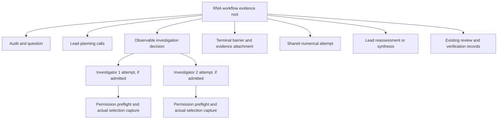

# LangSmith RNA Cross-Agent Tracing Implementation Plan

> **For agentic workers:** Use `executing-plans` for an explicitly authorized implementation, or `subagent-driven-development` only when delegation is authorized. Steps use checkboxes to track future work. Assign one writer per file group and preserve other workers' edits.

**Goal:** Make the first bounded bulk RNA adapter's lead, zero to two independent investigators, shared numerical execution, reconciliation, failures and resource evidence inspectable in controlled near-real-time nested LangSmith traces without changing scientific behavior or granting execution authority.

**Architecture:** Keep the existing local operation ledger, protected captures, immutable artifacts and checkpoint bindings authoritative. First qualify a versioned read-only projection and reviewed post-run export; then add trusted coordinator instrumentation, explicit local process correlation and a durable sanitized outbox feeding a separate best-effort exporter of live starts/ends. No scientific process receives an external tracing client or credentials.

**Tech stack:** Existing Python, SQLite operation ledger and immutable artifact store; optional pinned LangGraph 1.2.12, LangChain Core 1.6.6 and LangGraph SQLite checkpoint 3.1.1; existing LangSmith REST uploader; pytest with fake transports and bounded synthetic fixtures. SDK/manual and OpenTelemetry transports are alternatives requiring separate qualification.

**Status — 2026-10-06: PLAN ONLY.** Creating this document and its [handoff](../../langsmith-rna-tracing-handoff.md) does not implement instrumentation, enable tracing, alter environments, run tests/models/scientific analyses, read credentials, export/upload evidence, create projects or commit files. Checkbox work below is future implementation. All file operations resolve beneath `/Users/vajraang/Documents/ChatGPT/bio-agent-harness`; owner paths and links are relative to that root, command paths are absolute. Historical evidence, supplied inputs, answer schemas and qualified environments stay intact.

## 1. What data do we have?

This feature operates on bounded **execution evidence**, not expression data. Its initial scientific workload is the existing bulk RNA adapter, with declared raw-count or normalized-expression representation, gene-by-sample identity, exact metadata joins, group/contrast definitions and biological-unit declarations. The existing input contract permits at most 100 MB, 100,000 genes and 128 samples; it does not establish sample independence or assay validity. Do not load matrices into the exporter. No new biological data were analyzed while planning.

| Evidence class | Current sources | Treatment |
|---|---|---|
| Observed | Operation/reservation transitions; actual selector dispatch checkpoints; protected capture manifests; verified usage; immutable artifacts; graph cursor | Verify bytes and source binding. Record only supported status/measurement facts. |
| Supplied declarations | Data classification, measurement family, units, contrast/test-family and resource policy, exact requirement origins | Preserve attribution locally; export enumerated scope and opaque references only. |
| Inferred | Reconstructed parent linkage or display timing when original receipts lack clocks | Label reconstruction and timing unavailable; never call it measured execution. |
| Unknown | Missing capture, uncertain launch, native total-token ceiling, unsupported isolation, absent cost/timing/memory or unperformed review | Retain null/unknown and a reason code. Never infer zero from missing evidence. |

Observed source inspection on this date:

- [Existing optional exporter](../../langsmith.md) supports terminal study/preflight evidence and explicit synthetic/public-processed scope. `devbench/study/langsmith_export.py::prepare_export` creates a payload and local evidence map; `upload_export` uploads its exact hash-bound payload. It does not yet accept an independent RNA workflow checkpoint as its source format.
- [Independent investigations](../../rna-independent-investigations.md) expose `create_rna_workflow(mode="independent_investigations", ...)`, one bounded pre-fit or post-fit fork, allocation ceiling 0/1/2, private contexts, terminal barrier and evidence attachment. Default `single_agent` remains serial.
- `devbench/analysis/langgraph_investigations.py::require_pinned_graph` calls `ensure_local_observability`; the selected independent mode requires pinned LangGraph. `devbench/analysis/langchain_tools.py` rejects enabled external tracing environment flags, callbacks and inherited LangSmith context (`enabled`, `client`, `parent`). Preserve this guard.
- `AuditedInvestigationBackend.capabilities()` reports native `source_inspected_not_multiagent_qualified`, aggregate token ceiling unavailable, optional post-hoc usage and unqualified parallel boundary. `require_admission` blocks native independent launch. Tracing cannot qualify those capabilities.
- `WorkflowOperationLedger` owns campaign/reservation accounting; `verify_selection_capture`, `verify_capture` and `retain_verified_usage` own capture validity. `IndependentRNAWorkflow.open_replay` requires existing read-only stores; replay does not dispatch, fit, retrieve, resume or initialize storage.
- Existing exporter bounds are 8 MB/file or payload, 64 MB total reads, default 2,000 spans and maximum 10,000. Hosted endpoint allowlist includes documented US/EU/AWS-US/APAC hosts; custom/self-hosted endpoints are currently unsupported. Upload stops at first failed/ambiguous request and performs no automatic retries.

The retained [qualification summary](../../../reports/rna-agent-readiness/2026-10-04-independent-subagents-qualification/qualification-summary.json) was inspected as bounded summary fields: SHA-256 `a2f2946dcb559d3c8182b5ab082ffd722f111850526bf09d051dca8ee2846de8`, 3,350 passes, 799 new/changed tests passing, one retained T14 failure and four retained harmonypy setup errors, zero skips. The [root verification](../../../reports/rna-agent-readiness/2026-10-04-independent-subagents-qualification/root-final-verification.json), SHA-256 `08ada1c7179f171524a9086a356046522f7b47346414397fbf8ad083ba332181`, records 42/42 checks true, 685 source files, no unexpected nonpasses/identity drift, preserved canonical/old-workflow environments and no native provider campaign. These are retained verification records, not tests rerun by this planning task; do not call the broad suite green. The older workbench status remains historical.

The inspected documents and code support the implementation facts above. This plan does not claim fresh suite results, service acceptance, dashboard rendering or a new qualified source identity.

## 2. What question are we investigating?

The implementation objective is: **Can a reviewer reconstruct what the lead and each admitted child actually did, what was captured, what was charged, what failed, what numerical evidence they shared, and what remains unknown, without changing the underlying RNA workflow?**

| Source | Requirement or choice | Attribution |
|---|---|---|
| Current user request | Detailed LangSmith implementation plan and handoff; visibility across agents | Direct requirement. Planning is authorized; enablement is not performed. |
| Workspace AGENTS.md | Ordered scientific explanation, trusted tool path, immutable evidence, explicit units/designs, no clinical external input or invented results | Governing constraints. |
| Existing qualified adapter | Lead plus conditional 0–2 independent investigators; LangGraph required in selected mode; local ledger/captures authoritative | Existing interface to preserve. |
| This plan | Post-run REST qualification first, trusted live start/end export later, bounded outbox, proposed software thresholds | Proposed engineering choices, not user-prespecified scientific parameters. |
| Later separately authorized study | Whether extra investigators improve scientific quality under matched budget | Independent evaluation; not demonstrated by tracing or offline fixtures. |

Non-goals for this release: replace the ledger, add a model provider, add unmetered summarization/citation calls, expose prompts or matrices, add agents, change admission/budget rules, migrate every workflow, add HPC or remote notebook execution, broaden single-cell support, automatically evaluate with an LLM, or claim scientific/clinical qualification.

## 3. Which methods are appropriate, and why?

| Approach | Benefit | Limitation / decision |
|---|---|---|
| **A. Local projection qualification → trusted coordinator events → sanitized outbox → separate REST live exporter** | Reuses existing preview/receipt/endpoint controls as the first gate; then makes actual nested starts/ends visible during work. No remote client in measured processes. | Recommended staged delivery. Post-run reconstruction qualifies topology first; live instrumentation is required to satisfy the full near-real-time objective. Missing historical timing remains unknown. |
| B. Manual LangSmith SDK tracing in an isolated export process | `RunTree`, explicit IDs/parents and controlled client can ease topology/lifecycle management. | Optional transport only. Adds dependencies and asynchronous drain behavior; qualify separately. Never wrap scientific tools/models or activate inherited tracing context. |
| C. OpenTelemetry collector with manual allowlisted spans | Standard transport and optional backend fanout; supports cross-service propagation. | Deferred. Broader dependencies, baggage and attribute leak risks, parent-ingestion ordering, flush/queue behavior and collector operations require a separate bounded rollout. No global provider/auto-instrumentation in scientific workers. |

Official distributed tracing uses explicit propagated headers, with SDK `to_headers()` and receiver `tracing_context(parent=...)`; the documentation warns against trusting caller baggage because it can influence project/tags/metadata. We adopt validated identity propagation, not arbitrary baggage or a scientific tracing context. [LangSmith distributed tracing](https://docs.langchain.com/langsmith/distributed-tracing).

The REST interface supports parent-child runs. Basic `/runs` ingestion can derive trace fields; batch `/runs/multipart` requires caller-generated `trace_id`/`dotted_order`. Keep existing basic transport initially and test explicit tree fields; batch is a later transport optimization. [LangSmith REST tracing](https://docs.langchain.com/langsmith/trace-with-api).

LangSmith offers input/output hiding and processors, but metadata still exists. Use a strict export allowlist before any transport rather than treating a masking callback as the privacy boundary. [LangSmith masking](https://docs.langchain.com/langsmith/mask-inputs-outputs). Explicit programmatic tracing is available without global environment enablement; a future isolated SDK exporter must still avoid context leakage into guarded scientific code. [Tracing without environment variables](https://docs.langchain.com/langsmith/trace-without-env-vars).

OpenTelemetry support permits manual spans, collector fanout and parent fields; it also maps prompt/completion attributes to trace inputs/outputs. Exclude those attributes entirely. A child whose parent is not ingested may be dropped, so optional OTLP qualification must verify parent arrival and sampling consistency. [LangSmith OpenTelemetry](https://docs.langchain.com/langsmith/trace-with-opentelemetry).

## 4. Proposed topology and contracts

### 4.1 Logical tree



This is a logical hierarchy, not a universal chronological ordering. In pre-fit mode the fork precedes existing declared execution; in post-fit mode numerical evidence precedes preliminary explanation/fork/final synthesis. One root persists across pauses/resume; separate invocation spans show active intervals. A reviewer pause is an event/record, not paid model duration. Zero allocation retains its decision and skip reason, with no invented child span. The exporter itself has a separate export-operation identity outside the measured workflow tree.

Each parent or child **call attempt** contains separate permission-preflight and actual selection spans if those dispatches occurred. Other nodes represent registered numerical tools, declared fit families, validation, failure/cancel/reconciliation transitions and evidence links. Do not merge preflight usage into selection usage or call a reserved/unstarted child executed. Shared numerical evidence links to all relevant explanations without cloning the numerical call beneath every child.

### 4.2 Versioned local identity envelope

Create `devbench.rna-trace-context/1` as a local coordinator receipt, external to answer schemas, neutral packets, exact existing reservation requests and v1 parent cursors. It is correlation information, never a grant. Resolve it through the already protected invocation descriptor/sidecar at a trusted process boundary; do not inject it into scientific prompts or child result JSON.

```json
{
  "format": "devbench.rna-trace-context/1",
  "trace_id": "opaque-uuid",
  "span_id": "opaque-uuid",
  "parent_span_id": "opaque-uuid-or-null",
  "workflow_alias": "opaque-local-alias",
  "attempt": 1,
  "role": "lead",
  "phase": "method_scientific_planning",
  "invocation_binding_digest": "sha256",
  "source_digest": "sha256",
  "runtime_digest": "sha256",
  "policy_digest": "sha256"
}
```

The illustration names types, not uploadable example values. Validation requires exact keys, approved enum roles (`lead`, `investigator`, `coordinator`, `numerical`, `review`), bounded phase enum, positive integer attempt and canonical UUID/digest shapes. Context size ≤4,096 bytes. Root/parent must exist in the local topology index, child must match its frozen reservation/invocation binding and source/runtime/policy. No writable authority object, selector, credentials, filesystem location, question text, sibling proposal or grant may appear.

First-release post-hoc IDs use deterministic UUID5 over a fresh local random export namespace plus exact verified internal identity and semantic node/attempt. Live tracing allocates the namespace and IDs before actual dispatch and keeps them for later reconstruction, so end/recovery operations update the same run rather than creating another tree. The namespace and alias map remain local and are reused for recovery. Never derive external IDs directly from donor/sample labels. Rebuilding the same approved export yields identical IDs; a distinct export namespace intentionally creates another view and must be labeled accordingly. Internal content digests used for binding are not an anonymization guarantee; keep raw input-derived hashes local.

Live-stage process propagation: the coordinator allocates all child IDs before launch, writes bounded protected sidecars, and passes only a sidecar reference through the trusted adapter transport. The worker validates its exact descriptor binding and emits local sanitized lifecycle receipts. It does not read ambient LangSmith headers, baggage or SDK context. Threads/processes do not inherit correctness by assumption; tests must demonstrate simultaneous child spans have the right parent and no sibling context. If an external HTTP service is added later, validate and reconstruct only approved trace identity at its trusted ingress; discard baggage and caller project selection. No such service is implemented by this plan.

### 4.3 Local event schema

Create `devbench.rna-trace-event/1` with closed fields:

| Field | Type / rule |
|---|---|
| `event_id`, `trace_id`, `span_id`, `parent_span_id` | Canonical opaque UUID; parent nullable only for root. |
| `sequence`, `attempt` | Nonnegative monotonic local sequence; positive attempt. Cross-process sequences are scoped by span, not a fabricated global clock. |
| `role`, `phase`, `kind` | Closed enums. Kinds: `reservation`, `dispatch`, `capture`, `completion`, `failure`, `cancel`, `pause`, `reconcile`, `verification`, `gap`. |
| `source_status`, `dispatch_status`, `capture_status` | Preserve source enum separately from normalized display status. Reject unknown future source enums until explicitly mapped. |
| `clock` | `{utc: string|null, monotonic_ns: int|null, process_alias: uuid, timing_basis: observed|reconstructed|display_anchor|unavailable}`. Only same-process monotonic differences establish duration. |
| `bindings` | Local-only verified references to workflow, reservation, capture, result, usage, policy, source/runtime and test-family. Never upload this object wholesale. |
| `metrics` | `{input_tokens: int|null, output_tokens: int|null, total_tokens: int|null, elapsed_seconds: number|null, peak_rss_mb: number|null, provider_cost: cost_record, usage_basis: verified_complete|observed_partial|unavailable}`. All numbers finite/nonnegative; no zero substitution. `cost_record` is the closed record defined below. |
| `reason_code`, `origin` | Closed reason enum; origin `retained_authoritative_evidence` or `optional_observer_receipt`. Free error text is excluded. |

Per-event cap 4,096 bytes; initial workflow cap 2,000 events and 8 MB export payload, using the smaller byte cap when limits conflict. These are proposed software defaults to freeze before pilot measurement, not scientific parameters. Truncation stops additions, retains a single bounded gap/count record and blocks any claim of complete capture. No full CLI stream, argument lists, matrix values, private reasoning or model message text is copied.

Clock policy: preserve negative/malformed historical epoch values as local invalid-clock diagnostic evidence instead of silently correcting them; do not export an invalid timestamp as a measurement. Record wall-clock/monotonic disagreement explicitly. A same-process nonnegative monotonic interval determines an observed duration; timestamps from different workers cannot establish global elapsed ordering. Use causal parent/attempt IDs and source sequence for ordering, and a labeled display anchor only when the transport requires a valid timestamp. Clock skew cannot create a negative duration, reorder causal parents or erase the anomaly.

Live lifecycle operations use an additional closed envelope `devbench.rna-trace-operation/1`: `{operation_id, span_id, revision, operation: start|finish|annotation, event_digest, redaction_policy_digest, source_binding_alias, payload_sha256}`. `start` creates an unfinished run with actual start basis; `finish` patches the same run only after retained completion/failure/cancellation/uncertainty evidence. Source event revisions are immutable, start precedes finish, and identical revision/content is idempotent. No finish time/success is invented for an unresolved live span. A bounded unresolved annotation can show stale/uncertain state; later actual completion is a new annotation/finish revision preserving the cancellation/failure history, not a rewrite of it.

Closed `cost_record`: `{value: number|null, currency: string|null, basis: verified_recorded_charge|verified_recorded_estimate|observed_partial_charge|observed_partial_estimate|unavailable, source_alias: uuid|null}`. `value` must be finite/nonnegative; a present value requires a validated ISO-4217 currency and opaque alias to a locally retained billing/rate-basis record. The `verified_recorded_*` bases require complete accounting for the represented calls; `observed_partial_*` may retain an observed subtotal but cannot label it total cost. `unavailable` requires value/currency/source_alias all null. An absent receipt is unavailable, not free. Charge versus historically recorded rate-based estimate stays explicit in `basis`; never infer historical cost from current prices. Aggregate only complete amounts with the same currency and identical basis; otherwise report per-currency/basis subtotals plus unresolved scope. No exchange-rate conversion or mixed-currency scalar total is permitted in this release. Source paths, account identifiers and raw billing text remain local.

### 4.4 Status and accounting semantics

| Retained state | Display meaning | Rule |
|---|---|---|
| Reservation `reserved` | Planned capacity; no evidence of dispatch | Counts against the existing hold; no model usage invented. |
| Reservation `active` | Active/possibly launched | Dispatch still requires actual checkpoints; not assumed from reservation alone. |
| Actual preflight/selection checkpoint | Attempted corresponding call | Preserve counted `actual_calls`, preflight separately, source capture completeness. |
| Verified receipt `completed` | Actual validated completion | Does not establish scientific success, reviewer expertise or biological validity. |
| Receipt `failed`, malformed result, timeout, tool rejection | Failed attempt with retained scope | Calls/tails remain charged according to local ledger. |
| Child outcome `incomplete` | Capture or result commit incomplete | Do not produce successful-looking proposals. |
| Child outcome `uncertain`; reservation `uncertain` | Unknown launch/completion | Keep pending charge/liveness unknown; never redispatch to repair observability. |
| `cancelled` | Cancellation recorded | Surviving tails and observed usage still exist; no zero-cost assumption. |
| Graph skip/admission block | No admitted child work | Retain reason/capability gate and actual zero-child decision. |

Use `get_campaign`, `campaign_reservations` and verified usage objects; the trace is not an alternative summation algorithm. A top-level accounting view reports observed totals plus unresolved reservations/unknown usage and policy kind. Do not display `total_tokens=0` when any attributable dispatched call lacks complete usage. A verified no-dispatch outcome may show zero with that explicit evidence basis. Cost uses the closed value/currency/basis/source-alias record above; partial coverage, absent rate basis and mixed currencies prevent a complete scalar total. LangSmith billing/latency and harness resource evidence remain separate.

### 4.5 Remote projection allowlist

Remote fields: opaque trace/span/parent IDs; fixed run names and kinds; role/phase/status enums; synthetic/public-processed classification; child allocation/actual count; capability status/booleans; finite recorded metrics; usage/timing/completeness basis; closed failure/skip reasons; exported software/runtime identity digests; redaction version; local evidence alias; test-family equality and shared-result equality flags. Any project name is explicit operator-supplied configuration, not input-derived metadata.

Excluded: matrices or sample-level statistics, gene lists, prompts/responses/thoughts, objective/free-text summaries, citations/text, command arguments, stack traces/error strings, sample/donor/specimen/patient identifiers (including deterministic hashes), raw dataset/test-family hashes, usernames, absolute/relative host paths, environment dumps, provider session credentials, headers and permission/grant objects. Hidden truth, private grader fields and goldens are never read or copied into tracing. Random local aliases plus a local-only lookup connect scientific bindings to trace spans. Scientific comparison detail remains in the local evidence packet.

Allowlist serialization must construct a new object. Never recursively export an arbitrary source object then mask known names; new metadata keys fail closed. Reject clinical/unclassified scope before reading scientific evidence or accessing transport credentials. Public scope is not permission to transmit every field. A manual SDK transport, if later selected, uses `hide_inputs`/`hide_outputs` as additional controls but applies the same allowlist to tags, metadata, events and errors.

## 5. Scientific boundaries to preserve

Tracing follows the AGENTS.md five-question sequence while retaining the adapter's exploration/diagnostics/modeling/synthesis schemas. It cannot add intermediate `final_discovery.json`, alter answers or reinterpret historical requirements.

- Freeze whole comparison criteria, gene/contrast hypothesis family, population and numerical declaration before outcomes. Retain their exact identity locally. The trace exposes whether binding equality holds, not raw identities.
- A child supplies an independent proposal/explanation within its admitted scope; it does not execute a private fit or launch tools. Shared approved numerical attempts remain on ToolDispatcher/MCP and existing execution/provenance routes. Observation/replay/export never runs another fit to obtain a more convenient trace.
- Execute each approved immutable numerical request once; reuse its retained result under existing semantics. A declared scientific comparison may contain multiple frozen candidate fits; trace each genuine attempt once under one shared family rather than inventing one universal fit or duplicating it for each explanation.
- Raw counts retain RLE offsets and empirical-Bayes negative-binomial dispersions; normalized expression retains Gaussian splines on its declared scale. Trace availability cannot favor an implemented method. AIC/BIC/GCV selection or genuinely prespecified df remains attributed and selection-conditional inference disclosed.
- Biological units, chronology, design rank, contrasts, repeated specimens and complete age/batch confounding retain applicable diagnostic warnings/vetoes. Missing donor identity stays unknown; a unique sample label is insufficient. Do not drop failed/confounded events to create a clean dashboard.
- Existing gene statistics retain finite supported estimates, p-values and BH q-values with q≥p; failures do not become zeros/significance. Export does not recompute, grade or calibrate them.
- Association, curated TF-target membership, enrichment, motif hits, causal binding claims, inferred pseudotime and collection age stay distinct. The trace may link local evidence scopes but adds no scientific evidence. Missing plot pixels, expert assessments and comparative evidence remain absent.
- Operator permission, recorded scientific review, qualified independent validation and authenticated human/clinical approval are separate. A trace or local SHA-256 DAG is neither a clinical certificate nor electronic signature. No private clinical input is eligible for hosted or external model services.

## 6. File ownership and planned APIs

Each listed file is **future implementation ownership**, not a file modified while writing this plan.

| Unit / owner | Planned files | Responsibility |
|---|---|---|
| Contract and projection owner | Create `devbench/analysis/rna_trace_contract.py`, `devbench/analysis/rna_trace_projection.py`; create `tests/test_rna_trace_contract.py`, `tests/test_rna_trace_projection.py` | Closed schema, stable aliases/IDs, read-only verified source projection, local lookup. No exporter credentials/SDK imports. |
| Lifecycle owner, live-stage increment | Create `devbench/analysis/rna_trace_receipts.py`; narrow changes in `langgraph_investigations.py`, `rna_investigation_backend.py`, `method_planner.py`, `episode_codex.py`; create `tests/test_rna_trace_receipts.py` | Protected local-only context sidecars and actual timing/status receipts at established trust boundaries. Keep packet/reservation/cursor schemas unchanged; qualify new source identity. |
| Export owner | Create `devbench/study/rna_langsmith_export.py`; modify `devbench/study/cli.py`; extend `tests/test_langsmith_export.py`; create `tests/test_rna_langsmith_export.py` | Add separate RNA source command; retain legacy commands/contracts; project redacted completed tree. Reuse validated transport without participant/grader imports. |
| Reliability owner | Create `devbench/study/langsmith_outbox.py`, `devbench/study/rna_langsmith_live.py`, `tests/test_langsmith_outbox.py`, `tests/test_rna_langsmith_live.py` | Separate exporter journal, leases, immutable payload/revision binding, start/end transport, stop/reconcile/resume delivery. No workflow mutation. |
| Verification/documentation owner | Create `tests/test_rna_trace_invariance.py`, `scripts/run_rna_tracing_verification.py`, `tests/support/rna_trace_fixture_paths.py`; update `docs/langsmith.md` and `docs/rna-independent-investigations.md` after implementation; save fresh report under `reports/rna-agent-readiness/` | Source-bound frozen-epoch runner and bounded local-fixture staging, guard/invariance/failure evidence and synthetic pilot. Do not modify historical report directories. |

Proposed public contracts (exact names to implement):

```python
validate_trace_context(value: dict) -> dict
validate_trace_event(value: dict) -> dict
project_rna_trace(snapshot: dict, *, export_namespace: str, limits: dict) -> dict
read_rna_trace_snapshot(*, actions, checkpoint_path, investigation_backend,
                        workflow_id: str, allow_evidence_read: bool) -> dict
prepare_rna_export(*, snapshot_path, output_dir, data_scope: str,
                   project: str, expected_snapshot_sha256: str,
                   allow_evidence_read: bool, max_spans: int = 2000) -> dict
```

`read_rna_trace_snapshot` uses existing read-only methods/ledger and `open_replay` verification, never `start`, `resume`, `reconcile`, selector construction with dispatch, or numerical execution. It returns a bounded explicit snapshot to a **fresh separate output**, not a write into the replay stores. Verify external/local retained-root distinction; mismatched evidence rejects the snapshot. Missing optional observer receipts yield partial reconstruction, not fabricated authoritative evidence.

The outbox interface:

```python
ExportOutbox.create(path, *, payload_path, expected_sha256,
                    endpoint: str, project: str, max_attempts: int = 3)
ExportOutbox.status() -> dict
ExportOutbox.deliver(*, transport, allow_upload: bool,
                     timeout_seconds: float = 15, deadline_seconds: float = 60) -> dict
ExportOutbox.reconcile(span_id: str, *, remote_state: str,
                       reviewed_receipt_digest: str) -> dict
LiveTraceExporter.open(*, authorized_session_manifest, outbox,
                       sanitized_event_source, transport)
LiveTraceExporter.drain_once(*, max_operations: int = 100,
                            deadline_seconds: float = 5) -> dict
LiveTraceExporter.shutdown(*, deadline_seconds: float = 5) -> dict
```

All paths must be absolute, disjoint from source/evidence and symlink/traversal-free. Read-only open is a separate constructor that cannot create tables, locks or WAL files. Post-run transport reuses the existing allowlisted REST path; live start/finish uses separately tested `POST /runs` and `PATCH /runs/{id}` with the same endpoint/redirect/proxy controls. Fake transport tests do not read environment credentials. No method has a provider/model/execution argument.

## 7. Phased implementation steps

### Phase 0 — Freeze source, boundaries and pilot criteria

**Owner:** implementation coordinator. **Files:** new fresh implementation report only; protected current code/environments/reports read-only.

- [ ] Record absolute workspace, interpreter/module origins, package versions, owned file hashes, existing cursor/packet/ledger schema versions and target tests in a fresh report. Use actual source hashes because this checkout contains substantial untracked work; a Git HEAD alone does not identify it.
- [ ] Preserve `.venv-rna-subagents`, `.venv`, `requirements-langgraph.lock`, `uv.lock`, frozen source snapshots and historical reports. Create the proposed separate source-bound `.venv-rna-tracing` runtime and frozen `rna-tracing-1` source epoch defined in §9; record installations and exact origins. Do not silently `uv sync`, upgrade, or use the qualified runtime to test new source through path insertion.
- [ ] Check whether source bindings still match the inspected interfaces. Adapt the plan to a newer API before editing; do not patch hashes/capability records to retain a qualification label after source changes.
- [ ] Freeze proposed tracing software defaults: ≤4 KB/context or event; ≤2,000 spans and ≤8 MB payload; ≤64 MB aggregate evidence reads; export request timeout 15 s; delivery call deadline 60 s; outbox max attempts 3; telemetry storage ceiling 32 MB per workflow/export. Any cap breach leaves a bounded gap/error and retains source evidence.
- [ ] Freeze pilot comparison before outputs: observed authoritative evidence versus projected tree, source/workflow invariance, zero extra calls/fits, sanitization, completeness and software overhead. Numerical acceptance thresholds below are proposed and can be changed before measurement with attribution retained.

### Phase 1 — Closed contracts and deterministic topology

**Owner/files:** contract/projection owner from §6.

- [ ] Add negative tests for every forbidden field, invalid enum/UUID/digest/clock/metric, NaN/Infinity, oversized object, conflicting duplicate event and unknown status. A completely unknown field must fail instead of being silently copied.
- [ ] Implement validators and stable mapping using stdlib JSON/UUID with canonical serialization. Persist only the fresh local alias/namespace map outside source stores. Use `(verified workflow binding, role, phase, invocation, attempt)` as the local identity key; identical key/content is idempotent and different content is an integrity error.
- [ ] Test zero/one/two children, pre-fit/post-fit order, each preflight under its actual attempt, terminal barrier and single shared numerical evidence identity. Count source requests before and after projection; expected equality is exact.
- [ ] Add separate status fields and partial usage/timing/cost support; source `uncertain` cannot normalize to success. Test display anchors cannot enter measured-duration aggregates, missing/partial cost cannot become a total, and different currencies/bases cannot merge into one scalar.
- [ ] Run only the new contract/projection tests in an approved implementation session; retain failing/passing output. Stop this phase on a test failure without broadening the RNA product scope.

### Phase 2 — Read-only snapshot and redacted RNA preview

**Owner/files:** projection plus export owners; `devbench/study/cli.py` additive commands.

- [ ] Build snapshot input from `open_replay`/verified artifact APIs and existing campaign reservations, not arbitrary path traversal. Freeze the workflow checkpoint/ledger/artifact identities before and after bounded reading; reject concurrent source change. Do not read expression matrices, private grader files or evaluation goldens.
- [ ] Add proposed `devbench-study rna-langsmith-preview` command with required absolute `--snapshot`, `--expected-snapshot-sha256`, `--output`, explicit `--data-scope`, `--project` and `--authorize-evidence-read`. It emits `payload.json`, `local-evidence.json`, `export-manifest.json` and hashes in a fresh directory. It never uploads.
- [ ] Project input/output dictionaries from fixed enums/scalars only. Keep source references/paths/dataset/test-family digests in `local-evidence.json`; assign remote aliases. Do not use existing arbitrary answer redaction as permission to upload RNA answers, gene-level statistics or free text.
- [ ] Link all model phases and child dispatch/capture/usage with source/runtime/capability identities; report native admission block and observable zero-child decisions explicitly. A replay backend's offline qualification must not be labeled native qualification.
- [ ] Validate root/parent reachability, parent-before-child order, distinct attempt IDs, no orphan/cycle, finite schema and span/byte caps. Reject complete-trace claims if optional event gaps exist.
- [ ] Test snapshot/preview twice against retained synthetic fixtures: IDs and payload bytes equal, authoritative store hashes/mtimes unchanged, no new store files/locks, zero selector/tool/fit/retrieval/LLM evaluator calls. Spy calls raise immediately if attempted.
- [ ] Test unsupported clinical/unclassified scope rejection before source read and all credential/network access. Existing `langsmith-export`/`langsmith-upload` continue accepting only their existing source formats unless separately extended with explicit version dispatch.

### Phase 3 — Export-only durable outbox and recovery

**Owner/files:** reliability owner; export CLI additive integration. No workflow instrumentation yet.

- [ ] Create a fresh outbox database for one immutable approved payload. Tables: `exports(export_id, payload_sha256, redaction_version, endpoint, project, state, created_at)`; `spans(span_id, parent_span_id, payload_sha256, state, attempt_count, response_class, last_receipt_digest)`; `operations(operation_id, span_id, revision, operation, payload_sha256, state)`; `attempts(attempt_id, operation_id, started_at, ended_at, outcome, receipt_digest)`; local-only `leases(owner_alias, expires_at)`. All table schemas have closed state checks. The operations table later permits separate immutable start/finish revisions for one span.
- [ ] Freeze rows in `prepared`, validate payload before opening credentials/transport, and enqueue parents before children. States are `prepared`, `sending`, `acknowledged`, `rejected`, `retryable`, `uncertain`, `blocked`, `abandoned`. Persist `sending` and attempt count before request; atomically persist sanitized receipt afterward.
- [ ] Treat transport as a best-effort exporter. Do not block the scientific workflow on LangSmith availability. Required ledger/capture failures retain their original fail-closed behavior; exporter errors do not convert them to success or suppress them.
- [ ] Network timeout/reset or process death after send becomes `uncertain`. Recovery never blindly POSTs that span. Delivery remains blocked until a separately authorized remote read or operator check establishes its actual state, with a local reviewed receipt. Matching ID alone is insufficient if content/version cannot be verified; retain uncertainty.
- [ ] For a proven pre-send connection failure or explicit service rejection safe to retry, permit a subsequent explicit delivery command within max attempts/deadline, bounded exponential backoff (1/2/4 s with bounded jitter) and documented Retry-After cap (≤15 s). Authentication/permission/schema errors stop; do not retry them. Existing uploader's no-auto-retry interface remains unchanged.
- [ ] Deduplicate locally on immutable payload hash plus operation ID/span revision. Different payload bytes for an existing operation/revision are an integrity conflict; a later finish is a distinct revision for the same span. Server duplicate/idempotency semantics remain unqualified until a fake transport test and separately authorized hosted synthetic pilot verify them; local dedup is not exactly-once remote delivery.
- [ ] Add proposed `rna-langsmith-outbox`, `rna-langsmith-deliver` and `rna-langsmith-status` commands. Outbox creation/status are local; deliver requires the exact approved payload hash and `--authorize-upload`; it reads credentials only after approval/payload/scope/endpoint checks. Status cannot initialize missing storage.
- [ ] Fail-inject crash before send, after send/before ack, after ack/before commit, disk full, queue cap, two competing exporters, changed payload, missing parent, expired lease and every retry class. Preserve uncertain span plus child withholding; export recovery never calls RNA replay continuation or any scientific executor.
- [ ] Provide a bounded shutdown: stop admitting new export work, persist state and release lease. Any future asynchronous SDK uses a bounded `flush`/shutdown in the export process; unfinished items remain durable. In-memory queues alone are not recovery.

### Phase 4 — Trusted local receipts and explicit process propagation

**Owner/files:** lifecycle owner from §6. This is a second increment after Phases 1–3 pass; it changes source identity and needs focused requalification. It is required for the full live tracing objective, while deployment remains default-off and separately controlled.

- [ ] First record a runtime/source freeze and run failing tests for inherited context, concurrent child identity, resumed attempt collision, malformed sidecar, mismatched invocation/policy/capability and stopped process before dispatch. Do not remove or relax `ensure_local_observability`.
- [ ] Add a default-off local observer configured by the trusted caller, not scientific metadata or environment flags. It creates one bounded coordinator sidecar before process launch; the ordinary protected adapter links its sidecar reference outside scientific packet/result content.
- [ ] Emit local events only at observed transitions: reservation, actual preflight/selection checkpoint, verified capture, child completion/uncertainty, barrier, attachment, active numerical attempt and recorded review. Use existing coordinator-composed assignment attribution; do not call a policy template lead-authored or add a lead call to narrate it.
- [ ] Isolate local event contexts per invocation with explicit argument handoff. Do not use ambient SDK contextvars as authority. Restore prior local context on all exit paths. Preserve serialized exact request/reservation/answer schemas; if an API version extension is genuinely needed, design/version it before changing qualified bindings.
- [ ] On observer failure, retain a bounded local observer-gap record when possible; if storage cannot accept even that, a later snapshot labels optional receipts absent. Required scientific ledger/capture writes retain their existing stricter semantics. No observer failure triggers scientific retry or adds a fit/model call.
- [ ] Compare tracing-local-off/on runs using recorded synthetic selectors only. Parent/child request bytes, scientific decisions, packet isolation, budget reservations, numerical declarations/results and final answers must agree exactly except for documented local observer files/timing. New source/runtime digests must be explicit, not inherited qualification labels.
- [ ] Verify tail/cancel/timeout paths and read-only replay with zero observer writes. Only a separate fresh snapshot/export directory may be created by an explicitly invoked preview command.

### Phase 5 — Synthetic software pilot and acceptance report

**Owner/files:** verification/documentation owner; synthetic fixtures/fake transports and fresh report directory only.

- [ ] Freeze a small software pilot of allocations 0/1/2 for pre-fit and post-fit, a valid bulk-count declaration and a normalized-expression declaration, plus failure/unknown/blocked cases. Use recorded selectors and existing controlled synthetic fixtures. No live native model, real RNA data, private goldens or hosted upload.
- [ ] Assert numerical fitting occurs only under the existing approved declaration, once per genuine immutable attempt/frozen candidate family. Preview/replay/export repeat 10 times and produce zero extra fits/models/retrieval calls. Spies and store hashes are the evidence, not a trace's own self-report.
- [ ] Exercise invalid rank/contrast, repeated-unit and complete-confounding outcomes through existing synthetic public test fixtures. Their warning/veto/status must survive projection; do not weaken statistical checks to make topology pass.
- [ ] Measure local-only observer overhead independently of model/scientific quality: 30 short deterministic repetitions; report median/p95 paired wall-time delta, event bytes/count, projection latency, peak RSS when captured and all measurement failures. Proposed engineering target: median overhead ≤5% and p95 added time ≤100 ms on the frozen fixture workload. If a baseline is near zero, report absolute delta and decline a misleading percentage. Missing RSS remains unavailable. These are adoption targets, not observed results.
- [ ] Software acceptance: zero unauthorized network/credential access; zero forbidden strings/fields in remote payload; exact source-store invariance; complete represented authoritative attempt/capture identities or explicit gaps; no orphan/cycle/duplicate/conflicting IDs; all local known failures retained; deterministic re-preview; durable recovery without ambiguous resend; same call/fit accounting as source.
- [ ] Run focused existing RNA/graph/export regressions and a frozen synthetic software selection: exact prior 112 modules from the retained selection plus the explicit tracing modules listed in §9. Run them from the new source epoch/runtime with bounded local fixtures enabled only where required and staged under fresh assigned short roots. Do not blindly collect all repository tests or a real-data/HPC/provider campaign. Retain known T14/Harmony nonpasses distinctly and investigate new regressions. Tests needing broader host process permissions must have actual permission evidence; skip/blocked is not pass.
- [ ] Write the report with inspected source/runtime hashes, commands, failing then passing checks, invariance manifests, privacy scan, outbox injection outcomes, overhead measurements/unknowns and limits. Update docs only to describe delivered functionality. Do not rewrite qualified historical reports or claim native quality superiority.

### Phase 6 — Controlled near-real-time exporter, then hosted/self-hosted rollout

**Owner:** project/operator owner plus export implementer, with a separately authorized scope. No account changes now.

- [ ] Implement `rna_langsmith_live.py` as a separate process consuming only sanitized closed events/outbox operations. It has no import/argument path to model selectors, numerical tools, matrices or graders. Only this trusted exporter receives API credentials; worker launch environments explicitly exclude LangSmith/OTLP API keys and remote client objects without changing the current tracing guard. Avoid shell environment dumps and credential logs.
- [ ] Add a frozen `devbench.rna-live-trace-session/1` authorization manifest binding one workflow alias, synthetic/public-processed scope, source/runtime/policy identities, endpoint/project/workspace selection, redaction schema/version, allowed event fields, max spans/bytes/delivery attempts and session expiry. A reviewed finite event schema and scope authorize future sanitized events; an as-yet-unknown live payload cannot be honestly described as individually hash-reviewed. Retain per-operation hashes and reconstruct a final reviewable post-run payload. Existing exact-payload approval still applies to the existing post-run upload path.
- [ ] The coordinator writes sanitized attempt-start events before actual dispatch and end events after authoritative capture/status updates, without waiting on network. A pre-dispatch start is labeled `prepared`, not attempted/executed; only the actual retained dispatch checkpoint changes dispatch status. Separate exporter polls/flushed batches at a proposed ≤1 s cadence with a bounded 100-operation drain and 5 s exporter drain deadline. Proposed visibility target under a healthy fake/local transport is p95 ≤2 s from durable receipt to acknowledged remote operation. Freeze this engineering target before pilot measurement; no model/science latency is claimed by it.
- [ ] For live transport, create root/parent runs first, acknowledge their starts, then create child starts; end operations patch existing IDs when authoritative evidence becomes terminal. Keep starts pending if parent ingestion is unknown and withhold child delivery until resolved. Same-process monotonic duration is authoritative; root wall-clock envelope and exporter ingestion delay have separate labels. Reviewer pauses are visible without becoming paid model time.
- [ ] Qualify fake-transport live 0/1/2 fork overlap, parent start order, live failure/unknown status, cancellation with late completion, resume under same namespace, finish-before-start rejection, stale open spans and clock skew/negative epoch disagreement. Observe an actual separate exporter process on synthetic software fixtures, without provider calls. Inject network failure while work completes: science outcome/usage must remain identical and the outbox must retain pending operations.
- [ ] Keep uploads default-off. If the service is offline, retain the outbox within bounds and continue science under the unchanged local authority rules. If event caps are exhausted, annotate partial trace and disable optional export for the session; do not add an LLM call or numerical rerun. Live tracing is explicitly selected independently of the scientific workflow mode and cannot admit a blocked native backend.
- [ ] Select endpoint/workspace/project, data residency, retention/deletion, access roles and automated-evaluator settings. Dedicated synthetic-only pilot project; automated LLM evaluators and webhooks off. Resolve organizational cost/retention policy before uploading. Do not inspect secrets until an authorized delivery.
- [ ] First upload one reviewed synthetic-only immutable payload with a small span/byte ceiling, then run one separately approved live software-fixture session using the frozen session manifest. Capture start/patch receipts and independently inspect dashboard nesting while agents' recorded invocations overlap and finish, plus failure/unknown states and duplicate/revision behavior. Record HTTP acceptance, live display verification, export delay and measured local facts separately. No native model campaign is needed or implied.
- [ ] Check absence of forbidden fields in all server-visible channels, including errors/tags/metadata. Hosted retention/permissions are service controls to verify, not properties supplied by hashes.
- [ ] Only after explicit approval consider public-processed evidence. Private clinical input remains unsupported. Observability approval does not authorize provider/scientific campaigns or native multiagent admission.
- [ ] Self-hosting remains a separate endpoint/security qualification: exact explicit HTTPS origin, certificate/authentication and redirect/proxy behavior, allowed residency, retention, operator roles and cost; never bypass current endpoint allowlist casually. Hosted and self-hosted use the same redacted payload contract. No deployment/installation is part of this plan.
- [ ] Roll out local projection first, trusted receipts and fake/local live exporter second, approved remote live export last. Rollback disables receipts/delivery and leaves authoritative RNA stores/results available; outbox is retained for inspection or explicitly abandoned. Never delete local failure evidence to make a dashboard green.

## 8. Acceptance and failure matrix

| Scenario | Required result / evidence |
|---|---|
| Default serial, no tracing selection | Exact current behavior, no exporter import hook or network/client creation. |
| LangSmith enabled flags/callbacks/context inherited | Existing guard rejection before scientific tool execution. Exporter-only opt-in cannot override guard. |
| Native independent capability unqualified | Admission blocked; zero fabricated child dispatch; retained capability reason. |
| Zero/one/two offline admitted children | Correct actual decision/tree, isolation and barrier; no sibling evidence leakage. |
| Preflight consumes resources, selection fails | Two actual dispatch states when present, all charged usage, failure preserved. |
| Active/uncertain launch at restart | Unknown retained; no model redispatch or fake completion. |
| Cancel with surviving tail | Cancellation and known tail charges coexist; no zero-cost assumption. |
| Result commit absent after valid capture | `incomplete`, source capture ref retained locally, no invented response. |
| Missing timestamp/partial token capture | Explicit null/basis; no measured zero duration or exact token total. |
| Missing/partial cost, absent currency/source, incompatible currencies/bases | Closed cost record validates or rejects; no invented zero, current-price estimate or mixed-currency total. |
| Invalid/confounded/repeated-unit inference | Existing refusal/diagnostic survives; graph/export success cannot override it. |
| Re-preview/read-only replay | Zero model/tool/fit/retrieval/storage writes to source; same payload/IDs with same namespace. |
| Source/runtime/packet/result/usage tampering | Reject before projection/upload; retained mismatch evidence, no requalification by trace. |
| Privacy canary in source text/paths/metadata | No canary/token/identifier/hash derived from it reaches payload, headers, exceptions or transport logs. |
| Queue/storage cap / disk full | Bounded blocked/gap outcome; source science retains original semantics. |
| HTTP 401/403/schema failure | Stop; no automatic retries or credential logging. |
| HTTP timeout / process death after send | `uncertain`; children withheld until approved reconciliation; no blind duplicate upload. |
| Concurrent exporters / payload substitution | Lease and immutable hash conflict block; source stores unchanged. |
| Cross-worker skew, negative epoch, wall/monotonic disagreement | Causal identity/sequence survives, invalid-clock diagnostic retained locally, no invented global latency/order. |
| Live root/parent start, child start, end patch | Parent starts acknowledged before child starts; finish patches same span; all source revisions retained. |
| Cancel then late verified completion | Cancellation history retained; new bound completion revision; actual usage/tail status preserved. |
| Live export offline while workflow completes | Same science outcome, zero extra calls/fits, durable pending/uncertain operations, explicit partial display. |
| Hosted dashboard rendering verified later | Explicit service/display evidence; still no scientific/clinical validation claim. |

## 9. Commands for a later authorized implementation

Commands are **not executed by this planning task**. They describe the proposed new source-bound tracing epoch and runner, which must be implemented before use. No command borrows project modules from the live tree or an older qualified snapshot. Preserve `.venv-rna-subagents`, `.venv` and historical evidence; use ordinary installed imports under `-I -B`, without `sys.path`/`PYTHONPATH` insertion, editable installation, custom source hooks or `.pth` source borrowing.

Define this fresh implementation layout in Phase 0 (if any target exists, choose and record a new version before copying; never overwrite it):

| Proposed absolute location | Frozen responsibility |
|---|---|
| `/Users/vajraang/Documents/ChatGPT/bio-agent-harness/reports/rna-agent-readiness/2026-10-06-langsmith-tracing-implementation-v1/source/rna-tracing-1` | Independently retained current implementation source, selected test modules, runner, test helper, required bounded software assets, locks and exact file/hash manifest. No private goldens or real datasets. |
| `/Users/vajraang/Documents/ChatGPT/bio-agent-harness/reports/rna-agent-readiness/2026-10-06-langsmith-tracing-implementation-v1/wheels` | Hash-bound wheels built from that source epoch and pinned dependency artifacts. Build in separate disposable build tooling; do not add build tools to the analysis runtime. |
| `/Users/vajraang/Documents/ChatGPT/bio-agent-harness/.venv-rna-tracing` | New ordinary wheel-installed analysis/test runtime bound to `rna-tracing-1`; freeze package inventories, origins, entrypoints, assets and RECORD before verification. No upgrades to preserved runtimes. |
| `/Users/vajraang/Documents/ChatGPT/bio-agent-harness/reports/rna-agent-readiness/2026-10-06-langsmith-tracing-implementation-v1/selections` | `focused.json` and `broad.json` with exact epoch-relative module paths, test hashes, source-manifest digest, allowed fixture classes and no campaign/test-discovery expansion. |
| `/Users/vajraang/Documents/ChatGPT/bio-agent-harness/lf` and `/Users/vajraang/Documents/ChatGPT/bio-agent-harness/lw` | Fresh short local-fixture and actor-workspace roots; check absence/ownership before use and enforce current protected actor-path bound. Never alias occupied roots or historical fixture trees. |
| `/Users/vajraang/Documents/ChatGPT/bio-agent-harness/reports/rna-agent-readiness/2026-10-06-langsmith-tracing-implementation-v1/verification` | New command starts/results, loaded origins, JUnit, fixture maps, timing/resource evidence and runtime/source before/after hashes. |

`focused.json` selects `test_rna_trace_contract.py`, `test_rna_trace_projection.py`, `test_rna_langsmith_export.py`, `test_langsmith_outbox.py`, `test_rna_trace_invariance.py`, `test_langsmith_export.py`, `test_rna_investigation_backend.py`, `test_rna_investigation_budget.py`, `test_rna_investigation_replay.py` and `test_langgraph_investigations.py`, each below frozen `tests/`. Phase 4 explicitly adds `tests/test_rna_trace_receipts.py`; Phase 6 adds `tests/test_rna_langsmith_live.py`. A phase cannot select an unimplemented module as a passing check.

`broad.json` contains the exact 112 paths in retained [qualified-3 test selection](../../../reports/rna-agent-readiness/2026-10-04-independent-subagents-qualification/qualified-3-test-selection.json), plus the implemented explicit tracing modules above, deduplicated by path. Verify every copied path/hash against the **new** source manifest and retain the prior selection's hash as provenance. Selection reuses names, not old source execution or old qualification. Never replace it with recursive `/tests` collection or run real-data/HPC/provider campaigns. The new epoch's source count and package inventory are measured afresh, not assumed to equal 685 or earlier inventories.

Create `scripts/run_rna_tracing_verification.py` as the trusted frozen verification runner. Its CLI is `--epoch-root`, `--selection`, `--output`, `--scope software`, `--allow-bounded-local-fixtures`, `--short-fixture-root`, `--short-workspace-root`. Before importing/testing product code it validates the closed selection, source/runtime binding, disjoint fresh storage and declared scope; rejects unauthorized tests/campaigns; confirms installed project modules and entrypoints match the new epoch's wheel/RECORD hashes; and records actual loaded module/test/helper origins. It calls pytest only on explicit absolute paths below the frozen epoch, with `-p no:cacheprovider` and fresh per-run temporary/JUnit directories. No custom import finder or path insertion is allowed. Tests/helpers reside in the frozen epoch; project modules must be ordinary installed copies of that same epoch. Record any pytest-controlled test-helper imports explicitly rather than confusing them with product-source imports.

The frozen `tests/support/rna_trace_fixture_paths.py` helper stages only bounded synthetic/local fixtures needed by selected modules into `lf`/`lw`, records exact fixture maps/hashes and enforces containment/short-path restrictions. Freeze and verify the helper with the epoch; it may redirect approved fixture **storage**, never source resolution, scientific semantics or expected outcomes. `--allow-bounded-local-fixtures` authorizes only those declared software fixture classes and existing controlled synthetic work required by selected tests; no provider, private golden, real data, HPC, credentials or external upload. Without the flag, required fixture work fails explicitly. Preserve original failed attempts, clocks and operator corrections. Snapshot/runtime before/after manifests must agree outside declared new test storage.

Focused verification command, after the runner/epoch/runtime exist and implementation is authorized:

```sh
/Users/vajraang/Documents/ChatGPT/bio-agent-harness/.venv-rna-tracing/bin/python -I -B \
  /Users/vajraang/Documents/ChatGPT/bio-agent-harness/reports/rna-agent-readiness/2026-10-06-langsmith-tracing-implementation-v1/source/rna-tracing-1/scripts/run_rna_tracing_verification.py \
  --epoch-root /Users/vajraang/Documents/ChatGPT/bio-agent-harness/reports/rna-agent-readiness/2026-10-06-langsmith-tracing-implementation-v1/source/rna-tracing-1 \
  --selection /Users/vajraang/Documents/ChatGPT/bio-agent-harness/reports/rna-agent-readiness/2026-10-06-langsmith-tracing-implementation-v1/selections/focused.json \
  --output /Users/vajraang/Documents/ChatGPT/bio-agent-harness/reports/rna-agent-readiness/2026-10-06-langsmith-tracing-implementation-v1/verification/focused-1 \
  --scope software --allow-bounded-local-fixtures \
  --short-fixture-root /Users/vajraang/Documents/ChatGPT/bio-agent-harness/lf \
  --short-workspace-root /Users/vajraang/Documents/ChatGPT/bio-agent-harness/lw
```

Broad frozen synthetic-software regression command:

```sh
/Users/vajraang/Documents/ChatGPT/bio-agent-harness/.venv-rna-tracing/bin/python -I -B \
  /Users/vajraang/Documents/ChatGPT/bio-agent-harness/reports/rna-agent-readiness/2026-10-06-langsmith-tracing-implementation-v1/source/rna-tracing-1/scripts/run_rna_tracing_verification.py \
  --epoch-root /Users/vajraang/Documents/ChatGPT/bio-agent-harness/reports/rna-agent-readiness/2026-10-06-langsmith-tracing-implementation-v1/source/rna-tracing-1 \
  --selection /Users/vajraang/Documents/ChatGPT/bio-agent-harness/reports/rna-agent-readiness/2026-10-06-langsmith-tracing-implementation-v1/selections/broad.json \
  --output /Users/vajraang/Documents/ChatGPT/bio-agent-harness/reports/rna-agent-readiness/2026-10-06-langsmith-tracing-implementation-v1/verification/broad-1 \
  --scope software --allow-bounded-local-fixtures \
  --short-fixture-root /Users/vajraang/Documents/ChatGPT/bio-agent-harness/lf \
  --short-workspace-root /Users/vajraang/Documents/ChatGPT/bio-agent-harness/lw
```

Expected: no new tracing failures/identity drift and no provider calls, with the native capability still blocked. Retain the known T14 failure and four Harmony setup errors separately if present; do not silently install Harmony, change scientific expectations or treat baseline nonpasses as green. If a nonpass changes, explain and qualify that change rather than assuming the old count still applies. Tests needing an unavailable approved fixture/host permission are explicitly blocked, never pass. Do not assume current pass/module totals from historical counts. Repeat commands require fresh output/fixture namespaces recorded in the same epoch; never overwrite an earlier attempt. Any later source change requires a new frozen epoch and ordinary installed matching runtime before verification. Separate numerical/model campaigns require their own scope and admission.

Proposed preview CLI acceptance is exercised in tests with a generated synthetic snapshot and exact returned hash. No arbitrary production path/example is supplied here to invite an accidental campaign:

```python
preview = run_cli([
    "rna-langsmith-preview", "--snapshot", str(absolute_snapshot),
    "--expected-snapshot-sha256", snapshot_sha256,
    "--output", str(fresh_absolute_preview), "--data-scope", "synthetic",
    "--project", "rna-tracing-software-pilot", "--authorize-evidence-read",
])
assert preview["status"] == "prepared"
assert network_call_count == model_call_count == numerical_call_count == 0
assert source_manifest_before == source_manifest_after
```

This is a proposed test contract; `run_cli` is the future local fake-transport test helper, and all other values are supplied by its synthetic fixture. Implement the helper in `tests/test_rna_langsmith_export.py`, not as a runtime provider launcher. Separate upload tests use fake transport; no live credential/session evidence is implied.

## 10. What happened, and what can we conclude?

This planning task inspected the current guard, exporter, graph/backend, ledger interfaces and documented RNA boundaries, and consulted current official LangSmith guidance. It produced this plan and the handoff. No new plot, scientific output, cost comparison, test run, trace upload or dashboard inspection was performed.

The recommended first implementation is a read-only bulk-RNA projection plus explicit redacted export/outbox, followed by trusted local lifecycle receipts and controlled near-real-time nested starts/ends from a separate exporter. Post-run export alone does not satisfy the full live objective. These additions can improve inspectability without changing execution; they cannot fix an unqualified native security/budget boundary. Whether independent investigators improve scientific quality, reviewer performance or total cost requires a separately frozen, matched-budget independent evaluation. A software tracing pilot is not that evaluation.

Genuine decisions for later implementation/rollout: deliver Phases 0–3 as the first gate or authorize the full staged local/live implementation; select hosted region/workspace/project versus a separately qualified self-hosted endpoint; confirm engineering overhead/visibility/retention ceilings before measurement. The live objective is already in scope of this plan, but no implementation or service enablement is performed now. These choices do not block completion of the plan.
