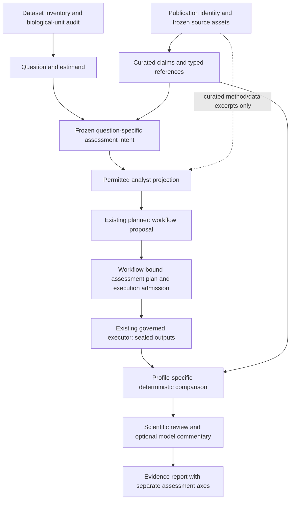

# RNA-seq Publication Grounding and Question-Adaptive Comparison Implementation Plan

> **For agentic workers:** REQUIRED SUB-SKILL: Use `subagent-driven-development` or `executing-plans` to implement this plan task by task after separate implementation authorization. Unchecked steps are proposed work, not implemented or qualified capabilities.

**Goal:** Extend the existing harness so an RNA-seq question determines the evidence, estimands, methods and comparisons needed, while preserving exact publication grounding, governed execution, independent assessment and explicit uncertainty.

**Architecture:** Reuse the publication evidence store, scientific planner, governed executor, immutable artifacts, figure contracts and review packets. Add versioned assessment plans, evidence/output adapters and a small profile registry around these seams. Deterministic comparisons, scientific review and model commentary remain separate outputs.

**Tech stack:** Existing Python contracts/artifact services, registered devharness MCP/ToolDispatcher operations, governed method execution and installed-wheel verification. Additional parsers, renderers or statistical packages must be selected and pinned for the admitted source/profile; this document installs none.

**Status / scope:** Researched documentation only, October 9, 2026. No product code, tests, dependencies or runtime configuration are changed by this deliverable. No dataset, publication-backed analysis, model call or hosted mutation is authorized. The research sources below inform the design; none is selected as the trial publication.

## 1. Requirements and decisions

| ID | Source | Requirement or decision |
|---|---|---|
| U1 | User: “Implementation plan and handoff first”; “don't change any code” | Deliver this plan and its handoff first; implementation and scientific execution remain separate actions. |
| U2 | User: “lets stick with the current publication grounding” | Retain the current identity, retained-source and exact-excerpt mechanisms. No Deep Research API integration. |
| U3 | User explicitly confirmed “flexible across RNA-seq questions … shared evidence framework … specific endpoints and comparison rules … before analysis” | Generalize the assessment representation; choose precise rules for each question before analysis. Flexibility does not mean post-result metric selection. |
| U4 | User: previously pasted architecture was “just an idea” | DE overlap, F1, figures and a three-level rubric are candidate components, not universal required metrics or scientific defaults. |
| D1 | Design inference from the inspected workflow and research | Separate methodological adequacy, publication agreement and biological support. Do not produce a default weighted “scientific correctness” score. |
| D2 | Design inference | A profile advertises required inputs, compatible estimands, metrics, plots and refusal cases. An unimplemented profile or missing evidence is explicitly not assessable. |
| D3 | Design inference | Preserve `/1` contracts, parsers, historical seals and failures. New behavior is an additive, closed `/2` path; no silent migration. |
| D4 | Design inference | Prioritize the question/data/evidence contracts and a narrow supported route to a first case. Do not build a new general workflow compiler, executor or research agent framework. |

Three approaches were considered:

1. **Expand the scalar comparator alone:** a small change, useful for isolated numeric findings, but unable to express whole gene tables, trajectories or non-gene entities cleanly.
2. **Shared evidence contracts plus question profiles — recommended:** reuses the tested workflow and makes applicability, comparability and missingness explicit. Profiles can be added independently and do not pretend every assay is supported today.
3. **An open-ended model grader:** flexible narrative output, but a model verdict cannot provide missing statistical evidence or enforce numeric agreement. Keep this only as optional evidence-bound commentary.

The recommendation concerns this implementation and its constraints. It is not a claim of a universally optimal scientific method.

## 2. Verified starting point

The older October 7 plan calls some C4 files unimplemented. Current source contains them; use this inventory rather than that historical statement.

| Existing component | Verified behavior | Gap relevant to this plan |
|---|---|---|
| `devbench/analysis/rna_publication_evidence.py` | Exact identifier/title/version declarations, bounded approved text acquisition, Crossref exact DOI metadata lookup, source hashes and UTF-8 excerpt spans. | No broad title discovery, qualified NCBI full-text acquisition, PDF/figure extraction or automatic semantic claim verification. Identity declarations and source integrity are not publisher authentication. |
| `devbench/analysis/rna_publication_comparison.py` | Frozen scalar endpoints, exact numeric reference tokens, declared alignment, tolerances, optional sign/interval-overlap checks, missingness and abstention. | No gene-table/set/rank engine, plot assessment or integrated scientific reviewer. Declared alignment is not independently verified biological compatibility. |
| `devbench/analysis/rna_input_contract.py` | Registered immutable matrix JSON `{gene_ids,sample_ids,matrix}` plus metadata JSON `{samples}`; exact joins and bounded inspection. | Bulk gene-by-sample only: matrix ≤100,000,000 bytes, ≤100,000 genes, ≤128 samples. Gene totals cannot substitute for cell, exon, junction, allele or spatial measurements. |
| `devbench/analysis/rna_scientific_trial.py` and `rna_scientific_trial_contract.py` | Question/source/requirement binding, readiness checks, participant evidence projection, planner reuse, separate generation/execution bindings. | Live workflow generation is explicitly blocked on missing campaign binding; native admission is disabled; there is no default trusted `TrialAuthority`. Execution currently ends with comparison/review not performed. |
| `devbench/analysis/method_planner.py`, `methods.py`, `method_executor.py` | Scientific candidates before capability resolution; governed declarations and execution; immutable artifacts. | Resolve missing scientific methods from the selected question, not from convenience. Do not create a second planner/executor. |
| `devharness_server/method_adapter.py` and `dispatcher.py` | Registered tools use file/table ports and captured tool events. | A real input seam exists: C4 binds original JSON artifact IDs, while tools consume counts/metadata file/table inputs. A governed representation bridge is needed. |
| `devbench/analysis/figure_artifacts.py` | Typed identities/provenance and bounded artifact contracts. Actual renderer currently supports observation-point G02/G08 exports. | Typed sample/gene schemas alone do not render bulk comparison figures or establish pixel review. |
| `devbench/analysis/scientific_review.py` and `scientific_review_agent.py` | Bounded review packets, claim/context projections, selectors and retained review artifacts. | Trial/comparison subjects and necessary publication/statistical evidence are not integrated. Model review is not qualified scientific adjudication. |

Current source anchors include evidence preparation/context at `rna_publication_evidence.py:242–272`, comparator preparation/assessment at `rna_publication_comparison.py:142–281`, trial readiness/generation/execution at `rna_scientific_trial.py:144–419`, dispatcher ports at `method_adapter.py:81–124`, and bounded review at `scientific_review_agent.py:183`.

The earlier read-back fix has 263 passing affected tests and an exact read-only match of the existing synthetic LangSmith trace. Those results qualify neither this proposed comparator nor a scientific trial. Historical T14/Harmony and broader-suite nonpasses must remain visible when relevant to the chosen route.

## 3. Scientific workflow and information flow

Apply the project ordering throughout: **data → question → justified methods → actual outputs → supported conclusions and uncertainty**.



`B` and the evaluator portion of `E` are not analyst inputs in an independent method-selection test. The analyst projection contains the biological question, admissible data, permitted method/data excerpts and required output schemas, without hidden reference effect directions, magnitudes or selected-gene lists. If the user question itself names an outcome, preserve that exposure as a requirement, not a concealed reference.

### Two-step freeze without a circular workflow dependency

1. Following bounded input/design inspection, freeze an **AssessmentIntent** before workflow generation: question/data/reference/exposure binding, profile IDs, conditional applicability rules, metric definitions/thresholds/tolerances, required output schemas and endpoints. Generation approval binds this intent; it does not include an as-yet nonexistent workflow or authorize data execution. Preparatory diagnostics and any outcome exposure are recorded explicitly, not concealed as a blinded protocol.
2. After the governed workflow proposal and representation bridge exist, finalize the **AssessmentPlan** with their exact workflow/derived-input hashes. Finalization fills identities and resolves previously frozen conditional rules from declared capabilities; it cannot choose metrics from actual results, waive required evidence or change tolerances. A rule change requires a new intent, proposal and approvals, with old records and exposure retained.
3. Execution approval binds the finalized plan. The pre-run plan binds output **schemas and requirements**, not future output bytes. After execution, the AnalysisOutputBundle seals actual output hashes and references the immutable plan/workflow. Comparison verifies these separate records; never backfill or reseal a pre-run plan with observed results.

### Objective modes

- **Exact reproduction:** assess faithful execution of a specified published procedure on compatible data. Method/version fidelity is part of the objective; differences in supported preprocessing/version must be reported.
- **Independent method selection:** methods remain unconstrained unless the user actually specifies them. Assess scientific adequacy separately from publication agreement; several defensible methods or abstention are allowed.
- **External validation:** new cohort/population/data; compare the relevant validation claim, not exact equality to the original study's estimates.

Select the mode for each actual question. This plan does not select a paper, method, parameter, assay or model.

### Exposure and custody

Preserve the existing evaluator-held outcome excerpts and add distinct analyst/evaluator artifacts. Store reference outcomes outside the analyst's granted paths; deny evaluator file/search/network access under the actual selected participant boundary. Test those denials. Separate generation and execution approvals, authenticate grants through the trusted authority and consume allocations once before each admitted dispatch.

A context projection is not OS isolation. Public papers, prior discussion and pretrained knowledge can expose results. Record `prior_outcome_access`, `public_outcomes_accessible`, `author_outcome_access` and unknown exposure; report prospective access control separately from complete blinding. Do not label a public-study evaluation held-out merely because local files were sealed. The current native and mediated boundary gaps remain admission blockers, not JSON declarations of success.

## 4. Publication evidence and reference acquisition

Preserve existing source bytes and `/1` excerpts. Proposed assets add metadata around them:

- Requested/candidate DOI, PMID, PMCID; exact match basis, conflicts, title, article type and version relationship.
- Source provider/URL, retrieval time, MIME, byte size, local SHA-256, provider checksum/ETag/modification data when available, license evidence and intended-use decision.
- Correction/retraction/concern relations, checked providers/time and coverage. `none_found_in_checked_sources` is not a guarantee that no notice exists.
- Direct article-to-accession and repository-to-article links with evidence locations. A BioProject membership or reference-list mention does not establish the samples in the claimed contrast.
- Full text versus abstract versus metadata versus extracted representation; original and derived asset hashes and extraction lineage.

**Current service detail:** the legacy PMC OA service is unavailable as of August 25, 2026. Use current supported article dataset services rather than `oa.fcgi`. PMC's version prefix can remain unchanged after content/metadata changes; deposit order is not proof of version-of-record status. Freeze bytes plus article-instance/type metadata. [PMC service notice](https://pmc.ncbi.nlm.nih.gov/tools/oa-service/), [current dataset routes](https://pmc.ncbi.nlm.nih.gov/tools/textmining/), [cloud/version semantics](https://pmc.ncbi.nlm.nih.gov/tools/pmcaws/).

Prefer available JATS/XML and machine-readable supplements. Retain element IDs/XPath, captions, headers, footnotes and cell coordinates. PDF text requires an explicit extraction version and page/bounding-box locator; OCR, image-only tables and digitized plots require separately reviewed transformations and uncertainty. A caption is not numeric figure evidence. Rights decisions remain supplied/reviewed; public reading does not automatically authorize redistribution. [JATS tables](https://jats.nlm.nih.gov/publishing/tag-library/1.4/element/table-wrap.html), [supplements](https://jats.nlm.nih.gov/publishing/tag-library/1.4/element/supplementary-material.html).

Untrusted XML parsing must disable external DTD/entity/network resolution and XInclude; reject external resource requests rather than invoking a fallback fetch. Bound tree depth, nodes, text and expansion. Approved HTTP transport does not authorize an XML parser to read local files or fetch entity URLs. Any schema validation uses separately pinned trusted local resources. PDF/OCR extraction must similarly avoid executing scripts or following embedded links/resources; artifact references confer no retrieval permission.

Numeric extraction `/2` must retain the original lexeme and permit only named reviewed transformations: for example U+2212 minus to ASCII minus, or a declared percentage to a proportion. Locale/grouping, ranges, inequalities, uncertainty notation and censored values have explicit types; ambiguous forms abstain. Never silently convert `<0.001` into an exact value, or fabricate absent interval levels. Existing `/1` rejection behavior remains intact.

Deterministic excerpt/token checks and contextual support review are separate. Contextual review must check the entity, population, contrast, measurement, uncertainty, negation and claim scope. A model-assisted extraction is a proposal until checked against the source and reviewed; it must not replace the source snapshot.

## 5. Shared contracts and precise question profiles

These are proposed **internal** versioned contracts, not additions to staged task answer schemas.

| Contract | Required meaning |
|---|---|
| `SourceAsset / ReferenceBundle` | Immutable publication assets, identity/status/rights evidence, related datasets/supplements, exact locators, derived extraction lineage and reviewer state. A collection references existing single-publication `/1` manifests rather than rewriting them. |
| `EstimandSpec` | Original question/requirement sources; assay/measurement scale; target population; biological unit/dependence; entity type; contrast/relationship; time/reference/denominator; adjustment assumptions and intended claim scope. Unknowns remain explicit. |
| `FeatureMap / UniverseSpec` | Species, assembly/annotation release, original and canonical IDs, version handling, mapping method/source/hash, one-to-many ambiguity, exclusions and denominators. Never silently deduplicate symbols or drop unmapped features. |
| `AssessmentIntent /2` | Before workflow generation: mode; question/dataset/reference/exposure hashes; profile IDs/versions; applicability rules; exact metrics, units, universes, tolerances/rationale and missingness; output schemas/endpoints and separate projections. No workflow or future output hashes. |
| `AssessmentPlan /2` | Immutable intent reference plus generated workflow and derived-input hashes, resolved declared capabilities and execution prerequisites. Preserve intent rules; finalize before data execution. |
| `AnalysisOutputBundle /2` | Governed workflow/run/attempt IDs and output hashes; coordinator-extracted tables/curves/sets/graphs; full tested families; per-feature estimates and missingness; diagnostics, plots, transformations and interventions. Agent prose is not authoritative numeric output. |
| `EvidenceClaim / ReviewRecord` | Typed claim, estimand, exact supporting source/result/plot refs, evidence class and inference scope; deterministic checks; advisory/model versus qualified-review provenance; unsupported statements, alternatives and remaining uncertainty. |
| `AssessmentReport /2` | Separate execution, comparability, methodology, publication agreement and interpretation states; metric values with denominators; missing/incomparable evidence; exposure/access-control state; review status. No default global winner or clinical promotion. |

Each profile declares inputs, admissible output shape, identifiability checks, comparability rules, numerical/qualitative/visual checks and unsupported claims. A question can compose profiles with dependencies; invalid upstream units/design cannot be rescued by downstream pathway agreement.

### Minimum `/2` record fields and validation semantics

The proposed profile module owns these closed records. Use existing reference validators at each seam: publication manifests use `{manifest_path,root_hash}`, local source records use `{path,sha256,size_bytes}`, and method artifacts retain their existing service identities/checksums. Do not treat a manifest root, file checksum and artifact ID as interchangeable or replace existing reference formats with an unvalidated generic dictionary.

| Record | Required fields |
|---|---|
| `AssessmentIntent` | `format`, `intent_id`, `mode`, `question_ref`, `dataset_ref`, `reference_bundle_ref`, `exposure_ref`, `estimand`, `profile_specs`, `universe_policy_ref`, `required_claim_ids`, `analyst_projection_ref`, `evaluator_projection_ref`, `decision_policy`, `limitations`. References are immutable and validated; there is no workflow/output hash here. |
| `ProfileSpec` | `profile_id`, `profile_version`, `required_input_capabilities`, `applicability_rules`, `metric_specs`, `required_output_schemas`, `required_plot_kinds`, `permitted_claim_scopes`, `missingness_policy`. Rules are registered validated predicates, not executable model text. |
| `MetricSpec` | `metric_id`, `formula_version`, `units`, `parameter_record_ref`, `comparability_policy_ref`, `universe_rule_id`, `uncertainty_policy`, `acceptance_policy`, `required`. No hidden defaults: a descriptive metric has an explicit report-only policy; an agreement decision needs a justified bound. |
| `AssessmentPlan` | `format`, `plan_id`, `intent_ref`, `workflow_ref`, `execution_inputs_ref`, `resolved_capabilities_ref`, `finalization_receipt_ref`, `execution_prerequisites_ref`. Finalization copies no result values and verifies unchanged intent rules. |
| `MetricResult` | `metric_id`, `profile_id`, `estimand_id`, `status`, `value`, `units`, `denominators`, `universe_ref`, `exclusions_ref`, `uncertainty_ref`, `reason_codes`, `evidence_refs`. Status is `computed`, `not_applicable`, `not_assessable` or `failed`; noncomputed values stay null. A typed direction/categorical result is not forced into a float. |
| `ReferenceFinding` | `claim_id`, `estimand_ref`, `entity_refs`, `source_locator_refs`, `extraction_record_ref`, `value_or_censoring`, `uncertainty_ref`, `tested_family_ref`, `reporting_completeness`, `context_review_ref`, `limitations`. Missing family/uncertainty/completeness is recorded explicitly and restricts eligible metrics. |

Set bounded record/list/text and aggregate artifact limits before acquisition/computation. Start from existing input/source/execution bounds; a larger table/source requires an explicit reviewed `/2` capability and authority, not silent limit removal or truncation. Profile and formula IDs select reviewed implementations; never evaluate a free-form formula, script or source instruction supplied by a model or paper. Review projections must report omitted evidence and cannot infer a verdict from an incomplete packet.

| Question family | Specific comparison possibilities | Required evidence and capability boundary |
|---|---|---|
| Mean expression / treatment contrast | Matched effects and uncertainty; directions; gene-table/rank agreement; optionally complete selected-set agreement. | Gene-level measurements, independent units, identifiable design, exact contrast/effect/shrinkage definitions and tested family. DESeq2, edgeR or limma are eligible alternatives, not defaults. |
| Measured-time expression | Curves on an approved time domain, interactions, derivatives or event/peak timing and uncertainty. | Distinguish omnibus change from individual coefficients; repeated subjects and sparse times matter. No post-result curve warping to maximize agreement. |
| Inferred ordering / lineage | Ordering, topology and stability assessed separately. | Independent ordering/topology evidence where available. Collection age is not universal pseudotime truth. Current gene totals do not create per-cell lineage evidence. |
| Pathways / gene sets | Ranked enrichment versus over-representation; term direction/effects, corrected tests and contributing genes. | Matched background, mapping, set collection/version, rank statistic and test family; selection bias considered. Enrichment does not establish pathway flux or causality. |
| Transcript / exon / junction usage | Usage effects, uncertainty and matched feature tests. | Appropriate transcript/bin/event counts and annotation; gene totals cannot substitute. DEXSeq is exon-usage evidence, not a universal splice/transcript method. |
| Cell identity / state / abundance | Label/state evidence, within-type expression, and relative abundance separately. | Cell/specimen/donor mappings; replicate-aware designs and compositional denominators. No current general AnnData/sc/sn admission. Pseudobulk and mixed models are alternatives when justified. |
| Regulatory association / motif / binding | Edge/member agreement and stability within the supported evidence class. | Separate correlation, curated membership, motif support, measured binding and perturbational evidence. No promotion to causality from expression association. |
| Prediction / signatures | Discrimination/error and calibration on the declared validation population. | Group-aware splits and training-only transformations; sealed test outcomes. Internal cross-validation is not external validation. |
| Quantification, technical QC or another RNA-seq question | Measurable source-backed endpoints appropriate to the actual objective. | Add a reviewed profile and its input/claim prerequisites. Allele-specific, editing, spatial and long-read questions cannot be inferred from aggregate bulk gene counts. |

The first admitted profile is selected from the actual question/data. The framework is extensible; validated support is only the implemented and qualified subset. Return `unsupported_profile`, `unsupported_input` or `not_assessable` with concrete reasons rather than forcing every question into DE overlap.

## 6. Numerical comparison rules

### Gene tables and probabilities

Retain original feature IDs, mapping outcomes, tested/filtered/failed flags, effect scale/direction, uncertainty, raw p-values, adjusted values, correction method/family and shrinkage. Never fill missing estimates with zero or overwrite missing p/q with 1. Decision conventions for benchmark classification, if needed, are separate derived records.

Validate the declared probability semantics. For the harness's BH-adjusted `q` contract, require finite values in `[0,1]` and `q >= p`; do not apply that invariant to every source column named “q-value.” Recompute an audit BH check only with the complete eligible testing family and a recorded policy; never recompute correction on the matched or significant subset. Missing full families limit the corresponding assessment.

Comparability has layers: identical estimand/units/design versus compatible alternative processing/model paths versus genuinely different questions/cohorts. `/1` exact alignment stays unchanged. `/2` records permitted differences and metric-specific ineligibility; it does not relax mismatches globally. Different shrinkage or tested hypotheses require explicit strata, transformations or a not-comparable outcome.

### Optional set/rank/effect metrics

- Select metrics for the question; no automatic F1, `0.05`, effect cutoff or tolerance.
- Reference selected lists must be declared complete at their stated decision rule. Highlights or incomplete supplements cannot supply exhaustive recall. Unreported genes are not established biological negatives.
- Freeze eligible-universe and mapping/exclusion rules; report original, mapped, ambiguous, excluded and jointly estimable counts. Any conditional metric reports its denominator and coverage; exclusions cannot inflate the headline silently.
- For complete comparable selected lists, **reference-agreement** precision is intersection/actual-set size, recall is intersection/reference-set size, F1 is `2*intersection/(actual_size+reference_size)`, and Jaccard is intersection/union. These are not truth-based accuracy metrics. Zero denominators have explicit missing/not-assessable states, not automatic perfect scores.
- Matched effect discrepancies, calibration/scatter and rank correlation answer different questions; correlation alone is not estimate agreement. Preserve uncertainty and effect-definition differences.
- Predeclared threshold/top-k sensitivity can be reported as a curve with every specified point. Never choose the most favorable point after observing outputs.
- Interval overlap is descriptive; it is not a formal equivalence test. Equivalence or noninferiority requires a separate justified hypothesis/margin/design.

The existing scalar rule remains `abs(actual-reference) <= absolute_tolerance + relative_tolerance*abs(reference)`. Its bounds must be justified for the actual endpoint, measurement precision and objective; they are not scientific defaults.

### Figures and interpretation

Compare source-backed numeric geometry/semantics first: feature IDs, observations, units, axes, uncertainty and declared transformations. Do not use pixel resemblance as the default scientific score. Render actual bounded sample/gene/effect/curve outputs and inspect the resulting pixels for labeling, joins and clipping. Paper-image digitization is a distinct reviewed extraction with uncertainty; absent source data stays absent.

Extend the existing scientific-review packet to expose the evidence necessary for method and claim review. A model can explain observed discrepancies and propose causes, with exact artifact/claim citations. Unverified explanations remain hypotheses; identifying their cause may need separately approved analysis. Model output cannot overwrite deterministic metrics, invent estimates, waive design failures or mark itself qualified. Insufficient review context produces `not_assessed`, not a confident verdict. Position/verbosity/self-preference issues documented for general LLM judging motivate explicit calibration and audit; they do not quantify RNA-seq scientific validity. [Zheng et al.](https://arxiv.org/abs/2306.05685).

## 7. Implementation sequence and ownership

All paths in file lists are repository-relative. Interfaces named below are **proposed**, except the existing functions identified in section 2. No new implementation is present. Each task starts with failing synthetic/hostile cases, then the minimal source change, then installed-package verification; do not run product tests from a mutable source checkout.

### Task 1 — Assessment contracts and profile applicability

**Create:** `devbench/analysis/rna_publication_profiles.py`; `tests/test_rna_publication_profiles.py`.
**Modify:** `devbench/analysis/rna_publication_comparison.py` only to dispatch the additive `/2` contract; keep `/1` untouched.

- [ ] Define closed `/2` `EstimandSpec`, assessment intent/final-plan/projection and profile descriptor schemas from section 5. Proposed API: `validate_assessment_intent(record)`, `finalize_assessment_plan(intent, workflow_ref, execution_inputs_ref)`, `validate_assessment_plan(record)` and `select_applicable_profiles(estimand, capabilities)` return validated records or explicit applicability reasons, never a winner. Finalization rejects changed intent rules.
- [ ] Add synthetic tests for DE, temporal, pathway and composed questions; unknown profile, gene-only input for splicing/cell abundance, reference-estimand mismatch, absent units, changed metric version and post-freeze threshold changes must fail or abstain before execution.
- [ ] Separate analyst/evaluator projections; test that expected effects, selected reference genes and source paths are absent from the independent-selection analyst projection.
- [ ] Add `/1` parity tests and contract-drift tests. No profile is marked computationally supported until its output adapter, metrics and qualified execution prerequisites exist.

### Task 2 — Primary-source acquisition and structured reference evidence

**Create:** `devbench/analysis/rna_publication_sources.py`, `devbench/analysis/rna_reference_extraction.py`; corresponding `tests/test_rna_publication_sources.py`, `tests/test_rna_reference_extraction.py`.
**Modify:** `devbench/analysis/rna_publication_evidence.py` additively, reusing its bounded approved transport and existing single-paper manifests.

- [ ] Implement exact-ID provider adapters and collection manifests. Discovery returns unresolved candidates only; metadata/abstracts cannot be promoted to full text.
- [ ] Pin and test the current selected provider contracts before implementing network routes. PMC legacy OA endpoints must be rejected; Europe PMC/GEO live endpoint details listed as access-blocked below require fresh primary verification.
- [ ] Retain raw/derived source hashes, version type, rights/status coverage and direct accession evidence. New acquisitions never overwrite frozen assets.
- [ ] Add JATS table/section extraction and reviewed numeric transformation records; PDF/OCR/figure support is independently capability-gated, not inferred from MIME alone.
- [ ] Disable XML external DTD/entities, network resolution and XInclude; bound depth/nodes/text/expansion. Test local-file and network entity attempts, entity-expansion bombs and resource loading from PDF/OCR inputs. No parser may expand the approved URL/filesystem grant.
- [ ] Tests: wrong/similar-title paper, conflicting identifiers, mutable same-version bytes, restricted/absent supplement, accession for another study, image-only table, merged headers, censored/ambiguous numbers, Unicode minus and percentage transforms, hostile redirects, truncated/oversized responses, archive traversal/expansion bombs and quoted-but-contradicted claims.

Example acceptance test for a proposed parser (artificial lexeme, not a publication result):

```python
def test_reviewed_minus_transform_preserves_source_evidence():
    parsed = canonicalize_reference_number(
        raw_text="−1.2", rule="unicode_minus_to_ascii", reviewed=True
    )
    assert parsed["raw_text"] == "−1.2"
    assert parsed["canonical_decimal"] == "-1.2"
    assert parsed["rule"] == "unicode_minus_to_ascii"
```

`canonicalize_reference_number(raw_text, *, rule, reviewed)` is a proposed Task 2 function. It rejects unreviewed or ambiguous transformations. Tests must also preserve existing `/1` rejection behavior and original-source bytes.

### Task 3 — Data and execution-input provenance bridge

**Create:** `devbench/analysis/rna_execution_inputs.py`; `tests/test_rna_execution_inputs.py`.
**Modify:** `devbench/analysis/rna_scientific_trial_contract.py`, `devbench/analysis/rna_scientific_trial.py`; reuse `devbench/analysis/methods.py`, `devharness_server/method_adapter.py` and `devbench/analysis/rna_input_contract.py` boundaries.

- [ ] Inspect declared measurement semantics and independent units before selecting methods. Retain current bulk `/1` size/type limits; unsupported modalities are not converted into supported-looking inputs.
- [ ] Proposed API: `prepare_execution_inputs(dataset_binding, method_ports, *, artifact_service, output)` returns original input refs, derived execution refs and an immutable transformation receipt.
- [ ] Implement only representation-preserving JSON-to-required-file/table transforms for the chosen governed method. Preserve values, IDs, sample order, types and missingness; no rounding of normalized values into counts and no scientific filtering hidden in this bridge.
- [ ] Version trial bindings to include both original dataset refs and derived execution refs plus transformation source/runtime/hash. Replace the current impossible direct-ID equality only on `/2`; require verified lineage, not unrelated files.
- [ ] Tests: swapped columns/donors, duplicate/ambiguous IDs, raw/normalized confusion, changed value/metadata, invalid contrast, complete confounding, rank deficiency, independent-unit uncertainty and dependency-sensitive paths. Inference remains blocked when its necessary preconditions fail.

### Task 4 — Coordinator-owned outputs and bounded numerical metrics

**Create:** `devbench/analysis/rna_comparison_outputs.py`, `devbench/analysis/rna_publication_metrics.py`; `tests/test_rna_comparison_outputs.py`, `tests/test_rna_publication_metrics.py`.
**Modify:** additive `/2` comparison dispatch in `devbench/analysis/rna_publication_comparison.py`.

- [ ] Proposed API: `extract_comparison_outputs(run_receipts, assessment_plan, *, artifact_service)` resolves retained result fields into typed output bundles. Never accept an agent's free-text numeric summary as a replacement for tool evidence.
- [ ] Preserve complete tested-family and missingness data, annotation/mapping lineage and output seals. Implement the selected profile's effect/table metrics before optional set/rank metrics.
- [ ] Proposed pure API: `gene_set_agreement(reference_ids, actual_ids, eligible_ids, *, reference_complete)` returns descriptive agreement metrics and coverage/status. Incomplete references or zero denominators are not silently scored.
- [ ] Implement metric-specific compatibility checks and predeclared sensitivity; preserve all frozen endpoints/denominators. Scalar `/1` still follows its original decision rule.
- [ ] Tests: changing contrast/unit/cohort, shrinkage/test mismatches, missing tested families, BH recomputation on a subset, `q < p` under the BH contract, raw Storey-like q wrongly labeled BH, filtered genes rewritten as values, duplicate mappings, partial reference lists, unknown reference membership, empty sets and threshold cherry-picking.

Artificial set test for the proposed Task 4 API:

```python
def test_gene_set_numbers_describe_reference_agreement():
    reference = {f"G{i:03d}" for i in range(100)}
    actual = {f"G{i:03d}" for i in range(85)} | {f"G{i:03d}" for i in range(100, 125)}
    universe = {f"G{i:03d}" for i in range(150)}
    result = gene_set_agreement(reference, actual, universe, reference_complete=True)
    assert result["overlap"] == 85
    assert result["precision"] == 85 / 110
    assert result["recall"] == 85 / 100
    assert result["f1"] == 170 / 210
    assert result["jaccard"] == 85 / 125
    assert result["scope"] == "publication_reference_agreement"
    assert result["biological_truth_accuracy"] is None
```

This example fixes software arithmetic, not a scientific threshold or user-selected evaluation metric.

### Task 5 — Question-appropriate figures

**Modify:** `devbench/analysis/figure_artifacts.py` and the existing profile-specific export/render path; `tests/test_figure_artifacts.py` plus proposed `tests/test_rna_publication_figures.py`.

- [ ] Add bounded sample/gene/effect/curve payloads needed by the selected profile, with entity membership, axes/units, transformations, renderer/source/runtime/parameter hashes and linked result receipts.
- [ ] Render and retain PNG/PDF plus machine-readable plot data. Inspect pixels; a valid payload or export path is not pixel proof.
- [ ] Numerical figure comparison uses matched underlying values/curves where available. Image-only reference comparisons require reviewed calibration/extraction uncertainty; no automatic visual truth score.
- [ ] Tests: wrong genes/joins/units, sign/axis reversal, misleading clipping or transform, censored zeros, absent uncertainty, stale renderer/data hashes, source image lacking numeric data and unsupported plot types.

### Task 6 — Independent review and structured evidence report

**Create:** `devbench/analysis/rna_publication_report.py`; `tests/test_rna_publication_report.py`.
**Modify:** `devbench/analysis/scientific_review.py`, `devbench/analysis/scientific_review_agent.py`; `tests/test_scientific_review.py`, `tests/test_scientific_review_agent.py` and `tests/test_completed_scientific_review.py`.

- [ ] Add trial/comparison subjects and allowlisted evidence projections to the existing review service. Bind actual diagnostics, tested families, numeric assessments, source claims and reviewed plot artifacts; disclose evidence omitted for limits.
- [ ] Produce separate methodology, publication-agreement and interpretation dispositions, with reasons and evidence refs. Qualified scientific review is its own status, not inferred from model output or different curator IDs.
- [ ] Optional model commentary uses the existing admitted selector/limits and retained schema/context/result, and validates cited artifact/claim IDs. It cannot waive deterministic failure or silently expand source access.
- [ ] Tests: an invalid method with high overlap, a defensible method with differing findings, fabricated cited evidence, unsupported causal interpretation, missing plot/statistical context, self-approval labels, publication outcome leakage and a confident verdict after truncated context. Both disagreement and abstention must survive report rendering.

### Task 7 — Existing trial lifecycle integration and execution admission

**Modify:** `devbench/analysis/rna_scientific_trial.py`, `devbench/analysis/rna_scientific_trial_contract.py`, existing planner/review seams and `scripts/run_rna_scientific_trial.py` only as necessary; `tests/test_rna_scientific_trial.py`, `tests/test_rna_scientific_trial_contract.py`.

- [ ] Bind generation to the immutable question-specific intent; bind execution to its finalized workflow/input-lineage plan. Bind post-run output hashes in a separate output bundle referencing that plan. Preserve distinct generation and execution approval purposes; generation permission cannot authorize data execution or change comparison rules.
- [ ] After governed execution, seal actual outputs before evaluator reference access; call the appropriate comparator and review/report service. Comparison/review statuses are derived from retained evidence, not optimistic defaults.
- [ ] Implement a real trusted one-use authority and exact model campaign binding only under a separately reviewed backend/control scope. Recheck drift/expiry/allocation before every candidate dispatch. Keep native denial until its exact gate passes; a serial or mediated route needs its own proof and is not automatically qualified.
- [ ] Use registered MCP tools for assisted CLI runs, or trusted in-process Dispatcher with actual event capture. Preserve supervised-worker `__main__` guards and existing phase/answer schemas.
- [ ] Keep LangSmith observability optional to scientific assessment and separately approved when used. Do not turn latency campaigns into scientific acceptance criteria, or remove existing engineering gates to obtain a successful trial.
- [ ] The current CLI has **only prepare/validate**, not execute. Add any future execute/evaluate command only after contracts/authority tests exist; publish its exact inspected invocation then. No guessed scientific-run command is supplied here.
- [ ] Tests: approval-purpose swaps, replay, expired/cap-exhausted grants, raw source or reference access from the participant, identity drift, partial/failed fits, model generation before admission, result-only self-reports, missing comparator/profile/renderer and recovery without fresh independent evidence.

### Task 8 — Verification and one selected real case

**Existing seams:** `scripts/freeze_rna_tracing_epoch.py`, `install_rna_tracing_epoch.py`, `run_rna_tracing_verification.py`; test selection/runtime bindings need an explicit publication extension, not reuse of an old epoch.

- [ ] Capture a fresh immutable source/test epoch; use a normal offline-built wheel in a disposable qualified runtime; reject editable/source-tree imports. Pin all selected statistical/parser/renderer dependencies before execution.
- [ ] Run minimal failing regression cases against the prior installed code, then affected synthetic suites on the new installed code. Preserve fixture/model/network/native deny controls and original interfaces. Record exact counts, JUnit, identities, failures and unknown attempts.
- [ ] Run the appropriately bounded broader scientific suite and classify baseline impacts. T14/Harmony-dependent paths stay blocked until separately repaired; do not install dependencies or reinterpret failures silently.
- [ ] Select one reviewable publication–dataset–question proposal separately: accessible source/supplements, known processing lineage, mapped samples/biological units, supported representation and assessable primary finding. The question selects the profile; this plan does not mandate DE.
- [ ] Freeze objective, workflow, method/parameter rationale, references/exposure, comparison rules, admissible plots and finite authority. No model/data run occurs until the exact selected route and action are approved.
- [ ] Execute once with retained tool/provenance evidence; publish independent comparison, disagreement explanations, pixel review and scientific review status. Maintain actual failure/missingness/intervention records; no tuning against the reference or silent retries.

## 8. Milestone acceptance and sequencing

| Milestone | Reviewable output | Acceptance evidence |
|---|---|---|
| M0 — Contracts/applicability | Task 1 assessment intents, final plans and projections | Known/unknown/composed question cases, legacy parity, no universal score, unavailable input rejected. |
| M1 — Source/reference custody | Task 2 assets/claims/extraction | Provider contract snapshots, unchanged bytes, reviewed transforms, rights/status coverage, hostile retrieval/extraction cases. |
| M2 — Input/output lineage | Tasks 3–4 bridge and selected output adapters | Original-to-derived IDs/value/sample invariants, full-family/missingness records, no prose substitutes. |
| M3 — Selected numerical profile | Task 4 selected metrics | Formula/compatibility/denominator tests, unknown/incomplete reference abstention and negative science cases. |
| M4 — Figures/review/report | Tasks 5–6 | Actual renderer output/pixel evidence and source-bound review; no model override or unsupported scientific promotion. |
| M5 — Admitted end-to-end route | Task 7 | Actual authenticated one-use authority, exact backend controls, purpose/expiry/replay and participant-boundary negative tests. |
| M6 — First publication-backed case | Task 8 | Selected real inputs, actual outputs, frozen comparisons, independent review and exposure/limitations. Local synthetic passes do not satisfy this milestone. |

Source/reference/protocol preparation may progress before live execution qualification. The selected route determines engineering dependencies; neither the earlier arithmetic trace nor this researched plan authorizes scientific execution. Treat native budget/boundary issues as explicit route blockers rather than as comparison metrics.

## 9. Research basis and applicability

Sources checked October 9, 2026. These support specific design boundaries; they do not establish that the proposed software or selected scientific run already works.

| ID | Primary source | Design implication / limits |
|---|---|---|
| S1 | [Crossref metadata](https://www.crossref.org/documentation/retrieve-metadata/rest-api/), [filters](https://www.crossref.org/documentation/retrieve-metadata/rest-api/rest-api-filters/), [versioning](https://www.crossref.org/documentation/principles-practices/best-practices/versioning/) | Bibliographic/version/update evidence is distinct from article text and authenticity; retain notice coverage/conflicts. |
| S2 | [PMC ID conversion](https://pmc.ncbi.nlm.nih.gov/tools/id-converter-api/) | Identifier mapping has repository coverage limits; missing mappings are not invalid-paper proof. |
| S3 | [PMC OA retirement](https://pmc.ncbi.nlm.nih.gov/tools/oa-service/), [datasets](https://pmc.ncbi.nlm.nih.gov/tools/textmining/), [cloud](https://pmc.ncbi.nlm.nih.gov/tools/pmcaws/) | Current retrieval routes and mutable object/version semantics require bytes plus type/version metadata. |
| S4 | [NLM linked corrections](https://www.nlm.nih.gov/bsd/policy/errata.html) | Typed linked notices supplement provider status evidence; absence is scoped, not guaranteed. |
| S5 | [JATS tables](https://jats.nlm.nih.gov/publishing/tag-library/1.4/element/table-wrap.html), [supplements](https://jats.nlm.nih.gov/publishing/tag-library/1.4/element/supplementary-material.html) | Preserve structured context; some tables are graphics and need different extraction. |
| S6 | [EMBL-EBI Europe PMC programmatic access](https://www.ebi.ac.uk/training/online/courses/embl-ebi-programmatically/europe-pmc-programmatically/) | Publication/data-link capability exists. Exact current full-text/supplement endpoints were not fully inspected and must be verified before implementation. |
| S7 | [NCBI GEO generated counts](https://ncbiinsights.ncbi.nlm.nih.gov/2023/04/19/human-rna-seq-geo/amp/), [GEO directory guidance](https://ncbiinsights.ncbi.nlm.nih.gov/2019/07/24/new-geo-ftp-subdirectories/amp/) | Repository-generated counts are a processing lineage distinct from paper/submitter outputs. Live GEO documentation challenged access during research; do not infer endpoint qualification or complete sample correspondence. |
| S8 | [DESeq2 official vignette](https://bioconductor.org/packages/release/bioc/vignettes/DESeq2/inst/doc/DESeq2.html), [edgeR guide](https://bioconductor.org/packages/release/bioc/vignettes/edgeR/inst/doc/edgeRUsersGuide.pdf), [limma guide](https://bioconductor.org/packages/release/bioc/vignettes/limma/inst/doc/usersguide.pdf) | Distinct count/transformation, effect, filtering, design and testing paths; eligible alternatives require exact versions and assumptions. No method or default cutoff is selected here. |
| S9 | [Schurch et al.](https://www.pure.ed.ac.uk/ws/portalfiles/portal/25681723/Blaxter_How_many_biological_replicates_are_needed_in_an_RNA_seq.pdf) | Replication/effect strength matter; findings in one experiment are not universal minimum-sample rules. |
| S10 | [Squair et al.](https://www.nature.com/articles/s41467-021-25960-2), [Zimmerman et al.](https://www.nature.com/articles/s41467-021-21038-1) | Replicate-aware scRNA inference; donor-aware aggregation and mixed models have conditional tradeoffs. More cells do not replace independent donors. |
| S11 | [GSEA original paper](https://software.broadinstitute.org/gsea/doc/subramanian_tamayo_gsea_pnas.pdf), [GOseq](https://link.springer.com/article/10.1186/gb-2010-11-2-r14), [g:Profiler](https://academic.oup.com/nar/article/47/W1/W191/5486750) | Ranking, background/annotation and selection bias affect gene-set comparisons. |
| S12 | [Saelens et al.](https://www.nature.com/articles/s41587-019-0071-9) | Ordering, topology and stability differ; accessed evidence included abstract/supplement descriptions, not subscription-only full text. |
| S13 | [DEXSeq official vignette](https://bioconductor.org/packages/release/bioc/vignettes/DEXSeq/inst/doc/DEXSeq.html) | Exon usage requires its own counts/features and hypotheses, not gene-total substitution. |
| S14 | [SCENIC](https://doi.org/10.1038/nmeth.4463), [scCODA](https://www.nature.com/articles/s41467-021-27150-6) | Regulatory evidence classes and compositional abundance constrain claims. |
| S15 | [scikit-learn cross-validation](https://scikit-learn.org/stable/modules/cross_validation.html), [TRIPOD](https://pmc.ncbi.nlm.nih.gov/articles/PMC4297220/) | Group-aware evaluation and training-only transformations; internal versus external validation. |
| S16 | [LLM-as-judge study](https://arxiv.org/abs/2306.05685) | General judge biases motivate evidence-bound advisory review; no scientific-qualification claim follows from text-judge agreement. |

Provider contracts, statistical versions, scientific appropriateness and source access must be rechecked for the actual implementation/case. No inaccessible page was treated as proof of a live endpoint.
