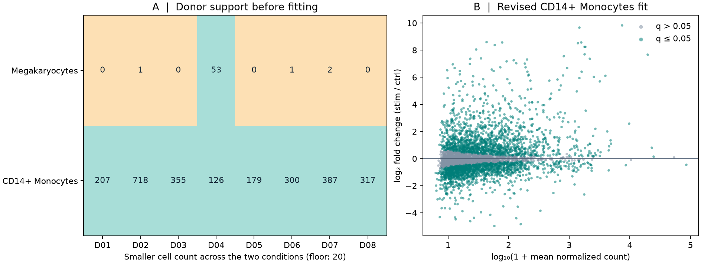

# How real single-cell data changed the analysis plan

## Data

The public Kang PBMC dataset contains paired control and IFN-β-stimulated
aliquots from eight donors. The cached scverse H5AD contains 24,673 cells and
15,706 features. This walkthrough uses the published donor and population
labels. The integer counts in `X` sum to the recorded RNA count for every
retained cell. [Study](https://doi.org/10.1038/nbt.4042) · [GEO GSE96583](https://www.ncbi.nlm.nih.gov/geo/query/acc.cgi?acc=GSE96583) · [Pertpy data loader](https://pertpy.scverse.org/en/stable/_modules/pertpy/data/_datasets.html#kang_2018)

The original sample records identify one pooled capture per condition.
[Control capture](https://www.ncbi.nlm.nih.gov/geo/query/acc.cgi?acc=GSM2560248) · [Stimulated capture](https://www.ncbi.nlm.nih.gov/geo/query/acc.cgi?acc=GSM2560249)

## Initial question and plan

> Can we estimate a stimulation-associated change in expression separately from capture in megakaryocytes and CD14+ monocytes?

The analysis unit is the donor. The plan uses donor-by-condition pseudobulk
because repeated cells from the same donor share that unit. It requires at
least 20 cells in each arm for at least six complete donor pairs before fitting
a population. This is a walkthrough rule. The planned design was
`~ donor + capture + condition`. The rule and revision criteria were committed
before reading the matrix. [Frozen plan](kang-plan.json) · [Pseudobulk methods](https://doi.org/10.1038/s41467-020-19894-4)

## What the data changed

| Check | Observed result | Decision |
| --- | --- | --- |
| Megakaryocyte support | 63 control cells, 69 stimulated cells, **1 of 8 eligible donor pairs** | Withhold this population from fitting. |
| CD14+ monocyte support | 2,932 control cells, 2,765 stimulated cells, **8 of 8 eligible donor pairs** | Keep 16 donor-by-condition libraries for the revised fit. |
| Capture-adjusted design | On the supported libraries, the local DevHarness design compiler reported rank **9 of 10** and a non-estimable condition contrast | Hold the capture-adjusted question. Revise the estimand to an exploratory association across the observed preparations. |

MCP inspection of the original H5AD returned `local_workflow_unavailable`.
The runner preserves the refusal, reads the original H5AD locally with
AnnData, and obtains a DevHarness inspection receipt for the derived pseudobulk counts.
The decision record binds the revision to the first plan and diagnostics.
[Observed evidence](kang-evidence.json)

## Revised fit

The revised `~ donor + condition` design had rank **9 of 9** and seven residual
degrees of freedom. The local PyDESeq2 fit used median-ratio RLE, a mean
dispersion trend, and a two-sided Wald contrast for stimulated versus
control. A gene entered the family if it had at least 10 counts in at
least six of the 16 libraries, regardless of condition. [PyDESeq2 workflow](https://pydeseq2.readthedocs.io/en/stable/auto_examples/plot_step_by_step.html)

Of 4,328 genes in this family, 4,323 had estimates and five were withheld.
There were 2,654 BH-adjusted p-values at or below 0.05. For example, the
fitted IL1RN log₂ fold change was +6.70. These estimates and adjusted p-values
are conditional on the fitted model and the two observed pooled preparations. Donor pairing
controls donor differences, while capture remains inseparable from condition.
A capture-adjusted comparison would need condition overlap across
independent captures.



Each heatmap entry is the smaller cell count across the two conditions for
that donor. Teal entries meet the 20-cell floor. The MA plot shows the
estimated gene contrasts from the revised fit.

## Reproduce the walkthrough

Install the locked environment and check the patched SQLite runtime.
Run from the repository root. The download is a 38 MB processed count file.
The runner verifies its SHA-256 before opening it. [Installation](../../docs/installation.md)

```sh
repo="$(pwd -P)"
inputs="$repo/results/kang-input"
input="$inputs/kang_2018.h5ad"
mkdir -p "$inputs"
if test ! -e "$input"; then
  curl --fail --location --proto '=https' --max-filesize 50000000 \
    'https://exampledata.scverse.org/pertpy/kang_2018.h5ad' \
    -o "$input.part" && mv "$input.part" "$input"
fi

"$repo/.venv/bin/python" \
  "$repo/examples/single-cell-rnaseq/run_kang_walkthrough.py" \
  --input "$input" \
  --output "$repo/results/kang-walkthrough"
```

Use a new output directory each time. It contains both plans, the donor
support and design diagnostics, both MCP inspection responses, the full
differential-expression TSV and the figure. The archived example retains the
compact evidence summary and figure. The count matrix stays with its
[public source](https://exampledata.scverse.org/pertpy/kang_2018.h5ad).

The [synthetic inspection script](../run_rna_demo.py) also accepts the
`single-cell` scenario for an offline admission check.
