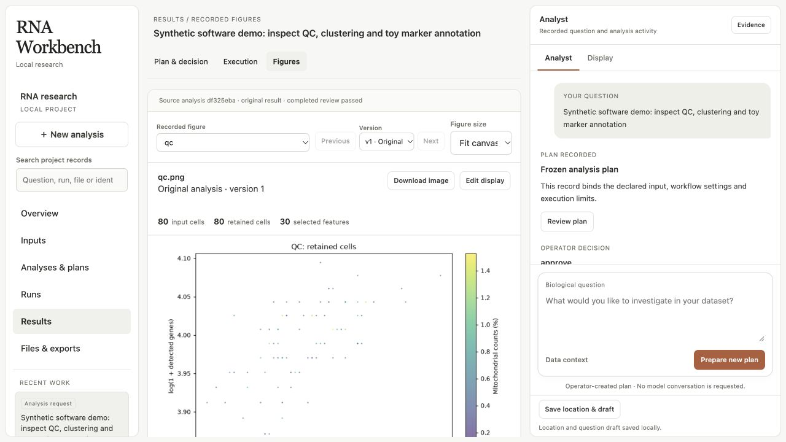
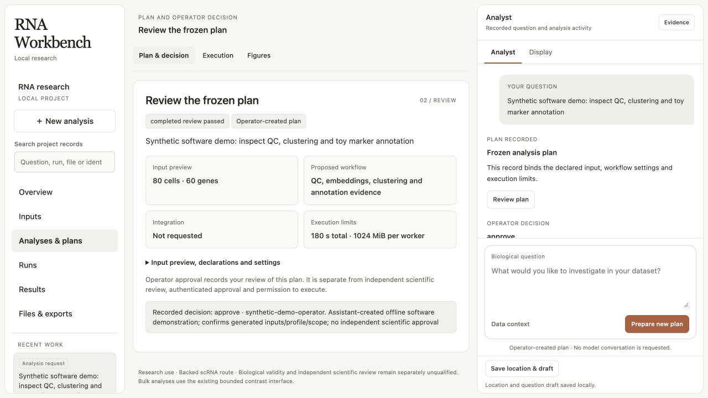

# GitHub homepage demonstration evidence — 2026-10-07

The existing local research interface completed a new synthetic execution through its reviewed controller. A separate registered-tool demonstration performed three real diagnostic calls. These are software demonstrations for the repository homepage, not a biological benchmark, method recommendation, live-agent evaluation or clinical validation.

## 1. What data do we have?

### Local UI demonstration

- **Observed input:** an H5AD with 80 generated cells, 60 features and integer count measurements in `X`. The file remained unchanged across the completed execution.
- **Generator declarations:** a seed-128 Poisson background, with two planted 40-cell marker blocks and alternating synthetic capture labels `one` and `two`. The generator follows the documented software fixture; it contains no patient or experimental cohort data.
- **Units:** generated cells and two synthetic capture labels. They are not independent donors or animals, and the labels do not establish biological replication.
- **Quality concerns:** the tiny, idealized fixture cannot validate real-world annotation, batch correction or clinical thresholds. The two capture groups have 40 cells each, below the configured doublet method's 100-cell minimum. No external QC columns, cluster labels or validated cell-type reference were supplied.
- **Unknowns:** experimental annotation accuracy, biological cluster stability, cohort transfer and scientific calibration remain unmeasured.

### Registered diagnostic demonstration

- 24 generated samples × 30 genes with seed-128 Poisson integer measurements.
- 12 samples at each of two nominal stages (`E8.5`, `E10.5`). One metadata file balances batch across stages; the second deliberately makes stage and batch completely confounded.
- The generator declares a separate synthetic subject for each generated unit. This declaration comes from the construction of the control, not an inference from unique sample labels.
- These are diagnostic controls with no real organism, cohort or clinical threshold calibration.

## 2. What question are we investigating?

The user authorized experiments while requesting a detailed GitHub homepage. The UI experiment asks whether the current local application can register a bounded generated input, retain an operator decision, execute its existing workflow, verify outputs and display actual evidence. The diagnostic experiment asks whether the registered tools retain QC observations and distinguish an estimable balanced design from a fully confounded design before fitting.

The exact fixture, seed, profile and formula were **assistant-selected software controls**, following existing documentation and tests. They were not user-prespecified biological methods or an instruction to select a scientifically optimal method.

## 3. Which methods are appropriate, and why?

For a software-flow demonstration, a tiny generated input avoids private-data disclosure and keeps execution bounded. The existing backed scRNA workflow is used as a fixed procedure to exercise the interface. It performs raw-count QC, preserves selected counts, normalizes, selects 30 features, computes eight PCs and an uncorrected neighbor graph/UMAP, clusters and applies two toy marker panels.

No batch correction is requested. MAD filtering is disabled, `min_genes=3`, seed is 128, the worker memory limit is 1024 MiB, the stage limit is 90 seconds and the total reviewed run limit is 180 seconds. These values support the software control only; no comparison establishes them as optimal for biological data. Alternative correction, feature-selection, embedding or annotation approaches were not evaluated, so none is recommended on this evidence.

The diagnostic experiment uses the trusted `ToolDispatcher` for `audit_expression_quality` and two `validate_design_matrix` calls. It freezes the same formula, `1 + numeric_time + C(batch)`, before observing both design results. The intended controls are full rank for the balanced design and rank deficiency for complete confounding. No fitting follows a rank-deficient result, and dropping a covariate is not used to manufacture a causal adjusted effect.

Model access remained disabled. The local operator approval was caller-asserted by the demonstration script and explicitly labeled as a software control, not independent scientific approval.

## 4. What happened?

### Actual completed UI execution

| Observable | Result |
|---|---|
| Controller outcome | `completed_review_passed` |
| Execution elapsed time | 107.966 seconds, within the 180-second reviewed budget |
| Input / retained cells | 80 / 80 |
| Selected features / PCs | 30 / 8 |
| Computed Leiden clusters | 3 |
| Batch correction | `not_requested` |
| Marker-panel annotation | Completed; zero `uncertain` calls on this planted fixture |
| Doublet estimation | Unavailable: 40 cells per capture group, below the method minimum |
| External QC concordance | Unavailable for the five unsupplied reference columns |
| External cluster concordance | ARI and NMI unavailable |
| Actual model sessions | 0 |
| Source input unchanged | Verified |
| Native bundle artifact integrity | Verified; 470 retained artifacts |
| Scientific review | `not_performed_by_this_service` |

The independent deterministic process recomputed source/count/QC relationships, selection, normalization, figure populations, saved coordinates/categories, receipt bindings and presentation artifacts. Its 26 checks passed. That process reuses some producer routines; it is not a qualified independent scientific reviewer. Its report explicitly leaves clustering stability, population calibration and biological accuracy unestablished.

The retained integrity root is `b8617c088add0cd5cd4b9a5b65dd8109a2e9152fe4a19a4e2bfcf9c9e6de16a2`. Hash verification is scoped to artifact integrity, not numerical reexecution or biological validation.

Actual plots were generated by the native workflow, fetched through verified artifact routes and visually inspected. No plot points or categories were edited for the homepage.

### Browser evidence from the existing interface

The root agent separately opened the current local application in the native browser, inspected its live DOM and captured the actual rendered states below. The results page exposed original verified figures and recorded **80 input cells, 80 retained cells and 30 selected features**. The retained-plan page showed **80 cells, 60 genes, the 180-second limit, a 1024 MiB worker and no integration**. These captures demonstrate the current UI; they are not generated mockups or a new UI redesign. No session token appears in the published screenshots.







The QC plot shows log-transformed library sizes and detected-feature counts for retained generated cells, with mitochondrial count fraction encoded by color. The fixture's narrow distributions and absence of rejected cells do not establish an appropriate filtering policy for a real experiment.


The UMAP contains two separated groups in the planted fixture, while the computed clustering has three labels. This is an observed embedding and clustering output, not proof of recovery accuracy, stability or true cell identity. The batch-colored panel shows the alternating synthetic capture labels in both groups. No batch-correction benefit is inferred.

### Recorded diagnostic results

| Check | Recorded result |
|---|---|
| Expression audit | `pass`; no emitted diagnostic warnings/errors for this generated matrix |
| Balanced design | Full rank: 3 parameters, rank 3, condition number 92.879188368443 |
| Fully confounded design | Rank 2 of 3; `is_full_rank=false`; condition number unavailable (`null`) |
| Actual captured tool calls | 3, all succeeded |
| Estimates / significance tests | None fitted or reported |

The confounded design's missing finite condition number is preserved. It is not replaced with zero or a success-looking value.

### Failures and operator corrections

1. The first proposal failed before analysis because the default requested `layers/counts`, while the generated fixture stored counts in `X`. The original proposal/input were retained; the next isolated attempt explicitly selected `counts_layer=null` to match the documented fixture. See [attempt 1](ui-demo-attempt01.json).
2. The corrected proposal reached approval, but the sandbox denied loopback sockets needed by the Jupyter kernel and HTTP server. This was retained as an execution/environment failure; the same profile was run in a fresh attempt with targeted local-loopback permission. See [attempt 2](ui-demo-attempt02.json).
3. The third attempt completed within its original reviewed deadline. No resource ceiling, model access or data scope was expanded. Its real terminal outcome and outputs are in [UI evidence](ui-demo-evidence.json).

Complete local inputs, native receipts, notebooks and service states for these attempts remain in excluded `.runtime*` directories. The published compact evidence preserves their recorded findings and failure/correction history. It does not claim that the compact JSON alone can replay or authenticate the whole native bundle.

Before publication, local checkout paths in the four compact JSON records were replaced with `<repo-root>` or `<demo-root>`. Numerical observations and scientific findings were unchanged. Each export records its pre-normalization SHA-256; original bytes remain in the excluded `.runtime-publication-originals` directory. This path normalization is a disclosure boundary, not new scientific execution evidence.

## 5. What can we conclude, and what remains uncertain?

This run demonstrates that the current local interface can complete one bounded synthetic workflow, retain a caller-asserted review, verify native artifacts and expose real QC/embedding evidence. The separate diagnostic control demonstrates three actual registered calls and detection of a deliberately rank-deficient design. No live model participated.

A completed workflow, 80 retained cells, three clusters, successful toy-marker calls or elapsed runtime does not establish the best scientific method or a valid biological conclusion. These demonstrations do not resolve the separately documented broad-suite failures or T14 baseline failure, qualify hosted tracing, evaluate new UI functionality, measure live-agent benefit or provide clinical validation.

## Reproducing the bounded controls

The [UI generator](run_ui_demo.py) and [diagnostic generator](run_diagnostic_demo.py) use canonical paths derived from their own absolute locations. Both have module-level `__main__` guards for supervised workers. Run from a fresh checkout using an analysis environment that has the existing optional scRNA dependencies installed:

```sh
/absolute/repo/.venv-analysis/bin/python /absolute/repo/reports/github-homepage-20261007/run_diagnostic_demo.py
/absolute/repo/.venv-analysis/bin/python /absolute/repo/reports/github-homepage-20261007/run_ui_demo.py
```

The UI script needs local loopback access for its notebook kernel and HTTP server. It binds `127.0.0.1:18876` after the recorded terminal outcome and prints a one-session local browser URL. The token is not retained in published evidence. Stop the server with Ctrl+C after inspecting it. A previously created runtime input directory causes the generator to stop; preserve prior evidence and use a fresh checkout for a new cycle.

These scripts reproduce the intended procedure, not byte-identical outputs across unpinned package versions. [Diagnostic evidence](diagnostic-demo-evidence.json) records actual calls, arguments, results and timestamps; [UI evidence](ui-demo-evidence.json) records the executed profile, review boundary, report, artifact verification and export identity. Browser-rendering evidence is captured separately and must not be inferred from the API/numerical checks alone.

## Publication artifact inventory

- This report and the two bounded generators, `run_ui_demo.py` and `run_diagnostic_demo.py`.
- Four compact records: `ui-demo-evidence.json`, `diagnostic-demo-evidence.json`, `ui-demo-attempt01.json`, `ui-demo-attempt02.json`.
- Two native plots: `images/qc.png`, `images/uncorrected.png`.
- Four actual browser captures: `images/workbench-overview.jpg`, `images/workbench-results.jpg`, `images/workbench-qc.jpg`, `images/workbench-plan.jpg`.
- The report-local `.gitignore`, which excludes `.runtime*` directories containing generated inputs and full operational evidence.
