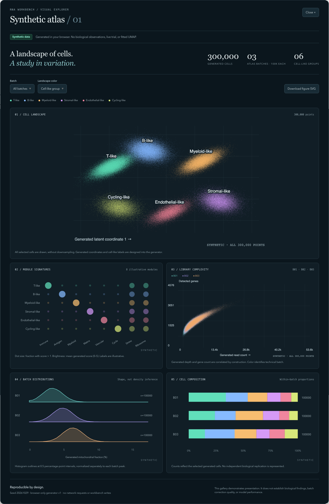

# October 29 workbench source update and synthetic atlas

This update synchronizes current application/library source, associated test and script source, and documentation from the local development workspace into the existing public repository. A separate publication checkout starts from `9651039`. It preserves earlier public reports and their failures. The root workspace has an untracked development tree; this is a selected source snapshot, not a claim that its entire filesystem is a reproducible Git revision.

## Visual atlas

The workbench now offers a **Synthetic atlas** with 300,000 generated cell-like records: 100,000 in each of three batches with distinct designed mixtures, read-depth shifts and mitochondrial-fraction distributions. The two scatter panels draw every selected point on Canvas. Module signatures, histograms and composition panels aggregate the same generated records. Nothing is imported from project data or written as an analysis/trial result.

The screenshot shows the actual composed gallery UI rendered locally. It is presentation evidence, not a captured scientific run. The [mobile capture](images/synthetic-atlas-mobile.png), [SVG export](synthetic-cell-landscape.svg), [browser observations](browser-checks.json), and [user guide](../../docs/synthetic-atlas.md) preserve the output and its limitations. The exported SVG embeds a raster image and synthetic metadata; it is not a vector-per-cell plot.

## Validation

- 74 selected workbench input, project-isolation and local-analyst evidence controls passed on the publication checkout.
- Controlled synthetic continuous/count verification completed, with identical repeats, valid audit checks and completed configured R references. See [compact verification](verification.json) and [numerical report](controlled-report.md). No model-service call occurred. The count reference shares fitted dispersions/offsets and cannot independently validate those estimates.
- The gallery, workbench packaging and core UI checks passed on the copied source; final counts and timings are retained in `verification.json`.
- Instrumented browser rendering counted 600,000 scatter point draws across the two full-population panels, and 200,000 after selecting a single batch. Desktop and 390px mobile checks verified no horizontal overflow, export provenance, Escape closure/focus restoration, and no page errors or requests from the gallery. Opening took 753ms and batch filtering 105ms in this particular local browser; these are observations, not cross-device performance guarantees.
- An independent source/count review and screenshot inspection found no critical blocker. The batch-color legend mismatch found during review was corrected before publication.
- The initial pre-scale sandbox test run retained 29 passes and two failures (socket permission and an unclassified synthetic execution failure). A rerun with local socket/process permission passed; these earlier failures are not reclassified as successful runs.

## Scope and limits

No live trial, external model session, patient-data upload, Docker execution, or expression-data download was performed. Generated plots are visibly synthetic; latent coordinates are not computed UMAP, group labels are illustrative, and the gallery makes no biological efficacy or method-comparison claim.

This is a research development snapshot. The full suite and hosted CI are not qualified here. Historical scripts/tests may depend on excluded local reports, frozen source trees or native runtime assets. Source synchronization does not establish correctness of every changed module, comparative scientific validity, or clinical readiness. [Release readiness](../../RELEASE_READINESS.md) preserves earlier limitations.

The publication excludes environments, downloaded matrices, local run state, captured source archives, private grading material and integration validation outputs. The manifest records copied-source and publication-only file identities. Only these explicitly selected files are staged.

The staged whitespace check found 41 existing copied-source findings across 7 files. Source bytes are retained; this check is not reported as a pass. New research/design documents are preserved proposals and historical commentary, not user-prespecified requirements or independently validated production specifications.
