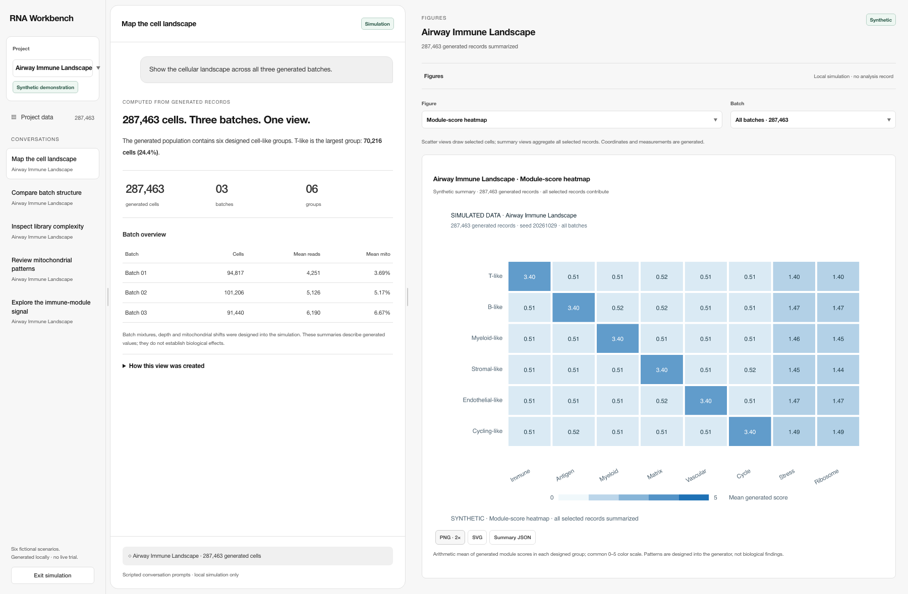

# Current workbench plot families

The workbench now offers eight additional descriptive plot families across six explicitly generated projects. There are **66 published plot exports**: [48 summary plots](gallery/README.md) and [18 scatter views](../workbench-integrated-simulation-20261029/gallery/README.md). These are synthetic presentation records, not observations from biological studies.

## Data, question and methods

The six project populations range from 145,756 to 293,508 generated records. Each uses a distinct seed and unequal batch sizes. The purpose is to inspect distributions, composition and module patterns through the current workbench's figure selector, without a live model or scientific trial. All selected records contribute to the summaries.

| Family | Calculation and scope |
| --- | --- |
| Stacked composition | Count each designed cell-like group within each batch; bar widths are within-batch proportions. |
| Read-depth histogram | 36 equal bins on log10(read count + 1); bin counts conserve the selected population. |
| Mitochondrial ridges | 36-bin histogram outlines, each batch scaled to its own peak; no fitted density or KDE. |
| Batch boxplots | Quartiles and median from sorted generated reads; whiskers are minimum and maximum. Display uses a log10 axis; no outlier exclusion. |
| ECDF | Up to 201 displayed rank knots, connected linearly. Ties use the full right-inclusive rank; not every step is drawn. |
| Module heatmap | Mean generated score for each designed group and module, with a common 0–5 color scale. |
| Module dot plot | Dot area is proportional to fraction(score > 1); color encodes mean score on 0–5. |
| Correlation matrix | Descriptive Pearson correlations among log10 reads, detected genes, mitochondrial fraction and immune score. No p-values or causal inference. |

The scatter renderer and retained figure contracts remain separate. A new browser summary component computes these aggregates and exports PNG, SVG-with-raster and summary JSON from the same workbench canvas location. The generated data and source identities remain explicit.

## Actual outputs and validation

All 48 additional PNGs were downloaded using the workbench's native PNG button. Browser checks asserted project populations, seed/batch provenance, all six project selectors, each of eight plot families, batch filtering, zero HTTP requests and zero page errors. The [manifest](gallery/manifest.json) retains source hashes, output hashes and plotting configuration.

Representative images from all eight families were visually reviewed. Header alignment, categorical boxplot ticks and explicit whisker/dot-size legends were refined during review. Final header pixels were also inspected separately where full-image previews omitted the top region. Native exports retain project name, seed, population and synthetic labels.

The [verification record](verification.json) provides exact final test counts and controlled synthetic checks. The [agentic workflow and harness guide](../../docs/agentic-workflow-and-harness.md) describes the actual code boundaries and registered tools.

## Conclusions and limits

The outputs establish that the current workbench can calculate and export these generated-data summaries. They do not establish biological findings, scientific method superiority or clinical readiness. The six scenario titles share one generic simulation engine. Full-suite hosted CI is not claimed green. No live trial or model-service call was used.
