# Workbench summary plot gallery

48 native PNG exports across six generated projects and eight distinct summary plot families. Every selected record contributes to each aggregate; marks represent summaries, not individual cells. These are synthetic, descriptive views, not biological findings.

[Manifest](manifest.json) · [18 scatter plots](../../workbench-integrated-simulation-20261029/gallery/README.md)

## Airway Immune Landscape

### Airway Immune Landscape · Cell-group composition

287,463 generated records. Within-batch proportions; bar widths sum to 100%.

### Airway Immune Landscape · Read-depth histogram

287,463 generated records. 36 equal bins on log10(read count + 1); counts use every selected record.

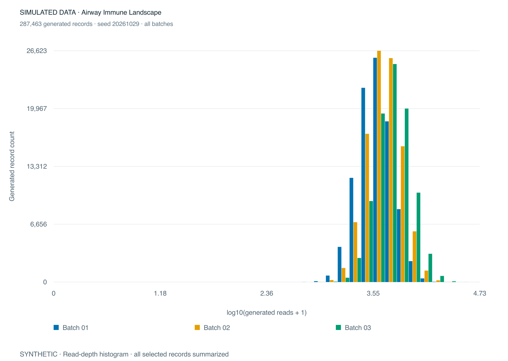

### Airway Immune Landscape · Mitochondrial distributions

287,463 generated records. 36 equal bins; each batch normalized to its own peak. These are histogram outlines, not fitted densities.

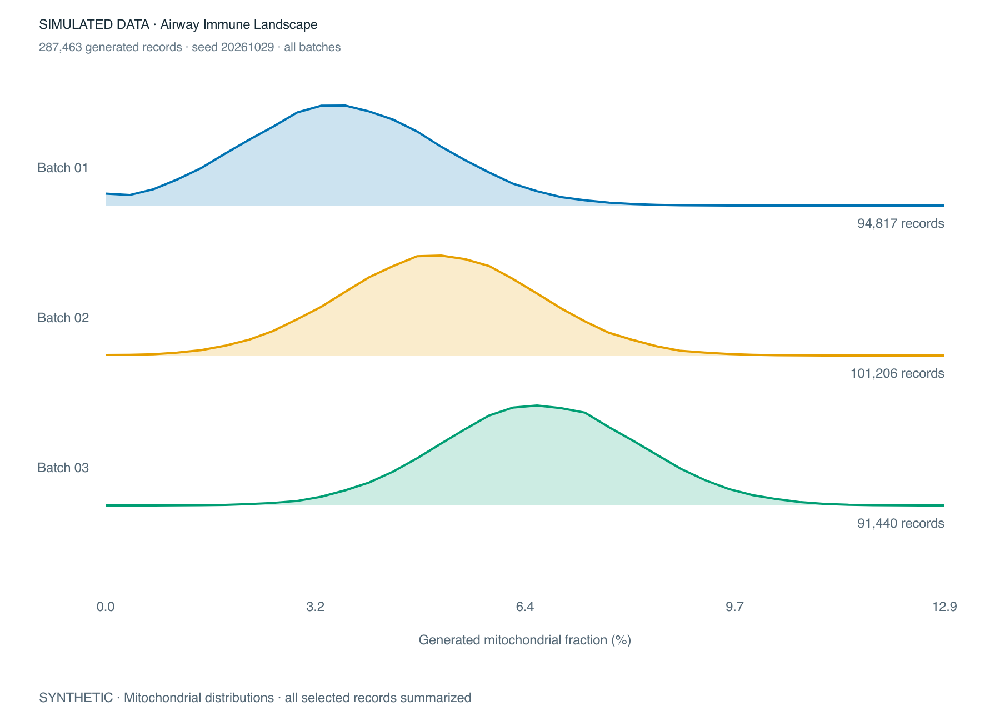

### Airway Immune Landscape · Read-depth boxplots

287,463 generated records. Box: quartiles; line: median; whiskers: minimum and maximum. Log10 axis; no outlier filtering.

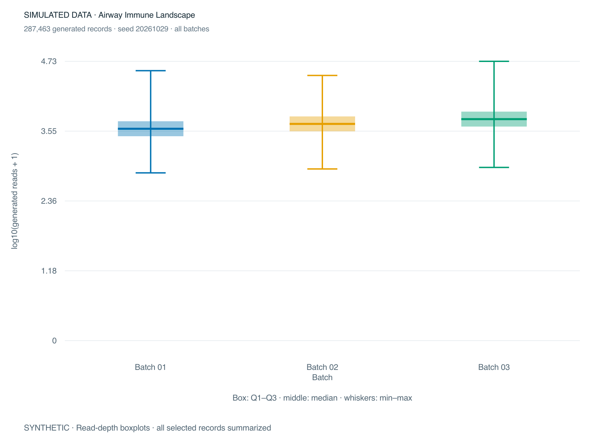

### Airway Immune Landscape · Read-depth cumulative distribution

287,463 generated records. Empirical cumulative distribution at up to 201 displayed rank knots, connected linearly; ties use the full right-inclusive rank. Every record determines the ranks.

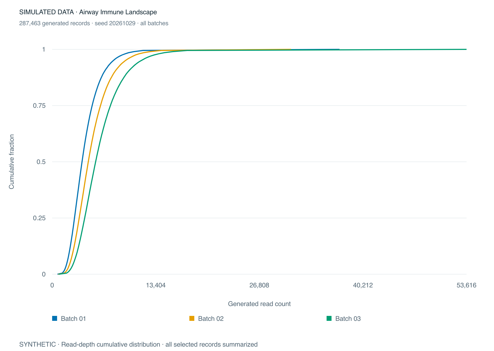

### Airway Immune Landscape · Module-score heatmap

287,463 generated records. Arithmetic mean of generated module scores in each designed group; common 0–5 color scale.

### Airway Immune Landscape · Module-score dot plot

287,463 generated records. Dot area proportional to fraction with score > 1; color is mean generated score on a common 0–5 scale.

### Airway Immune Landscape · Measurement correlation matrix

287,463 generated records. Pearson correlations across generated log10(reads + 1), genes, mitochondrial fraction and immune score; no p-values.

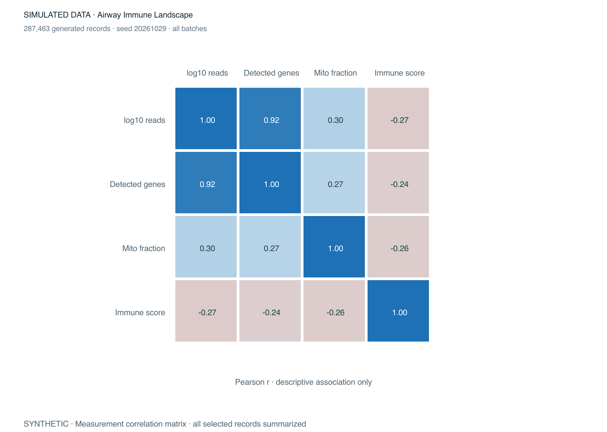

## Tissue Repair Atlas

### Tissue Repair Atlas · Cell-group composition

220,676 generated records. Within-batch proportions; bar widths sum to 100%.

### Tissue Repair Atlas · Read-depth histogram

220,676 generated records. 36 equal bins on log10(read count + 1); counts use every selected record.

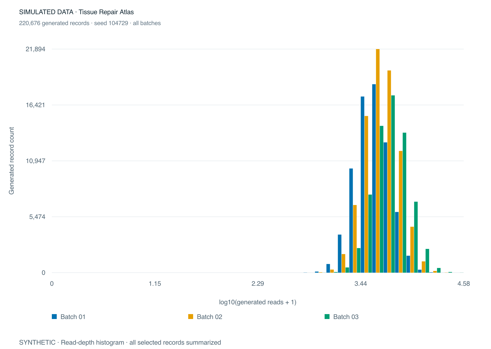

### Tissue Repair Atlas · Mitochondrial distributions

220,676 generated records. 36 equal bins; each batch normalized to its own peak. These are histogram outlines, not fitted densities.

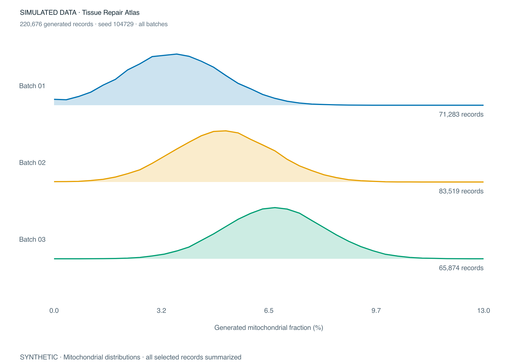

### Tissue Repair Atlas · Read-depth boxplots

220,676 generated records. Box: quartiles; line: median; whiskers: minimum and maximum. Log10 axis; no outlier filtering.

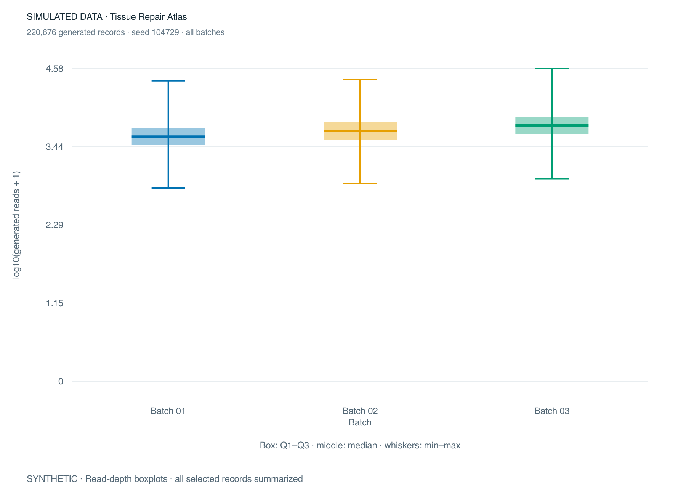

### Tissue Repair Atlas · Read-depth cumulative distribution

220,676 generated records. Empirical cumulative distribution at up to 201 displayed rank knots, connected linearly; ties use the full right-inclusive rank. Every record determines the ranks.

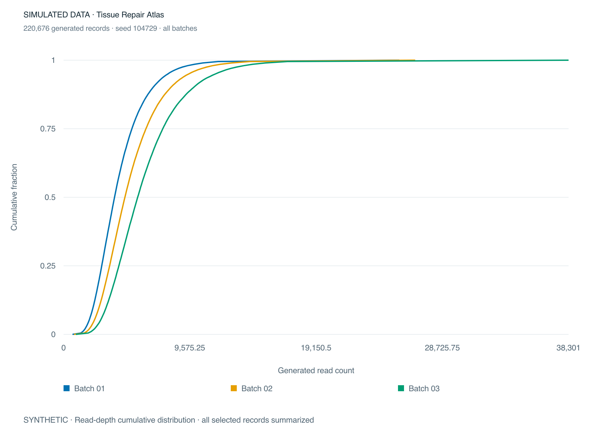

### Tissue Repair Atlas · Module-score heatmap

220,676 generated records. Arithmetic mean of generated module scores in each designed group; common 0–5 color scale.

### Tissue Repair Atlas · Module-score dot plot

220,676 generated records. Dot area proportional to fraction with score > 1; color is mean generated score on a common 0–5 scale.

### Tissue Repair Atlas · Measurement correlation matrix

220,676 generated records. Pearson correlations across generated log10(reads + 1), genes, mitochondrial fraction and immune score; no p-values.

## Immune Activation Map

### Immune Activation Map · Cell-group composition

260,665 generated records. Within-batch proportions; bar widths sum to 100%.

### Immune Activation Map · Read-depth histogram

260,665 generated records. 36 equal bins on log10(read count + 1); counts use every selected record.

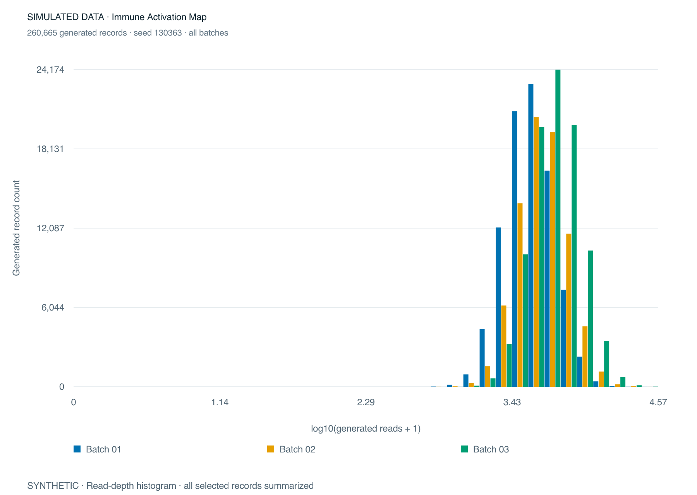

### Immune Activation Map · Mitochondrial distributions

260,665 generated records. 36 equal bins; each batch normalized to its own peak. These are histogram outlines, not fitted densities.

### Immune Activation Map · Read-depth boxplots

260,665 generated records. Box: quartiles; line: median; whiskers: minimum and maximum. Log10 axis; no outlier filtering.

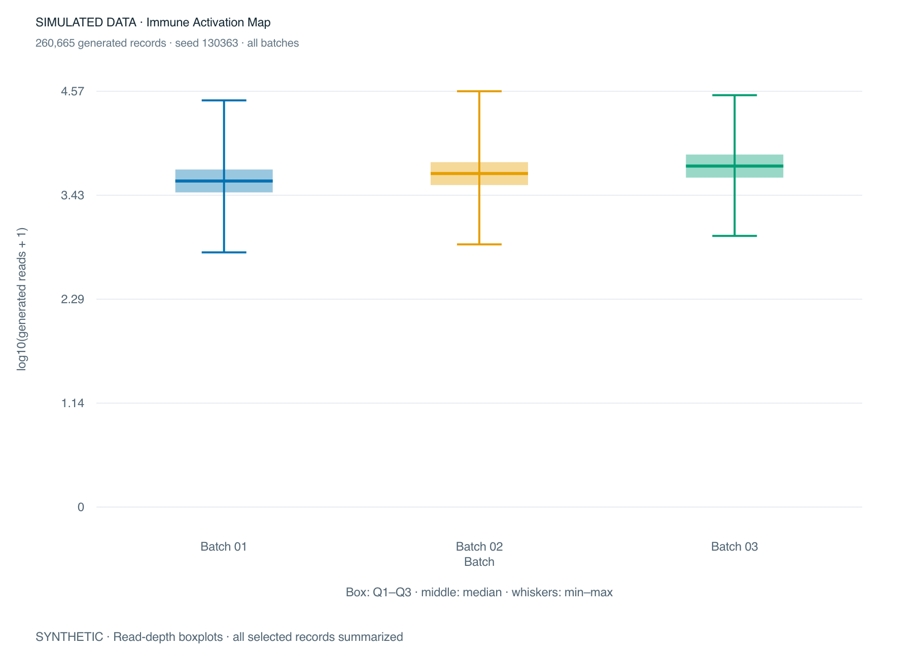

### Immune Activation Map · Read-depth cumulative distribution

260,665 generated records. Empirical cumulative distribution at up to 201 displayed rank knots, connected linearly; ties use the full right-inclusive rank. Every record determines the ranks.

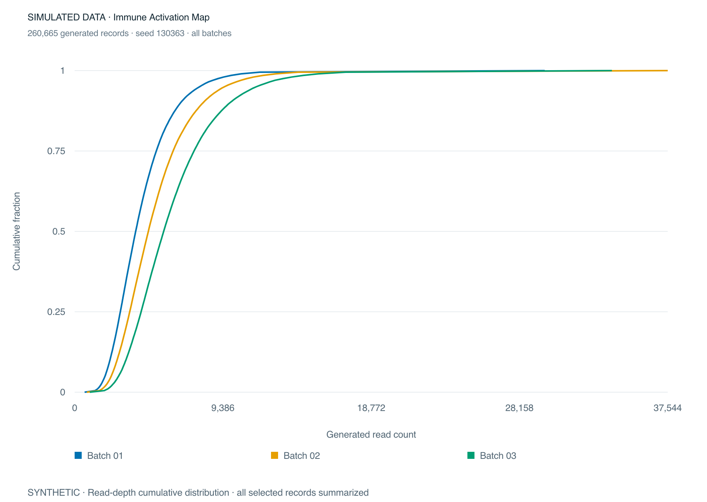

### Immune Activation Map · Module-score heatmap

260,665 generated records. Arithmetic mean of generated module scores in each designed group; common 0–5 color scale.

### Immune Activation Map · Module-score dot plot

260,665 generated records. Dot area proportional to fraction with score > 1; color is mean generated score on a common 0–5 scale.

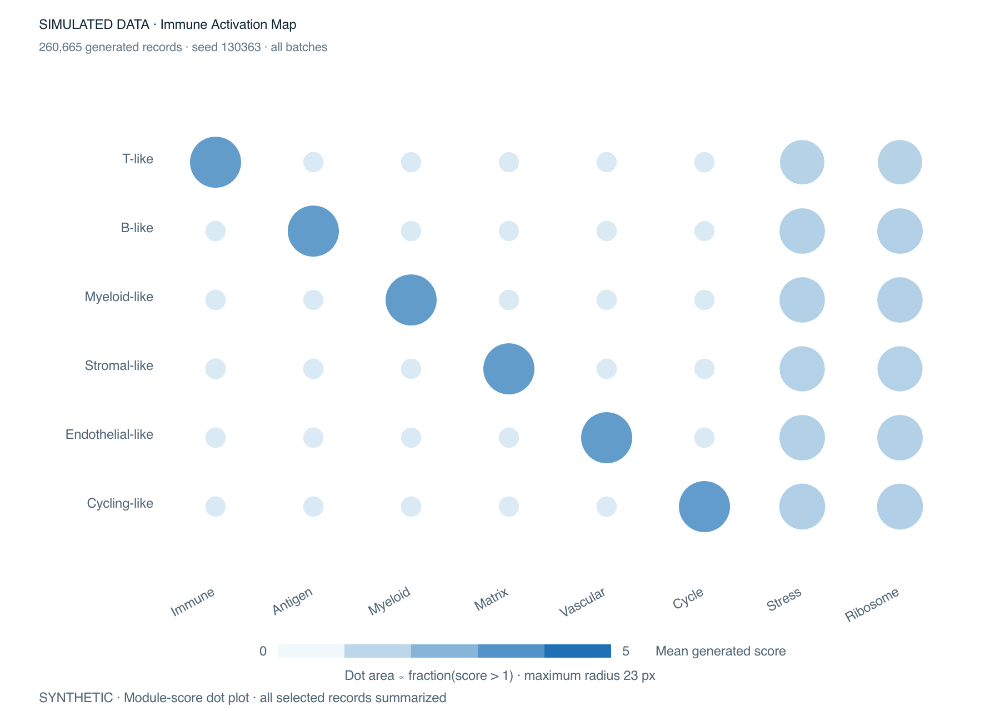

### Immune Activation Map · Measurement correlation matrix

260,665 generated records. Pearson correlations across generated log10(reads + 1), genes, mitochondrial fraction and immune score; no p-values.

## Vascular Cell Landscape

### Vascular Cell Landscape · Cell-group composition

180,276 generated records. Within-batch proportions; bar widths sum to 100%.

### Vascular Cell Landscape · Read-depth histogram

180,276 generated records. 36 equal bins on log10(read count + 1); counts use every selected record.

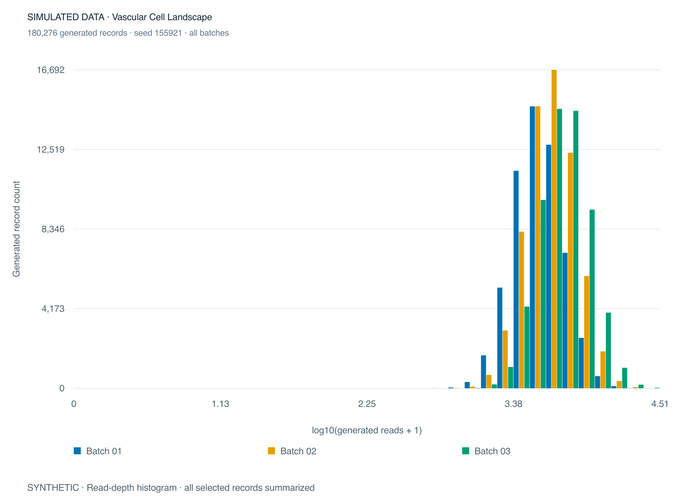

### Vascular Cell Landscape · Mitochondrial distributions

180,276 generated records. 36 equal bins; each batch normalized to its own peak. These are histogram outlines, not fitted densities.

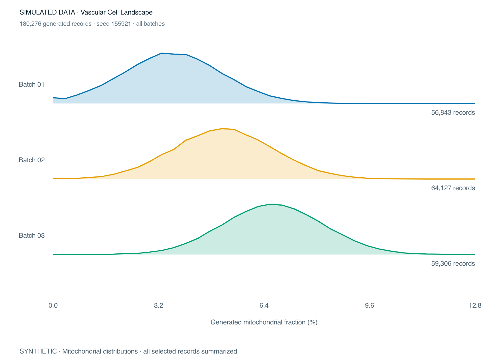

### Vascular Cell Landscape · Read-depth boxplots

180,276 generated records. Box: quartiles; line: median; whiskers: minimum and maximum. Log10 axis; no outlier filtering.

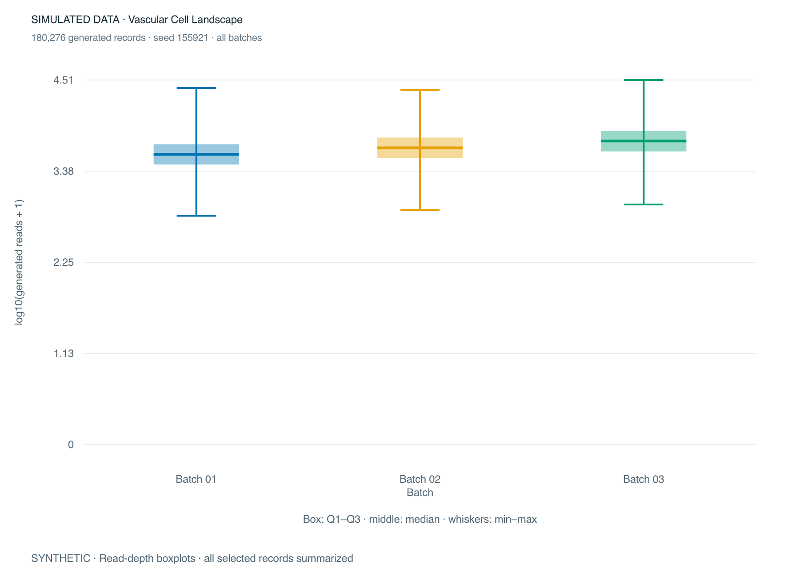

### Vascular Cell Landscape · Read-depth cumulative distribution

180,276 generated records. Empirical cumulative distribution at up to 201 displayed rank knots, connected linearly; ties use the full right-inclusive rank. Every record determines the ranks.

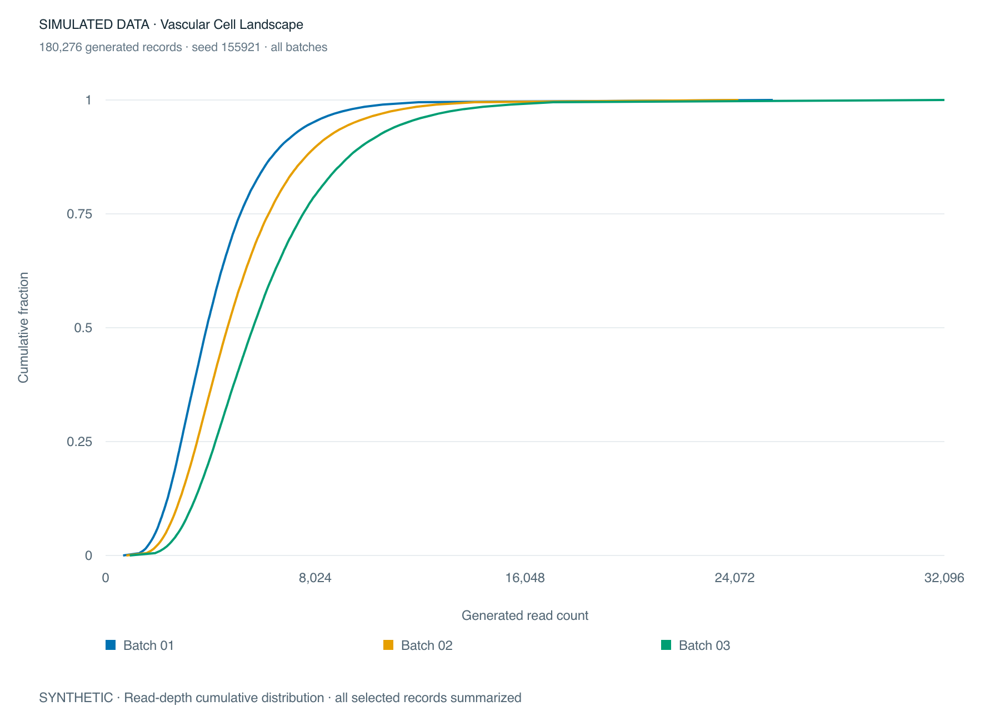

### Vascular Cell Landscape · Module-score heatmap

180,276 generated records. Arithmetic mean of generated module scores in each designed group; common 0–5 color scale.

### Vascular Cell Landscape · Module-score dot plot

180,276 generated records. Dot area proportional to fraction with score > 1; color is mean generated score on a common 0–5 scale.

### Vascular Cell Landscape · Measurement correlation matrix

180,276 generated records. Pearson correlations across generated log10(reads + 1), genes, mitochondrial fraction and immune score; no p-values.

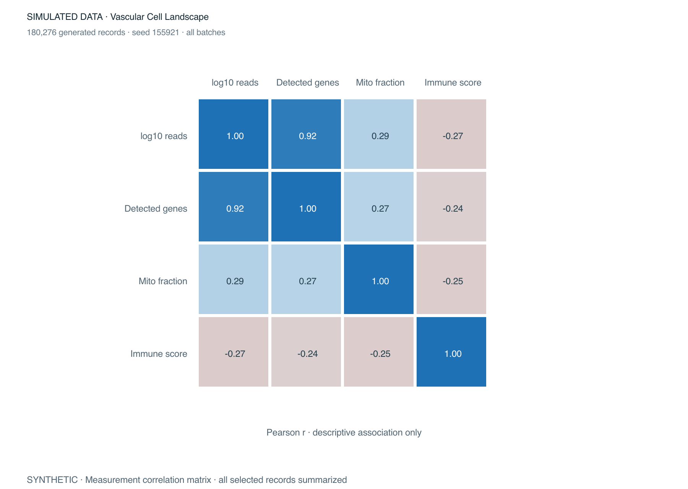

## Stromal Remodeling Study

### Stromal Remodeling Study · Cell-group composition

293,508 generated records. Within-batch proportions; bar widths sum to 100%.

### Stromal Remodeling Study · Read-depth histogram

293,508 generated records. 36 equal bins on log10(read count + 1); counts use every selected record.

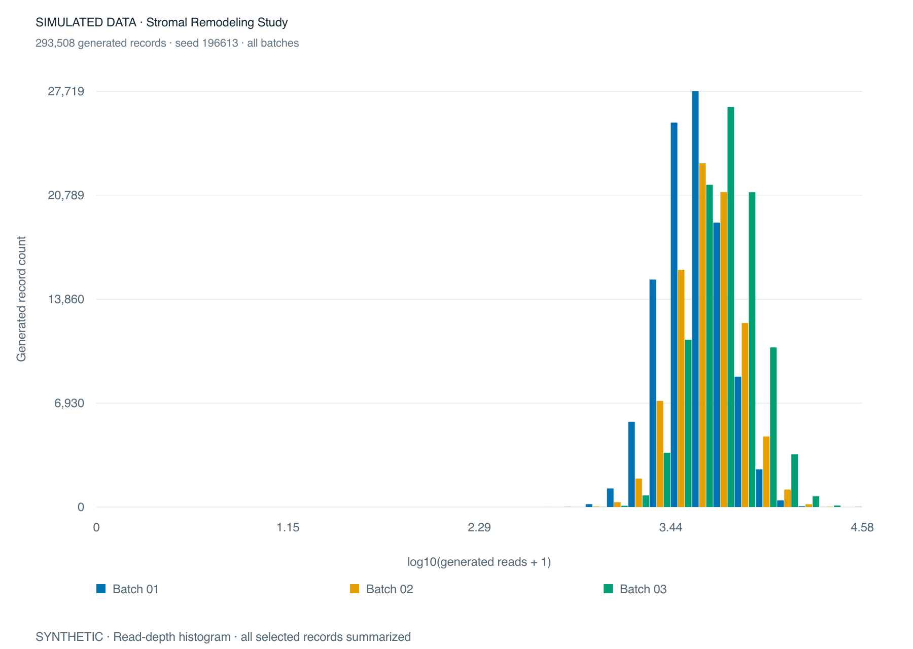

### Stromal Remodeling Study · Mitochondrial distributions

293,508 generated records. 36 equal bins; each batch normalized to its own peak. These are histogram outlines, not fitted densities.

### Stromal Remodeling Study · Read-depth boxplots

293,508 generated records. Box: quartiles; line: median; whiskers: minimum and maximum. Log10 axis; no outlier filtering.

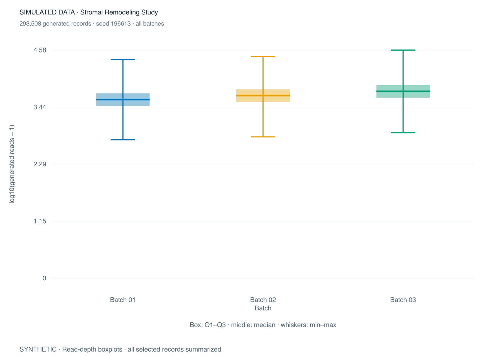

### Stromal Remodeling Study · Read-depth cumulative distribution

293,508 generated records. Empirical cumulative distribution at up to 201 displayed rank knots, connected linearly; ties use the full right-inclusive rank. Every record determines the ranks.

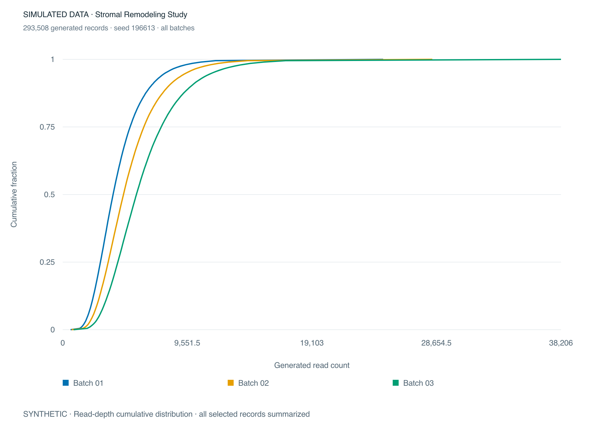

### Stromal Remodeling Study · Module-score heatmap

293,508 generated records. Arithmetic mean of generated module scores in each designed group; common 0–5 color scale.

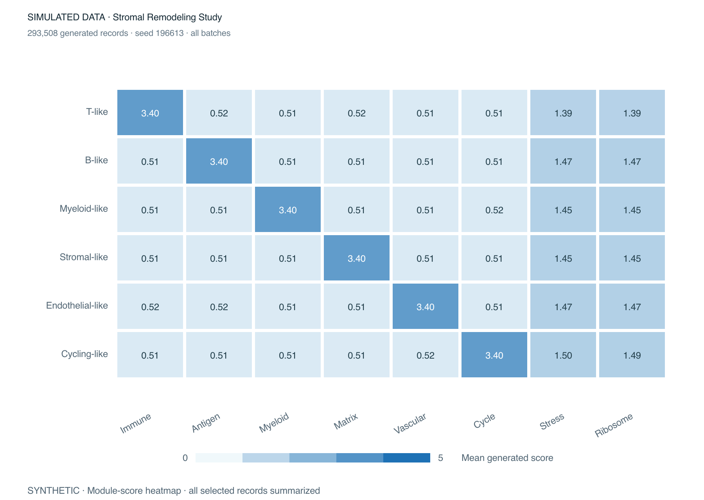

### Stromal Remodeling Study · Module-score dot plot

293,508 generated records. Dot area proportional to fraction with score > 1; color is mean generated score on a common 0–5 scale.

### Stromal Remodeling Study · Measurement correlation matrix

293,508 generated records. Pearson correlations across generated log10(reads + 1), genes, mitochondrial fraction and immune score; no p-values.

## Cell-Cycle Reference

### Cell-Cycle Reference · Cell-group composition

145,756 generated records. Within-batch proportions; bar widths sum to 100%.

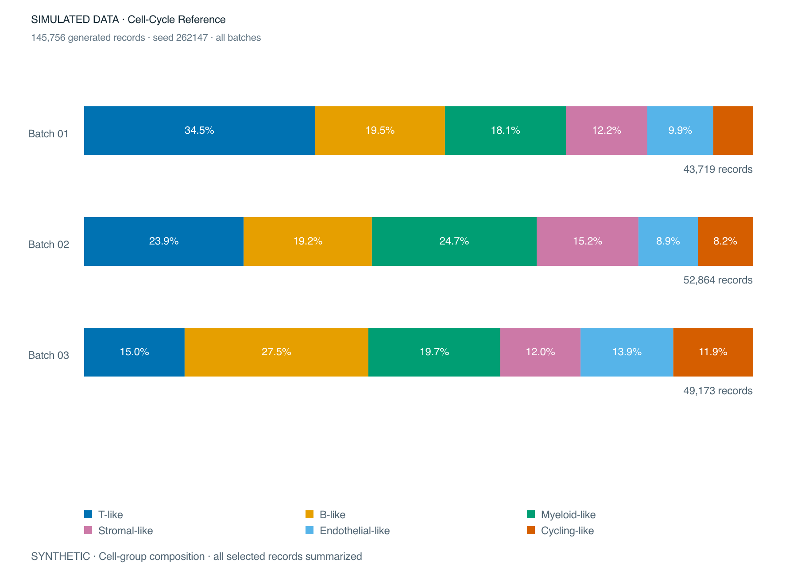

### Cell-Cycle Reference · Read-depth histogram

145,756 generated records. 36 equal bins on log10(read count + 1); counts use every selected record.

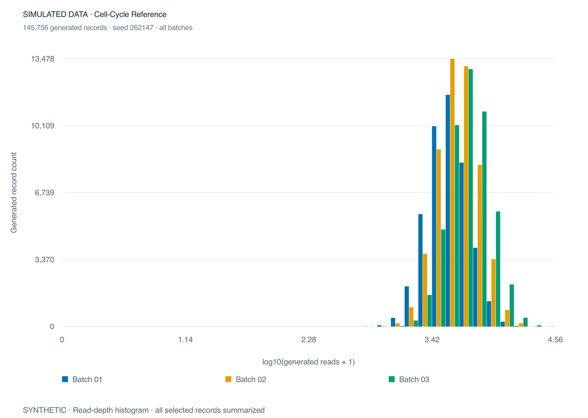

### Cell-Cycle Reference · Mitochondrial distributions

145,756 generated records. 36 equal bins; each batch normalized to its own peak. These are histogram outlines, not fitted densities.

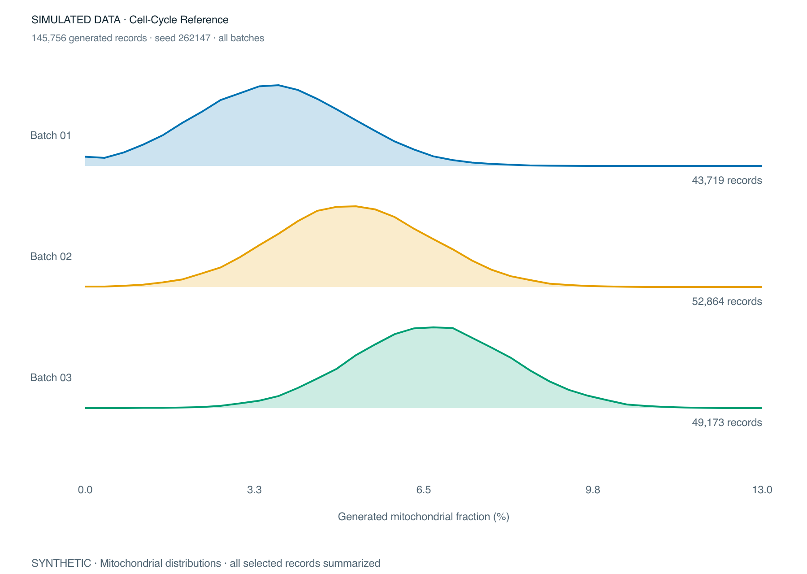

### Cell-Cycle Reference · Read-depth boxplots

145,756 generated records. Box: quartiles; line: median; whiskers: minimum and maximum. Log10 axis; no outlier filtering.

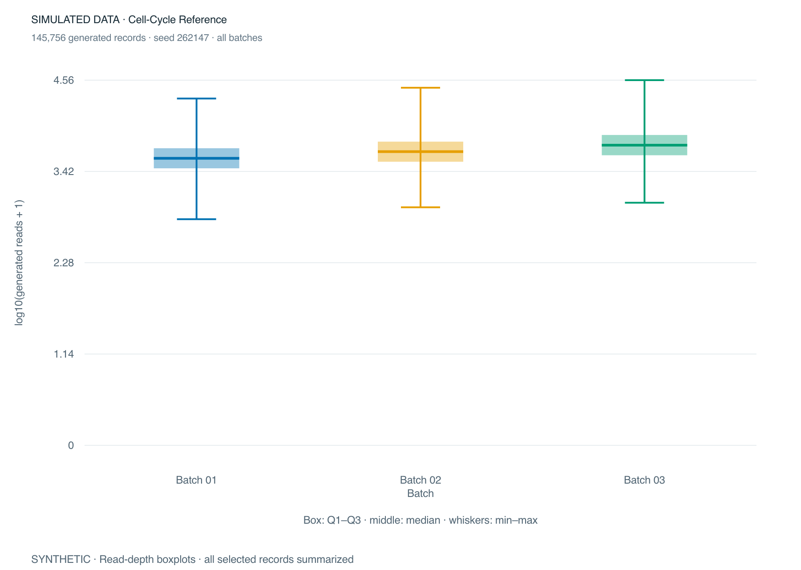

### Cell-Cycle Reference · Read-depth cumulative distribution

145,756 generated records. Empirical cumulative distribution at up to 201 displayed rank knots, connected linearly; ties use the full right-inclusive rank. Every record determines the ranks.

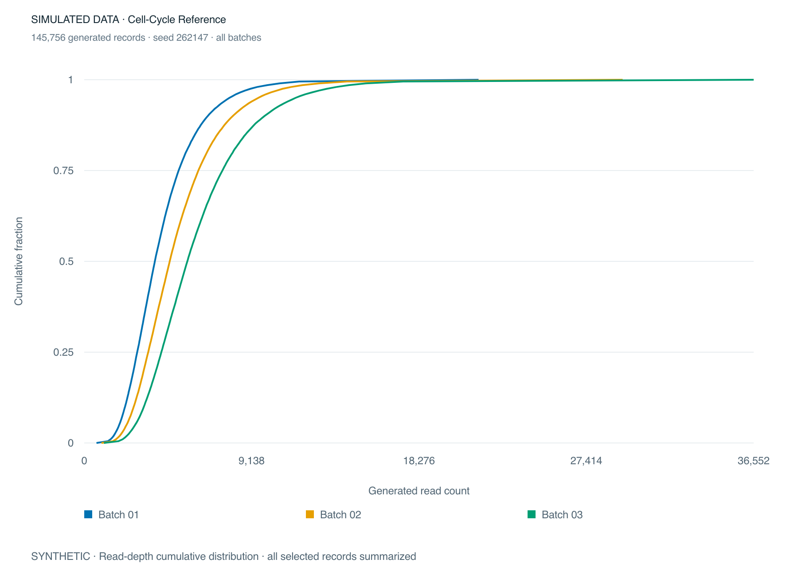

### Cell-Cycle Reference · Module-score heatmap

145,756 generated records. Arithmetic mean of generated module scores in each designed group; common 0–5 color scale.

### Cell-Cycle Reference · Module-score dot plot

145,756 generated records. Dot area proportional to fraction with score > 1; color is mean generated score on a common 0–5 scale.

### Cell-Cycle Reference · Measurement correlation matrix

145,756 generated records. Pearson correlations across generated log10(reads + 1), genes, mitochondrial fraction and immune score; no p-values.

